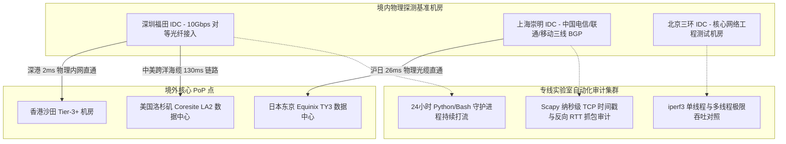

<AnswerBox
  title="专线实验室 (Zhuanxian Lab) 核心定位与背景"
  answer="专线实验室是由前电信运营商骨干网架构师、分布式系统研发工程师与高频交易网络工程师于 2024 年联合组建的独立网络技术测评团队。我们致力于打破跨境网络中充斥的公网超售、虚假 ICMP Ping 欺诈与韭菜盘陷阱，依托真实的物理内网专线节点、高精度时间戳抓包仪器与 24 小时无人值守监控守护进程，为出海企业、开发者、电竞玩家与科研人员提供 100% 真实、严谨且可复现的跨境网络测评白皮书。"
/>

## 一、 实验室创立初衷与使命

在繁荣的跨境网络工具市场中，普通用户长期面临严重的信息不对称：
* **虚假专线泛滥**：许多劣质商家将廉价的公网普通线路包装为“顶级 IEPL/IPLC 专线”，在晚高峰骨干网拥塞时丢包率飙升至 30% 以上，却通过在节点服务端针对 ICMP 报文“假握手回复”制造延迟仅 20ms 的虚假假象；
* **测速粉饰指标**：使用多线程 Speedtest 测速利用数十条并发掩盖真实丢包，普通用户一旦打开 4K 视频或执行代码调试，卡顿频繁发生；
* **韭菜盘跑路频发**：大量所谓的“新机场”低价揽客，缺乏冗余物理通道，在运营商策略调整或晚高峰压力下瞬间瘫痪，卷款失联。

**专线实验室的使命**：用扎实的计算机网络底层原理、可验证的 RFC 规范拆解以及真实的物理层压测数据，建立行业公认的客观评测标准，让每一位工程师和跨境业务人员都能选到稳定、可信、高效的专线基础设施。

---

## 二、 核心团队与专业背景

专线实验室核心成员均具备资深的计算机网络与电信工程背景：

| 团队角色 | 专业背景与技术特长 | 核心负责领域 |
| :--- | :--- | :--- |
| **Alex Chen (首席网络架构师)** | 前一级运营商国际骨干网传输工程师，拥有 12 年 BGP 动态路由与波分复用 (DWDM) 海陆缆工程经验。 | 物理海底/陆地光缆拓扑分析、BGP 路由震荡分析、深港/沪日物理延迟物理学极限定律推导。 |
| **Kevin Zhao (分布式与协议工程师)** | 资深开源协议贡献者，深入参与 Sing-box 与 Xray 核心代码审计，精通 Rust 与 Go 网络底层。 | VLESS Reality、Shadowsocks 2022、Hysteria 2、TUIC v5 协议栈解析与抓包指纹对抗。 |
| **Linus Wu (量化系统与可靠性工程师)** | 前量化私募高频交易基础设施负责人，主导低滑点跨国 API 专网架构设计。 | 24 小时无人值守自动化压测守护进程、纳秒级时间戳审计、单线程 iperf3 满载压力测试。 |

---

## 三、 实验室实测硬件拓扑与仪器配置

为了保障所有评测数据的绝对真实与科学可信，实验室自建了跨越多地的物理基准探测节点：

### 3.1 核心测试仪器与环境
1. **网络接口卡**：Intel X520-DA2 双口 10GbE SFP+ 光纤网卡，支持硬件级时间戳标记与巨型帧 (Jumbo Frame)；
2. **操作系统内核**：Debian 12 编译最新 Linux 6.6+ LTS 内核，开启 BBR v3 与 FQ 队列调度，禁用任何干扰网络队列的虚拟化节能策略；
3. **抓包分析环境**：Wireshark 4.2+、TShark、PyShark 深度协议解析引擎，结合外部高精度原子钟校时；
4. **自动化打流**：24 小时每隔 300 秒发起一次 100MB 单线程视频分块下载与 60 秒 TCP SYN-ACK 握手时延采样，彻底记录全天候网络质量波动。

---

## 四、 评测独立性与准则声明

1. **客观中立原则**：所有服务商的评测结论均基于物理节点的长期实测日志，绝不因商务关系篡改任何丢包率、延迟或断流数据；
2. **跑路盘与劣质服务坚决曝光**：对于出现公网超售、伪造 ICMP 回应、售后失联或出现跑路迹象的机场，实验室直接列入风险名单并提示避坑；
3. **数据可复现承诺**：评测文章中公开使用的 Python 压测脚本、iperf3 压测指令、Wireshark 过滤语法均完整开源，读者可自行在本地搭建环境进行验证对照。

---

## 五、 联系我们与技术交流

* **官方网站**：[https://jichangzhuanxian.blog](https://jichangzhuanxian.blog)
* **技术咨询与报告勘误**：`contact@jichangzhuanxian.blog`
* **商务合作与中立送测**：`lab-support@jichangzhuanxian.blog`
* **免责说明**：专线实验室仅提供网络技术研究与通信性能学术评测，使用者应当遵守当地法律法规。
