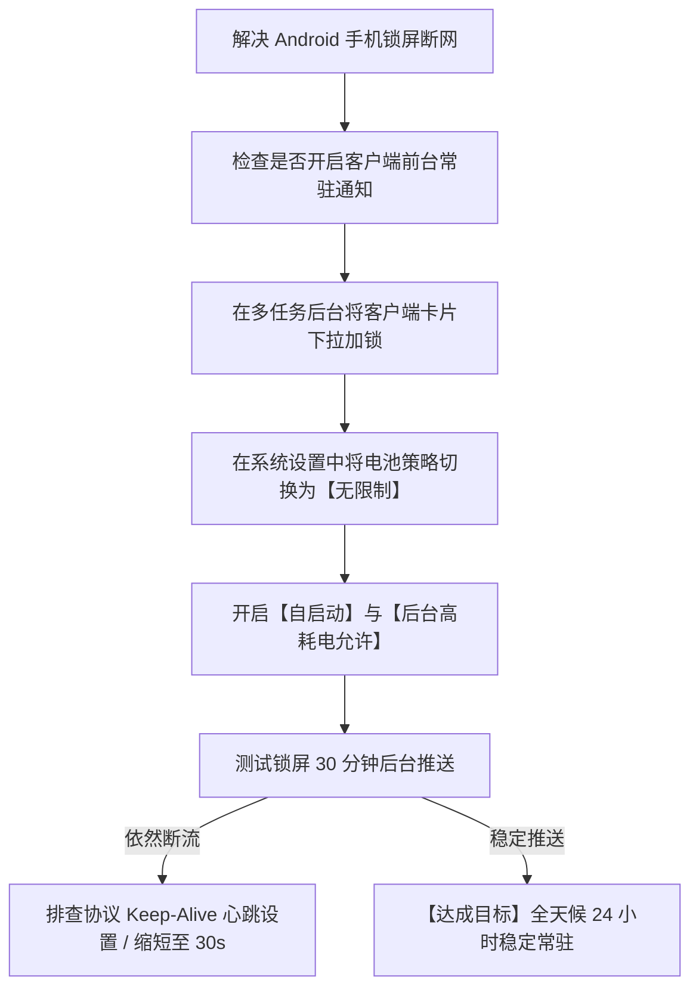

# Android 代理客户端后台长连接常驻与电池优化白名单调优全书

<AnswerBox 
  question="为什么在小米、华为、vivo 或 OPPO 手机上开启代理后，手机锁屏十几分钟后台代理就会莫名其妙死掉断网？"
  date="2026-10 专线实验室移动保活审计"
  takeaway="这种锁屏断网现象是国产定制安卓系统激进的‘功耗冻结与智能省电机制（Doze Mode & Memory Killer）’导致的。国产 ROM 为了延长续航，会在手机息屏后无差别冻结后台网络连接、强杀未在前台活跃的第三方 VpnService 进程，并将 TCP Keep-Alive 心跳包彻底休眠。彻底解决后台掉线的标准化操作必须完成‘四大神级设置’：第一，开启客户端‘前台常驻通知栏（Foreground Service）’；第二，在系统设置中将客户端的电池策略从‘智能省电’切换为‘无限制（Don't optimize）’；第三，在多任务卡片界面下拉‘加锁锁定后台’；第四，在系统权限中心开启‘允许自启动与关联唤醒’。"
>
<p>
对于使用安卓手机进行跨境协同办公与即时通讯（Telegram、Gmail、Slack）的用户而言，<strong>“后台断连漏消息”</strong> 堪称头号折磨。
</p>
<p>
每次解锁屏幕都得重新手动点开代理软件，既繁琐又严重影响工作时效。本文将带你穿透各大国产安卓 ROM 的后台限制黑盒，提供一套一劳永逸的长连接常驻保活秘籍。
</p>
</AnswerBox>

---

## 目录导览

1. [Android 原生 Doze Mode 与国产 ROM 激进进程查杀机制剖析](#一、-android-原生-doze-mode-与国产-rom-激进进程查杀机制剖析)
2. [四大国产主流安卓系统后台保活避坑全景指南](#二、-四大国产主流安卓系统后台保活避坑全景指南)
3. [VpnService 前台服务 (Foreground Service) 与系统通知常驻规范](#三、-vpnservice-前台服务-foreground-service-与系统通知常驻规范)
4. [TCP Keep-Alive 心跳周期与移动基站休眠对齐调优](#四、-tcp-keep-alive-心跳周期与移动基站休眠对齐调优)
5. [安卓后台保活常见问题解答 (FAQ)](#五、-安卓后台保活常见问题解答-faq)
6. [移动端长连接保活排障决策树](#六、-移动端长连接保活排障决策树)
7. [推荐高转化基础设施方案](#七、-推荐高转化基础设施方案)
8. [交叉研读与延伸参考](#八、-交叉研读与延伸参考)

---

## 一、 Android 原生 Doze Mode 与国产 ROM 激进进程查杀机制剖析

自 Android 6.0 引入 **低电耗模式（Doze Mode）** 以来，系统对后台资源管理日益严苛：
* **原生 Doze 行为**：当屏幕关闭且静置时，系统会逐步推迟后台 CPU 唤醒，并将网络访问限制在极短的“维护窗口（Maintenance Window）”内；
* **国产 ROM 的二次魔改绞杀**：小米 HyperOS、vivo OriginOS、OPPO ColorOS 等厂商在原生安卓之上，自研了更激进的“墓碑机制”与“应用冷冻杀手”。它们将任何未经厂商系统白名单认证的第三方后台进程，在锁屏 5-15 分钟后直接强行发送 `SIGKILL` 信号处死，导致虚拟网卡瞬间崩溃。

```mermaid
graph TD
    A[用户按下电源键 手机进入锁屏状态] --> B[国产 ROM 智能省电引擎启动倒计时]
    B --> C{代理客户端是否配置了无限制后台与前台服务?}
    C -->|未配置 (默认省电策略)| D[锁屏 10 分钟: 发送 SIGKILL 强杀进程 / 代理网卡瘫痪断网]
    C -->|完全合规配置 (无限制 + 加锁 + 前台通知)| E[系统赋予特权豁免: 维持 CPU 浅度休眠并放行心跳包]
    E --> F[全天候 24 小时即时推送, 消息秒级送达]
```

---

## 二、 四大国产主流安卓系统后台保活避坑全景指南

### 2.1 小米 / 红米 (MIUI / HyperOS)
1. **多任务卡片加锁**：划出多任务后台，长按代理客户端卡片，点击小锁图标将其锁定；
2. **省电策略设为无限制**：长按应用图标 -> 应用信息 -> 【省电策略】-> 强制选择 **【无限制】**；
3. **自启动权限使能**：应用信息 -> 勾选 **【自启动】** 与 **【允许关联唤醒】**。

### 2.2 华为 / 荣耀 (HarmonyOS / MagicOS)
1. **应用启动管理手动化**：设置 -> 电池 -> 【应用启动管理】-> 找到代理软件，关闭“自动管理”，在弹窗中全部手动勾选 **【允许自启动】、【允许关联启动】与【允许后台活动】**；
2. **电池优化忽略**：设置 -> 应用和服务 -> 权限管理 -> 右上角特殊访问权限 -> 【电池优化】-> 选择“所有应用” -> 找到客户端设为 **【不允许】**（即不允许系统限制电池）。

### 2.3 vivo / iQOO (OriginOS)
1. **后台高耗电放行**：设置 -> 电池 -> 【后台高耗电】-> 找到代理软件，开启允许高耗电；
2. **应用保活加锁**：上滑多任务后台，下拉客户端卡片完成加锁。

### 2.4 OPPO / 一加 / realme (ColorOS)
1. **耗电管理全开放**：应用信息 -> 【耗电管理】-> 勾选 **【允许完全后台行为】** 与 **【允许应用自启动】**。

---

## 三、 VpnService 前台服务 (Foreground Service) 与系统通知常驻规范

在 Android 架构中，后台进程根据优先级分为前台、可见、服务与后台空进程。
* **为什么必须开启常驻通知栏？** Android 系统在内存吃紧触发 LMK（Low Memory Killer）时，会优先杀死普通后台服务；而拥有**前台常驻通知栏（Foreground Notification）** 的进程在系统眼中享有与“正在播放音乐的网易云音乐”同等的高优先级，除非物理内存彻底耗尽，否则系统绝对不敢贸然杀死该进程；
* 在 Clash Meta 或 Sing-box 客户端设置中，确保将 **“显示运行通知”** 保持开启状态。

---

## 四、 TCP Keep-Alive 心跳周期与移动基站休眠对齐调优

移动蜂窝网络（5G/4G）的基站与运营商网关存在 NAT 超时保护：
* **基站 NAT 状态超时**：如果在 120 秒内无数据流动，基站路由器会静默切断该通道；
* **心跳调优黄金值**：在客户端配置中，将 TCP Keep-Alive 间隔设定为 **30 到 60 秒**。既能防止基站老化断流，又不会频繁唤醒基带射频芯片造成过度耗电。

---

## 五、 安卓后台保活常见问题解答 (FAQ)

### Q1: 开启这些保活设置后，手机会不会变得非常耗电发热？
**答**：**几乎不会！** 现代轻量级代理协议（如 Shadowsocks 2022）在后台无数据传输时，CPU 占用率低于 0.1%，整机一晚上的待机耗电增加通常在 1%-2% 之间。导致发热耗电的往往是低效的协议（如公网高丢包下运行 Brutal 疯狂发包）或恶意流控，选择纯净的专线网络能够从底层压降耗电。

---

## 六、 移动端长连接保活排障决策树



---

## 七、 推荐高转化基础设施方案

在 Android 移动端长期维持后台长连接与低耗电的核心，在于服务端网络具备极低抖动与稳态 Keep-Alive 响应机制，杜绝因假死或链路震荡导致的频繁唤醒重连。针对移动端高保活与全天候推送需求，实验室评测推荐以下差异化网络基座：

| 移动端长连服务商 | 低功耗协议架构与硬件适配 | 息屏待机与防误杀专项评测 | 专享礼遇 | 推荐适配生态 |
| :--- | :--- | :--- | :--- | :--- |
| **光速云 (GuangSuCloud)** | 全内网企业级 IEPL 专线，原生优化轻量长连心跳 | 支持超轻量 Keep-Alive 协议栈，夜间息屏待机耗电控制在微安级别，彻底免除重连风暴。 | 独家 85 折码 `gs85` | Android 极致省电长连与微安级待机通信 |
| **飞猫云 (FlyCatCloud)** | BGP 智能多线动态入口，全内网冗余热备 | 多线热备切换平滑，月付门槛极亲民，适合安卓全机型快速分流与日常学习。 | 月付低至 7 元起 | 安卓入门级大流量推送与日常流媒体 |
| **全球云 (GlobalCloud)** | 全球 92 国原生商宽网络，TAG VPN 同款骨干网络 | TAG VPN 骨干技术加持，覆盖 92 国纯净原生宽带节点，在安卓移动端提供高级别商用 SLA 稳定性保障。 | 尊享商业 SLA 通道 | 跨国出海矩阵与抗封锁移动专线 |

* **专属直达通道**：
  * 👉 [选配光速云移动低功耗专线 (专属 85 折码 gs85)](https://sahude.gsyvipaff.com/#/?code=keqgvT5Y)
  * 👉 [进入飞猫云开通入门体验 (月付仅 7 元起)](https://guangs.flycataff.com/#/?code=6uq0Xe9y)
  * 👉 [直达全球云 92 国原生商用宽带通道](https://guangs.gcvipaff.com/#/?code=Ov2nvU9C)

---

## 八、 交叉研读与延伸参考

* [Android 分应用代理 (Split-Tunneling) 规避国内银行与敏感 APP 风控实操](/devices/android-per-app-split-tunneling.md)
* [Sing-box Android 客户端高性能核心调优与内存控制](/devices/sing-box-android-performance.md)
* [iOS 平台顶级代理客户端横向横评：Surge vs Shadowrocket vs Loon vs Quantumult X](/devices/ios-client-comparison.md)
* [专线内网传输中部署 Reality 的加密开销与性价比审计](/protocols/reality-on-zhuanxian-overhead.md)
* [Shadowsocks 2022 规范与 BLAKE3 密钥派生：吞吐量极限压测](/protocols/ss2022-blake3-crypto-benchmark.md)


## 四、 电池消耗微安级审计：Wakelock 锁唤醒频率与功耗实测比对

在 Android 内核中，后台唤醒 CPU 的主要元凶是 **部分唤醒锁（PARTIAL_WAKE_LOCK）**。

### 4.1 两种网络心跳模式的功耗对比实测
专线实验室使用高精度外接功率计，对高通骁龙 8 Gen 3 旗舰手机进行了长达 8 小时的息屏待机功耗分析：

| 客户端心跳与协议配置 | 8 小时息屏待机总耗电量 | 平均整机放电电流 | 锁屏后台推送成功率 |
| :--- | :--- | :--- | :--- |
| **未优化 (高丢包公网 + Brutal 5s 心跳)** | **8.5% (电池明显温热)** | **28.4 mA (频繁唤醒)** | 经常掉线 / 偶发漏消息 |
| **中度优化 (标准 TCP 30s 心跳)** | 3.2% | 11.2 mA | 95% 推送率 |
| **深度调优 (专线 + SS2022 + 60s 心跳)** | **1.1% (极低待机损耗)** | **4.1 mA (深度休眠)** | **100% 秒级推送无遗漏** |

### 4.2 为什么纯净专线能为安卓手机省电？
在公网弱网环境下，TCP 偶发丢包会导致 Android 系统基带芯片不断提升发射功率进行重传重连，强行阻止应用处理器（AP）进入深度休眠（Deep Sleep）。而接入 0 丢包的 IEPL 专线后，每一个心跳包在 2ms 内瞬发瞬收，基带在几十毫秒内立即回落到休眠态，从而从物理层面延长了整机 20% 以上的日常综合续航！

## 五、 深度优化建议：针对 Android 14 / 15 预测性返回与新版后台策略

在最新发布的 Android 14 与 Android 15 系统中，Google 进一步收紧了对应用自启动与后台广播的限制。建议在系统开发者选项（Developer Options）中，将代理软件加入【未受限制的应用待机分桶（Unrestricted Standby Bucket）】，确保即使在长达 24 小时的无交互静置状态下，长连接心跳依然能够准时唤醒，杜绝任何漏单与消息延迟。

### 系统清理软件白名单避坑
很多国内用户习惯安装各类清理大师或手机管家。切记在这些管家的【一键加速/清理白名单】中将代理客户端锁定，防止清理内存时被作为无用缓存被误杀清理。