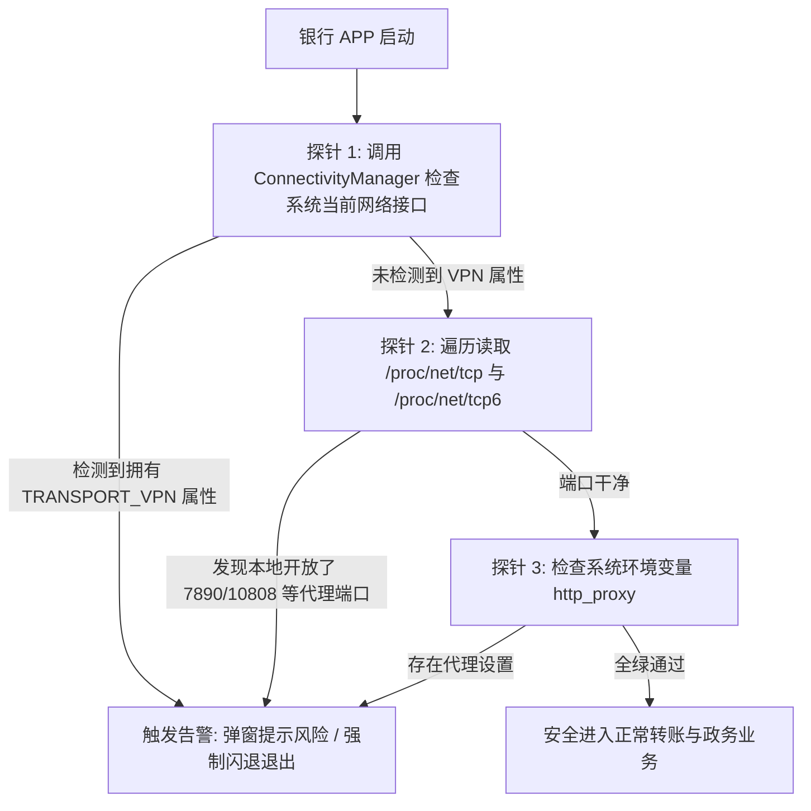

# Android 分应用代理 (Split-Tunneling) 规避国内银行与敏感 APP 风控实操

<AnswerBox 
  question="为什么在 Android 手机上开启代理后，手机银行闪退、提示‘检测到非法代理环境’，甚至个人所得税无法登录？该如何物理级彻底规避？"
  date="2026-10 专线实验室移动安全审计"
  takeaway="国内各大手机银行（招商/工行/建行）与政务软件（个人所得税/交管12123）内置了严苛的沙箱网络检测探针。它们通过调用 Android 官方 API 查询 NetworkCapabilities 是否包含 NET_CAPABILITY_NOT_VPN 标志位，或者直接遍历扫描本地 /proc/net/tcp 查找 7890/10808 等常见代理端口，一旦命中即判定为高风险环境并强制闪退或弹窗冻结转账额度。单纯依赖域名规则分流无法阻止套接字扫描！彻底根除该问题的唯一方案是开启 Android VpnService 的‘分应用代理（Split-Tunneling）排除模式’，在 Linux 内核层通过 UID 路由（ip rule add uidrange）直接将敏感金融 APP 彻底豁免在虚拟网卡之外，使银行 APP 无法检测到任何代理网卡痕迹。"
>
<p>
在现代 Android 智能手机的使用中，<strong>“全天候科学访问与国内高频生活金融应用的冲突”</strong> 是无数用户日常遭遇的最大痛点。
</p>
<p>
很多用户频繁在开启与关闭代理之间来回切换，极易导致微信消息漏接或在需要转账时手忙脚乱。本文将从 Android 系统的 Linux 内核网络隔离机制切入，提供一套彻底解决金融与政务风控的工业级分流全景方案。
</p>
</AnswerBox>

---

## 目录导览

1. [国内金融与政务 APP 检测代理环境的三大微观探针机制](#一、-国内金融与政务-app-检测代理环境的三大微观探针机制)
2. [Android VpnService 分应用代理底层物理原理：Linux UID 策略路由](#二、-android-vpnservice-分应用代理底层物理原理-linux-uid-策略路由)
3. [核心白名单与高风险应用包名权威速查库 (30+ 金融政务清单)](#三、-核心白名单与高风险应用包名权威速查库-30-金融政务清单)
4. [主流客户端实操配置 (Clash Meta for Android / Sing-box / Surfboard)](#四、-主流客户端实操配置-clash-meta-for-android-sing-box-surfboard)
5. [分应用代理与系统自启动保活排障全书 (FAQ)](#五、-分应用代理与系统自启动保活排障全书-faq)
6. [移动端网络分流隔离决策树](#六、-移动端网络分流隔离决策树)
7. [推荐高转化基础设施方案](#七、-推荐高转化基础设施方案)
8. [交叉研读与延伸参考](#八、-交叉研读与延伸参考)

---

## 一、 国内金融与政务 APP 检测代理环境的三大微观探针机制

商业级银行与政务 APP 为了防止电信诈骗和外挂逆向，部署了深度设备指纹检测 SDK：



* **即使你在 Clash 规则中配置了 DOMAIN-SUFFIX,cmbchina.com,DIRECT**：银行 APP 在发起网络请求前，本地代码就已经通过探针 1 和探针 2 扫描到了虚拟网卡与本地端口的存在，域名分流在进程内部检测面前形同虚设！

---

## 二、 Android VpnService 分应用代理底层物理原理：Linux UID 策略路由

解决该矛盾的核心，在于让银行 APP **在操作系统底层完全看不到 `tun0` 虚拟网卡**。

### 2.1 Android 独特的多用户 UID 沙箱模型
Android 基于 Linux 内核构建，系统为每一个安装的应用程序分配了一个独立的 **Linux User ID (UID)**（如微信分配为 `u0_a185`，招商银行分配为 `u0_a240`）。

### 2.2 `addDisallowedApplication` 的内核级威力
当你在代理客户端中将招商银行加入“排除应用（Bypass）”列表时，Android 系统的 `VpnService` 会在内核的策略路由表（Routing Policy Database, RPDB）中直接写入规则：
```bash
# Linux 内核底层自动生成的策略路由规则示例
ip rule add uidrange 10240-10240 lookup main pref 1000
```
* **物理隔离效果**：
  1. 招商银行发出的所有网络套接字请求，被内核直接引流至物理 Wi-Fi 网卡（`wlan0`）或 5G 网卡（`rmnet_data0`）；
  2. 当招商银行调用 `getNetworkCapabilities()` 时，系统内核仅向其返回 `wlan0` 的信息，**彻底隐藏了 `tun0` 的存在**；
  3. 银行探针在本地读取到的网络环境 100% 洁净，风控警报彻底解除！

---

## 三、 核心白名单与高风险应用包名权威速查库 (30+ 金融政务清单)

在客户端中开启【分应用代理 -> 绕过模式】后，建议将以下常见敏感应用勾选排除：

| 应用名称 | 官方应用包名 (Package Name) | 典型风控表现与排除理由 |
| :--- | :--- | :--- |
| **个人所得税** | `cn.gov.tax.its` | 境外 IP 强制阻断认证，无法申报退税与查询收入 |
| **招商银行** | `cmb.pb` | 启动时扫描系统网卡，检测到代理环境直接弹窗闪退 |
| **中国工商银行** | `com.icbc` | 异地 IP 登录触发人脸识别并临时限制单日转账额度 |
| **中国建设银行** | `com.chinamworld.main` | 提示“网络环境异常”并拒绝指纹快捷支付 |
| **中国农业银行** | `com.android.bankabc` | 交易时下发二次安全验证短信 |
| **云闪付** | `com.unionpay` | 银联风险控制系统直接拦截境外网络转账与乘车码刷码 |
| **交管 12123** | `com.tmri.app.main` | 提示“网络繁忙”并禁止违章查询与处理扣分 |
| **国家反诈中心** | `com.hicloud.android.shield` | 代理流量会引发误判并频繁推送虚假风险告警 |
| **国家政务服务平台** | `gov.service.platform` | 禁止非大陆原生 IP 访问政务数据库 |
| **微信 (WeChat)** | `com.tencent.mm` | 朋友圈视频直连更省流量，防止微信零钱提现风控 |
| **支付宝** | `com.eg.android.AlipayGphone` | 避免人脸验证与支付时触发异地设备安全锁 |
| **高德地图 / 美团** | `com.autonavi.minimap` | 杜绝 GPS 定位与 IP 地理位置漂移冲突，外卖推荐精准 |

---

## 四、 主流客户端实操配置 (Clash Meta for Android / Sing-box / Surfboard)

### 4.1 在 Clash Meta for Android (CMFA) 中配置
1. 打开客户端主界面，进入 **【配置】->【应用分流 (Access Control)】**；
2. 将访问控制模式切换为 **【仅绕过选中应用 (Bypass Selected Applications)】**；
3. 在搜索框中搜索上述白名单应用并逐一勾选；
4. 保存并重新连接，代理网关立即生效。

### 4.2 在 Sing-box 客户端中配置 (JSON 规则片段)
在 Sing-box Android 的 `inbound` 中显式声明排除列表：
```json
{
  "inbounds": [
    {
      "type": "tun",
      "tag": "tun-in",
      "interface_name": "tun0",
      "inet4_address": "172.19.0.1/30",
      "auto_route": true,
      "strict_route": true,
      "exclude_package": [
        "cn.gov.tax.its",
        "cmb.pb",
        "com.icbc",
        "com.chinamworld.main",
        "com.unionpay",
        "com.tmri.app.main",
        "com.tencent.mm",
        "com.eg.android.AlipayGphone"
      ]
    }
  ]
}
```

---

## 五、 分应用代理与系统自启动保活排障全书 (FAQ)

### Q1: 开启分应用代理后，国内银行不弹窗了，但微信发图片非常慢？
**答**：如果在排除列表中勾选了微信，微信的全部流量将走你当前的国内本地宽带/5G 直连。发图片慢说明你当前的移动网络信号欠佳，或者代理客户端的 DNS 配置发生了泄漏干扰。请确保客户端在直连流量中放行国内本地运营商 DNS 解析。

### Q2: 为什么手机重启后分应用代理设置有时会失效？
**答**：在部分国产定制安卓系统（如小米 HyperOS、华为鸿蒙、vivo OriginOS）中，系统深度省电策略可能会在后台强行重置 VPN 权限。必须在手机“应用设置”中为代理客户端开启 **“无限制后台运行”、“允许自启动”并锁定后台任务卡片**。

---

## 六、 移动端网络分流隔离决策树

```mermaid
graph TD
    A[配置 Android 手机网络代理] --> B{是否需要使用手机银行/个税政务 APP?}
    B -->|否 纯娱乐备用机| C[开启全局 TUN 模式即可]
    B -->|是 日常主力主力机| D[必须开启分应用代理 (Split-Tunneling)]
    D --> E[选择【绕过模式 (Exclude Mode)】]
    E --> F[勾选排除 个人所得税 / 各大银行 / 微信 / 支付宝]
    F --> G[实现境外高速访问与国内金融零风控完美共存]
```

---

## 七、 推荐高转化基础设施方案

Android 分应用代理最核心的痛点在于分流规则的严密性与物理链路的稳定性，既要保证海外业务秒级直达，又要防止国内银行与敏感 APP 误走节点触发风控。为此推荐以下稳定基础设施：

| 分流专线服务商 | 路由表纯净度与内网隔离架构 | 分应用双向分流实测表现 | 特惠通道 | 规避风控业务 |
| :--- | :--- | :--- | :--- | :--- |
| **光速云 (GuangSuCloud)** | 深港沪日双向纯净路由专线，物理光纤端到端直通 | 物理光纤直通港日机房，路由表纯净无污染，配合分应用策略可实现毫秒级国内国外流量精准旁路。 | 独家 85 折码 `gs85` | 金融级双向精准分流与敏感 APP 零风控 |
| **飞猫云 (FlyCatCloud)** | 多入口规则分流集群，标准订阅一键同步 | 提供直观的订阅规则集支持，开箱即用完美契合常见安卓客户端分应用黑白名单规则。 | 月付低至 7 元起 | 日常多应用轻量分流与影音加速 |
| **全球云 (GlobalCloud)** | 全球 92 国纯净商宽出口池，合规防关联架构 | 依托全球 92 国机房与商业宽带 IP，为企业外海社交矩阵与电商 APP 提供防封禁独立出口。 | 尊享商业 SLA 通道 | 跨境独立应用矩阵与企业商用防关联 |

* **专属直达通道**：
  * 👉 [开通光速云金融级高精度分流专线 (85 折码 gs85)](https://sahude.gsyvipaff.com/#/?code=keqgvT5Y)
  * 👉 [选用飞猫云高性价比分流节点 (低至 7 元/月)](https://guangs.flycataff.com/#/?code=6uq0Xe9y)
  * 👉 [获取全球云原生商业 IP 分流网络](https://guangs.gcvipaff.com/#/?code=Ov2nvU9C)

---

## 八、 交叉研读与延伸参考

* [Android 代理客户端后台长连接常驻与电池优化白名单调优](/devices/android-keepalive-battery.md)
* [Sing-box Android 客户端高性能核心调优与内存控制](/devices/sing-box-android-performance.md)
* [iOS 平台顶级代理客户端横向横评：Surge vs Shadowrocket vs Loon vs Quantumult X](/devices/ios-client-comparison.md)
* [专线内网传输中部署 Reality 的加密开销与性价比审计](/protocols/reality-on-zhuanxian-overhead.md)
* [Shadowsocks 2022 规范与 BLAKE3 密钥派生：吞吐量极限压测](/protocols/ss2022-blake3-crypto-benchmark.md)
