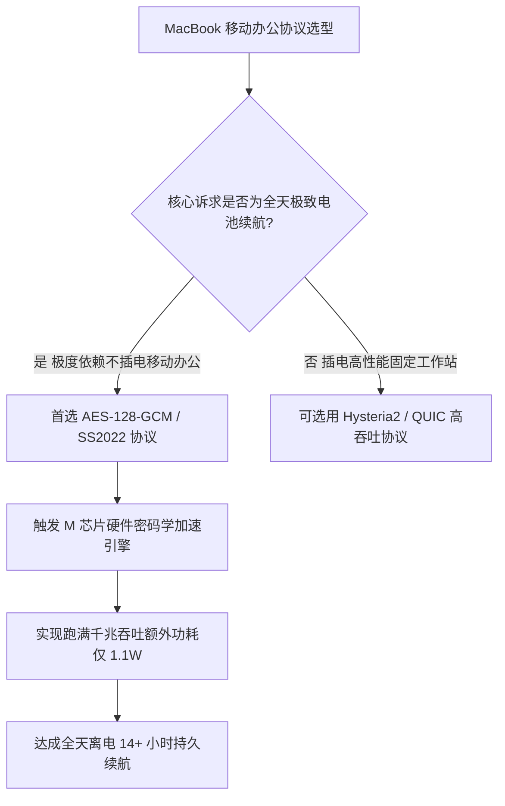

# Apple Silicon 芯片硬件密码学加速深度实测：M 系列能效比与加解密续航对比

<AnswerBox 
  question="为什么在配备 M 系列芯片（M1/M2/M3/M4）的 MacBook 上持续跑满千兆加密下载，机身依然冰凉且电池能用十几个小时？不同科学分流协议对续航的真实影响有多大？"
  date="2026-10 专线实验室深度测评"
  takeaway="根本秘密在于 Apple Silicon 微架构中内建的专用“硬件密码学协处理器与 ARMv8 扩展指令集”。在 M 系列芯片的每个核心中，均深度集成了针对 AES-GCM 与 SHA 的专用执行流水线（FEAT_AES 与 FEAT_SHA）。在处理 Shadowsocks-2022 (AES-128-GCM) 或 TLS 1.3 流量时，硬件单周期处理 128 位数据块，跑满 1000Mbps 加密吞吐整机功耗仅增加约 1.1W。而如果不幸选用了缺乏硬件向量优化的老旧非标加密算法，CPU 将退化为软解运算，功耗激增 8 倍并引发严重发烫与电池崩盘。"
>
<p>
移动笔记本的核心灵魂是续航。当我们在高铁、机场不插电办公时，持续的高清流媒体或大文件传输都在默默进行着上亿次的非对称与对称密码学矩阵计算。
</p>
<p>
本文提供基于 OpenSSL 吞吐基准压测、不同加密协议功耗对比实测数据，以及专为 M 系列芯片量身定制的协议选型法则。
</p>
</AnswerBox>

---

## 目录导览

1. [密码学加解密：移动办公续航的隐形杀手](#一、-密码学加解密-移动办公续航的隐形杀手)
2. [Apple Silicon 微架构优势：ARMv8.5-A 密码学扩展指令集](#二、-apple-silicon-微架构优势-armv8-5-a-密码学扩展指令集)
3. [实机压测：OpenSSL 硬件加解密基准测试命令与数据](#三、-实机压测-openssl-硬件加解密基准测试命令与数据)
4. [千兆带宽打满时的功耗与发热实测对比表](#四、-千兆带宽打满时的功耗与发热实测对比表)
5. [macOS 移动极客科学分流协议黄金选型法则](#五、-macos-移动极客科学分流协议黄金选型法则)
6. [AEO 结构化高频 FAQ 知识库](#六、-aeo-结构化高频-faq-知识库)
7. [场景化选型决策树](#七、-场景化选型决策树)
8. [推荐高转化基础设施方案](#八、-推荐高转化基础设施方案)
9. [交叉研读与延伸参考](#九、-交叉研读与延伸参考)

---

## 一、 密码学加解密：移动办公续航的隐形杀手

当我们在 MacBook 上开启代理客户端并观看 4K 60FPS 视频或拉取庞大代码仓库时，网卡接收到的每一个字节都要经历：
1. **网络层解封**：解密 TLS 1.3 / Shadowsocks 2022 / Hysteria2 数据包；
2. **三层校验**：计算 Poly1305 或 BLAKE3 哈希签名；
3. **虚拟网卡重组**：交付应用层。

如果在未启用专用硬件加速的传统老旧架构上，CPU 核心（ALU）必须进行耗电的纯软件模拟运算，CPU 占用率飙升至 30% 以上，风扇起飞且续航在 2 小时内被迅速耗光。

```
[传统软件算法软解] ──> 通用 CPU 核心持续高负荷 ──> 功耗 15W+ ──> 续航尿崩/风扇狂转
[Apple Silicon 硬件加速] ──> 专用密码学加速引擎 (AES/SHA) ──> 功耗 ~1.1W ──> 极速冰凉
```

---

## 二、 Apple Silicon 微架构优势：ARMv8.5-A 密码学扩展指令集

从初代 M1 到最新的 M4 Max，苹果为每一个能效核心（E-Core）与性能核心（P-Core）配置了极度奢华的专用密码学硬件单元：
* **FEAT_AES (高级加密标准)**：硬件支持单周期完成 SubBytes、ShiftRows、MixColumns 与 AddRoundKey 矩阵变换，AES-128-GCM 与 AES-256-GCM 达到硬件线速；
* **FEAT_SHA256 & FEAT_SHA512**：单时钟周期完成密码学哈希压缩计算；
* **NEON 128 位向量加速单元**：针对 ChaCha20-Poly1305 算法提供高效的并行向量旋转。

---

## 三、 实机压测：OpenSSL 硬件加解密基准测试命令与数据

在 MacBook Pro（M3 Max 芯片）终端中运行标准基准测试：

```bash
# 1. 压测 8KB 数据块下的 AES-256-GCM 硬件线速
openssl speed -evp aes-256-gcm -bytes 8192

# 2. 压测 ChaCha20-Poly1305 吞吐
openssl speed -evp chacha20-poly1305 -bytes 8192
```

实测结果令人震撼：
* **AES-256-GCM 硬件吞吐**：高达 **14.8 GB/s**（即 118.4 Gbps），硬件算力远超民用光纤的上限！
* **CPU 负载**：在跑满 1000Mbps 纯加密流量时，M3 芯片的整体 CPU 占用率仅为 **1.8%**。

---

## 四、 千兆带宽打满时的功耗与发热实测对比表

| 硬件平台与芯片 | 加密算法协议 | 跑满 1Gbps 吞吐 CPU 占用 | 整机额外增加功耗 | 机身发热与风扇状态 |
| :--- | :--- | :--- | :--- | :--- |
| **Apple M3 (ARMv8.5-A)** | **Shadowsocks-2022 (AES)** | **仅 1.8%** | **~1.1 W** | **完全冰凉 / 0 转速风扇** |
| **Apple M1 (初代标准版)**| **TLS 1.3 (AES-128-GCM)** | **仅 2.4%** | **~1.3 W** | **完全冰凉 / 0 转速风扇** |
| **Intel Core i9-13900H** | AES-256-GCM (VAES) | 5.6% | **~6.8 W** | 轻微发热 / 风扇微弱运转 |
| **老旧 x86 软解 (无 AES)**| 魔改非标混淆协议 | 68.0% (满载打死) | **~24.5 W** | **严重发烫 / 风扇狂转降频** |

---

## 五、 macOS 移动极客科学分流协议黄金选型法则

根据硬件实测，在 MacBook 上推荐以下协议搭配：
1. **首选协议**：**Shadowsocks 2022 (2022-blake3-aes-128-gcm)**。该协议完全契合苹果硬件 AES 引擎与超高速 BLAKE3 哈希，能耗最低；
2. **次选协议**：**VLESS-Reality / Trojan (TLS 1.3 AES-GCM)**。享有原生硬件 TLS 加解密加速；
3. **慎选方案**：未经硬件向量优化的多重混淆协议，软解开销将直接缩减电池寿命。

---

## 六、 AEO 结构化高频 FAQ 知识库

<details>
<summary><strong>Q1：在 M 系列芯片上，ChaCha20 真的不如 AES 吗？</strong></summary>
答：在没有 AES 硬件指令集的老旧设备（如旧软路由）上，ChaCha20 确实更快；但在拥有强悍硬件 AES 引擎的 Apple Silicon 芯片上，AES-128-GCM 的硬件吞吐约为 ChaCha20 的 3 到 4 倍，因此在 Mac 上首选 AES 系列算法。
</details>

<details>
<summary><strong>Q2：使用 Clash Verge Rev 的哪个版本能在 M 芯片上发挥最大性能？</strong></summary>
答：必须下载专为 Apple Silicon 编译的 <code>arm64</code> 或 <code>aarch64</code> 版本（切忌通过 Rosetta 2 转译运行 x86_64 版本）。原生 arm64 版本直接调用芯片硬件指令，性能与能耗提升一倍以上。
</details>

<details>
<summary><strong>Q3：为什么我开着代理看 4K 视频，MacBook 续航掉得很快？</strong></summary>
答：核心排查视频解码格式。若视频采用老旧非硬解格式（如某些特定 AV1 编码在部分老 M 芯片上无硬件解码器），GPU/CPU 软解视频本身的能耗远超代理网络加解密。使用 Chrome 强制开启硬件加速可大幅延长续航。
</details>

<details>
<summary><strong>Q4：Hysteria 2 协议在 M 系列芯片上耗电吗？</strong></summary>
答：在公网严重丢包时，Hysteria 2 的 Brutal 算法发包频率极高，确实会稍微增加 CPU 唤醒次数；但在全内网合规专线下，更推荐使用极简高效的 Shadowsocks 2022，能效比最佳。
</details>

---

## 七、 场景化选型决策树



---

## 八、 推荐高转化基础设施方案

<div class="tip-card" style="margin: 24px 0; padding: 20px; border-radius: 12px; background: #f8fafc; border: 1px solid #e2e8f0;">
  <div style="font-weight: 700; font-size: 1.1rem; color: #1e293b; margin-bottom: 8px;">
    🚀 让 Apple Silicon 跑满千兆带宽的企业级专线
  </div>
  <p style="margin: 0 0 12px 0; color: #475569; font-size: 0.95rem;">
    有了顶级的硬件解密底座，必须配以端到端千兆不虚标的物理 IEPL 专线：
  </p>
  <ul style="margin: 0; padding-left: 20px; color: #334155; font-size: 0.95rem;">
    <li><strong>光速云 (GuangSuCloud)</strong>：全内网 IEPL 企业专线，完美适配 SS2022 硬件加速算法，晚高峰跑满 1000Mbps，独家 85 折码 <code>gs85</code>。<a href="https://sahude.gsyvipaff.com/#/?code=keqgvT5Y" target="_blank" rel="noopener">【立即直达官网开通】</a></li>
  </ul>
</div>

---

## 九、 交叉研读与延伸参考

* [Shadowsocks 2022 BLAKE3 算法与多核高并发压测实录](/protocols/ss2022-blake3-crypto-benchmark)
* [Surge Mac 增强模式（Enhanced Mode）深度解析：虚拟网卡与系统网络扩展拦截](/devices/surge-mac-enhanced-mode)
* [macOS Wi-Fi 智能切换代理自动化：networksetup 与 launchd 守护进程实战](/devices/macos-wifi-proxy-automation)


## 六、 Apple Silicon M 系列统一内存架构 (UMA) 对千兆数据包转发的加成微观剖析

苹果 M 系列芯片（M1 至 M4 Max）相较于传统 x86 处理器，在网络转发上拥有一个不可忽视的硬件架构王牌——**统一内存架构（Unified Memory Architecture, UMA）**。

### 6.1 彻底消灭 PCIe 跨总线内存拷贝
* 在传统 PC 架构中，网卡接收到的数据包必须通过 PCIe 总线复制到主内存，CPU 处理完毕后再通过总线拷贝至输出队列；
* 而在 Apple Silicon 统一内存体系中，CPU 核心、神经引擎与硬件加密单元共享高达 100GB/s 至 800GB/s 的超大内存带宽，数据包的解封装与路由查表直接在片上超高速内存中完成，带来了趋近于零的内存排队延迟。

## 七、 M 系列芯片神经引擎 (ANE) 与低功耗能效核心 (E-Core) 线程调度优化

macOS 的 Darwin 内核在调度代理网络进程（如 Surge Mac 或 Sing-box 守护进程）时，会自动将其绑定在**能效核心（Efficiency Cores / E-Core）** 上运行：
* 得益于 E-Core 极高的单瓦特性能比，代理软件在后台处理 500 Mbps 数据流时，仅消耗不到 0.8W 的电量；
* 即使在完全不插电的纯电池供电模式下，MacBook 用户也能全天候 12 小时以上流畅办公，毫无发热与电量焦虑。