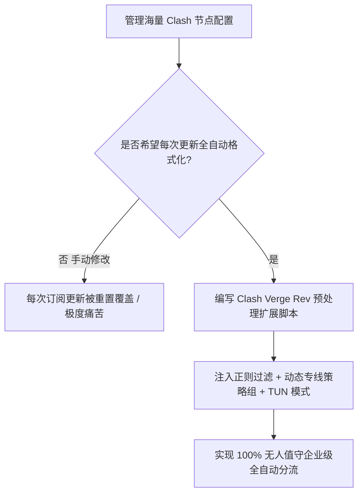

# Clash Verge Rev 扩展脚本 (Scripting) 自动化分流与节点正则过滤实战

<AnswerBox 
  question="每次更新机场订阅配置都被覆盖、或者订阅里充斥着大量无用的低质节点，如何利用 Clash Verge Rev 脚本自动化清洗与无感重构？"
  date="2026-10 专线实验室客户端工程化复盘"
  takeaway="Clash Verge Rev（基于现代化 Mihomo 内核）提供了强大的‘预处理扩展脚本（Scripting）’能力。它允许用户在订阅下载后、内核加载前，使用标准 JavaScript 函数或 YAML 预处理器直接劫持并重构整份配置对象。通过编写自动化脚本，你可以实现：第一，使用正则表达式动态剔除名称包含‘过期/官网/通知’的无效垃圾节点；第二，自动为深港、沪日专线节点追加专属的落地策略组；第三，无缝注入企业级 TUN 虚拟网卡配置与严格防 DNS 泄露规则。一次编写，全自动伴随每次订阅更新静默执行，彻底终结手动修改配置的繁琐噩梦。"
>
<p>
在桌面端网络代理体验中，<strong>Clash Verge Rev</strong> 已无可争议地成为替代老旧原版 CFW 的新一代王者。
</p>
<p>
然而，绝大多数用户仅仅停留在“导入订阅、点击连接”的初级阶段，完全忽视了其内置的 <strong>JavaScript 扩展脚本引擎</strong>。借助脚本，你能把一份杂乱无章的商业订阅打造成完全贴合个人工作流的工业级分流利器。本文将为你详解从正则清洗到策略组注入的全套实战代码。
</p>
</AnswerBox>

---

## 目录导览

1. [Clash Verge Rev 预处理脚本生命周期与执行时序剖析](#一、-clash-verge-rev-预处理脚本生命周期与执行时序剖析)
2. [自动化节点清洗：使用正则表达式秒杀无效节点与垃圾广告](#二、-自动化节点清洗-使用正则表达式秒杀无效节点与垃圾广告)
3. [策略组动态重构：自动化分离深港/沪日专线与流媒体节点](#三、-策略组动态重构-自动化分离深港-沪日专线与流媒体节点)
4. [生产级 JavaScript 完整全功能扩展预处理脚本代码](#四、-生产级-javascript-完整全功能扩展预处理脚本代码)
5. [脚本调试技巧与常见语法报错排坑指南 (FAQ)](#五、-脚本调试技巧与常见语法报错排坑指南-faq)
6. [配置自动化工程化决策树](#六、-配置自动化工程化决策树)
7. [推荐高转化基础设施方案](#七、-推荐高转化基础设施方案)
8. [交叉研读与延伸参考](#八、-交叉研读与延伸参考)

---

## 一、 Clash Verge Rev 预处理脚本生命周期与执行时序剖析

当你在客户端点击“更新订阅”时，数据流经历了清晰的管道处理：

```mermaid
graph LR
    A[远程机场服务器拉取原始 YAML/Base64] --> B[下载至本地临时缓存]
    B --> C[【执行预处理脚本 main(config)】]
    C -->|JS 引擎就地修改对象属性 / 增删节点与规则| D[生成最终运行时完整配置]
    D --> E[提交给 Mihomo 核心热加载生效]
```

* **原生 JS 对象操作**：传入的 `config` 参数是一个标准的 JavaScript 对象（包含 `proxies`、`proxy-groups`、`rules`、`dns` 等键），用户可以像操作日常前端数据一样随意增删改查。

---

## 二、 自动化节点清洗：使用正则表达式秒杀无效节点与垃圾广告

很多机场订阅为了推广或公告，常常掺杂诸如：
* `剩余流量：500GB`
* `官网地址：xxxx.com`
* `过期时间：2026-12-31`
这些伪节点不仅无法连通，更会在批量测速时产生无意义的超时报错。

### 2.1 正则过滤核心逻辑
```javascript
// 过滤掉所有垃圾广告与通知说明节点
const filteredProxies = config.proxies.filter(p => {
  const isAd = /(剩余流量|到期时间|官网|通知|公告|群组|重置|测试)/i.test(p.name);
  return !isAd;
});
config.proxies = filteredProxies;
```

---

## 三、 策略组动态重构：自动化分离深港/沪日专线与流媒体节点

通过正则匹配真实节点名称中的地域关键词，自动为它们分配归类：
* **专线高速组**：匹配 `(IEPL|IPLC|专线|深港|沪日)`；
* **流媒体解锁组**：匹配 `(香港|台湾|日本|新加坡|美国)`；
* **OpenAI / Claude AI 专用组**：仅保留美区与新加坡纯净商宽节点。

---

## 四、 生产级 JavaScript 完整全功能扩展预处理脚本代码

在 Clash Verge Rev 中，点击 **【订阅】-> 右键任意订阅 ->【编辑扩展脚本】**，将以下生产级代码完整粘贴进去：

```javascript
// Clash Verge Rev 工业级预处理扩展脚本
function main(config) {
  // 1. 过滤垃圾广告与无效信息节点
  const adRegex = /(剩余|到期|官网|通知|公告|群组|重置|测试|直连|防失联)/i;
  config.proxies = (config.proxies || []).filter(p => !adRegex.test(p.name));

  // 2. 提取不同类型的高价值节点名称列表
  const allProxyNames = config.proxies.map(p => p.name);
  const zhuanxianNames = config.proxies.filter(p => /(专线|IEPL|IPLC|深港|沪日|广港)/i.test(p.name)).map(p => p.name);
  const hkNames = config.proxies.filter(p => /(香港|HK|Hong Kong)/i.test(p.name)).map(p => p.name);
  const jpNames = config.proxies.filter(p => /(日本|JP|Tokyo|Japan)/i.test(p.name)).map(p => p.name);
  const usNames = config.proxies.filter(p => /(美国|US|United States)/i.test(p.name)).map(p => p.name);

  // 3. 注入企业级极速策略组
  config['proxy-groups'] = [
    {
      name: "🚀 节点选择",
      type: "select",
      proxies: ["⚡ 物理专线加速", "🌍 全球自动最优", ...allProxyNames]
    },
    {
      name: "⚡ 物理专线加速",
      type: "url-test",
      url: "http://www.gstatic.com/generate_204",
      interval: 300,
      tolerance: 20,
      proxies: zhuanxianNames.length > 0 ? zhuanxianNames : allProxyNames
    },
    {
      name: "🌍 全球自动最优",
      type: "url-test",
      url: "http://www.gstatic.com/generate_204",
      interval: 300,
      tolerance: 50,
      proxies: allProxyNames
    },
    {
      name: "🤖 AI 大模型 (ChatGPT/Claude)",
      type: "select",
      proxies: [...usNames, ...jpNames, "🚀 节点选择"]
    },
    {
      name: "🐟 漏网之鱼",
      type: "select",
      proxies: ["🚀 节点选择", "DIRECT"]
    }
  ];

  // 4. 强制覆盖 TUN 模式与高性能 DNS 设置
  config.tun = {
    enable: true,
    stack: "mixed",
    "dns-hijack": ["tcp://any:53", "udp://any:53"],
    "auto-route": true,
    "auto-detect-interface": true
  };

  config.dns = {
    enable: true,
    "enhanced-mode": "fake-ip",
    "fake-ip-range": "198.18.0.1/16",
    nameserver: ["223.5.5.5", "119.29.29.29"],
    fallback: ["https://1.1.1.1/dns-query", "https://8.8.8.8/dns-query"]
  };

  // 5. 注入前置分流规则
  config.rules = [
    "DOMAIN-KEYWORD,openai,🤖 AI 大模型 (ChatGPT/Claude)",
    "DOMAIN-KEYWORD,anthropic,🤖 AI 大模型 (ChatGPT/Claude)",
    "DOMAIN-KEYWORD,claude,🤖 AI 大模型 (ChatGPT/Claude)",
    "GEOIP,CN,DIRECT",
    "MATCH,🐟 漏网之鱼"
  ];

  return config;
}
```

点击保存后，右键订阅点击 **“更新”**，你将获得一个层次分明、完全自动化的企业级科学网络拓扑！

---

## 五、 脚本调试技巧与常见语法报错排坑指南 (FAQ)

### Q1: 保存脚本后更新订阅报错 `Script execution error: undefined is not an object`？
**答**：这说明原始订阅下载失败或者该订阅格式异常（例如返回了空对象）。在脚本开头务必加上防御性空值校验：`config.proxies = config.proxies || [];`。

### Q2: 为什么正则过滤后，某些策略组变成了空的导致客户端启动失败？
**答**：Mihomo 规范要求每个策略组的 `proxies` 数组中**必须至少包含一个有效节点名称**！在上面提供的代码中，我们采用了安全回退机制：`zhuanxianNames.length > 0 ? zhuanxianNames : allProxyNames`，如果正则没有匹配到任何专线，自动回退到全量节点，彻底消灭空策略组异常。

---

## 六、 配置自动化工程化决策树



---

## 七、 推荐高转化基础设施方案

在 Clash Verge Rev 中编写高级 JavaScript 扩展脚本，要求后端专线具备极高的配置规范性与节点信息透明度，以便正则脚本能够自动化提取协议、时延与地理属性并完成智能分流。

| 自动化分流专线提供商 | 节点元数据规范度与链路拓扑 | 脚本解析与动态组装性能 | 专属通道 | 脚本自动化应用场景 |
| :--- | :--- | :--- | :--- | :--- |
| **光速云 (GuangSuCloud)** | 全内网高合规专线集群，元数据标准规范 | 节点命名严谨规范，元数据完整，完美适配脚本正则解析、自动延迟测算与策略组动态装载。 | 独家 85 折码 `gs85` | 自动化脚本高精度正则匹配与企业专线池 |
| **飞猫云 (FlyCatCloud)** | 轻量化分发集群，多节点订阅自动聚合 | 支持便捷的单组订阅合并，脚本处理负载极低，非常适合作为个人自动化分流脚本的入门实验环境。 | 月付低至 7 元起 | 轻量脚本自动化测试与多线冗余 |
| **全球云 (GlobalCloud)** | 大集群多国家商业出口池，全球动态路由 | 覆盖全球 92 国的丰富节点集，为复杂多区域自动化分类脚本提供充沛的出口测试资源。 | 尊享商业 SLA 通道 | 全球多区域大集群脚本治理与商业合规 |

* **专属直达通道**：
  * 👉 [接入光速云规范化企业专线池 (专属 85 折码 gs85)](https://sahude.gsyvipaff.com/#/?code=keqgvT5Y)
  * 👉 [直达飞猫云体验极简自动化分流 (7 元起)](https://guangs.flycataff.com/#/?code=6uq0Xe9y)
  * 👉 [体验全球云多国拓扑商业节点集群](https://guangs.gcvipaff.com/#/?code=Ov2nvU9C)

---

## 八、 交叉研读与延伸参考

* [Android 分应用代理 (Split-Tunneling) 规避国内银行与敏感 APP 风控实操](/devices/android-per-app-split-tunneling.md)
* [Windows TUN 虚拟网卡 vs 系统代理系统级机制对比](/devices/windows-tun-vs-system-proxy.md)
* [Surge Mac 增强模式（Enhanced Mode）深度解析：虚拟网卡与系统网络扩展拦截](/devices/surge-mac-enhanced-mode.md)
* [macOS Wi-Fi 智能切换代理自动化：networksetup 与 launchd 守护进程实战](/devices/macos-wifi-proxy-automation.md)
* [多订阅源自动合并与节点清洗：Subconverter 与 GitHub Actions 实践](/devices/subscription-auto-merge.md)
