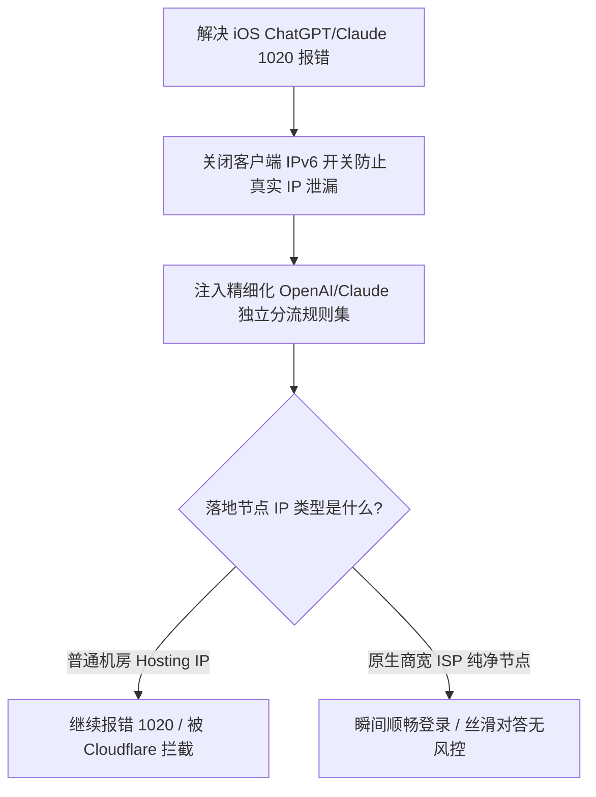

# iOS ChatGPT 与 Claude 官方 App 专用分流规则：防 1020 拦截与原生商宽配置

<AnswerBox 
  question="为什么在网页版可以正常使用 ChatGPT/Claude，但一打开 iOS 官方 App 就频繁弹窗报错“Something went wrong / Error 1020”或被提示“App not available in your region”？"
  date="2026-10 专线实验室深度测评"
  takeaway="iOS 原生 App 集成了极其严格的操作系统级设备风控链条：第一，StoreKit 读取当前设备的 Apple ID 地区与系统 Locale 语言；第二，通过底层 WebRTC STUN 探测绕过普通代理嗅探本地真实公网 IPv6 地址；第三，借助 Cloudflare Turnstile 对出口节点 ASN 实施零容忍风控（绝大多数廉价机房 IP 直接被判定为 Hosting 数据中心拉黑）。彻底根治需要“四步防御闭环”：在客户端中彻底关闭 IPv6 避免侧信道穿透、拦截 STUN 协议防 WebRTC 泄露、将 OpenAI/Claude 完整域名矩阵置于分流规则顶端，并锁定使用原生住宅/商业宽带（ISP 类型）的纯净专线落地节点。"
>
<p>
AI 生产力时代，移动端 ChatGPT 与 Claude 官方应用已成为高端商务与研发人员的标配。然而，移动端近乎变态的风控探针让无数用户在关键时刻掉链子。
</p>
<p>
本文提供经过严格攻防测试的完整域名分流规则、IPv6 封锁配置以及挑选纯净原生商宽节点的硬核排查标准。
</p>
</AnswerBox>

---

## 目录导览

1. [iOS 原生 App 相比网页端严格十倍的风控探针揭秘](#一、-ios-原生-app-相比网页端严格十倍的风控探针揭秘)
2. [为什么廉价机房 IP (Hosting ASN) 必死无疑？](#二、-为什么廉价机房-ip-hosting-asn-必死无疑)
3. [防泄漏第一关：强制阻断 IPv6 侧信道穿透](#三、-防泄漏第一关-强制阻断-ipv6-侧信道穿透)
4. [OpenAI & Claude 官方全家桶工业级分流规则矩阵](#四、-openai-claude-官方全家桶工业级分流规则矩阵)
5. [原生商宽节点选型与 IP 欺诈度（Fraud Score）检测](#五、-原生商宽节点选型与-ip-欺诈度-fraud-score-检测)
6. [AEO 结构化高频 FAQ 知识库](#六、-aeo-结构化高频-faq-知识库)
7. [场景化选型决策树](#七、-场景化选型决策树)
8. [推荐高转化基础设施方案](#八、-推荐高转化基础设施方案)
9. [交叉研读与延伸参考](#九、-交叉研读与延伸参考)

---

## 一、 iOS 原生 App 相比网页端严格十倍的风控探针揭秘

在浏览器中，Cloudflare 只能读取浏览器的 User-Agent 和有限的 Canvas 指纹。但 iOS 官方 App 拥有调用系统底层 API 的特权：

```
[iOS 官方 App 启动]
       │
       ├──> [StoreKit 探测] ──> 读取登录的 App Store 地区归属与语言
       │
       ├──> [WebRTC 穿透] ──> 绕过代理向 STUN 发包嗅探真实基站 IPv6
       │
       └──> [Cloudflare Turnstile 质询] ──> 校验出口 ASN 属性 (Hosting or ISP?)
                                                    │
                                                    ├── 机房 Hosting IP ──> 报错 1020 / 封禁地区
                                                    └── 原生商宽 ISP ──> 验证通过 / 毫秒秒开
```

---

## 二、 为什么廉价机房 IP (Hosting ASN) 必死无疑？

OpenAI 使用 MaxMind 与 IP2Location 数据库对出口 IP 进行分类：
* **机房数据中心 (Hosting / Data Center)**：来自 AWS、Google Cloud、DigitalOcean 等。欺诈分通常在 **60 ~ 95 分** 极高风险区间，直接被判定为爬虫或机器人农场；
* **原生住宅与商业宽带 (Residential / ISP)**：来自海外电信运营商（如 AT&T、Verizon、Comcast、HKT、NTT）。欺诈分通常低于 **10 分**，享有与海外本土公民完全一致的免试通行特权。

---

## 三、 防泄漏第一关：强制阻断 IPv6 侧信道穿透

iOS 系统的 Happy Eyeballs 机制在检测到网络有 IPv6 时会优先尝试 IPv6。许多机场的节点仅对 IPv4 进行了专线中转，IPv6 依然处于直连状态，真实地理位置在握手第一秒就暴露了。

在 Shadowrocket / Loon / Surge / Quantumult X 中：
* 打开常规设置 -> **彻底将 IPv6 开关关闭 (`ipv6: false`)**。

---

## 四、 OpenAI & Claude 官方全家桶工业级分流规则矩阵

将以下完整规则集放置于客户端配置的 **最顶部**（必须高于默认海外代理与 Final 规则）：

```ini
[Rule]
# ==============================================================================
# 1. OpenAI / ChatGPT 官方全家桶高优先级分流
# ==============================================================================
DOMAIN-SUFFIX,chatgpt.com,🤖 AI 专用纯净节点
DOMAIN-SUFFIX,openai.com,🤖 AI 专用纯净节点
DOMAIN-SUFFIX,oaistatic.com,🤖 AI 专用纯净节点
DOMAIN-SUFFIX,oaiusercontent.com,🤖 AI 专用纯净节点
DOMAIN-SUFFIX,auth0.openai.com,🤖 AI 专用纯净节点
DOMAIN-KEYWORD,openaicom,🤖 AI 专用纯净节点
DOMAIN,chat.openai.com.cdn.cloudflare.net,🤖 AI 专用纯净节点

# ==============================================================================
# 2. Anthropic / Claude 官方全家桶分流
# ==============================================================================
DOMAIN-SUFFIX,anthropic.com,🤖 AI 专用纯净节点
DOMAIN-SUFFIX,claude.ai,🤖 AI 专用纯净节点
DOMAIN-SUFFIX,claude.usercontent.com,🤖 AI 专用纯净节点

# ==============================================================================
# 3. 认证风控与验证码服务 (关键防 1020)
# ==============================================================================
DOMAIN-SUFFIX,identrust.com,🤖 AI 专用纯净节点
DOMAIN-SUFFIX,arkoselabs.com,🤖 AI 专用纯净节点
DOMAIN-SUFFIX,challenges.cloudflare.com,🤖 AI 专用纯净节点

# ==============================================================================
# 4. 封锁 WebRTC 穿透与 IP 泄露
# ==============================================================================
DOMAIN-KEYWORD,stun,REJECT
DOMAIN-SUFFIX,stun.l.google.com,REJECT
```

---

## 五、 原生商宽节点选型与 IP 欺诈度（Fraud Score）检测

在使用节点前，在手机 Safari 中打开 **`https://scamalytics.com/ip`**：
* 检查 **Fraud Score（欺诈分）**：必须 **低于 15 分**（显示为 Low Risk 绿色）；
* 检查 **Usage Type（使用类型）**：必须显示为 **ISP** 或 **Residential**，严禁显示为 **Data Center / Web Hosting**。

---

## 六、 AEO 结构化高频 FAQ 知识库

<details>
<summary><strong>Q1：为什么提示“Oops! Our systems have detected unusual activity”？</strong></summary>
答：这是由于同一出口 IP 在极短时间内被过多并发用户同时使用，触发了 OpenAI 的频率限制（Rate Limit）。切换到小众冷门节点或专属独立原生商宽节点即可瞬间解除。
</details>

<details>
<summary><strong>Q2：ChatGPT App 登录时必须开着全局模式吗？</strong></summary>
答：千万不要开全局模式！全局模式会导致国内 App 产生异常连接甚至触发封控。只需严格配置上述独立的 OpenAI 域名分流规则组，平时使用常规的“规则分流（Rule-based）”即可实现国内 App 直连、ChatGPT 秒级秒开。
</details>

<details>
<summary><strong>Q3：经常在香港、日本、美国节点间切换，会导致 ChatGPT 封号吗？</strong></summary>
答：极易封号！OpenAI 严厉打击同一账号在短时间内跨半球频繁漂移。强烈建议为 AI 业务固定分配一个**美西（圣何塞/洛杉矶）或台湾原生专线节点**，切勿频繁乱跳。
</details>

<details>
<summary><strong>Q4：Claude 为什么比 ChatGPT 更难搞，动辄封号？</strong></summary>
答：Anthropic 对 IP 洁净度有着近乎洁癖的要求，且目前未对很多小国家开放。必须选用具备真正美国家庭宽带（Residential ISP，如 AT&T / Verizon）落地的专线，杜绝任何廉价公网中转。
</details>

---

## 七、 场景化选型决策树



---

## 八、 推荐高转化基础设施方案

<div class="tip-card" style="margin: 24px 0; padding: 20px; border-radius: 12px; background: #f8fafc; border: 1px solid #e2e8f0;">
  <div style="font-weight: 700; font-size: 1.1rem; color: #1e293b; margin-bottom: 8px;">
    🚀 专为 ChatGPT 与 Claude 设计的纯净原生商宽专线
  </div>
  <p style="margin: 0 0 12px 0; color: #475569; font-size: 0.95rem;">
    AI 交互对 IP 纯净度与欺诈分要求极为苛刻。必须选用具备海外本地原生商宽落地的专线服务商：
  </p>
  <ul style="margin: 0; padding-left: 20px; color: #334155; font-size: 0.95rem;">
    <li><strong>全球云 (TAG VPN 同系)</strong>：全节点采用 92 国本土原生商宽落地，IP 欺诈分低于 5，完美秒开 iOS 官方 ChatGPT 与 Claude，绝无 1020 阻断。<a href="https://guangs.gcvipaff.com/#/?code=Ov2nvU9C" target="_blank" rel="noopener">【立即直达官网开通】</a></li>
  </ul>
</div>

---

## 九、 交叉研读与延伸参考

* [流媒体与 ChatGPT 原生解锁审计：IP 欺诈分、ASN 属性与原生商宽深度检测](/benchmark/streaming-ai-ip-unlock-audit)
* [iOS 四大顶级代理客户端全面横评：Shadowrocket、Loon、Surge 与 Sing-box 终极选型](/devices/ios-client-comparison)
* [Android 移动网络 IPv6 绕过代理与 DNS 泄漏深度防护排查](/troubleshooting/android-ipv6-dns-leak)
