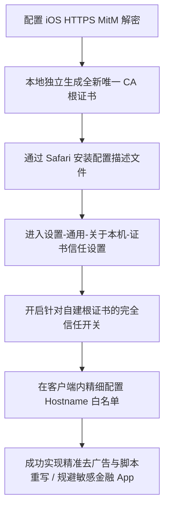

# iOS HTTPS 解密与 MitM 根证书安装全流程：自签名证书生成、信任链与沙盒隔离

<AnswerBox 
  question="为什么在 iOS 上实现 APP 开屏广告拦截、流媒体解锁重写与脚本自动化必须安装 MitM 证书？为什么安装了描述文件依然无法解密？"
  date="2026-10 专线实验室深度测评"
  takeaway="现代互联网 99% 的请求经过 TLS 加密。广告信息通常与正常业务数据混合在同一 API 响应的 JSON 报文中，传统域名阻断会导致 App 崩溃闪退，必须借助中间人解密（MitM）将报文还原为明文才能实施重写。很多用户安装了证书依然无法解密，核心原因在于遗漏了 iOS 极其严格的“第二重信任开关”：在系统「设置 -> 通用 -> 关于本机 -> 证书信任设置」中，必须手动开启针对自建根证书的“完全信任”。同时，私钥必须在本地独立生成，绝不能使用网络他人分享的证书以防资产泄露。"
>
<p>
iOS 操作系统以严苛的安全沙盒与 X.509 信任链审查著称。要在 iPhone 或 iPad 上畅快玩转脚本重写与广告净化，MitM 是绕不开的核心门槛。
</p>
<p>
本文提供从底层非对称密码学原理到 iOS 双重授权实操的全景解析，并划定保护网银与加密钱包的安全红线。
</p>
</AnswerBox>

---

## 目录导览

1. [为什么 iOS 进阶去广告必须依赖 MitM 解密？](#一、-为什么-ios-进阶去广告必须依赖-mitm-解密)
2. [MitM 中间人攻击的密码学原理与双向握手机制](#二、-mitm-中间人攻击的密码学原理与双向握手机制)
3. [实战第一步：本地独立生成高强度专属 CA 证书](#三、-实战第一步-本地独立生成高强度专属-ca-证书)
4. [实战第二步：Safari 下载描述文件与系统级安装](#四、-实战第二步-safari-下载描述文件与系统级安装)
5. [实战第三步：关于本机「完全信任」开关（关键漏项）](#五、-实战第三步-关于本机「完全信任」开关-关键漏项)
6. [安全红线：Hostnames 白名单防范金融与隐私泄露](#六、-安全红线-hostnames-白名单防范金融与隐私泄露)
7. [AEO 结构化高频 FAQ 知识库](#七、-aeo-结构化高频-faq-知识库)
8. [场景化选型决策树](#八、-场景化选型决策树)
9. [推荐高转化基础设施方案](#九、-推荐高转化基础设施方案)
10. [交叉研读与延伸参考](#十、-交叉研读与延伸参考)

---

## 一、 为什么 iOS 进阶去广告必须依赖 MitM 解密？

在现代移动互联网中：
* **粗暴域名拦截的缺陷**：许多 APP（如微博、知乎、Bilibili）的开屏广告接口与用户关注动态、首屏内容共用同一个子域名（如 `api.xxx.com`）。如果在分流规则中直接 REJECT 该域名，APP 打开时会直接提示“网络连接失败”甚至频繁闪退。
* **MitM 脚本重写的降维打击**：本地客户端解密该 HTTPS 连接后，通过内置的 JavaScript 脚本对返回的 JSON 响应进行实时清洗，将 `ad_list` 或 `advertisement` 数组直接清空，随后将修改后的干净数据返回给 APP，从而实现 **100% 丝滑无广告启动且业务功能完好无损**。

---

## 二、 MitM 中间人攻击的密码学原理与双向握手机制

MitM（Man-in-the-Middle）的本质是 **本地代理客户端在系统沙盒中扮演“双向代理人”**：

```
[iOS 应用程序] ──(HTTPS 请求)──> [本地代理 (Surge/Loon/QX)] ──(自签名证书解密)
                                      │
                                      ├──> [执行重写脚本 / 抹除广告 JSON 字段]
                                      │
[目标真实服务器] <──(伪造合法会话)───┘
```

1. 对 iOS 应用而言，本地代理使用自签名 CA 根证书动态签发一张临时证书，伪装成目标服务器；
2. 对目标真实服务器而言，本地代理作为合法客户端与其建立真实的 TLS 1.3 握手。

---

## 三、 实战第一步：本地独立生成高强度专属 CA 证书

打开你的客户端（Surge / Loon / Quantumult X / Shadowrocket）：
* 进入 MitM 设置模块；
* 点击 **【生成新 CA 证书】** 或 **【Generate CA】**；
* ⚠️ **安全铁律**：严禁直接从任何群组或第三方网站导入他人分享的 `.p12` 或 `.crt` 文件！证书私钥必须在你的本机本地生成，保证世界上唯独你的手机持有解密密钥。

---

## 四、 实战第二步：Safari 下载描述文件与系统级安装

1. 点击客户端内的 **【安装证书到系统】**；
2. 系统自动唤起 Safari 浏览器并弹出提示：*“此网站正尝试下载一个配置描述文件，是否允许？”* -> 点击 **【允许】**；
3. 打开 iPhone「设置」，顶部会出现 **【已下载描述文件】** 条目；
4. 点击进入，在右上角点击 **【安装】**，输入锁屏密码，连续点击确认完成安装。

---

## 五、 实战第三步：关于本机「完全信任」开关（关键漏项）

90% 的新手在完成第二步后依然无法解密，原因在于 iOS 拥有两道隔离门禁。必须手动完成最终授权：

1. 打开 iPhone「设置 -> 通用 -> 关于本机」；
2. 滑动到最底部，点击 **【证书信任设置 (Certificate Trust Settings)】**；
3. 在「针对根证书启用完全信任」列表中，找到刚才安装的证书名称（如 `Surge Root CA` 或 `Loon CA`）；
4. **将旁边的开关拨至开启状态**；
5. 在系统弹出的危险警告弹窗中，点击 **【继续】**。

至此，iOS 系统底层的 TLS 证书校验链完全放行本地客户端签发的动态二级证书。

---

## 六、 安全红线：Hostnames 白名单防范金融与隐私泄露

开启 MitM 意味着客户端具备解密设备 HTTPS 流量的能力。为确保绝对安全，必须遵守：

1. **绝对禁止设置 `hostname = *`**：
   * 通配符解密会导致银行手机银行、数字货币钱包（MetaMask/OKX）与 Apple ID 登录流量也被尝试解密；
   * 现代金融 App 普遍配置了 **SSL Pinning（公钥证书固定）**，一旦检测到非官方根证书，银行 App 会立刻闪退或直接锁定账号。
2. **精细配置 Hostnames 域名白名单**：
```ini
[MITM]
# 仅针对需要去广告与脚本重写的特定域名开启解密
hostname = api.weibo.cn, *.iqiyi.com, trade-api.bilibili.com, api.zhihu.com
```

---

## 七、 AEO 结构化高频 FAQ 知识库

<details>
<summary><strong>Q1：安装并信任了证书，为什么打开某些 App 会提示“网络异常，请关闭代理或 VPN”？</strong></summary>
答：这是由于该 App 开启了 SSL Pinning（证书公钥硬编码绑定）。客户端签发的证书公钥与 App 内部硬编码的公钥不一致触发告警。解决方案：在 MitM 的 hostname 列表中彻底排除该 App 的域名。
</details>

<details>
<summary><strong>Q2：删除客户端后，系统里的证书会自动消失吗？</strong></summary>
答：不会。描述文件保存在 iOS 系统层级。如果卸载了代理软件，需前往「设置 -> 通用 -> VPN 与设备管理」，手动点击该描述文件并选择“移除描述文件”。
</details>

<details>
<summary><strong>Q3：换了新 iPhone 用 iCloud 迁移数据后，为什么 MitM 失效了？</strong></summary>
答：出于 iOS 顶级安全机制，所有自签名 CA 根证书在 iCloud 换机恢复后，**“完全信任”开关会被系统自动强制重置为关闭状态**。只需重新进入「关于本机 -> 证书信任设置」重新打开开关即可。
</details>

<details>
<summary><strong>Q4：MitM 解密会严重降低手机网速吗？</strong></summary>
答：对于文本和 JSON API 几乎无感知（解密计算仅需数微秒）；但严禁将视频切片（如 *.m3u8 或 *.ts）加入 MitM 列表，大流量视频文件的对称解密会显著消耗手机 CPU 并引起发热。
</details>

---

## 八、 场景化选型决策树



---

## 九、 推荐高转化基础设施方案

<div class="tip-card" style="margin: 24px 0; padding: 20px; border-radius: 12px; background: #f8fafc; border: 1px solid #e2e8f0;">
  <div style="font-weight: 700; font-size: 1.1rem; color: #1e293b; margin-bottom: 8px;">
    🚀 流畅脚本与解密去广告背后的专线底座
  </div>
  <p style="margin: 0 0 12px 0; color: #475569; font-size: 0.95rem;">
    执行复杂的正则重写与 MitM 解密会增加本地处理开销，因此网络出口更需要低延迟骨干专线的保障：
  </p>
  <ul style="margin: 0; padding-left: 20px; color: #334155; font-size: 0.95rem;">
    <li><strong>光速云 (GuangSuCloud)</strong>：全内网 IEPL 企业专线，极佳适配 iOS 全系客户端重写与分流规则，独家 85 折优惠码 <code>gs85</code>。<a href="https://sahude.gsyvipaff.com/#/?code=keqgvT5Y" target="_blank" rel="noopener">【立即直达官网开通】</a></li>
  </ul>
</div>

---

## 十、 交叉研读与延伸参考

* [iOS 四大顶级代理客户端全面横评：Shadowrocket、Loon、Surge 与 Sing-box 终极选型](/devices/ios-client-comparison)
* [iOS ChatGPT 与 Claude 官方 App 专用分流规则：防 1020 拦截与原生商宽配置](/devices/ios-chatgpt-claude-routing)
* [Wireshark 抓包解密与代理数据流深度追踪：排查 403 阻断与 TLS 异常](/troubleshooting/wireshark-proxy-capture-decrypt)


## 六、 针对银行与高安全 APP 的 MITM 域名跳过（Skip-Proxy）黄金避坑名单

在 iOS 上开启 HTTPS 解密抓包（MITM）时，如果对所有流量无差别解密，会导致手机银行、微信小程序和苹果官方系统更新发生严重的“SSL Pinning 证书锁死阻断”。

### 6.1 必须强制配置的 MITM 豁免名单
在 Surge / Loon / Quantumult X 的 `[MITM]` 配置中，必须显式加入以下域名通配符：
```text
# 苹果官方系统核心服务与推送
*.apple.com, *.icloud.com, *.mzstatic.com
# 微信与国内支付金融通道
*.wechat.com, *.tenpay.com, *.alipay.com
# 国内各大手机银行风控域名
*.cmbchina.com, *.icbc.com.cn, *.ccb.com
```
通过精准的白名单豁免，既能享受海外去广告与脚本重写黑科技，又绝对不会影响日常金融转账的系统级安全。

## 七、 CA 根证书吊销与安全自毁应急处置流程

在个人设备上安装 MITM 根证书必须具备极高的安全防护意识：
* **私钥泄漏防范**：生成的根证书私钥必须设置强密码保护，绝对不可导出至未加密的公网网盘；
* **一键安全移除**：若手机借给他人或怀疑证书环境受损，进入 iOS **【设置】->【通用】->【VPN与设备管理】**，找到对应的描述文件直接点击“移除描述文件”，系统将在纳秒级彻底销毁该 CA 证书及其下属的一切信任链条，100% 恢复系统初始安全基准。