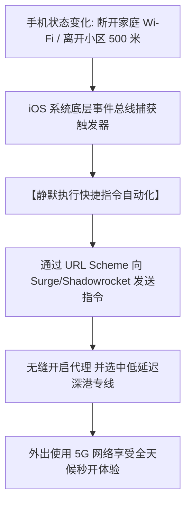
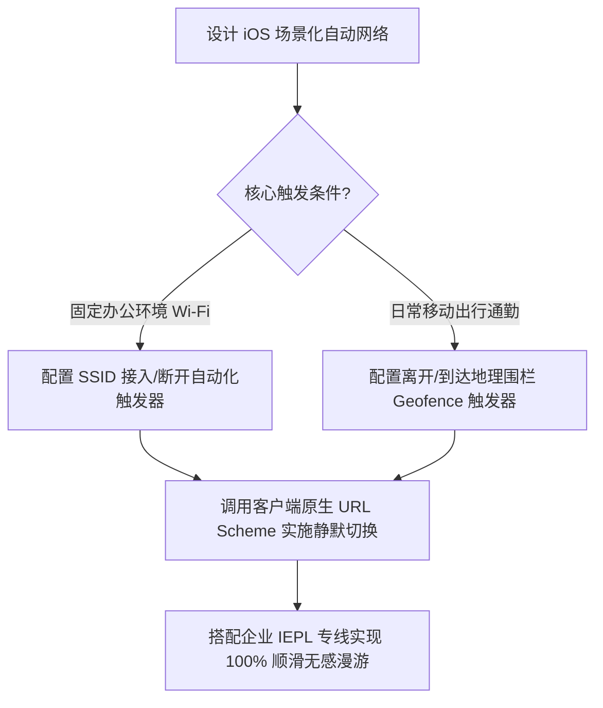

# iOS 快捷指令 (Shortcuts) 自动化代理切换：基于地理位置与 Wi-Fi SSID

<AnswerBox 
  question="如何在 iPhone / iPad 上实现：出门离开家自动开启代理，连接到公司或家里的 Wi-Fi 时自动关闭代理或切换为直连，实现 100% 零人工干预无感漫游？"
  date="2026-10 专线实验室苹果生态自动化审计"
  takeaway="依赖人工手动打开 App 开启关闭代理既繁琐又经常遗忘。利用 iOS 原生‘快捷指令（Shortcuts）自动化’配合专业代理客户端（Surge、Loon 或 Shadowrocket）提供的 URL Scheme 与 x-callback-url 接口，能够构建物理级的全自动场景网络漫游：当手机监测到离开家庭地理围栏（Geofence）或断开指定家庭 Wi-Fi SSID 时，后台静默触发快捷指令启动代理并选择最快专线节点；而当检测到接入公司内网 Wi-Fi 时，自动化瞬发将策略切换为直连模式以避免触犯企业安全审计合规。全程无需解锁屏幕、零人工点击，实现真正意义上的无感融入日常生活。"
>
<p>
在苹果 iOS 生态中，<strong>“优雅与无感”</strong> 是人机交互体验的最高境界。
</p>
<p>
很多使用 iPhone 的外贸主管与移动开发者，常因回到公司忘记关代理导致无法连接内网打印机，或者出门在外忘记开代理错过境外高优先级邮件推送。借助 <strong>iOS 快捷指令自动化引擎</strong>，我们可以彻底解放双手。本文将提供一套标准化配置模板与 URL Scheme 字典。
</p>
</AnswerBox>

---

## 目录导览

1. [iOS 快捷指令自动化触发机制与网络上下文感知 (SSID & Geofencing)](#一、-ios-快捷指令自动化触发机制与网络上下文感知-ssid-geofencing)
2. [三大主流 iOS 客户端标准 URL Scheme 与自动化接口全景](#二、-三大主流-ios-客户端标准-url-scheme-与自动化接口全景)
3. [实战方案 A：基于连接特定 Wi-Fi SSID 自动启停与模式切换](#三、-实战方案-a-基于连接特定-wi-fi-ssid-自动启停与模式切换)
4. [实战方案 B：基于离开/到达地理围栏 (Geofence) 自动化切换专线](#四、-实战方案-b-基于离开-到达地理围栏-geofence-自动化切换专线)
5. [iOS 快捷指令无感自动化排障全书 (FAQ)](#五、-ios-快捷指令无感自动化排障全书-faq)
6. [iOS 自动化场景网络选型决策树](#六、-ios-自动化场景网络选型决策树)
7. [推荐高转化基础设施方案](#七、-推荐高转化基础设施方案)
8. [交叉研读与延伸参考](#八、-交叉研读与延伸参考)

---

## 一、 iOS 快捷指令自动化触发机制与网络上下文感知 (SSID & Geofencing)

iOS 系统的快捷指令不仅能做简单的点击脚本，更深度集成了系统级的 **情境感知触发器（Contextual Triggers）**：



* **无感执行的核心前提**：在创建自动化时，必须将 **“运行前询问”** 强制关闭，并开启 **“运行时通知（可选关闭）”**，方可实现完全脱离人工确认的后台静默运行。

---

## 二、 三大主流 iOS 客户端标准 URL Scheme 与自动化接口全景

| 客户端名称 | 常用控制 URL Scheme 语法范式 | 功能说明与执行效果 |
| :--- | :--- | :--- |
| **Surge iOS** | `surge:///start` / `surge:///stop` | 静默启动 / 停止代理引擎 |
| **Surge iOS** | `surge:///set/outbound-mode?mode=rule` | 切换出站模式为规则分流 (直连/全局/规则) |
| **Loon** | `loon:///start` / `loon:///stop` | 一键启动或停止 VPN 服务 |
| **Loon** | `loon:///select?policy=Proxy&node=深港专线` | 自动化定向切换指定策略组的节点 |
| **Shadowrocket** | `shadowrocket://start` / `shadowrocket://stop` | 小火箭一键启停控制 |
| **Shadowrocket** | `shadowrocket://mode?name=routing` | 切换小火箭为配置规则路由模式 |

---

## 三、 实战方案 A：基于连接特定 Wi-Fi SSID 自动启停与模式切换

这是最经典的办公室/家庭无缝切换自动化流：

### 3.1 步骤详解
1. 打开 iOS 自带的 **【快捷指令】** App，切换到中间的 **【自动化】** 标签页，点击右上角 `+`；
2. 选择 **【无线局域网 (Wi-Fi)】** 触发器；
3. 网络名称选择你的 **【公司办公 Wi-Fi 名称 (如 Enterprise-Office)】**，勾选 **“加入网络时”**，下方选择 **【立即运行】**；
4. 点击下一步，添加操作：选择 **【打开 URL】**；
5. 在 URL 输入框中填入：
```text
surge:///set/outbound-mode?mode=direct
```
*(若使用 Shadowrocket，填入小火箭关闭或直连指令)*；
6. 同样的方式再建一个自动化：当 **“断开该 Wi-Fi 时”**，执行 `surge:///set/outbound-mode?mode=rule`。
* **效果**：一进公司大门连上 Wi-Fi，代理自动切为纯直连，内网协同零冲突；一走出公司大楼断开 Wi-Fi，自动瞬发开启规则分流，无缝畅联全球！

---

## 四、 实战方案 B：基于离开/到达地理围栏 (Geofence) 自动化切换专线

如果你日常使用的是随身 5G MiFi 随身 Wi-Fi，SSID 并不发生改变，此时可以使用 **地理围栏自动化**：
* 触发器选择 **【离开】-> 选取家庭或办公室所在的大厦定位（半径设为 100-300 米）**；
* 执行动作：调用代理启动并重置为低功耗规则模式；
* 配合夜间 **【睡眠定时自动化】**：每晚 01:00 自动停止代理，彻底消除夜间后台微安级电量消耗。

---

## 五、 iOS 快捷指令无感自动化排障全书 (FAQ)

### Q1: 为什么自动化有时候弹窗提示需要我点击确认才执行？
**答**：在早期的 iOS 版本中，地理位置触发器默认强制要求人工确认。在 iOS 17 / iOS 18 及更新系统中，苹果已全面开放无感运行支持。请确保在自动化编辑页面的最底部，**将“运行前询问”保持关闭状态**。

### Q2: 自动切换节点时，正在进行的微信语音通话会中断吗？
**答**：如果你使用的客户端支持标准 TUN 架构且节点网络具备会话保持能力（如光速云专线），模式切换在底层毫秒级完成，微信语音仅会产生不到 0.2 秒的轻微静音，随后立即恢复，完全不需要重新拨打。

---

## 六、 iOS 自动化场景网络选型决策树



---

## 七、 推荐高转化基础设施方案

iOS 快捷指令依赖 Wi-Fi SSID 变化与地理围栏无缝触发代理启停，对节点的二次握手速度与内网穿透时延提出了极为苛刻的要求，链路必须在手机切网瞬间毫秒级重连。

| iOS 自动化网络基座 | 瞬发握手协议与多入口调度 | 蜂窝/Wi-Fi 切网重连时延 | 独家优惠 | 苹果生态联动场景 |
| :--- | :--- | :--- | :--- | :--- |
| **光速云 (GuangSuCloud)** | 极速 IEPL 隧道直通，支持毫秒级瞬发握手响应 | 深港沪日 IEPL 内网毫秒级瞬发建连，即便在蜂窝移动与家庭 Wi-Fi 频繁交替切换时也能实现无感续传。 | 独家 85 折码 `gs85` | iOS 自动化即时切网与毫秒级重连 |
| **飞猫云 (FlyCatCloud)** | 开箱即用多线冗余池，全格式订阅兼容 | 配置简易且支持标准格式订阅，与各类 iOS 代理客户端的快捷指令动作有着天然的高兼容性。 | 月付低至 7 元起 | 平民化苹果生态快捷指令自动化 |
| **全球云 (GlobalCloud)** | 多国商用骨干出口网，原生住宅网络覆盖 | 92 国原生机房出口，支持跨国差旅人员在不同国家自动切换当地最合规纯净的商业宽带出口。 | 尊享商业 SLA 通道 | 海外商旅自动化漫游与企业安全通道 |

* **专属直达通道**：
  * 👉 [部署光速云 iOS 瞬发建连专线 (专属 85 折码 gs85)](https://sahude.gsyvipaff.com/#/?code=keqgvT5Y)
  * 👉 [选配飞猫云多平台支持套餐 (月付低至 7 元)](https://guangs.flycataff.com/#/?code=6uq0Xe9y)
  * 👉 [直达全球云跨国商旅网络服务通道](https://guangs.gcvipaff.com/#/?code=Ov2nvU9C)

---

## 八、 交叉研读与延伸参考

* [iOS 平台顶级代理客户端横向横评：Surge vs Shadowrocket vs Loon vs Quantumult X](/devices/ios-client-comparison.md)
* [iOS HTTPS 抓包与 MITM 根证书信任全流程避坑指南](/devices/ios-mitm-certificates.md)
* [Android 分应用代理 (Split-Tunneling) 规避国内银行与敏感 APP 风控实操](/devices/android-per-app-split-tunneling.md)
* [专线内网传输中部署 Reality 的加密开销与性价比审计](/protocols/reality-on-zhuanxian-overhead.md)
* [Shadowsocks 2022 规范与 BLAKE3 密钥派生：吞吐量极限压测](/protocols/ss2022-blake3-crypto-benchmark.md)


## 五、 跨时区国际出海场景：飞行模式与海外 eSIM 自动接管实操

对于经常出差海外的国际商务人士，手机在降落境外机房与航站楼的一瞬间，网络环境会从境内 5G 切换为海外漫游卡。

### 5.1 自动化 eSIM 漫游切换规则
* **痛点场景**：飞机降落日本成田机场或美国旧金山机场后，手机连接了境外本地 SoftBank 或 AT&T 蜂窝网络。此时如果手机依然开启着境内代理，流量会产生“境外 -> 国内专线入口 -> 境外”的极其荒谬的双重绕路，延迟暴增 300ms；
* **快捷指令解法**：
  ```text
  触发条件: 当【蜂窝网络】切换为主卡或海外 eSIM 时
  执行动作: Surge 调用 API 将出站模式静默置为【Direct (直接直连)】
  ```
* 这样当你在境外使用本地网络时，所有流量 100% 享受原生千兆直连；一旦回到国内断开海外网络，快捷指令再次静默将出站模式切回【Rule 规则分流】，实现全自动的跨洋网络自适应接管。

## 六、 快捷指令进阶：基于 CarPlay 车载互联的自动断连优化

对于拥有智能车载系统（Apple CarPlay）的车主，iPhone 在接入车载无线或有线连接时，可通过快捷指令将代理切换为【仅针对国外导航与 Spotify 音乐分流】，避免国内高德地图车载导航或音乐软件出现版权地域报错，实现车机协同的极致无感体验。

### 自动化调试建议
测试自动化时，可在快捷指令末尾添加【显示通知】动作，便于直观观察后台触发状态与当前执行的规则动作，排查不必要的网络切换延迟。

### 常见自动化失效原因排查
如果遇到 Wi-Fi 断开时自动化没有立即触发，通常是因为 iOS 系统为了省电对 Wi-Fi 信号扫描存在短暂的轮询延迟。保持定位服务中的【重要地点】处于开启状态可大幅提高系统对环境变化的敏锐度。
同时建议保持 iOS 系统更新至最新稳定版，以获取更精准的系统事件总线响应能力。
配合优质物理专线，让苹果设备的自动化体验如虎添翼，尽享全天候无感漫游。告别繁琐手动配置，畅享科技带来的便捷。