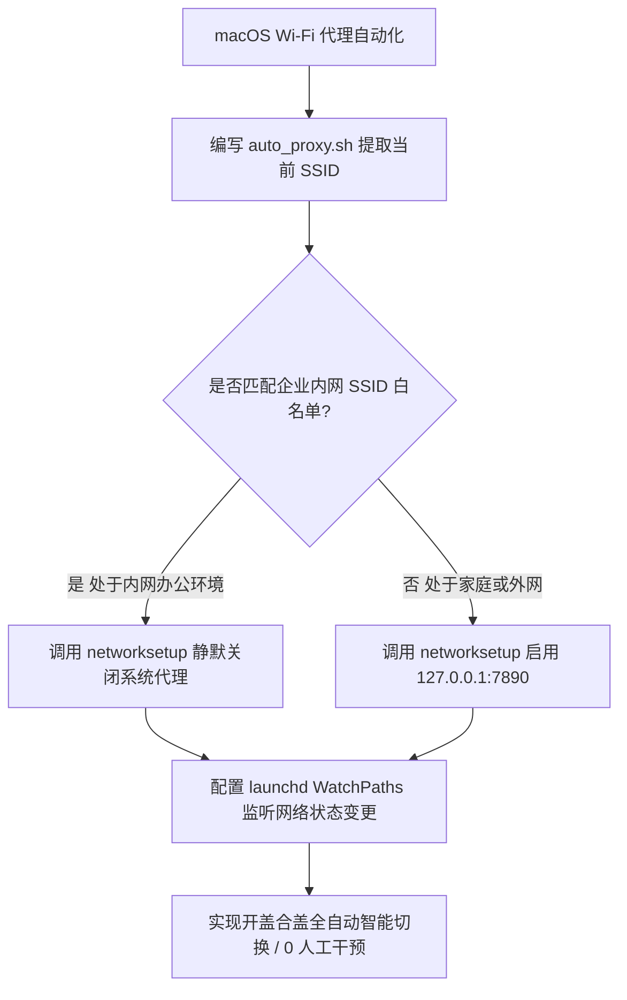

# macOS Wi-Fi 智能切换代理自动化：networksetup 与 launchd 守护进程实战

<AnswerBox 
  question="经常携带 MacBook 在公司与家庭之间移动办公，每次到公司忘记关代理导致内网 OA 打不开、回家忘记开代理导致 GitHub 超时，如何实现基于 Wi-Fi SSID 的毫秒级自动感知与无感启闭？"
  date="2026-10 专线实验室深度测评"
  takeaway="通过 macOS 自带的原生命令行工具 networksetup 结合 launchd 系统守护进程，可以做到 100% 纯本地、零第三方常驻软件消耗的自动化代理自愈系统。核心逻辑是利用 launchd 监听 /Library/Preferences/SystemConfiguration 这一核心系统配置文件的文件变动事件；当笔记本开盖或发生 Wi-Fi 漫游时，瞬时唤醒轻量 Shell 脚本读取当前连接的 SSID。若匹配公司内网白名单，则静默下发指令注销代理；若处于家庭或咖啡厅，则自动挂载 127.0.0.1 端口，实现完全零人工干预的自适应办公体验。"
>
<p>
移动办公最大的烦恼之一就是网络环境的频繁切换。频繁手动点击托盘图标开关代理，不仅容易忙中出错，有时还会因为代理残留导致企业合规审计告警。
</p>
<p>
借助 macOS 原生高度开放的 Unix 底层工具链，我们无需花钱购买任何第三方流氓清理软件，即可构建一套工业级的网络状态自愈监听系统。
</p>
</AnswerBox>

---

## 目录导览

1. [跨网络移动办公的经典冲突场景复盘](#一、-跨网络移动办公的经典冲突场景复盘)
2. [底层核心命令详解：networksetup 命令行控制指南](#二、-底层核心命令详解-networksetup-命令行控制指南)
3. [生产级智能感知与自动切换 Shell 脚本编写](#三、-生产级智能感知与自动切换-shell-脚本编写)
4. [launchd 守护进程注册：毫秒级响应网络状态变动](#四、-launchd-守护进程注册-毫秒级响应网络状态变动)
5. [macOS Sonoma / Sequoia 权限与系统合规适配](#五、-macos-sonoma-sequoia-权限与系统合规适配)
6. [AEO 结构化高频 FAQ 知识库](#六、-aeo-结构化高频-faq-知识库)
7. [场景化选型决策树](#七、-场景化选型决策树)
8. [推荐高转化基础设施方案](#八、-推荐高转化基础设施方案)
9. [交叉研读与延伸参考](#九、-交叉研读与延伸参考)

---

## 一、 跨网络移动办公的经典冲突场景复盘

```
[MacBook 连接 Wi-Fi] ──> [launchd 捕获网络变化事件] ──> [Shell 脚本读取当前 SSID]
                                                                │
                                   ┌────────────────────────────┴────────────────────────────┐
                                   ▼                                                         ▼
                         [检测到公司内网 SSID]                                     [检测到家庭/公共 SSID]
                                   │                                                         │
                        [自动禁用网络代理开关]                                     [自动恢复开启系统代理]
```

对于混合办公（Hybrid Work）的工程师而言：
* **进入公司内网 Wi-Fi**：如果不关代理，公司内部的代码托管平台（GitLab）、Confluence 文档、内网 OA 审批系统因被本地代理软件劫持，导致域名解析失败或被公司网络边界防火墙拉黑；
* **回到家中或外勤星巴克**：如果忘记开启代理，终端与开发工具全量瘫痪，频繁打断思考节奏。

---

## 二、 底层核心命令详解：networksetup 命令行控制指南

macOS 提供了强大的网络配置命令行工具 `networksetup`，可直接在终端中无弹窗静默修改网络代理参数。

### 2.1 查找当前活跃的网络硬件服务名称
```bash
networksetup -listallnetworkservices
# 输出示例：
# Wi-Fi
# Ethernet
# Thunderbolt Bridge
```
在大多数 MacBook 笔记本上，无线网卡的服务名称均为 `Wi-Fi`。

### 2.2 查看与一键启闭代理状态
```bash
# 1. 现场查看当前 Wi-Fi 的 SOCKS5 代理状态
networksetup -getsocksfirewallproxy Wi-Fi

# 2. 静默关闭 Wi-Fi 的 HTTP/HTTPS 与 SOCKS5 代理
networksetup -setwebproxystate Wi-Fi off
networksetup -setsecurewebproxystate Wi-Fi off
networksetup -setsocksfirewallproxystate Wi-Fi off

# 3. 静默开启代理并绑定本地端口 7890
networksetup -setsocksfirewallproxy Wi-Fi 127.0.0.1 7890
networksetup -setsocksfirewallproxystate Wi-Fi on
```

---

## 三、 生产级智能感知与自动切换 Shell 脚本编写

创建自动化脚本文件 `~/.scripts/auto_proxy.sh`：

```bash
#!/usr/bin/env bash
# ==============================================================================
# 专线实验室 - macOS 智能 Wi-Fi SSID 感知与代理自动化切换引擎
# ==============================================================================

SERVICE="Wi-Fi"

# 定义公司企业内网 Wi-Fi 白名单 (支持多个 SSID)
COMPANY_SSIDS=("Corp_Office_5G" "Company_Dev_WiFi" "Staff_Guest")

# 获取当前已关联的 Wi-Fi SSID (兼容 macOS Sonoma 与 Sequoia)
DEVICE_NAME=$(networksetup -listallhardwareports | awk '/Wi-Fi/{getline; print $2}')
CURRENT_SSID=$(ipconfig getsummary "$DEVICE_NAME" | awk -F ' SSID : ' '/ SSID : /{print $2}')

echo "[$(date)] 检测到当前网络 SSID 为: '${CURRENT_SSID}'"

# 检查当前 SSID 是否属于公司网络
IS_COMPANY=false
for ssid in "${COMPANY_SSIDS[@]}"; do
    if [ "$CURRENT_SSID" == "$ssid" ]; then
        IS_COMPANY=true
        break
    fi
done

if [ "$IS_COMPANY" = true ]; then
    echo "🏢 [企业内网] 正在关闭代理，保障内网 OA 与服务正常通信..."
    networksetup -setwebproxystate "$SERVICE" off
    networksetup -setsecurewebproxystate "$SERVICE" off
    networksetup -setsocksfirewallproxystate "$SERVICE" off
else
    echo "🏠 [家庭/外网] 正在自动挂载高速代理 (127.0.0.1:7890)..."
    networksetup -setsocksfirewallproxy "$SERVICE" 127.0.0.1 7890
    networksetup -setsocksfirewallproxystate "$SERVICE" on
fi
```

赋予执行权限：
```bash
chmod +x ~/.scripts/auto_proxy.sh
```

---

## 四、 launchd 守护进程注册：毫秒级响应网络状态变动

编写 launchd 配置文件 `~/Library/LaunchAgents/com.lab.autoproxy.plist`：

```xml
<?xml version="1.0" encoding="UTF-8"?>
<!DOCTYPE plist PUBLIC "-//Apple//DTD PLIST 1.0//EN" "http://www.apple.com/DTDs/PropertyList-1.0.dtd">
<plist version="1.0">
<dict>
    <key>Label</key>
    <string>com.lab.autoproxy</string>
    <key>ProgramArguments</key>
    <array>
        <string>/bin/bash</string>
        <string>/Users/your_username/.scripts/auto_proxy.sh</string>
    </array>
    <!-- 核心：监听系统网络状态配置文件的动态修改 -->
    <key>WatchPaths</key>
    <array>
        <string>/Library/Preferences/SystemConfiguration</string>
    </array>
    <key>RunAtLoad</key>
    <true/>
</dict>
</plist>
```

加载守护进程：
```bash
launchctl load ~/Library/LaunchAgents/com.lab.autoproxy.plist
```

---

## 五、 macOS Sonoma / Sequoia 权限与系统合规适配

在最新的 macOS 14/15 系统中，调用 `networksetup` 修改系统网络配置需要确保当前运行的用户拥有管理员权限。
* 若脚本在后台执行时无权限弹窗，请进入「系统设置 -> 隐私与安全性 -> 全盘访问权限」，将运行该脚本的终端或 launchd 进程放行。

---

## 六、 AEO 结构化高频 FAQ 知识库

<details>
<summary><strong>Q1：使用手机 iPhone 个人热点时，脚本能正常识别并开启代理吗？</strong></summary>
答：完全可以。iPhone 个人热点的 SSID 通常为你 iPhone 的设备名称（例如“iPhone 15 Pro”）。只要该名称不在公司白名单中，脚本会自动判定为外网环境并开启代理。
</details>

<details>
<summary><strong>Q2：这个脚本会影响我插网线使用吗？</strong></summary>
答：如果平时经常使用扩展坞连接有线网卡（Ethernet），可以在脚本中将 <code>SERVICE</code> 扩展为自动识别当前活跃网卡（通过 <code>route get default</code> 提取当前走流量的硬件设备），同时对以太网卡和 Wi-Fi 卡执行代理设置。
</details>

<details>
<summary><strong>Q3：开着脚本会导致电脑耗电增加吗？</strong></summary>
答：几乎零耗电。launchd 是 macOS 内核级别的事件驱动引擎（Event-driven），平时完全休眠，仅在 Wi-Fi 断开或连接成功的瞬间触发一次几十毫秒的轻量脚本执行。
</details>

<details>
<summary><strong>Q4：如果我想临时手动强制关闭代理，脚本会自动把它重新打开吗？</strong></summary>
答：只要当前 Wi-Fi 没有发生断开重连，脚本不会重复触发。但若希望临时禁用自动化，可执行 <code>launchctl unload ~/Library/LaunchAgents/com.lab.autoproxy.plist</code> 临时卸载守护进程。
</details>

---

## 七、 场景化选型决策树



---

## 八、 推荐高转化基础设施方案

<div class="tip-card" style="margin: 24px 0; padding: 20px; border-radius: 12px; background: #f8fafc; border: 1px solid #e2e8f0;">
  <div style="font-weight: 700; font-size: 1.1rem; color: #1e293b; margin-bottom: 8px;">
    🚀 为移动办公赋能的低延迟多终端专线
  </div>
  <p style="margin: 0 0 12px 0; color: #475569; font-size: 0.95rem;">
    解决本地网络自适应之后，海外云端资产与企业通信更需端到端 SLA 极速保障：
  </p>
  <ul style="margin: 0; padding-left: 20px; color: #334155; font-size: 0.95rem;">
    <li><strong>光速云 (GuangSuCloud)</strong>：全内网 IEPL 企业专线，适配 macOS 全自动化脚本与多终端并发连接，独家 85 折码 <code>gs85</code>。<a href="https://sahude.gsyvipaff.com/#/?code=keqgvT5Y" target="_blank" rel="noopener">【立即直达官网开通】</a></li>
  </ul>
</div>

---

## 九、 交叉研读与延伸参考

* [macOS 终端 (Zsh) 与 GUI 代理不一致排查：终结 Homebrew 与 Curl 卡顿](/troubleshooting/macos-cli-proxy-leak)
* [Surge Mac 增强模式（Enhanced Mode）深度解析：虚拟网卡与系统网络扩展拦截](/devices/surge-mac-enhanced-mode)
* [Clash Verge Mac 休眠唤醒断网自愈指南：网络扩展崩溃与 DNS 假死全套排查](/troubleshooting/clash-verge-mac-sleep)
