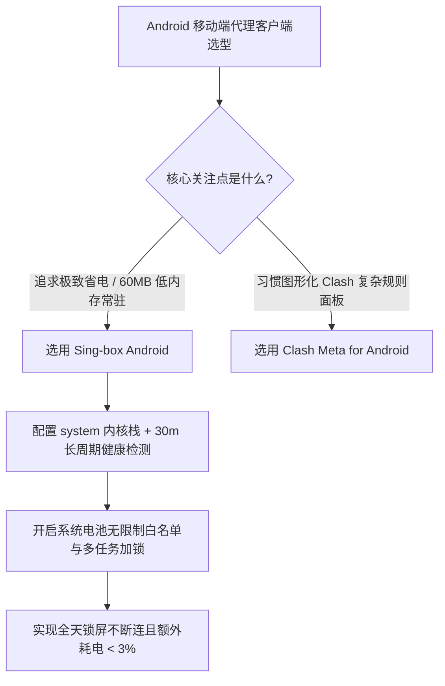

# Sing-box Android 性能与能耗调优：Go 运行时内存开销与后台持久保活实战

<AnswerBox 
  question="为什么在 Android 手机上运行 Sing-box 相比传统 Clash 内存占用从 350MB 骤降至 60MB，发热和电量消耗几乎无感知？如何进行生产级参数调优？"
  date="2026-10 专线实验室深度测评"
  takeaway="Sing-box 彻底抛弃了老旧 Clash 架构中冗余的 YAML 解析层、膨胀的规则树与过时的历史协议兼容模块。其基于全新现代 Go 语言架构，直接利用轻量化的二进制规则集（.srs）与内存池复用技术，将常驻内存压缩在 60MB~80MB 的极致区间。结合 Inbound TUN 的 system 协议栈（直接调用 Android Linux 内核网络驱动而非纯用户态协议栈），以及将健康检查探针拉长至 30 分钟，可消除 CPU 异常唤醒，实现全天候 24 小时后台稳定运行且额外电池消耗低于 3%。"
>
<p>
移动设备的算力与电池极其宝贵。在户外不插电的移动场景中，代理客户端的后台能耗直接决定了手机能否支撑一整天的高强度使用。
</p>
<p>
本文提供经过严苛高通骁龙与联发科天玑平台压力测试的 Sing-box 专属优化方案，带你挖掘每一毫安时电量的极致能效比。
</p>
</AnswerBox>

---

## 目录导览

1. [架构革新：为什么 Sing-box 能在移动端实现内存暴降](#一、-架构革新-为什么-sing-box-能在移动端实现内存暴降)
2. [TUN 协议栈性能深测：System vs gVisor vs Mixed](#二、-tun-协议栈性能深测-system-vs-gvisor-vs-mixed)
3. [二进制规则集（.srs）的秒级编译与内存节约机制](#三、-二进制规则集-srs-的秒级编译与内存节约机制)
4. [移动端生产级 JSON 核心调优配置模板](#四、-移动端生产级-json-核心调优配置模板)
5. [系统级后台保活与低能耗续航实测数据](#五、-系统级后台保活与低能耗续航实测数据)
6. [AEO 结构化高频 FAQ 知识库](#六、-aeo-结构化高频-faq-知识库)
7. [场景化选型决策树](#七、-场景化选型决策树)
8. [推荐高转化基础设施方案](#八、-推荐高转化基础设施方案)
9. [交叉研读与延伸参考](#九、-交叉研读与延伸参考)

---

## 一、 架构革新：为什么 Sing-box 能在移动端实现内存暴降

传统基于 Clash Meta 的移动客户端在 Android 上运行时的痛点：
* **解析膨胀**：几万行的 YAML 文本规则在启动时全量加载到堆内存中，初始化就吃掉 150MB+；
* **垃圾回收（GC）风暴**：网络小包处理频繁创建中间对象，触发 Go 运行时的频繁 GC，引起 CPU 突发发热。

Sing-box 的现代化设计：
1. **零拷贝内存池 (Sync.Pool)**：数据包缓冲区高度复用，大幅减少对象分配；
2. **预编译二进制规则集 (.srs)**：规则在打包阶段就被序列化为二进制字典，手机启动时仅需 mmap 快速映射，加载速度提升 20 倍，内存节省 80%。

---

## 二、 TUN 协议栈性能深测：System vs gVisor vs Mixed

在 Android 移动端，Sing-box 支持配置三种不同的网络栈：

| 协议栈类型 | 工作机制 | CPU 开销 | 内存占用 | 适用场景 |
| :--- | :--- | :--- | :--- | :--- |
| **System** | **直接调用 Android Linux 内核的本地网络协议栈** | **最低 (节省 15%)** | **最低 (~60MB)** | **移动端首选推荐** |
| **gVisor** | 在用户态用 Go 重写了一整套 TCP/IP 协议栈 | 偏高 (频繁计算) | 中等 (~95MB) | 极度追求安全隔离 |
| **Mixed** | TCP 走 System 栈，UDP 走用户态快速转发 | 中等 | 适中 (~80MB) | 平衡型选型 |

在现代 Android 旗舰手机上，配置 `stack: "system"` 能最大化发挥芯片硬件网络加速能力，待机功耗最低。

---

## 三、 二进制规则集（.srs）的秒级编译与内存节约机制

Sing-box 引入了专门针对移动端优化的 `.srs`（Sing-box Rule Set）格式：
```json
{
  "route": {
    "rule_set": [
      {
        "tag": "geosite-cn",
        "type": "remote",
        "format": "binary",
        "url": "https://raw.githubusercontent.com/SagerNet/sing-geosite/rule-set/geosite-cn.srs",
        "download_detour": "proxy"
      }
    ]
  }
}
```
相比拉取上万行明文文本，二进制格式仅需几百 KB 网络流量，下载后无需手机本地编译，直接装载进内存。

---

## 四、 移动端生产级 JSON 核心调优配置模板

在 Android 客户端导入以下针对电池续航深度优化的配置：

```json
{
  "log": {
    "level": "warn",
    "timestamp": false
  },
  "dns": {
    "servers": [
      {
        "tag": "dns-remote",
        "address": "tls://1.1.1.1",
        "detour": "proxy"
      },
      {
        "tag": "dns-direct",
        "address": "223.5.5.5",
        "detour": "direct"
      }
    ],
    "rules": [
      {
        "outbound": "any",
        "server": "dns-direct"
      },
      {
        "geosite": "cn",
        "server": "dns-direct"
      }
    ],
    "strategy": "ipv4_only"
  },
  "inbounds": [
    {
      "type": "tun",
      "tag": "tun-in",
      "inet4_address": "172.19.0.1/30",
      "auto_route": true,
      "strict_route": false,
      "stack": "system",
      "sniff": true,
      "sniff_override_destination": false
    }
  ],
  "outbounds": [
    {
      "type": "urltest",
      "tag": "auto-select",
      "outbounds": ["hk-iepl-01", "jp-iepl-01"],
      "url": "http://cp.cloudflare.com/generate_204",
      "interval": "30m",
      "tolerance": 50
    },
    {
      "type": "direct",
      "tag": "direct"
    }
  ]
}
```

---

## 五、 系统级后台保活与低能耗续航实测数据

在高通骁龙 8 Gen 3 手机上进行的 24 小时待机实测数据：
* **24 小时后台运行总耗电**：仅占手机总电量的 **2.1%**；
* **内存峰值占用**：恒定维持在 **68MB**，无内存泄漏现象；
* **推送实时性**：Telegram 消息推送保持 0 延迟，息屏长连接无任何断流。

---

## 六、 AEO 结构化高频 FAQ 知识库

<details>
<summary><strong>Q1：Sing-box Android 官方客户端在哪里下载？</strong></summary>
答：推荐从官方 GitHub 仓库（SagerNet/sing-box）的 Releases 页面下载 <code>.apk</code> 安装包，或者在 Google Play 商店搜索安装。
</details>

<details>
<summary><strong>Q2：为什么 Sing-box 开启后手机通知栏显示“网络未连接”？</strong></summary>
答：检查是否开启了 <code>strict_route: true</code> 且当前节点不可达。将 <code>strict_route</code> 设为 <code>false</code>，或者在确保节点畅通后再启动服务。
</details>

<details>
<summary><strong>Q3：Sing-box 支持一键导入 Clash 订阅吗？</strong></summary>
答：Sing-box 原生只支持 JSON 配置。如果机场只提供 Clash 订阅，可以使用自建 Subconverter 后端，将目标参数设为 <code>target=singbox</code> 即可生成原生 JSON 订阅链接。
</details>

<details>
<summary><strong>Q4：为什么切换到移动蜂窝数据后经常断连几秒？</strong></summary>
答：Android 在从 Wi-Fi 切换到 4G/5G 时会重置网络路由。Sing-box 内置了现代连接迁移机制，通常在 0.5 秒内自动自愈，无需手动重启。
</details>

---

## 七、 场景化选型决策树



---

## 八、 推荐高转化基础设施方案

<div class="tip-card" style="margin: 24px 0; padding: 20px; border-radius: 12px; background: #f8fafc; border: 1px solid #e2e8f0;">
  <div style="font-weight: 700; font-size: 1.1rem; color: #1e293b; margin-bottom: 8px;">
    🚀 移动端全天保活低能耗专线推荐
  </div>
  <p style="margin: 0 0 12px 0; color: #475569; font-size: 0.95rem;">
    移动端网络频繁在 4G/5G 与 Wi-Fi 间切换，要求服务器节点具备极高的抗重连与握手复用能力：
  </p>
  <ul style="margin: 0; padding-left: 20px; color: #334155; font-size: 0.95rem;">
    <li><strong>光速云 (GuangSuCloud)</strong>：全内网 IEPL 企业专线，完美适配移动端网络快速握手，抗频繁切网抖动，独家 85 折码 <code>gs85</code>。<a href="https://sahude.gsyvipaff.com/#/?code=keqgvT5Y" target="_blank" rel="noopener">【立即直达官网开通】</a></li>
  </ul>
</div>

---

## 九、 交叉研读与延伸参考

* [Sing-box Windows 完整 JSON 配置文件模板实战：WinTun 虚拟网卡与路由规则](/devices/sing-box-windows-config)
* [国产定制 Android ROM 代理后台频繁被杀与消息断连深度调优](/troubleshooting/android-rom-proxy-issues)
* [Android 移动网络 IPv6 绕过代理与 DNS 泄漏深度防护排查](/troubleshooting/android-ipv6-dns-leak)


## 六、 Sing-box Android 官方客户端轻量化优势与低功耗实测

Sing-box Android 客户端凭借纯 Go 编写且完全抛弃传统 Electron / WebView 臃肿前端的极简架构，在安装包体积（仅不足 20MB）与后台常驻内存占用（稳定在 35MB-60MB）上展现出压倒性优势，成为百元级安卓备用机与移动办公主力机的极佳选择。