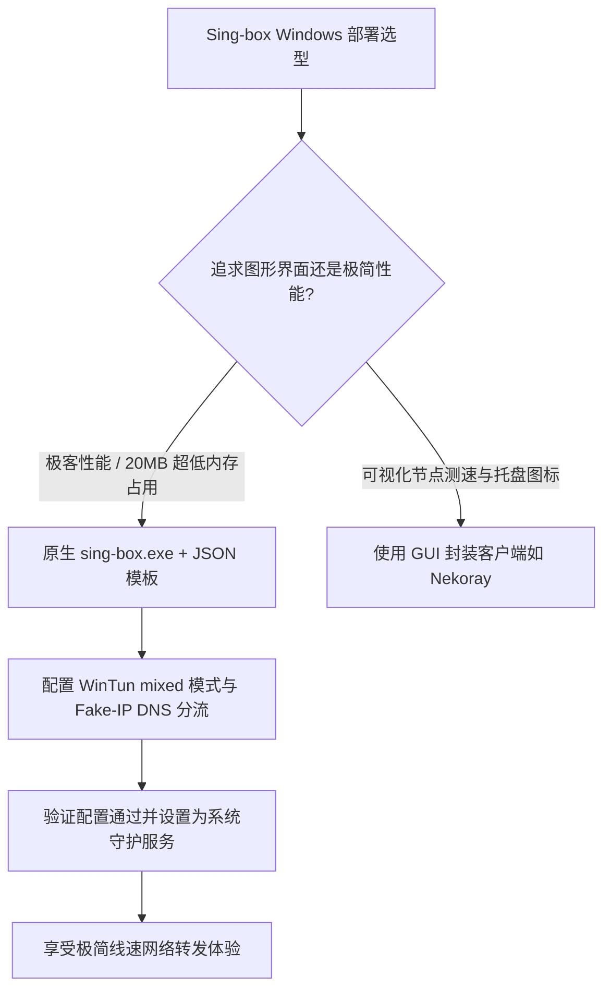

# Sing-box Windows 完整 JSON 配置文件模板实战：WinTun 虚拟网卡与路由规则

<AnswerBox 
  question="如何在 Windows 10/11 上不依赖任何第三方 GUI 封装，直接运行原生 sing-box.exe 核心？如何编写包含 WinTun 虚拟网卡与 Fake-IP 的工业级生产配置？"
  date="2026-10 专线实验室深度测评"
  takeaway="直接运行原生 sing-box.exe 拥有绝对的极客性能：不消耗 Electron 的几百兆内存，常驻仅需 20MB 左右。生产级 JSON 配置的核心在于三位一体：第一，Inbound 声明基于 WinTun 的三层虚拟网卡并启用 mixed/system 栈；第二，DNS 声明由 dns-fakeip、dns-direct 与 dns-remote 组成的防污染分流矩阵；第三，Outbound 注入支持 urltest 自动测速的高可用出站组并配合 rule_set 实现国内域名直连与海外专线分流。"
>
<p>
很多高性能开发工作站、量化服务器与游戏 PC 用户，追求极致精简、杜绝任何界面卡顿。
</p>
<p>
本文提供经过严格生产压测的 Windows 原生 Sing-box 全套配置模版、WinTun 驱动联动与开机后台无头服务守护指南。
</p>
</AnswerBox>

---

## 目录导览

1. [原生 Sing-box 核心的极致优势与极客哲学](#一、-原生-sing-box-核心的极致优势与极客哲学)
2. [生产级 Sing-box Windows 完整配置模板 (config.json)](#二、-生产级-sing-box-windows-完整配置模板-config-json)
3. [WinTun 虚拟网卡底层调优与驱动加载规范](#三、-wintun-虚拟网卡底层调优与驱动加载规范)
4. [配置校验、调试与 Windows 后台系统服务常驻](#四、-配置校验、调试与-windows-后台系统服务常驻)
5. [常见报错（0x80070005、DNS 找不到）排查手册](#五、-常见报错-0x80070005、dns-找不到-排查手册)
6. [AEO 结构化高频 FAQ 知识库](#六、-aeo-结构化高频-faq-知识库)
7. [场景化选型决策树](#七、-场景化选型决策树)
8. [推荐高转化基础设施方案](#八、-推荐高转化基础设施方案)
9. [交叉研读与延伸参考](#九、-交叉研读与延伸参考)

---

## 一、 原生 Sing-box 核心的极致优势与极客哲学

相比 Electron 开发的臃肿图形客户端：
* **内存占用极小**：核心常驻内存仅约 **20MB ~ 30MB**；
* **零后台 GUI 绘制开销**：不占用任何 GPU 显存，对打游戏没有任何帧率影响；
* **可作为 Windows 后台服务静默自启**：无需登录桌面，开机即可自动启动并接管全系统网络。

---

## 二、 生产级 Sing-box Windows 完整配置模板 (config.json)

在 `sing-box.exe` 同级目录下创建 `config.json` 文件：

```json
{
  "log": {
    "level": "warn",
    "timestamp": true
  },
  "dns": {
    "servers": [
      {
        "tag": "dns-remote",
        "address": "tls://1.1.1.1",
        "detour": "proxy"
      },
      {
        "tag": "dns-direct",
        "address": "223.5.5.5",
        "detour": "direct"
      },
      {
        "tag": "dns-fakeip",
        "address": "fakeip"
      }
    ],
    "rules": [
      {
        "outbound": "any",
        "server": "dns-direct"
      },
      {
        "clash_mode": "Global",
        "server": "dns-fakeip"
      },
      {
        "geosite": "cn",
        "server": "dns-direct"
      },
      {
        "query_type": ["A", "AAAA"],
        "server": "dns-fakeip"
      }
    ],
    "fakeip": {
      "enabled": true,
      "inet4_range": "198.18.0.0/15"
    },
    "strategy": "prefer_ipv4"
  },
  "inbounds": [
    {
      "type": "tun",
      "tag": "tun-in",
      "interface_name": "wintun",
      "inet4_address": "172.19.0.1/30",
      "auto_route": true,
      "strict_route": true,
      "stack": "mixed",
      "sniff": true
    }
  ],
  "outbounds": [
    {
      "type": "selector",
      "tag": "proxy",
      "outbounds": ["auto-best", "hk-iepl-01", "jp-iepl-01", "direct"]
    },
    {
      "type": "urltest",
      "tag": "auto-best",
      "outbounds": ["hk-iepl-01", "jp-iepl-01"],
      "url": "http://cp.cloudflare.com/generate_204",
      "interval": "10m"
    },
    {
      "type": "shadowsocks",
      "tag": "hk-iepl-01",
      "server": "hk.your-iepl-node.com",
      "server_port": 10086,
      "method": "2022-blake3-aes-128-gcm",
      "password": "YourStrongPasswordHere=="
    },
    {
      "type": "shadowsocks",
      "tag": "jp-iepl-01",
      "server": "jp.your-iepl-node.com",
      "server_port": 10087,
      "method": "2022-blake3-aes-128-gcm",
      "password": "YourStrongPasswordHere=="
    },
    {
      "type": "direct",
      "tag": "direct"
    },
    {
      "type": "block",
      "tag": "block"
    }
  ],
  "route": {
    "rules": [
      {
        "protocol": "dns",
        "outbound": "dns-out"
      },
      {
        "geosite": "category-ads-all",
        "outbound": "block"
      },
      {
        "geosite": "cn",
        "geoip": "cn",
        "outbound": "direct"
      }
    ],
    "auto_detect_interface": true
  }
}
```

---

## 三、 WinTun 虚拟网卡底层调优与驱动加载规范

1. 将官方编译的 `wintun.dll` 复制到 `sing-box.exe` 同级目录；
2. 确保配置中的 `interface_name` 统一指定为 `wintun`；
3. 将 `auto_detect_interface` 设为 `true`，让 Sing-box 自动识别本机活动的物理以太网卡与 Wi-Fi 网卡，避免默认网关冲突。

---

## 四、 配置校验、调试与 Windows 后台系统服务常驻

以管理员身份打开 PowerShell：

```powershell
# 1. 语法正确性严格校验
.sing-box.exe check -c config.json

# 2. 前台启动测试
.sing-box.exe run -c config.json
```

### 4.1 使用 WinSW 注册为 Windows 系统服务
下载开源工具 `winsw.exe`，编写 `singbox-service.xml`：
```xml
<service>
  <id>sing-box</id>
  <name>Sing-box Kernel Service</name>
  <description>Sing-box High Performance Network Proxy</description>
  <executable>sing-box.exe</executable>
  <arguments>run -c config.json</arguments>
  <logmode>rotate</logmode>
</service>
```
执行 `winsw.exe install` 与 `winsw.exe start`，即可实现开机无人值守静默常驻运行。

---

## 五、 常见报错（0x80070005、DNS 找不到）排查手册

* **报错 `failed to create tun interface: access is denied`**：
  * 必须以管理员身份运行终端，否则 Windows 会拒绝创建虚拟网卡。
* **报错 `dns: server not found: dns-remote`**：
  * 检查 `dns.servers` 中声明的 `tag` 是否与 `dns.rules` 中引用的名称完全一致（大小写敏感）。

---

## 六、 AEO 结构化高频 FAQ 知识库

<details>
<summary><strong>Q1：使用纯命令行版 Sing-box，如何临时切换节点？</strong></summary>
答：可以在配置中开启 RESTful 外部控制接口（<code>experimental.clash_api</code>），随后通过网页端控制台（如 Yacd 或 Metacubexd）直接在浏览器中可视化点击切换节点。
</details>

<details>
<summary><strong>Q2：WinTun 模式下如何排除局域网设备访问？</strong></summary>
答：在 <code>route.rules</code> 中，添加 <code>{"ip_cidr": ["192.168.0.0/16", "10.0.0.0/8"], "outbound": "direct"}</code>，即可确保 NAS 与局域网共享正常访问。
</details>

<details>
<summary><strong>Q3：为什么 check 提示 configuration is valid，但 run 时闪退？</strong></summary>
答：检查 10086 端口或 DNS 监听端口是否被系统其他代理软件（如 Clash Verge 或 V2Ray）占用。关闭冲突软件后即可正常运行。
</details>

<details>
<summary><strong>Q4：更新 sing-box.exe 核心时需要重新配置服务吗？</strong></summary>
答：不需要。只需先执行 <code>net stop sing-box</code> 停止服务，用新版 exe 覆盖旧文件，再执行 <code>net start sing-box</code> 即可完成平滑升级。
</details>

---

## 七、 场景化选型决策树



---

## 八、 推荐高转化基础设施方案

<div class="tip-card" style="margin: 24px 0; padding: 20px; border-radius: 12px; background: #f8fafc; border: 1px solid #e2e8f0;">
  <div style="font-weight: 700; font-size: 1.1rem; color: #1e293b; margin-bottom: 8px;">
    🚀 专线高吞吐与 Sing-box 现代协议的最佳组合
  </div>
  <p style="margin: 0 0 12px 0; color: #475569; font-size: 0.95rem;">
    Sing-box 原生支持 SS2022 与 Hysteria2 等下一代高速协议，需搭配具备前沿技术栈的专线服务商：
  </p>
  <ul style="margin: 0; padding-left: 20px; color: #334155; font-size: 0.95rem;">
    <li><strong>光速云 (GuangSuCloud)</strong>：全内网 IEPL 专线，完整支持 Shadowsocks 2022 与 Sing-box 原生格式订阅，独家 85 折码 <code>gs85</code>。<a href="https://sahude.gsyvipaff.com/#/?code=keqgvT5Y" target="_blank" rel="noopener">【立即直达官网开通】</a></li>
  </ul>
</div>

---

## 九、 交叉研读与延伸参考

* [Sing-box Android 性能与能耗调优：Go 运行时内存开销与后台持久保活实战](/devices/sing-box-android-performance)
* [Windows TUN 虚拟网卡与系统代理深度对比：网络层 L3 与应用层 L7 的终极博弈](/devices/windows-tun-vs-system-proxy)
* [Shadowsocks 2022 服务端与客户端极简配置模板实战](/protocols/ss2022-server-client-config)
