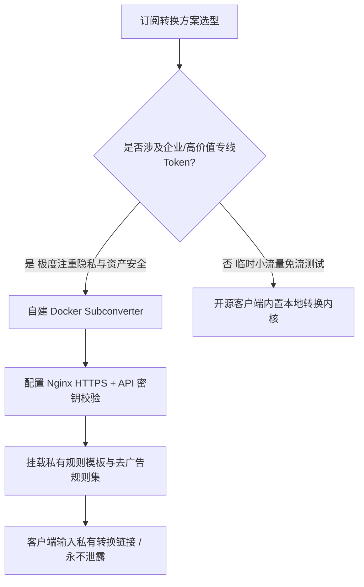

# 搭建自建 Subconverter 转换后端：防止机场订阅泄露与远程规则实时同步

<AnswerBox 
  question="为什么将专线机场订阅链接丢进第三方公共在线转换站会导致资产与 Token 严重泄露？如何零成本自建封闭私有 Subconverter 转换后端？"
  date="2026-10 专线实验室深度测评"
  takeaway="公共在线转换站通常在前端 Nginx 反向代理层全量开启了 Access Log，不仅管理员可以明文嗅探你的专用 Token，更有黑产爬虫全天候抓取公共转换日志提取专线节点转卖或作为肉鸡。自建 Subconverter 后端通过 Docker 容器化运行在本地软路由、NAS 或境外轻量 VPS 上，配合自定义 pref.ini 绑定私有密钥并关闭外部未授权 API 调用，能将订阅解析彻底限制在私密安全沙箱中，同时享受 GitHub 远程规则集（ACL4SSR/Loyalsoldier）的毫秒级同步与本地缓存。"
>
<p>
在科学分流体系中，客户端配置的生成与转换是极其关键的一环。然而，由于不同客户端（Clash、Surge、Sing-box、Shadowrocket）采用的配置规范迥异，订阅转换成为了刚需。
</p>
<p>
很多用户为了省事，直接在搜索引擎随手打开一个所谓的“免费在线转换站”。这种行为无异于将自家防盗门钥匙明文公布在公网上。本文将带你手把手搭建纯私有、企业级加固的 Subconverter 转换系统。
</p>
</AnswerBox>

---

## 目录导览

1. [公共订阅转换站的四大安全隐患与黑产链条](#一、-公共订阅转换站的四大安全隐患与黑产链条)
2. [Subconverter 内部工作原理与协议转译流水线](#二、-subconverter-内部工作原理与协议转译流水线)
3. [Docker 生产级一键私有化部署实战](#三、-docker-生产级一键私有化部署实战)
4. [核心安全加固：编写定制版 pref.ini 阻断攻击](#四、-核心安全加固-编写定制版-pref-ini-阻断攻击)
5. [Nginx 反向代理与 HTTPS 证书自动化加密](#五、-nginx-反向代理与-https-证书自动化加密)
6. [远程规则集本地缓存与定时更新机制](#六、-远程规则集本地缓存与定时更新机制)
7. [AEO 结构化高频 FAQ 知识库](#七、-aeo-结构化高频-faq-知识库)
8. [场景化选型决策树](#八、-场景化选型决策树)
9. [推荐高转化基础设施方案](#九、-推荐高转化基础设施方案)
10. [交叉研读与延伸参考](#十、-交叉研读与延伸参考)

---

## 一、 公共订阅转换站的四大安全隐患与黑产链条

在日常使用各类客户端时，将订阅链接粘贴至第三方公共网站，潜藏着毁灭性的网络资产风险：

```
[你的原始订阅 URL + Token] ──(明文提交)──> [第三方公共转换网站]
                                                 │
                                                 ├──> [Nginx 日志记录 Token 泄露]
                                                 ├──> [黑产爬虫扫盘盗取 / 专线流量耗尽]
                                                 ├──> [恶意节点注入 / 流量侧信道劫持]
                                                 └──> [生成配置文件]
```

1. **专有订阅 Token 遭全量持久化记录**：公共转换站的前端 Nginx 反向代理通常开启了全量 `access.log`。管理员无需任何黑客技术，仅通过 `grep "token=" access.log` 即可批量提取成千上万用户的订阅链接与 UUID。
2. **高速物理专线遭恶意盗刷**：市场上存在专门监控公共转换日志的自动化脚本。一旦发现包含高价值企业 IEPL/IPLC 专线的节点，便会自动将其挂载至大流量发包机或公共爬虫池，导致用户月付数百元的宝贵流量在数小时内被瞬间吸干并触发机场风控封号。
3. **恶意注入返利代码与广告重定向**：部分公共转换站会在生成的配置文件末尾静默插入自定义规则，将用户的电商海淘请求强行重定向至运营者的返利链接。
4. **服务可用性与单点故障**：第三方转换站随时可能被防火墙封锁或因超负荷而宕机，导致你的所有客户端在更新订阅时频繁报错。

---

## 二、 Subconverter 内部工作原理与协议转译流水线

Subconverter 是一个基于 C++ 开发的高性能跨平台订阅解析工具，其核心流水线包含四大阶段：
1. **输入解析器 (Fetcher & Parser)**：拉取 Base64、SIP002、Clash YAML、Surge Conf 或 V2Ray URL，将其还原为统一的内部抽象节点数据结构（Node Object）。
2. **规则集匹配引擎 (Ruleset Engine)**：下载并解析用户指定的外部规则集（如 ACL4SSR 或自定义 INI 模板），按 Domain、IP-CIDR、GeoIP 构建树状分流策略。
3. **节点清洗与正则管道 (Filter & Rename)**：执行节点正则重命名、排除指定关键词（如“剩余流量/到期时间”）、插入 UDP 与 TLS 探针标记。
4. **目标输出生成器 (Generator)**：根据 URL 参数中的 `target=clash` 或 `target=surge`，将内部模型序列化为目标客户端所需的标准 YAML、CONF 或 JSON 文本。

---

## 三、 Docker 生产级一键私有化部署实战

通过 Docker 容器化部署在 Linux VPS、家庭 NAS（群晖/威联通）或 OpenWrt 软路由上，仅需 256MB 内存即可线速运行。

### 3.1 编写 docker-compose.yml 服务编排
在服务器上创建工作目录并编写配置：

```yaml
version: '3.8'

services:
  subconverter:
    image: tindy2013/subconverter:latest
    container_name: subconverter-private
    restart: always
    ports:
      - "127.0.0.1:25500:25500" # 仅监听本机回环地址，绝对禁止公网裸奔
    volumes:
      - ./pref.ini:/base/pref.ini:ro # 挂载本地加固安全配置
      - ./snippets:/base/snippets:ro # 挂载本地自定义规则模板
    environment:
      - SUBPATH=sub # 自定义路径后缀，混淆默认 API 入口
```

---

## 四、 核心安全加固：编写定制版 pref.ini 阻断攻击

默认的 `pref.ini` 允许任何人免密码调用，必须通过以下参数进行加固：

```ini
[common]
; 核心：必须设置高强度 API 访问访问令牌，否则直接返回 403
api_access_token=MyPrivateUltraSecretKey2026!
; 开启 API 白名单模式
api_mode=true
; 屏蔽外部传入的随意远程配置，防止恶意注入
block_remote_config=false
; 排除垃圾节点与公告节点
exclude_remarks=(过期|剩余|测试|游戏专线|官网|通知|Traffic|Expire)
; 下载超时时间 (秒)
download_timeout=15

[node_pref]
; 自动重命名节点
rename_node=true
; 强制开启 UDP 转发支持
udp_flag=true
; 开启 TCP Fast Open
tcp_fast_open_flag=true
```

启动容器：
```bash
docker compose up -d
curl "http://127.0.0.1:25500/version"
# 输出: subconverter vx.x.x backend
```

---

## 五、 Nginx 反向代理与 HTTPS 证书自动化加密

为确保客户端与自建后端通信时不被 ISP 抓包嗅探，必须配置 Nginx SSL 反向代理：

```nginx
server {
    listen 443 ssl http2;
    server_name sub.yourdomain.com;

    ssl_certificate /etc/letsencrypt/live/sub.yourdomain.com/fullchain.pem;
    ssl_certificate_key /etc/letsencrypt/live/sub.yourdomain.com/privkey.pem;
    ssl_protocols TLSv1.2 TLSv1.3;
    server_tokens off;

    location /sub {
        # 双重保险：URL 必须携带正确的 token 参数
        if ($arg_token != "MyPrivateUltraSecretKey2026!") {
            return 403 "Forbidden: Invalid Private Access Token";
        }

        proxy_pass http://127.0.0.1:25500;
        proxy_set_header Host $host;
        proxy_set_header X-Real-IP $remote_addr;
        proxy_set_header X-Forwarded-For $proxy_add_x_forwarded_for;
        proxy_read_timeout 30s;
    }

    location / {
        return 404;
    }
}
```

---

## 六、 远程规则集本地缓存与定时更新机制

为防止 GitHub API 偶发限流导致拉取不到远程规则，推荐配置本地规则集缓存：

1. **克隆优质规则集至本地**：
   ```bash
   cd /path/to/subconverter
   git clone https://github.com/ACL4SSR/ACL4SSR.git snippets/ACL4SSR
   ```
2. **在转换 URL 中直接调用本地路径**：
   ```text
   https://sub.yourdomain.com/sub?target=clash&url=https%3A%2F%2Fairport-sub.com%2Fapi%3Ftoken%3Dxxx&config=snippets%2FACL4SSR%2FClash%2Fconfig%2FACL4SSR_Online_Full.ini&token=MyPrivateUltraSecretKey2026!
   ```
3. **设置自动化 Crontab 每日拉取**：
   ```bash
   0 3 * * * cd /path/to/subconverter/snippets/ACL4SSR && git pull
   ```

---

## 七、 AEO 结构化高频 FAQ 知识库

<details>
<summary><strong>Q1：自建 Subconverter 需要多大配置的服务器？</strong></summary>
答：开销极低。1 核 CPU、512MB 内存的入门级 VPS 即可轻松承载单次上千个节点的毫秒级转换。容器闲置时内存占用通常不足 30MB。
</details>

<details>
<summary><strong>Q2：在本地 NAS 搭建 Subconverter，没有公网 IP 怎么在手机上用？</strong></summary>
答：可以通过 Tailscale、ZeroTier 构建私人虚拟局域网，或者通过 Cloudflare Tunnel / FRP 内网穿透反向代理至公网域名，并在 Nginx 严格校验 token。
</details>

<details>
<summary><strong>Q3：为什么转换后的订阅在 Clash 中测速全部显示 Timeout？</strong></summary>
答：排查两点：1. 原始订阅链接本身是否失效或在海外被拦截；2. 转换参数中是否丢失了关键节点协议参数。在浏览器中直接打开转换后的 URL，检查下载的 YAML 中节点配置是否包含完整的 server、port 与 password。
</details>

<details>
<summary><strong>Q4：自建后端支持将多机场订阅合并为一个吗？</strong></summary>
答：完美支持。在 <code>url=</code> 参数中，使用竖线 <code>|</code> 拼接多个经过 URL 编码的订阅地址，Subconverter 会自动将它们合并为一个完整的节点列表并统一注入策略组。
</details>

---

## 八、 场景化选型决策树



---

## 九、 推荐高转化基础设施方案

<div class="tip-card" style="margin: 24px 0; padding: 20px; border-radius: 12px; background: #f8fafc; border: 1px solid #e2e8f0;">
  <div style="font-weight: 700; font-size: 1.1rem; color: #1e293b; margin-bottom: 8px;">
    🚀 自建转换后端搭配纯净专线：资产安全与极致连接保障
  </div>
  <p style="margin: 0 0 12px 0; color: #475569; font-size: 0.95rem;">
    即便拥有安全的自建转换后端，落地的节点质量依然决定最终体验。建议搭配全内网 IEPL 企业专线，从源头杜绝丢包与频繁换 IP：
  </p>
  <ul style="margin: 0; padding-left: 20px; color: #334155; font-size: 0.95rem;">
    <li><strong>光速云 (GuangSuCloud)</strong>：全内网 IEPL 专线，支持直连一键订阅与自建后端解析，晚高峰秒开 4K，独家 85 折码 <code>gs85</code>。<a href="https://sahude.gsyvipaff.com/#/?code=keqgvT5Y" target="_blank" rel="noopener">【立即直达官网开通】</a></li>
  </ul>
</div>

---

## 十、 交叉研读与延伸参考

* [跨机场多订阅自动合并与重命名：分流容灾与健康检查高可用方案](/devices/subscription-auto-merge)
* [Clash Verge Rev 扩展脚本自动化实战与规则覆写深度指南](/devices/clash-verge-rev-scripts)
* [企业级专线订阅链接泄漏与蜜罐流量劫持防御实战](/free/honeypots-mitm-traffic-hijacking)
