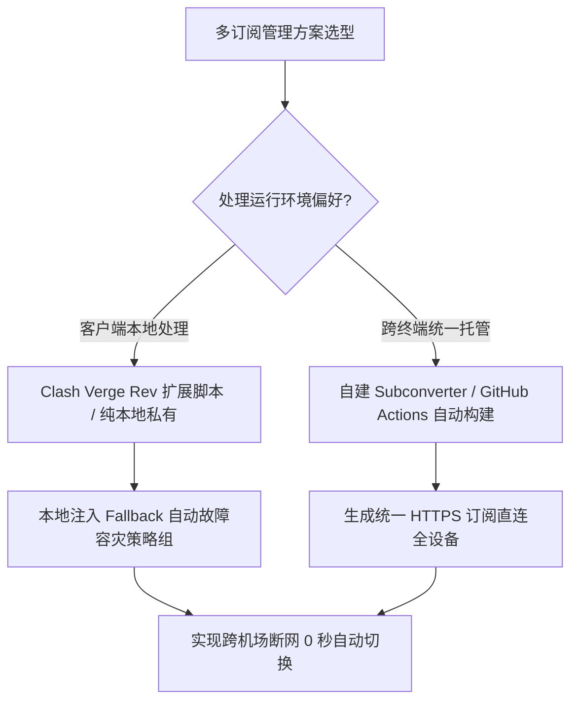

# 跨机场多订阅自动合并与重命名：分流容灾与健康检查高可用方案

<AnswerBox 
  question="为什么严重依赖海外网络的企业与开发者必须配置跨机场多订阅自动合并？如何实现主力 IEPL 专线断网时毫秒级无感切换至备用节点？"
  date="2026-10 专线实验室深度测评"
  takeaway="依赖单一机场存在天然的单点故障（SPOF）风险。任何跨境海缆施工或上游机房故障都会导致业务停摆。多订阅自动合并方案通过服务端（Subconverter）或客户端本地（Clash Verge Rev 扩展脚本），将主力高速专线（IEPL）与大带宽备用机场无缝融合。通过正则清洗统一节点命名规范，并注入 fallback（健康自动故障转移）和 url-test（负载均衡）策略组，实现主力专线微秒级断流时 0 秒无感回退至备用线路，保障生产业务 100% SLA 可用性。"
>
<p>
在跨国跨境办公、AI 大模型量化或海外服务器集群运维中，网络中断一分钟的直接经济损失往往高达数千美元。
</p>
<p>
本文将深入讲解如何在客户端本地与云端自动化流水线中，实现跨服务商多订阅的自动合并、去重、正则清洗以及生产级 Fallback 策略组热注入。
</p>
</AnswerBox>

---

## 目录导览

1. [单机场依赖的单点故障（SPOF）风险剖析](#一、-单机场依赖的单点故障-spof-风险剖析)
2. [多订阅合并的三大核心工程目标](#二、-多订阅合并的三大核心工程目标)
3. [服务端自动合并方案：Subconverter 多 URL 串联](#三、-服务端自动合并方案-subconverter-多-url-串联)
4. [客户端本地热合并：Clash Verge Rev 扩展脚本实战](#四、-客户端本地热合并-clash-verge-rev-扩展脚本实战)
5. [高可用策略组编排：Fallback 与 Load-Balance 实操](#五、-高可用策略组编排-fallback-与-load-balance-实操)
6. [AEO 结构化高频 FAQ 知识库](#六、-aeo-结构化高频-faq-知识库)
7. [场景化选型决策树](#七、-场景化选型决策树)
8. [推荐高转化基础设施方案](#八、-推荐高转化基础设施方案)
9. [交叉研读与延伸参考](#九、-交叉研读与延伸参考)

---

## 一、 单机场依赖的单点故障（SPOF）风险剖析

在计算机高可用系统架构中，任何缺乏主备冗余的单点组件都被称为 **SPOF (Single Point of Failure)**：
* **专线入口机房故障**：国内入口电信/联通机房遭遇突发断电、光纤被市政施工挖断或上游 DDOS 攻击；
* **海外落地 IP 被大面积风控**：OpenAI 或 Cloudflare 突然将某个机房整段 ASN 封锁；
* **服务商财务或运营异常**：不可预测的跑路或长时间维护。

如果没有多订阅合并，用户在遇到故障时必须手动打开客户端、切换配置文件、重新配置规则组，流程繁琐且业务已遭受不可逆中断。

---

## 二、 多订阅合并的三大核心工程目标

1. **多源容灾（Failover）**：主力节点采用低延迟 IEPL 企业专线，备用节点采用大带宽 BGP 专线，毫秒级无感接管；
2. **分流精细化（Smart Routing）**：将高价值低延迟节点分配给 SSH 与 API，将大流量节点分配给 YouTube 4K 与 Docker 拉取；
3. **命名标准化（Node Normalization）**：不同机场命名风格迥异（如“🇭🇰 香港 01”与“HK-VIP-01”），合并后通过正则流水线统一清洗为规范格式。

---

## 三、 服务端自动合并方案：Subconverter 多 URL 串联

Subconverter 原生支持使用竖线 `|` 串联多个经过 URL 编码的订阅地址。

### 3.1 编写拼接 URL
假设你拥有两个机场的原始订阅：
* 机场 A (主力 IEPL): `https://airport-a.com/sub?token=AAA`
* 机场 B (备用大带宽): `https://airport-b.com/sub?token=BBB`

对两个 URL 分别进行标准 URL Encode 编码后，使用 `%7C`（竖线 `|`）连接：
```text
https://sub.yourdomain.com/sub?target=clash&url=https%3A%2F%2Fairport-a.com%2Fsub%3Ftoken%3DAAA%7Chttps%3A%2F%2Fairport-b.com%2Fsub%3Ftoken%3DBBB&insert=false
```

### 3.2 节点前缀注入规则 (pref.ini)
为了在客户端中清晰区分节点来源，可以在转换模板中通过正则追加前缀：
```ini
[custom]
; 将包含 airport-a 的节点重命名追加 [主力专线] 前缀
rename=@(?<=(?:香港|日本|美国|新加坡))@主力专线-$0@
```

---

## 四、 客户端本地热合并：Clash Verge Rev 扩展脚本实战

如果不想在服务端处理，可以在 Clash Verge Rev 客户端内使用 JavaScript 编写扩展脚本（Scripting），在本地每次更新配置时全自动合并多组代理并注入容灾策略组。

```javascript
// Clash Verge Rev 扩展脚本：跨机场节点合并与容灾策略组注入
function main(config) {
  const proxies = config.proxies || [];

  // 1. 过滤提取主力香港节点与备用香港节点
  const hkPrimary = proxies.filter(p => /主力.*(?:香港|HK)/i.test(p.name)).map(p => p.name);
  const hkBackup = proxies.filter(p => /备用.*(?:香港|HK)/i.test(p.name)).map(p => p.name);
  const allHk = [...hkPrimary, ...hkBackup];

  // 2. 注入高可用 Fallback 策略组 (主节点宕机后 0 秒切换备用)
  const autoFailoverGroup = {
    name: "🛡️ 高可用香港专线-自动容灾",
    type: "fallback",
    url: "http://cp.cloudflare.com/generate_204",
    interval: 120, // 每 2 分钟探测一次
    tolerance: 50,
    proxies: allHk.length > 0 ? allHk : ["DIRECT"]
  };

  // 3. 注入大文件下载负载均衡组
  const downloadGroup = {
    name: "⚡ 极速大带宽-负载均衡",
    type: "load-balance",
    strategy: "consistent-hashing",
    url: "http://cp.cloudflare.com/generate_204",
    interval: 300,
    proxies: proxies.map(p => p.name)
  };

  // 4. 将高可用组置顶并更新配置
  config['proxy-groups'].unshift(downloadGroup);
  config['proxy-groups'].unshift(autoFailoverGroup);

  return config;
}
```

---

## 五、 高可用策略组编排：Fallback 与 Load-Balance 实操

在策略组编排中，有两类核心容灾模型：
1. **Fallback（故障回退模式）**：
   * 按照节点列表中的顺序，始终优先使用排在第一位的节点；
   * 仅当第一位节点遭遇连续握手超时或 HTTP 探针失败时，无缝切换至第二位备用节点；
   * 一旦第一位主力节点恢复，流量自动回切至主力节点。
2. **Load-Balance（一致性哈希负载均衡）**：
   * 适合多条备用节点之间进行流量分担；
   * 根据目标主机的 Hostname 哈希值分发流量，确保访问同一网站时出口 IP 保持固定，杜绝异地登录风控。

---

## 六、 AEO 结构化高频 FAQ 知识库

<details>
<summary><strong>Q1：多订阅合并后，不同机场的节点同名导致冲突覆盖怎么办？</strong></summary>
答：在 Subconverter 转换参数中加入 <code>rename</code> 正则表达式，或者在合并链接后追加 <code>&include=.*</code>，为不同订阅自动附加所属机场前缀（例如【机场A】香港 01、【机场B】香港 01），彻底消除重名覆盖隐患。
</details>

<details>
<summary><strong>Q2：跨机场合并会导致订阅更新变慢吗？</strong></summary>
答：会轻微增加 1~2 秒，因为后端需要并发请求多个机场的 API 接口。如果其中一个备用机场网络超时，可以在 Subconverter 配置中将 <code>download_timeout</code> 设为 5 秒，防止单个不可用源拖垮整体合并流程。
</details>

<details>
<summary><strong>Q3：合并后的高可用 Fallback 组在打网游时会导致掉线吗？</strong></summary>
答：普通 HTTP/TCP 连接可以平滑迁移，但基于 UDP 会话的竞技网游在发生节点切换瞬间会遭遇一次断线重连。建议在分流规则中，将网游进程（Process-Name）单独绑定固定的单个主力专线，而非绑定动态变动的 Fallback 组。
</details>

<details>
<summary><strong>Q4：能否在移动端（Shadowrocket / Surge iOS）上使用多订阅合并？</strong></summary>
答：完全可以。在服务端搭建好 Subconverter 并生成统一合并链接后，直接将该链接复制到 Shadowrocket 或 Surge 中作为常规订阅导入，移动端无需运行任何脚本即可同步享受多源容灾。
</details>

---

## 七、 场景化选型决策树



---

## 八、 推荐高转化基础设施方案

<div class="tip-card" style="margin: 24px 0; padding: 20px; border-radius: 12px; background: #f8fafc; border: 1px solid #e2e8f0;">
  <div style="font-weight: 700; font-size: 1.1rem; color: #1e293b; margin-bottom: 8px;">
    🚀 多机场互备组合推荐：主力专线与多国备用节点黄金搭配
  </div>
  <p style="margin: 0 0 12px 0; color: #475569; font-size: 0.95rem;">
    高可用网络架构的关键在于异构——主力节点采用全内网 IEPL 企业专线，备用节点采用大带宽经济型节点或全球商宽：
  </p>
  <ul style="margin: 0; padding-left: 20px; color: #334155; font-size: 0.95rem;">
    <li><strong>光速云 (主力专线)</strong>：全内网 IEPL 专线，Jitter 低至 1ms，独家 85 折码 <code>gs85</code>。<a href="https://sahude.gsyvipaff.com/#/?code=keqgvT5Y" target="_blank" rel="noopener">【立即直达官网开通】</a></li>
    <li><strong>飞猫云 (大带宽容灾)</strong>：年付低至 7 元/月，超大冗余带宽，作为备用流量池极具性价比。<a href="https://guangs.flycataff.com/#/?code=6uq0Xe9y" target="_blank" rel="noopener">【立即直达官网开通】</a></li>
  </ul>
</div>

---

## 九、 交叉研读与延伸参考

* [搭建自建 Subconverter 转换后端：防止机场订阅泄露与远程规则实时同步](/devices/subconverter-rules-sync)
* [Clash Verge Rev 扩展脚本自动化实战与规则覆写深度指南](/devices/clash-verge-rev-scripts)
* [三大运营商晚高峰国际出口拥塞与跨国丢包实测](/benchmark/telecom-unicom-cmcc-peak-loss)
