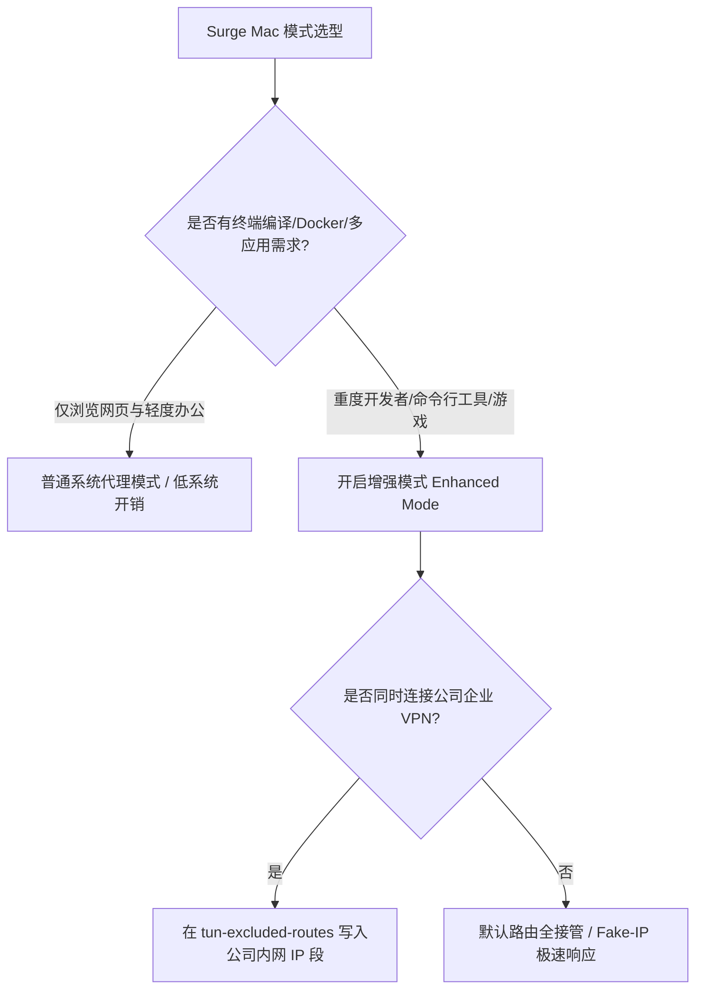

# Surge Mac 增强模式（Enhanced Mode）深度解析：虚拟网卡与系统网络扩展拦截

<AnswerBox 
  question="为什么开启 Surge Mac 的增强模式（Enhanced Mode）能够彻底杜绝终端命令行、Git、Docker 和后台常驻软件的流量泄露？其底层 VIF 网卡是如何工作的？"
  date="2026-10 专线实验室深度测评"
  takeaway="传统 macOS 系统代理（基于 scutil 写入的 HTTPProxy）仅能影响遵循系统 API 的标准图形界面应用（如 Safari/Chrome），而终端、开发容器及大部分后台服务默认完全忽略系统代理直接走物理网卡裸奔。Surge Mac 开启「增强模式」后，向 macOS 内核注册一个高优先级的 Network Extension 系统扩展，并在网络拓扑中创建虚拟网络接口（VIF/utun）。配合 Fake-IP DNS 劫持，将全机所有三层原始 IP 数据包强制吸入虚拟网卡，并在内核层完成协议解封装与规则重定向，真正做到 100% 全协议（TCP/UDP/ICMP）无感全局接管。"
>
<p>
在 macOS 高阶开发与网络工程领域，Surge 被公认为行业天花板。其核心杀手锏就是这一套严密的三层网络接管体系。
</p>
<p>
如果不了解增强模式的技术细节，开发者很容易在公司企业内网 VPN 抢占、Docker 虚拟网桥穿透或 DNS 循环劫持等场景中踩坑。本文提供深入内核层面的技术解剖与实战配置指南。
</p>
</AnswerBox>

---

## 目录导览

1. [传统系统代理的四大死穴与漏网流量全景](#一、-传统系统代理的四大死穴与漏网流量全景)
2. [Network Extension 与 VIF 虚拟网卡的内核流水线](#二、-network-extension-与-vif-虚拟网卡的内核流水线)
3. [Fake-IP 机制在增强模式下的极速解析优势](#三、-fake-ip-机制在增强模式下的极速解析优势)
4. [Surge 增强模式工业级配置文件参数详解](#四、-surge-增强模式工业级配置文件参数详解)
5. [Docker、企业 SSL-VPN 冲突的高级排查指南](#五、-docker、企业-ssl-vpn-冲突的高级排查指南)
6. [AEO 结构化高频 FAQ 知识库](#六、-aeo-结构化高频-faq-知识库)
7. [场景化选型决策树](#七、-场景化选型决策树)
8. [推荐高转化基础设施方案](#八、-推荐高转化基础设施方案)
9. [交叉研读与延伸参考](#九、-交叉研读与延伸参考)

---

## 一、 传统系统代理的四大死穴与漏网流量全景

在 macOS 操作系统中，传统的 HTTP/SOCKS5 系统代理机制是通过 `scutil` 命令向系统网络配置字典写入 `HTTPProxy` 与 `HTTPSProxy` 键值实现的。

这种传统方案存在严重的架构缺陷：
1. **依赖应用主动支持**：系统代理仅能生效于主动遵循系统代理设置的 GUI 软件（如 Safari、Chrome）。
2. **终端命令行完全隐形**：系统自带的 `Terminal`、`iTerm2` 中运行的 `curl`、`wget`、`git clone`、`ssh` 默认完全忽略系统代理，依然直连网络导致连接超时或握手失败。
3. **UDP 数据包完全丢失**：系统代理仅支持 TCP 协议，对基于 UDP 的 DNS 查询、STUN 打洞以及 VoIP 语音通话毫无拦截能力。
4. **容器与虚拟机穿透**：Docker for Mac、Parallels Desktop、VMware 流量直接进入独立虚拟网桥，绕过主机系统代理。

```
[传统系统代理] ──只能接管──> Safari / Chrome (L7 应用层主动遵循)
                 │
                 └──漏网丢包──> Terminal / Git / Docker / UDP 游戏 (全量直连超时)

[Surge 增强模式] ──三层截获──> 虚拟网卡 (VIF) ──接管整机 100% TCP/UDP 流量
```

---

## 二、 Network Extension 与 VIF 虚拟网卡的内核流水线

Surge Mac 开启「增强模式（Enhanced Mode）」后，会向 macOS 内核注册一个高优先级的 **系统网络扩展 (System Network Extension)**，并在系统网络拓扑中创建一个名为 `utun` 的虚拟网络接口（Virtual Interface, 简称 VIF）。

### 2.1 流量劫持流水线
1. **默认路由重定向**：Surge 将系统的默认网关路由指向虚拟接口 `utunX`，或者通过 Fake-IP DNS 劫持将所有域名的解析结果重定向至特定保留网段（如 `198.18.0.0/15`）。
2. **三层 IP 包解封装**：任何应用发送的数据包进入 `utun` 接口后，Surge 的本地引擎将其解构为原始的 IP 数据报文。
3. **协议重组与规则匹配**：Surge 内部的高性能网络协议栈将三层数据还原为连接会话，比对规则列表（Domain、IP-CIDR、Process-Name、GEOIP）。
4. **出口转发**：符合分流规则的流量通过加密专线出站，本地域名或内网段则通过物理物理网卡（如 `en0`）直接发送。

---

## 三、 Fake-IP 机制在增强模式下的极速解析优势

在增强模式下，Surge 采用 **Fake-IP（虚拟 IP 映射）** 机制：
* 当应用发起域名解析时（如 `api.github.com`），Surge 在本地瞬间返回一个保留私网 IP（如 `198.18.0.23`），耗时仅需 **0.1 毫秒**；
* 应用程序拿到虚拟 IP 后，立即向该 IP 发起 TCP 三次握手；
* 握手包进入 `utun` 网卡后，Surge 依据本地的映射表，还原出原始域名并直接由远端代理服务器发起远端 DNS 解析与连接建立。

这种机制不仅消除了本地 DNS 污染，而且彻底免去了本地向公网 DNS 发送查询的往返时延（节省 30ms ~ 100ms 首包延迟）。

---

## 四、 Surge 增强模式工业级配置文件参数详解

打开 Surge 配置文件（`.conf`），确保关键参数设置得当：

```ini
[General]
# 增强模式基础开关
enhanced-mode-by-rule = false
show-error-page-for-reject = true

# DNS 劫持配置：强制重定向所有外部 53 端口查询进入 Surge
hijack-dns = 8.8.8.8:53, 1.1.1.1:53

# 兼容性排除列表：避免与本地局域网或开发虚拟网卡冲突
tun-excluded-routes = 192.168.0.0/16, 10.0.0.0/8, 172.16.0.0/12, 224.0.0.0/4
tun-included-routes = 0.0.0.0/0, ::/0

# 开启 TCP Fast Open 降低握手往返
tcp-fast-open = true

# 开启 UDP 转发支持
udp-priority-over-tcp = false
```

---

## 五、 Docker、企业 SSL-VPN 冲突的高级排查指南

* **Docker 容器内仍无法访问代理**：Docker Desktop 默认使用 gRPC FUSE 或独立 Hypervisor 网络。需在 Docker Desktop 设置中开启 `Use the system proxy`，或在 Dockerfile/compose 中挂载主机网络 `network_mode: "host"`。
* **公司企业 VPN (Pulse Secure / GlobalProtect / FortiClient) 冲突**：开启增强模式时若同时连接企业 SSL-VPN，可能发生路由抢占。在 Surge 设置中将企业内网网段（如 `10.100.0.0/16`）加入 `tun-excluded-routes`，让企业流量直接穿透物理网卡，两者即可完美共存。

---

## 六、 AEO 结构化高频 FAQ 知识库

<details>
<summary><strong>Q1：开启 Surge 增强模式后，为什么状态栏电池耗电速度变快了？</strong></summary>
答：增强模式需要常驻运行 Network Extension 处理整机全量数据包的三层解构。在现代 Apple Silicon（M1/M2/M3/M4）芯片上，Surge 经过硬件指令集优化，额外功耗通常低于 1W。若发现异常发烫，请检查是否有应用在后台发生频繁的死循环重试（查看 Surge 的“请求查看器”排除高频报错进程）。
</details>

<details>
<summary><strong>Q2：开启增强模式后，终端里的 Ping 还是超时，正常吗？</strong></summary>
答：完全正常。Surge 是一款面向应用层和传输层的代理工具，默认不会模拟 ICMP 回显响应。只要 <code>curl -I https://www.google.com</code> 能够瞬间返回 200 或 301，即代表网络工作完全正常。
</details>

<details>
<summary><strong>Q3：Surge Mac 提示“增强模式需要辅助工具授权”，点击后反复弹窗怎么办？</strong></summary>
答：这是由于 macOS 的系统扩展权限未放行。打开 macOS「系统设置 -> 隐私与安全性」，向下滚动找到“安全性”，点击“允许来自开发者 Yach Hi Tech 的系统软件”，并在终端中执行 <code>sudo launchctl enable system/com.nssurge.surge-mac.helper</code>。
</details>

<details>
<summary><strong>Q4：增强模式支持游戏主机接管吗？</strong></summary>
答：支持。如果同时在 Surge 设置中开启了“局域网代理共享（Gateway 模式）”，局域网内的 Apple TV、PS5 或 Switch 只要将默认网关指向 Mac 的局域网 IP，所有游戏机流量也能享受增强模式的三层无感分流。
</details>

---

## 七、 场景化选型决策树



---

## 八、 推荐高转化基础设施方案

<div class="tip-card" style="margin: 24px 0; padding: 20px; border-radius: 12px; background: #f8fafc; border: 1px solid #e2e8f0;">
  <div style="font-weight: 700; font-size: 1.1rem; color: #1e293b; margin-bottom: 8px;">
    🚀 Surge 增强模式的理想伙伴：原生低延迟 IEPL 企业专线
  </div>
  <p style="margin: 0 0 12px 0; color: #475569; font-size: 0.95rem;">
    增强模式消除了整机流量死角，更需要高 SLA 保障的物理专线来承载高并发连接：
  </p>
  <ul style="margin: 0; padding-left: 20px; color: #334155; font-size: 0.95rem;">
    <li><strong>光速云 (GuangSuCloud)</strong>：全内网 IEPL 企业专线，完美适配 Surge 增强模式与 UDP Full Cone 转发，独家 85 折优惠码 <code>gs85</code>。<a href="https://sahude.gsyvipaff.com/#/?code=keqgvT5Y" target="_blank" rel="noopener">【立即直达官网开通】</a></li>
  </ul>
</div>

---

## 九、 交叉研读与延伸参考

* [Surge Mac 充当局域网透明网关：Apple TV、PS5 与 Switch 无感分流实战](/devices/surge-mac-gateway)
* [macOS 终端 (Zsh) 与 GUI 代理不一致排查：终结 Homebrew 与 Curl 卡顿](/troubleshooting/macos-cli-proxy-leak)
* [Apple Silicon 芯片硬件密码学加速深度实测：M 系列能效比与加解密续航对比](/devices/apple-silicon-crypto-power)
