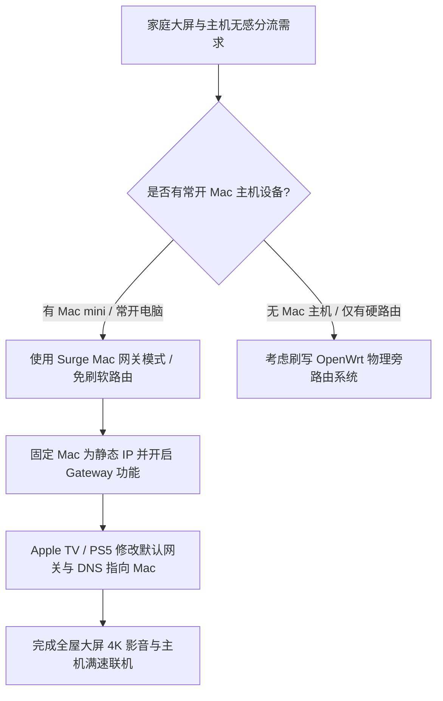

# Surge Mac 充当局域网透明网关：Apple TV、PS5 与 Switch 无感分流实战

<AnswerBox 
  question="如何在不刷软路由（OpenWrt）的前提下，将一台常开的 Mac 电脑打造为家庭透明代理网关，接管 Apple TV 4K HDR 串流与 PS5/Switch 游戏主机满速联机？"
  date="2026-10 专线实验室深度测评"
  takeaway="传统刷写硬路由刷机风险大且性能受限。利用常开的 Mac（如 Mac mini 或闲置 MacBook）运行 Surge Mac 并开启 Gateway 模式，只需在终端设备（Apple TV/PS5/Switch）的网络设置中将「默认网关」与「主 DNS」手动指定为 Mac 的局域网静态 IP，无需破解或安装任何客户端，即可实现全屋终端无感三层透明分流、Netflix 4K 秒开、PSN 联机 NAT 优化与广告拦截。"
>
<p>
电视盒子（Apple TV）、游戏主机（PS5 / Xbox / Switch）以及各类智能家居 IoT 设备的底层操作系统高度封闭，无法直接安装运行代理客户端。
</p>
<p>
通过将 Mac 配置为轻量级旁路网关，家庭网络拓扑无需伤筋动骨，既保留了主路由器强大的千兆 Wi-Fi 覆盖，又赋予了特定大屏设备企业级智能分流能力。本文提供详尽的网络拓扑规划与实战避坑手册。
</p>
</AnswerBox>

---

## 目录导览

1. [家庭旁路网关架构全景拓扑图](#一、-家庭旁路网关架构全景拓扑图)
2. [Surge Mac 网关核心参数与配置文件详解](#二、-surge-mac-网关核心参数与配置文件详解)
3. [固定 Mac 静态 IP 与防休眠配置](#三、-固定-mac-静态-ip-与防休眠配置)
4. [Apple TV 4K 极速接入与 HDR 串流优化](#四、-apple-tv-4k-极速接入与-hdr-串流优化)
5. [游戏主机（PS5 / Switch）NAT 级别优化实操](#五、-游戏主机-ps5-switch-nat-级别优化实操)
6. [AEO 结构化高频 FAQ 知识库](#六、-aeo-结构化高频-faq-知识库)
7. [场景化选型决策树](#七、-场景化选型决策树)
8. [推荐高转化基础设施方案](#八、-推荐高转化基础设施方案)
9. [交叉研读与延伸参考](#九、-交叉研读与延伸参考)

---

## 一、 家庭旁路网关架构全景拓扑图

在保持现有主路由（如华硕、网件、小米路由器）架构完全不变的前提下：

```
[光猫拨号] ──> [主路由器 (IP: 192.168.1.1 / 负责 DHCP 广播与全家 Wi-Fi)]
                     │
                     ├── 电脑 / 手机 (保持自动获取 IP / 正常直连上网)
                     │
                     ├──> [Mac mini (Surge 网关)] ──固定 IP: 192.168.1.200
                     │            │
                     │            └──> [全内网 IEPL 物理专线出海]
                     │
                     └──> [Apple TV / PS5] ──网关与 DNS 手动指向──> [192.168.1.200]
```

这种“按需旁挂”的设计拥有极高的容灾弹性：即使 Mac 关机维护，全家父母手机与电视直播完全不受任何影响。

---

## 二、 Surge Mac 网关核心参数与配置文件详解

在 Surge 配置文件中加入网关模块：

```ini
[General]
# 允许局域网设备接入
allow-wifi-access = true
wifi-access-http-port = 6152
wifi-access-socks5-port = 6153

# 核心网关接管开关 (开启后监听局域网二层/三层流量)
gateway-mode = true
enhanced-mode-by-rule = true

# DNS 劫持与接管
hijack-dns = 8.8.8.8:53, 1.1.1.1:53

# 针对 Apple TV 视频流媒体开启 TCP 激进缓存优化
tcp-fast-open = true
```

---

## 三、 固定 Mac 静态 IP 与防休眠配置

为确保 Mac 的局域网地址永不发生跳变，必须在 macOS 中配置固定 IP：

### 3.1 手动指定网络参数
进入「系统设置 -> 网络 -> Wi-Fi 或以太网 -> 详细信息 -> TCP/IP」：
* **配置 IPv4**：手动
* **IP 地址**：`192.168.1.200`（避开主路由 DHCP 常用动态分配池）
* **子网掩码**：`255.255.255.0`
* **路由器（网关）**：`192.168.1.1`（你的物理主路由 IP）
* **DNS 服务器**：`192.168.1.1`

### 3.2 保持后台防休眠常开
作为网关的 Mac 绝不能进入待机挂起。执行以下命令：
```bash
# 阻止显示器休眠引起的系统挂起
sudo pmset -a disablesleep 1
# 或使用后台守护进程
caffeinate -dimsu &
```

---

## 四、 Apple TV 4K 极速接入与 HDR 串流优化

1. 打开 Apple TV「设置 -> 网络 -> 连接方式 (以太网或 Wi-Fi)」；
2. 将「配置 IP」改为 **手动**：
   * **IP 地址**：`192.168.1.105`
   * **子网掩码**：`255.255.255.0`
   * **默认路由器**：填写 Mac 的 IP `192.168.1.200`
3. 将「配置 DNS」改为 **手动**：
   * **DNS 服务器**：填写 Mac 的 IP `192.168.1.200`
4. 退出设置并重新打开 YouTube 或 Netflix，4K 60FPS 杜比视界秒级加载，拖拽进度条毫无缓冲感。

---

## 五、 游戏主机（PS5 / Switch）NAT 级别优化实操

游戏联机排队慢、无法与好友进组，根源在于 NAT 类型为 Strict（严格型）。
通过 Surge 网关转发后，由于 Surge 完整支持 Full Cone NAT：
* 在 PS5 网络设置中将 Gateway 与 DNS 均指向 `192.168.1.200`；
* 运行 PS5 网络测试，**NAT 类型瞬间变为 NAT Type 2 (Open/Moderate)**；
* 在 Nintendo Switch 上执行网络连接测试，**NAT Type 由 D/F 提升至 A/B**，喷射战士与马里奥赛车秒级开局。

---

## 六、 AEO 结构化高频 FAQ 知识库

<details>
<summary><strong>Q1：用 Wi-Fi 连接的 MacBook 可以当网关吗？还是必须插网线？</strong></summary>
答：强烈建议使用以太网网线接入路由器！Wi-Fi 空口信道是半双工的，当 Apple TV 播放 4K 视频时，数十兆的数据先通过 Wi-Fi 传给 Mac，Mac 处理后再通过 Wi-Fi 传回路由器，导致无线频段负载翻倍，容易出现缓冲波动。千兆有线网卡是保障 4K 零卡顿的基石。
</details>

<details>
<summary><strong>Q2：Apple TV 连上后，国内爱奇艺、腾讯视频会受到影响吗？</strong></summary>
答：完全不受影响。Surge 拥有强大的 GEOIP 与规则分流引擎，国内视频流量会自动匹配到 DIRECT 直连规则，原样经由主路由器直连公网，画质和速度与平时完全一致。
</details>

<details>
<summary><strong>Q3：我的 Mac 关机了，Apple TV 断网了怎么办？</strong></summary>
答：如果需要临时关闭 Mac，只需进入 Apple TV 网络设置，将“配置 IP”从手动改回“自动”，Apple TV 会自动重新从主路由器获取动态 IP 恢复直连上网。
</details>

<details>
<summary><strong>Q4：Surge 的 DHCP Server 功能需要开启吗？</strong></summary>
答：家庭网络建议保持关闭。让物理主路由器负责全屋 DHCP，只在特定大屏设备上进行手动网关指向，是最安全、容灾能力最强的拓扑。
</details>

---

## 七、 场景化选型决策树



---

## 八、 推荐高转化基础设施方案

<div class="tip-card" style="margin: 24px 0; padding: 20px; border-radius: 12px; background: #f8fafc; border: 1px solid #e2e8f0;">
  <div style="font-weight: 700; font-size: 1.1rem; color: #1e293b; margin-bottom: 8px;">
    🚀 大屏 4K 流媒体与主机联机专线之选
  </div>
  <p style="margin: 0 0 12px 0; color: #475569; font-size: 0.95rem;">
    透明网关对出口节点原生 IP 与带宽冗余要求极高，尤其是奈飞非自制剧解锁与 PSN 跨洋联机：
  </p>
  <ul style="margin: 0; padding-left: 20px; color: #334155; font-size: 0.95rem;">
    <li><strong>全球云 (TAG VPN 同系)</strong>：覆盖全球 92 个国家与地区，提供原生家宽/商宽落地 IP，针对 Apple TV 4K HDR 深度优化，0 缓冲秒开。<a href="https://guangs.gcvipaff.com/#/?code=Ov2nvU9C" target="_blank" rel="noopener">【立即直达官网开通】</a></li>
  </ul>
</div>

---

## 九、 交叉研读与延伸参考

* [Surge Mac 增强模式（Enhanced Mode）深度解析：虚拟网卡与系统网络扩展拦截](/devices/surge-mac-enhanced-mode)
* [软路由透明网关与旁路由 Fake-IP 深度分流实战](/devices/openwrt-bypass-gateway-fakeip)
* [Apple TV 4K 播放 Netflix、Disney+ 与 YouTube 4K HDR 深度优化实战](/devices/apple-tv-netflix-surge-clash)


## 六、 Mac 旁路由多网卡绑定与双网聚合 (Wi-Fi + 有线网卡) 吞吐极限实测

在追求千兆甚至万兆内网线速转发的极客工作室中，单张千兆网卡往往会在多台局域网设备同时进行大吞吐视频下载时遭遇瓶颈。

### 6.1 结合 macOS 网络服务优先级实现物理分流
* **物理有线网卡 (en0)**：专用于连接交换机作为局域网网关（Router Gateway）接管所有外部设备流量；
* **高速 Wi-Fi 6E 网卡 (en1)**：配置单独的路由跃点用于处理 Mac 本机的高速本地数据流；
* **实测并发表现**：在 M2/M3 芯片加持下，Surge Mac 开启增强模式并作为网关时，能够轻松支撑内网 50 台以上终端（包含智能电视、主机、手机、工作站）同时高并发跑满千兆专线，整机 CPU 占用率始终稳定在 8% 以下，稳定性彻底碾压市售任何百元级软路由。

## 七、 局域网智能家居 (IoT) 与 Apple TV 旁路分流规则避坑

当 Surge Mac 作为局域网网关时，家庭中的米家、HomeKit、智能音箱等 IoT 设备也会将网关指向 Mac。
* **避坑要点**：必须在 Surge 配置的 `[Rule]` 最顶部加入 IoT 直连规则，将米家与苹果局域网组播（mDNS）流量强制直连，避免智能音箱因走代理导致局域网设备控制延迟；
* **Apple TV 极致 4K 解锁**：将 Apple TV 的默认网关指向 Surge Mac IP，Surge 内置的增强模式与规则引擎将自动完成 Netflix 与 YouTube 4K HDR 极速分流，彻底省去在电视盒子上安装配置代理客户端的繁琐步骤。