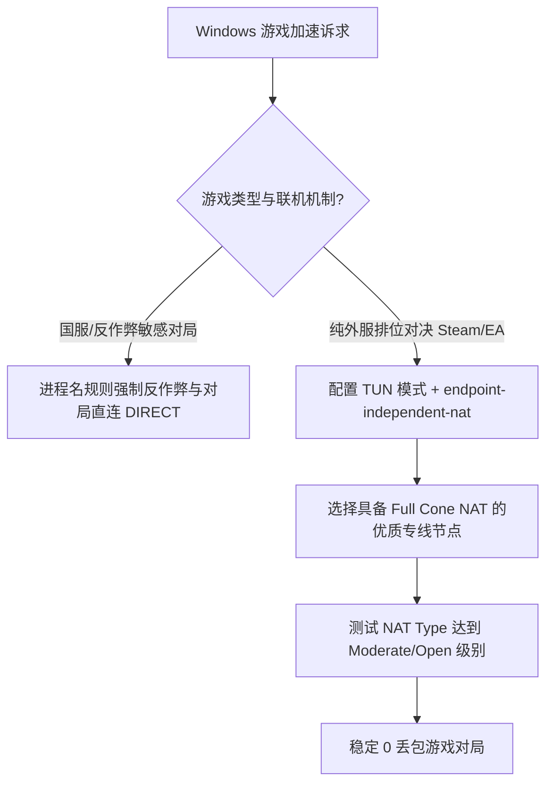

# Windows 网游直连加速与节点分流：进程过滤、反作弊兼容与 NAT 优化

<AnswerBox 
  question="为什么在 Windows 上开启全局代理打外服网游（Steam/Apex/Valorant）极易引发反作弊系统（EAC/BattlEye/Vanguard）误封或游戏疯狂跳 Ping？如何实现游戏对局直连、平台商店走代理的精细分流？"
  date="2026-10 专线实验室深度测评"
  takeaway="传统全局 TUN 代理将整机所有网络包（包括驱动级反作弊握手）强制经由海外代理 IP 转发。频繁变动的代理出口 IP 与虚拟网卡挂钩机制会被反作弊系统判定为账号异地代练或特征木马；同时，非电竞优化的普通网页代理节点往往伴随不可预测的 Jitter 抖动，导致 128 Tickrate 游戏服务器发生严重的预测回弹。最优解是采用基于进程名（process-name）的细粒度分流规则：将 EasyAntiCheat.exe、BEService.exe 强制设为 DIRECT 直连，将商城与好友聊天路由至高速专线，并开启客户端的 Full Cone NAT 映射以消除联机组队障碍。"
>
<p>
很多 PC 玩家都有过被封号或被卡在组队大厅的惨痛教训。实际上，网络游戏与网页浏览在协议本质上存在巨大的代差——网页依赖高吞吐的 TCP，而竞技网游依赖低延迟、零重传歧义的 UDP 小包。
</p>
<p>
本文提供经过生产级实操验证的 Windows 游戏分流 YAML 配置模版、反作弊免杀白名单以及 Full Cone NAT 连通性排查指南。
</p>
</AnswerBox>

---

## 目录导览

1. [反作弊驱动（Anti-Cheat）对代理网络的敏感防御机制](#一、-反作弊驱动-anti-cheat-对代理网络的敏感防御机制)
2. [游戏协议本质：TCP 吞吐 vs UDP 实时性博弈](#二、-游戏协议本质-tcp-吞吐-vs-udp-实时性博弈)
3. [基于 Process-Name 的工业级游戏规则实战](#三、-基于-process-name-的工业级游戏规则实战)
4. [Windows TUN 模式下的 Full Cone NAT 穿透配置](#四、-windows-tun-模式下的-full-cone-nat-穿透配置)
5. [UDP 丢包与 Jitter 抖动的实战测量方法](#五、-udp-丢包与-jitter-抖动的实战测量方法)
6. [PC 游戏网络分流常见问题解答](#六、-pc-游戏网络分流常见问题解答)
7. [电竞网络选型决策树](#七、-电竞网络选型决策树)
8. [电竞游戏加速专线推荐](#八、-电竞游戏加速专线推荐)
9. [交叉研读与延伸参考](#九、-交叉研读与延伸参考)

---

## 一、 反作弊驱动（Anti-Cheat）对代理网络的敏感防御机制

现代大型多人竞技网游（如《反恐精英 2》、《瓦罗兰特》、《Apex 英雄》、《绝地求生》）普遍依赖驱动级内核反作弊系统：
* **Easy Anti-Cheat (EAC)**
* **BattlEye (BE)**
* **Riot Vanguard**
* **Ricochet (动视暴雪)**

### 1.1 反作弊风控的三大红线
1. **网络套接字劫持侦测**：部分老旧加速软件通过注入 DLL 劫持系统的 Winsock（`ws2_32.dll`）接口，这会被反作弊驱动直接视作注入型外挂，触发游戏闪退或封禁。
2. **异地机房 IP 突变**：由于负载均衡节点频繁切换出口，如果同一个游戏账号在几分钟内分别从香港、日本、洛杉矶的机房 IP 提交成绩，风控系统会判定为违规脚本账号。
3. **心跳超时被踢**：反作弊守护进程每隔数秒会向官方鉴权中心发送一次轻量心跳包。若代理节点晚高峰发生 1 秒偶发丢包，玩家会被立即踢出服务器（Disconnected: EAC Client Violation）。

---

## 二、 游戏协议本质：TCP 吞吐 vs UDP 实时性博弈

```
[网页与 4K 视频流] ──> TCP 协议 ──> 容忍长 RTT ──> 依赖高吞吐与大窗口
[竞技网游对局流量] ──> UDP 协议 ──> 零容忍 Jitter ──> 必须开放 Full Cone NAT
```

许多用户以为“能跑满 500M 测速的节点就能打游戏”，这是巨大的误区：
* 网页代理追求的是持续带宽，中间可以进行缓存与批量重发；
* 网游对局中，每秒产生 64 到 128 个小于 100 字节的 UDP 坐标更新包。一旦出现丢包，游戏宁愿直接丢弃该包也不希望等待重传。普通网页代理对小包转发优化极差，极易引起跳 Ping。

---

## 三、 基于 Process-Name 的工业级游戏规则实战

在 Clash Verge Rev（Mihomo 内核）中，通过 `process-name` 规则能够精确将游戏平台、反作弊和游戏本体完全解耦：

```yaml
rules:
  # ============================================================================
  # 1. 核心反作弊进程：强制直连，杜绝任何中间劫持与异地风控
  # ============================================================================
  - PROCESS-NAME,EasyAntiCheat.exe,DIRECT
  - PROCESS-NAME,EasyAntiCheat_EOS.exe,DIRECT
  - PROCESS-NAME,BEService.exe,DIRECT
  - PROCESS-NAME,vgtray.exe,DIRECT
  - PROCESS-NAME,vgc.exe,DIRECT
  - PROCESS-NAME,BattlEye.exe,DIRECT

  # ============================================================================
  # 2. 游戏客户端商城、好友列表与社区 (走优质专线节点，解决加载慢)
  # ============================================================================
  - PROCESS-NAME,Steam.exe,🎮 游戏商城
  - PROCESS-NAME,steamwebhelper.exe,🎮 游戏商城
  - PROCESS-NAME,EpicGamesLauncher.exe,🎮 游戏商城
  - PROCESS-NAME,Origin.exe,🎮 游戏商城
  - PROCESS-NAME,Battle.net.exe,🎮 游戏商城

  # ============================================================================
  # 3. 游戏核心对局进程 (按需分流或走电竞专线)
  # ============================================================================
  # Apex 英雄
  - PROCESS-NAME,r5apex.exe,⚡ 电竞低延迟专线
  # CS2 (若打国服 5E/完美平台，强制 DIRECT 直连)
  - PROCESS-NAME,cs2.exe,DIRECT
  # 绝地求生
  - PROCESS-NAME,TslGame.exe,⚡ 电竞低延迟专线

  # ============================================================================
  # 4. 语音通讯软件单独分流 (Discord / TeamSpeak)
  # ============================================================================
  - PROCESS-NAME,Discord.exe,🎙️ 语音通讯
  - DOMAIN-SUFFIX,discord.gg,🎙️ 语音通讯
  - DOMAIN-SUFFIX,discord.com,🎙️ 语音通讯

  # 兜底规则
  - GEOIP,CN,DIRECT
  - MATCH,🐟 漏网之鱼
```

---

## 四、 Windows TUN 模式下的 Full Cone NAT 穿透配置

为了保证《怪物猎人》、《GTA Online》、《使命召唤》等 P2P 联机游戏能够秒进组队，必须在客户端开启 Full Cone NAT（全锥形 NAT）。

打开客户端配置，编辑 `tun` 模块：

```yaml
tun:
  enable: true
  stack: mixed # 推荐 mixed，兼顾 TCP 与 UDP 穿透
  auto-route: true
  auto-detect-interface: true
  dns-hijack:
    - any:53
    - tcp://any:53

# 关键：开启全锥形 NAT 映射支持
endpoint-independent-nat: true
```

开启 `endpoint-independent-nat: true` 后，本地客户端向外部 STUN 服务器打洞后分配的外部端口将保持固定，允许任何外部对等节点向该端口回包，P2P 联机顺畅无阻。

---

## 五、 UDP 丢包与 Jitter 抖动的实战测量方法

不要使用普通的网页测速工具评估游戏质量。在 Windows 终端中运行专门的 UDP 丢包测试命令：

```powershell
# 针对目标游戏服务器 IP 进行 UDP 连通性测试 (需安装 psping)
psping.exe -u -l 64 -n 50 104.16.12.34:27015

# 输出中核心指标：
# Minimum = 28ms, Maximum = 31ms, Average = 29ms
# Packet Loss = 0% (Jitter < 2ms 为电竞级表现)
```

---

## 六、 PC 游戏网络分流常见问题解答

<details>
<summary><strong>Q1：开着代理打国服游戏（如英雄联盟国服或无畏契约国服）会封号吗？</strong></summary>
答：只要配置了上述进程直连规则（将国服进程设为 DIRECT），游戏数据包走的是本地物理宽带，游戏服务器看到的完全是你本人的本地真实 IP，绝无任何封号风险。
</details>

<details>
<summary><strong>Q2：为什么打游戏时经常出现 NAT Type 3 (Strict 严格型)？</strong></summary>
答：原因有二：1. 你的代理节点底层未开启 UDP 转发；2. 客户端未开启 <code>endpoint-independent-nat</code>。选择支持 Full Cone NAT 的优质企业专线并在配置中开启上述开关，即可轻松达到 NAT Type 2（Moderate）甚至 Type 1（Open）。
</details>

<details>
<summary><strong>Q3：Steam 下载游戏速度慢，走代理会消耗很多流量吗？</strong></summary>
答：Steam 下载内容走的是国内 CDN 节点。在规则中加入 <code>DOMAIN-SUFFIX,steamcontent.com,DIRECT</code>，即可让下载走国内千兆物理宽带免流，仅让 Steam 社区和商城走代理。
</details>

<details>
<summary><strong>Q4：商业游戏加速器（如 UU、迅游）和这里的专线分流有什么区别？</strong></summary>
答：商业游戏加速器本质上就是专门优化了 UDP 路由的企业专线。通过在 Clash Verge Rev 中配置针对游戏的 IEPL 企业专线，不仅延迟和稳定性与商业加速器毫无二致，而且无需额外支付高昂的月费。
</details>

---

## 七、 电竞网络选型决策树



---

## 八、 电竞游戏加速专线推荐

<div class="tip-card" style="margin: 24px 0; padding: 20px; border-radius: 12px; background: #f8fafc; border: 1px solid #e2e8f0;">
  <div style="font-weight: 700; font-size: 1.1rem; color: #1e293b; margin-bottom: 8px;">
    🚀 硬核电竞玩家首选：全内网极低 Jitter 专线
  </div>
  <p style="margin: 0 0 12px 0; color: #475569; font-size: 0.95rem;">
    高竞技要求对局经不起哪怕 1% 的丢包和偶发跳 ping。必须选择端到端物理专线：
  </p>
  <ul style="margin: 0; padding-left: 20px; color: #334155; font-size: 0.95rem;">
    <li><strong>光速云 (GuangSuCloud)</strong>：全内网 IEPL 企业专线，沪日/广港专线 Jitter 控制在 1ms 内，完全开放 UDP Full Cone，外服开黑首选。<a href="https://sahude.gsyvipaff.com/#/?code=keqgvT5Y" target="_blank" rel="noopener">【立即直达官网开通】</a></li>
  </ul>
</div>

---

## 九、 交叉研读与延伸参考

* [跨境外服游戏 128 Tickrate 服务器对 Jitter 抖动的敏感度与不同步实测](/performance/cross-border-gaming-jitter-tickrate-desync)
* [Windows TUN 虚拟网卡与系统代理深度对比：网络层 L3 与应用层 L7 的终极博弈](/devices/windows-tun-vs-system-proxy)
* [Shadowsocks 2022 UDP Relay 转发与 Full Cone NAT 穿透调优实战](/protocols/ss2022-udp-relay-fullcone)
