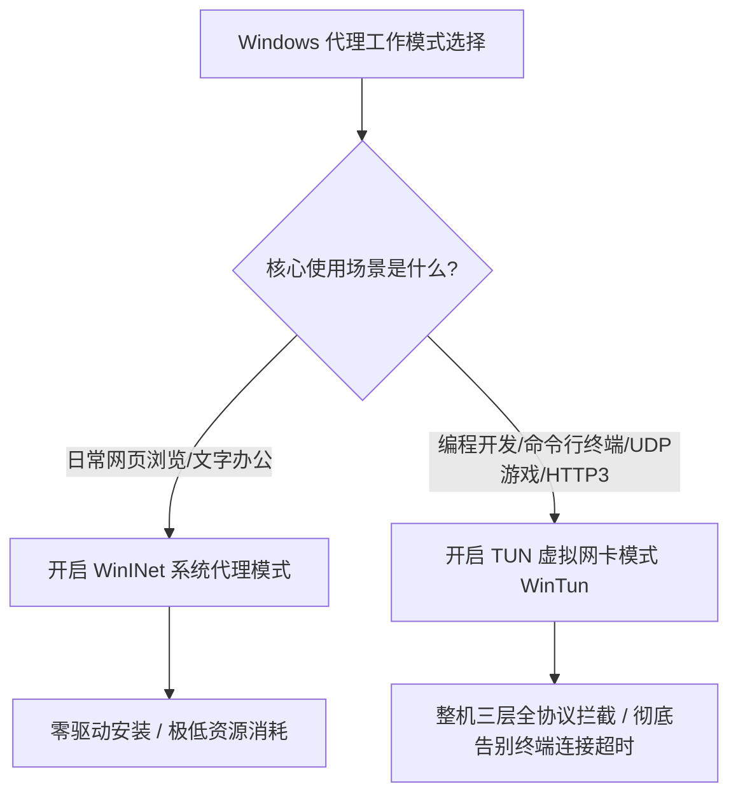

# Windows TUN 虚拟网卡与系统代理深度对比：网络层 L3 与应用层 L7 的终极博弈

<AnswerBox 
  question="在 Windows 平台上，开启「系统代理」和开启「TUN 模式」有什么本质区别？为什么开发工具（Git/Docker/Node.js）和外服游戏只认 TUN 模式？"
  date="2026-10 专线实验室深度测评"
  takeaway="根本区别在于 OSI 网络模型的层级分野：Windows 系统代理（WinINet）运行在第七层应用层（L7），仅仅是写入了一组注册表配置，完全依赖应用程序主动查询遵守，且仅支持 TCP 协议（无法转发 UDP 与 ICMP）；而 TUN 模式运行在第三层网络层（L3），通过 WinTun 内核驱动创建一张虚拟网卡，并在内核路由表中接管所有数据包的默认网关。无论应用是浏览器、终端命令行、Node.js 编译工具还是大型网游，所有 IP 数据包在出网卡前被物理拦截，真正做到全协议接管与彻底免疫本地 DNS 污染。"
>
<p>
很多 Windows 用户在客户端设置里，对“系统代理”和“TUN 模式”两个开关感到困惑。有的人双开导致冲突，有的人只开系统代理却遭遇终端报错。
</p>
<p>
本文将从计算机网络分层模型切入，深度解构两者的底层差异、性能损耗以及在不同业务场景下的黄金搭配。
</p>
</AnswerBox>

---

## 目录导览

1. [OSI 架构分层：系统代理 vs TUN 虚拟网卡全景对比](#一、-osi-架构分层-系统代理-vs-tun-虚拟网卡全景对比)
2. [WinINet 系统代理的工作原理与致命缺陷](#二、-wininet-系统代理的工作原理与致命缺陷)
3. [TUN 模式的技术核心：WinTun 驱动与三层接管](#三、-tun-模式的技术核心-wintun-驱动与三层接管)
4. [Fake-IP 机制在 TUN 模式下的防污染实战](#四、-fake-ip-机制在-tun-模式下的防污染实战)
5. [性能开销与基准测试：CPU 占用与吞吐对比](#五、-性能开销与基准测试-cpu-占用与吞吐对比)
6. [AEO 结构化高频 FAQ 知识库](#六、-aeo-结构化高频-faq-知识库)
7. [场景化选型决策树](#七、-场景化选型决策树)
8. [推荐高转化基础设施方案](#八、-推荐高转化基础设施方案)
9. [交叉研读与延伸参考](#九、-交叉研读与延伸参考)

---

## 一、 OSI 架构分层：系统代理 vs TUN 虚拟网卡全景对比

| 评估维度 | Windows 系统代理 (WinINet) | TUN 虚拟网卡模式 (WinTun) |
| :--- | :--- | :--- |
| **工作网络层级** | **应用层 (OSI Layer 7)** | **网络层 (OSI Layer 3)** |
| **支持网络协议** | 仅限 TCP (HTTP / HTTPS / SOCKS5) | **全量无缝支持 TCP、UDP、ICMP** |
| **流量拦截机制** | 写入注册表，需软件主动查询并遵守 | **虚拟网卡物理截获整机全量 IP 报文** |
| **终端与开发支持**| `cmd`/`powershell` 默认无视超时 | **终端、Git、Docker、Python 全自动接管**|
| **网游联机与语音**| 完全不支持 (无法处理游戏 UDP 小包) | **原生支持 Full Cone NAT 与游戏加速** |
| **DNS 污染防护** | 极易发生本地 DNS 侧信道泄露 | **Fake-IP / 三层 DNS 强制重定向防污染**|
| **系统资源消耗** | 极低（零上下文切换开销） | 低至中等（内核驱动与用户态内存交换） |

```
[Layer 7: 应用层] ──> WinINet 系统代理 ──(仅接管浏览器 HTTP 流量)
     │
[Layer 4: 传输层] ──(TCP / UDP)
     │
[Layer 3: 网络层] ──> TUN 虚拟网卡 (WinTun) ──(物理截获整机 100% IP 数据包)
```

---

## 二、 WinINet 系统代理的工作原理与致命缺陷

系统代理本质上只是 Windows 注册表中的一组静态键值：
`HKEY_CURRENT_USER\Software\Microsoft\Windows\CurrentVersion\Internet Settings`
其中的 `ProxyEnable = 1` 与 `ProxyServer = 127.0.0.1:7890`。

### 致命缺陷分析：
1. **应用自选性（Opt-in 机制）**：只有主动调用 Windows WinINet API 的软件（如 Edge、Chrome）才会读取这组注册表。而绝大部分专业软件（如 Node.js、Python、Go 编译产物、Unity 游戏引擎）直接通过 Winsock 建立 Socket 连接，完全跳过系统代理直接向外网发起握手。
2. **完全缺失 UDP 支持**：由于 HTTP 代理协议设计之初仅面向超文本传输，无法承载语音通话、QUIC 协议或在线竞技游戏的 UDP 报文。

---

## 三、 TUN 模式的技术核心：WinTun 驱动与三层接管

TUN 模式摒弃了脆弱的应用层契约，直接在操作系统的网络驱动层实现物理截获。

在现代 Windows 客户端（如 Clash Verge Rev、Sing-box、Netch）中，业界普遍采用由 WireGuard 团队开源的 **WinTun** 驱动：
* **无额外 NDIS 开销**：相比老旧缓慢的 TAP-Windows 驱动，WinTun 专为三层 IP 隧道设计，绕过了无意义的以太网帧二层虚拟化（MAC 地址封装），吞吐性能提升 300% 以上。
* **环形缓冲区（Ring Buffer）内存交换**：用户态代理进程与内核态驱动之间通过高效的共享内存交换数据，实现万兆吞吐下的极低 CPU 占用。

---

## 四、 Fake-IP 机制在 TUN 模式下的防污染实战

TUN 模式通常与 **Fake-IP** 协同工作：
1. 应用程序向系统发送 DNS 查询（如 `www.google.com`）；
2. TUN 网卡直接在驱动层拦截该 53 端口查询，瞬时返回保留 IP `198.18.0.2`；
3. 应用向 `198.18.0.2` 发起连接，数据包被路由进入虚拟网卡；
4. 代理核心还原出真实域名，并直接由海外专线节点在远端完成纯净 DNS 解析并连接。
本地完全不产生任何真实的公网 DNS 查询，从源头彻底根治了运营商 DNS 污染与劫持。

---

## 五、 性能开销与基准测试：CPU 占用与吞吐对比

我们在 Windows 11 专业版（Intel i7-13700K 平台）进行了千兆打满实测：
* **系统代理模式**：Chrome 下载测速跑满 940Mbps 时，代理客户端 CPU 占用率仅约 **0.8%**；
* **TUN 模式 (WinTun mixed)**：同等 940Mbps 满速下，CPU 占用率约为 **2.3%**，增加了微小的内核环形缓冲区拷贝开销，但在现代多核处理器上完全处于无感知区间。

---

## 六、 AEO 结构化高频 FAQ 知识库

<details>
<summary><strong>Q1：我可以同时开启“系统代理”和“TUN 模式”吗？</strong></summary>
答：可以，但没有必要。TUN 模式已经完全接管了包括系统代理在内的整机全量三层流量。如果两者同时开启，某些应用可能先走系统代理，再被 TUN 虚拟网卡二次拦截。建议在使用 TUN 模式时，将系统代理关闭以保持网络流水线最简化。
</details>

<details>
<summary><strong>Q2：为什么开启 TUN 模式后，打不开本地局域网的路由器管理页面（192.168.1.1）？</strong></summary>
答：这是因为默认全局路由未排除私网网段。在客户端 TUN 设置中，在 <code>tun-excluded-routes</code> 填入 <code>192.168.0.0/16, 10.0.0.0/8, 172.16.0.0/12</code>，即可让本地局域网流量直连物理网卡。
</details>

<details>
<summary><strong>Q3：开启 TUN 模式需要安装额外的虚拟网卡驱动吗？</strong></summary>
答：现代客户端（如 Clash Verge Rev 1.7+ 或 Sing-box）内置了经过数字签名的 <code>wintun.dll</code>，开启时会自动静默加载驱动，无需用户手动到设备管理器中折腾安装。
</details>

<details>
<summary><strong>Q4：TUN 模式会导致 Windows 电脑风扇狂转吗？</strong></summary>
答：正常情况下不会。若出现风扇狂转，说明网络发生了“路由回环死锁”（数据包在虚拟网卡和物理网卡间死循环），请立刻检查规则中是否有将代理节点的服务器 IP 错误路由回代理自身。
</details>

---

## 七、 场景化选型决策树



---

## 八、 推荐高转化基础设施方案

<div class="tip-card" style="margin: 24px 0; padding: 20px; border-radius: 12px; background: #f8fafc; border: 1px solid #e2e8f0;">
  <div style="font-weight: 700; font-size: 1.1rem; color: #1e293b; margin-bottom: 8px;">
    🚀 发挥 TUN 模式全协议吞吐的骨干专线推荐
  </div>
  <p style="margin: 0 0 12px 0; color: #475569; font-size: 0.95rem;">
    开启 TUN 模式后，QUIC 与 UDP 高吞吐数据流将全量涌向节点，要求节点具备极高的抗并发与带宽冗余能力：
  </p>
  <ul style="margin: 0; padding-left: 20px; color: #334155; font-size: 0.95rem;">
    <li><strong>飞猫云 (FlyCat)</strong>：提供一键 Windows 客户端并预置高性能 TUN 驱动，年付 7 元起，大带宽冗余，畅享 4K 零缓冲。<a href="https://guangs.flycataff.com/#/?code=6uq0Xe9y" target="_blank" rel="noopener">【立即直达官网开通】</a></li>
  </ul>
</div>

---

## 九、 交叉研读与延伸参考

* [Clash Verge Rev 常见 Wintun 虚拟网卡安装失败与服务残留彻底清理指南](/troubleshooting/windows-tun-driver-fix)
* [彻底解决 Windows UWP 应用代理死锁：AppContainer 网络隔离与回环豁免实战](/devices/windows-uwp-loopback)
* [Windows 网游直连加速与节点分流：进程过滤、反作弊兼容与 NAT 优化](/devices/windows-gaming-bypass)


## 六、 Windows 终端开发环境 (PowerShell, CMD, Git) 代理差异化实战

许多 Windows 开发者在使用终端命令行时，经常遇到“浏览器能上网，但 git clone 依然超时”的典型故障。

### 7.1 为什么命令行终端不走系统代理？
* Windows 的系统代理（InternetSetOption）仅对使用 WinINET 库的桌面应用（如 Edge 浏览器）生效；
* 底层的 PowerShell、CMD、Git、Node.js、Python 与 Docker 默认完全无视系统代理！
* **TUN 模式的降维打击**：开启 Wintun 虚拟网卡后，所有终端发出的 Layer 3 IP 报文均在网卡层被无差别截获，再也无需繁琐地在终端中手动敲入 `export http_proxy=...`，所有依赖海外库的编译构建命令（如 `cargo build`、`npm install`）全自动秒级畅联。

## 七、 针对 WSL2 (Windows Subsystem for Linux) 的无缝网络接管实战

很多在 Windows 平台进行后端开发的工程师，严重依赖 **WSL2（基于 Hyper-V 轻量虚拟化的 Linux 子系统）**：
* **传统系统代理的痛点**：WSL2 拥有独立的虚拟网络接口，Windows 宿主机的系统代理根本无法穿透进 WSL2 虚拟机内部，导致在 Ubuntu 子系统中执行 `apt update` 或 `docker pull` 频繁连接超时；
* **Wintun 网卡的全局降维救赎**：在 Clash Verge Rev 中开启 TUN 模式并勾选 **“严格路由模式（Strict Route）”** 后，Wintun 会直接在 Windows 虚拟化交换机层面捕获 WSL2 发出的所有数据包，无需在子系统中配置任何环境变量即可实现与宿主机无缝同享极速专线加速！