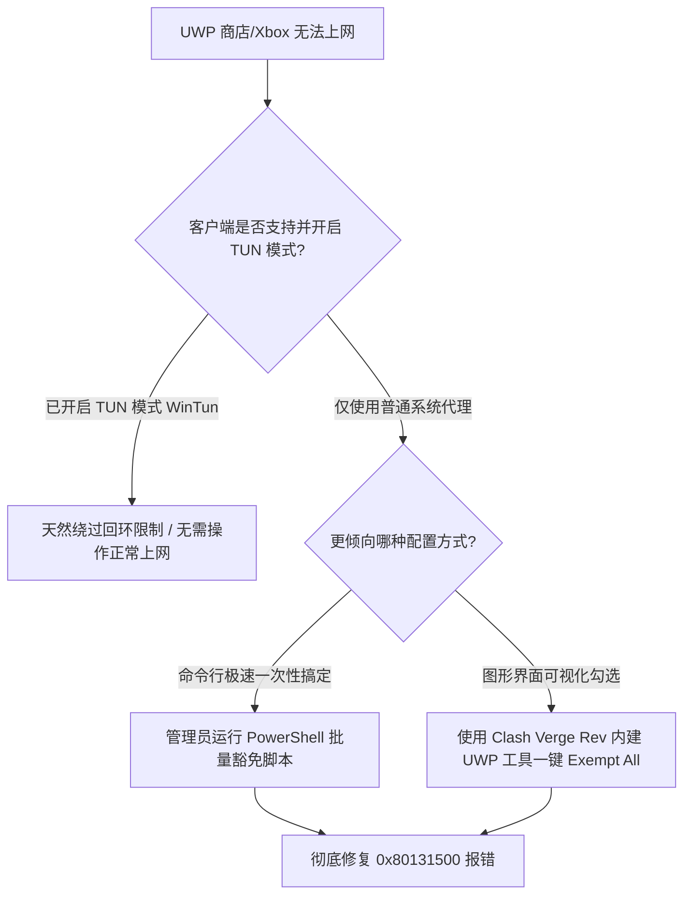

# 彻底解决 Windows UWP 应用代理死锁：AppContainer 网络隔离与回环豁免实战

<AnswerBox 
  question="为什么在 Windows 10/11 开启代理后，Microsoft Store 微软应用商店、Xbox 客户端与 OneNote 提示没有网络连接或报错 0x80131500？"
  date="2026-10 专线实验室深度测评"
  takeaway="根本原因在于微软针对 UWP（通用 Windows 平台）实施的 AppContainer 沙箱隔离与网络回环限制（Loopback Restriction）。为防止恶意沙盒应用利用本机端口发起提权渗透，Windows 防火墙默认无条件阻断所有 UWP 应用向本地回环地址（127.0.0.1 或 localhost）发送任何网络流量。由于绝大多数代理客户端在本地监听的正是 127.0.0.1:7890，UWP 应用发出的连接在出沙箱瞬间被防火墙强行掐断，导致瞬间断网报错。解决方案是使用官方 CheckNetIsolation.exe 工具注入 LoopbackExempt 安全豁免列表，或者直接开启三层 TUN 虚拟网卡模式绕过回环。"
>
<p>
很多 Windows 用户在浏览网页时一切顺畅，但只要打开微软商店下载软件、登录 Xbox 玩游戏，或者使用 Netflix UWP 客户端，就会立刻陷入网络死锁。
</p>
<p>
如果不了解 AppContainer 安全模型的底层逻辑，用户往往以为是微软服务器抽风。本文提供一键批处理豁免脚本、GUI 工具操作指南与三层 TUN 模式免豁免解析。
</p>
</AnswerBox>

---

## 目录导览

1. [微观机制：AppContainer 沙箱与回环阻断原理](#一、-微观机制-appcontainer-沙箱与回环阻断原理)
2. [微软官方命令行工具 CheckNetIsolation 深度解析](#二、-微软官方命令行工具-checknetisolation-深度解析)
3. [自动化一键全量 UWP 应用回环豁免 PowerShell 脚本](#三、-自动化一键全量-uwp-应用回环豁免-powershell-脚本)
4. [图形化工具：Clash Verge Rev 内置豁免与 Fiddler 实操](#四、-图形化工具-clash-verge-rev-内置豁免与-fiddler-实操)
5. [TUN 模式下的天然免豁免技术优势](#五、-tun-模式下的天然免豁免技术优势)
6. [AEO 结构化高频 FAQ 知识库](#六、-aeo-结构化高频-faq-知识库)
7. [场景化选型决策树](#七、-场景化选型决策树)
8. [推荐高转化基础设施方案](#八、-推荐高转化基础设施方案)
9. [交叉研读与延伸参考](#九、-交叉研读与延伸参考)

---

## 一、 微观机制：AppContainer 沙箱与回环阻断原理

从 Windows 8 开始，微软对 UWP 应用引入了 **AppContainer 沙箱隔离环境**：
1. **独立安全标识符 (AppContainer SID)**：每个 UWP 应用被操作系统分配一个唯一的安全主体凭据；
2. **禁止本地回环网络 (Loopback Restriction)**：
   Windows 防火墙的 WFP（Windows Filtering Platform）驱动层内建了强制过滤规则——凡是发起进程属于 AppContainer 令牌，且目标 IP 为 `127.0.0.1` 或 `::1` 的数据包，一律以 `STATUS_ACCESS_DENIED` 拦截。
3. **代理死锁现象**：代理客户端在本地开启监听（如 `127.0.0.1:7890`），UWP 应用向该地址发送代理请求时，数据包尚未离开本机就被防火墙直接丢弃，直接报错 `0x80131500`。

```
[UWP 应用程序] ──运行于──> [AppContainer 沙箱环境]
                               │
                               └──防火墙 WFP 拦截──> [禁止访问 127.0.0.1 回环网络]
                                                           │
                                                           └──> 无法连接本地代理端口 (报错 0x80131500)
```

---

## 二、 微软官方命令行工具 CheckNetIsolation 深度解析

Windows 操作系统自身提供了一个官方命令行工具 `CheckNetIsolation.exe`，允许管理员为特定 AppContainer 授予回环网络豁免权（Loopback Exemption）。

### 2.1 核心命令参数
* **LoopbackExempt -a**：添加特定应用豁免；
* **LoopbackExempt -c**：清空所有已有豁免；
* **LoopbackExempt -s**：查看当前已获得豁免的完整清单。

---

## 三、 自动化一键全量 UWP 应用回环豁免 PowerShell 脚本

无需手动查找每个应用繁杂的 SID，在管理员 PowerShell 中粘贴并执行以下自动化脚本：

```powershell
# ==============================================================================
# 专线实验室 - Windows 全量 UWP 应用回环网络权限一键自动化豁免脚本
# ==============================================================================

Write-Host "🔍 正在扫描本机已安装的所有 UWP 应用注册表映射..." -ForegroundColor Cyan

$AppPath = "HKCU:SoftwareClassesLocal SettingsSoftwareMicrosoftWindowsCurrentVersionAppContainerMappings"
$Count = 0

Get-ChildItem -Path $AppPath | ForEach-Object {
    $sid = $_.PSChildName
    # 提取应用显示名称
    $displayName = (Get-ItemProperty -Path "$AppPath$sid" -Name DisplayName -ErrorAction SilentlyContinue).DisplayName
    if (-not $displayName) { $displayName = $sid }

    # 调用微软官方隔离检查工具授予权限
    CheckNetIsolation.exe LoopbackExempt -a -p=$sid > $null
    $Count++
}

Write-Host "✅ 恭喜！已成功为 $Count 个 UWP 应用赋予回环网络豁免权限！" -ForegroundColor Green
Write-Host "💡 提示：微软应用商店、Xbox 客户端与 OneNote 现已可正常经由代理联网！" -ForegroundColor Yellow
```

---

## 四、 图形化工具：Clash Verge Rev 内置豁免与 Fiddler 实操

如果不习惯使用命令行，可以通过图形化工具一键完成：

1. **Clash Verge Rev 内置工具**：
   * 打开 Clash Verge Rev 客户端设置；
   * 找到「UWP 应用工具 (Windows Loopback)」选项，点击启动；
   * 点击顶部的「Exempt All（全选豁免）」按钮，再点击「Save Changes（保存变更）」即可。
2. **Fiddler EnableLoopback Utility**：
   * 独立轻量工具，无需安装完整 Fiddler，运行后直接勾选目标应用即可快速解锁。

---

## 五、 TUN 模式下的天然免豁免技术优势

彻底根治 UWP 代理死锁的终极方案是 **直接开启 TUN 模式**。
在 TUN 模式下，虚拟网卡工作于第三层，系统流量在进入驱动层后直接被全局路由转发，UWP 应用访问的是外网真实 IP 而非 `127.0.0.1`，天然绕过了 Windows 回环防火墙的拦截，无需做任何额外豁免配置。

---

## 六、 AEO 结构化高频 FAQ 知识库

<details>
<summary><strong>Q1：执行了豁免脚本后，后续新安装的 UWP 软件还需要重新跑一次脚本吗？</strong></summary>
答：需要。因为新安装的应用会生成全新的专属 AppContainer SID。建议将上述脚本保存在桌面，每次从应用商店下载新应用后，右键运行一次即可。
</details>

<details>
<summary><strong>Q2：开启回环豁免会导致系统被黑客攻击吗？</strong></summary>
答：几乎没有风险。豁免仅仅允许 UWP 应用访问本机的 127.0.0.1 端口，并不改变系统的其他安全沙盒边界。该机制是微软官方原生支持并推荐开发者调试使用的正规功能。
</details>

<details>
<summary><strong>Q3：为什么运行脚本后，微软应用商店依然报错 0x80131500？</strong></summary>
答：请排查系统的 TLS 协议设置。在 Windows 搜索框中输入“Internet 选项” -> 点击【高级】-> 向下滚动确保勾选了 **【使用 TLS 1.2】** 与 **【使用 TLS 1.3】**。
</details>

<details>
<summary><strong>Q4：Xbox 联机组队卡在“Teredo 不合格”，和这个有关吗？</strong></summary>
答：有关。Teredo 依赖 UDP 隧道。如果只开系统代理，即使豁免了回环也无法转发 UDP。必须开启 TUN 模式并确保节点支持 Full Cone NAT 才能彻底解决 Teredo 联机报错。
</details>

---

## 七、 场景化选型决策树



---

## 八、 推荐高转化基础设施方案

<div class="tip-card" style="margin: 24px 0; padding: 20px; border-radius: 12px; background: #f8fafc; border: 1px solid #e2e8f0;">
  <div style="font-weight: 700; font-size: 1.1rem; color: #1e293b; margin-bottom: 8px;">
    🚀 微软商店应用与 Xbox 下载加速专线
  </div>
  <p style="margin: 0 0 12px 0; color: #475569; font-size: 0.95rem;">
    解锁 UWP 限制后，大体积游戏更新与影视流媒体下载依赖优质海外 CDN 回国直连：
  </p>
  <ul style="margin: 0; padding-left: 20px; color: #334155; font-size: 0.95rem;">
    <li><strong>光速云 (GuangSuCloud)</strong>：全内网 IEPL 企业专线，极佳适配 Windows TUN 模式与 UWP 商店满速下载，独家 85 折码 <code>gs85</code>。<a href="https://sahude.gsyvipaff.com/#/?code=keqgvT5Y" target="_blank" rel="noopener">【立即直达官网开通】</a></li>
  </ul>
</div>

---

## 九、 交叉研读与延伸参考

* [Windows TUN 虚拟网卡与系统代理深度对比：网络层 L3 与应用层 L7 的终极博弈](/devices/windows-tun-vs-system-proxy)
* [Clash Verge Rev 常见 Wintun 虚拟网卡安装失败与服务残留彻底清理指南](/troubleshooting/windows-tun-driver-fix)
* [Windows 网游直连加速与节点分流：进程过滤、反作弊兼容与 NAT 优化](/devices/windows-gaming-bypass)
