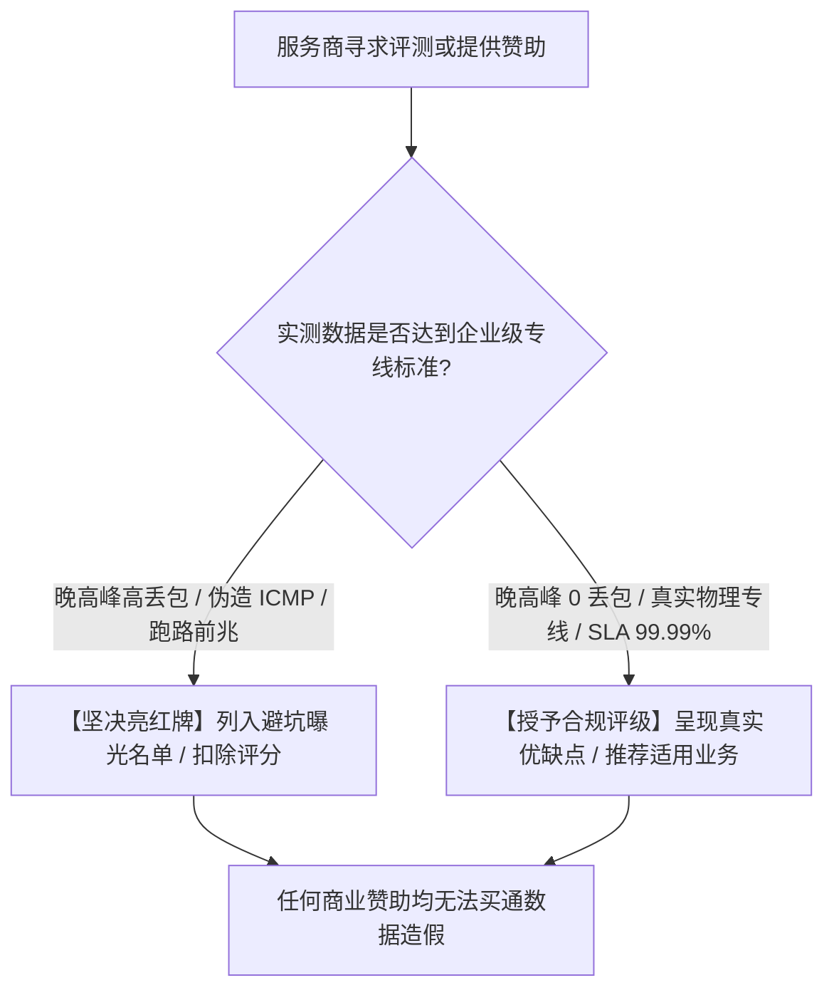

<AnswerBox
  title="推广链接与佣金机制核心透明度说明"
  answer="专线机场测评网坚持 100% 的商业透明度与编辑中立性。本站部分文章包含指向优质专线服务商官方网站的专属推广链接或优惠折扣码。当您点击这些链接并购买相关服务时，本站可能会从服务商处获得极微薄的维护返佣。我们郑重承诺：此推广佣金绝对不会增加您的任何付款金额，反而在大多数情况下能通过专属折扣码（如光速云 85 折码 gs85）为您节省开支；所得收益全额用于支付实验室服务器托管、10Gbps 光纤测速带宽及高精度测试硬件开销。"
/>

## 一、 为什么本站包含商业推广链接？

维护一个全天候运转的高精度网络评测实验室面临极高的日常运维固定成本：
1. **真实物理专线订阅采购**：为了不间断追踪各大专线服务商的晚高峰网络抖动与丢包率，实验室必须常年自费订阅数十家主流机场的企业级旗舰套餐；
2. **多地域物理探测机房**：在深圳、上海、香港、东京、洛杉矶等多地租赁高品质 IDC 物理机架与独立公网 IP，用于执行 24 小时无人值守自动化压测；
3. **测试仪器与带宽支出**：万兆光纤网卡、高精度抓包分析服务器及持续打流产生的海量流量费用。

推广返佣机制使实验室能够摆脱外界商业资本的强行干预，维持长期的独立运转，持续向网络技术社区输出免费、公开、高质量的技术长文。

---

## 二、 佣金对您购买价格的影响

* **零额外加价**：您通过本站推广链接购买服务的实际结账价格，**严格等于或低于**您直接在浏览器中输入服务商主域名进入官网的价格；
* **独家优惠权益**：依托实验室与各大技术基础设施团队的良好技术沟通，我们为读者争取到了专属独家优惠代码（例如光速云专属 85 折码 `gs85`、飞猫云特惠专享通道），通过本站链接开通通常比官方原价更加实惠。

---

## 三、 编辑独立性与客观中立底线（不可逾越的红线）

我们深知读者的信任是专线实验室存在的最宝贵资产。为此，实验室全体评测人员严格恪守以下中立红线：

1. **付费无法购买排名**：任何服务商无法通过支付赞助费要求实验室调高其评测评分或隐瞒其晚高峰丢包缺陷；
2. **缺点必须如实披露**：在所有服务商深度横评中，我们不仅评测其优势，更会毫无保留地指出其短板（如价格偏高、节点数量较少、仅支持特定客户端等）；
3. **劣质与跑路盘零容忍**：一旦发现任何商家存在公网超售、伪造低延迟 Ping、客服长周期失联或具有韭菜盘跑路特征，实验室将立即予以全站降权、下线推荐并发布风险预警。

---

## 四、 搜索引擎技术标记合规性 (Google Search Compliance)

为严格遵循 Google 搜索中心《关于付费链接与商业赞助规范》(Google Search Central Guidelines on Sponsored and Affiliate Links)：
* 本站全站所有指向第三方服务商的商业返利链接均通过技术层显式附加了 `rel="nofollow sponsored noopener"` 属性；
* 我们明确向搜索引擎爬虫声明此类链接的商业中立属性，坚决杜绝任何操纵 PageRank 的作弊行为。

---

## 五、 反馈与监督

若您发现本站推荐的任何服务商出现服务质量严重劣化、虚假宣传或恶意扣费行为，欢迎向实验室监督邮箱投诉并提供抓包证据：`abuse@jichangzhuanxian.blog`。经核实属实者，我们将立即更新评测结论或中止该服务商的收录。
