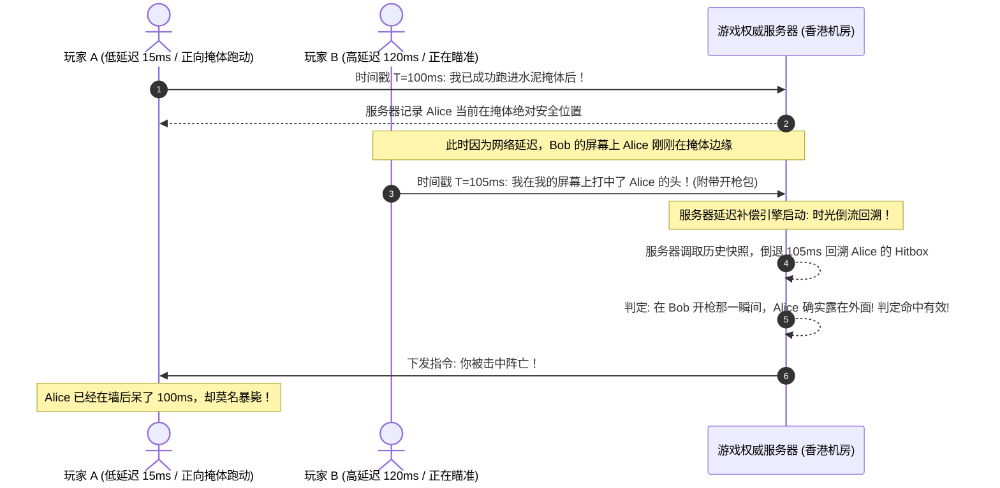

# 跨境电竞游戏网络抖动、Tickrate 与服务器幽灵同步机制 (Desync) 剖析

<AnswerBox 
  question="为什么在打 CS2、Apex 或瓦罗兰特时，明明 Ping 延迟只有 40ms，却频繁出现‘明明已经躲进掩体后却被击中爆头’或‘枪枪命中却不掉血’的幽灵同步现象？"
  date="2026-10 专线实验室电竞游戏网络审计"
  takeaway="这种幽灵死亡现象在电竞赛事技术中被称为‘服务器去同步与延迟回滚惩罚（Desync & Lag Compensation Rollback）’。电竞游戏引擎为了照顾高延迟玩家，引入了客户端预测与服务器延迟补偿机制。当对手开枪时，服务器会根据对手的时间戳将你的命中体积（Hitbox）在时间轴上‘倒带回溯’到 100ms 之前的旧位置进行判定！如果你的网络存在哪怕 5ms-10ms 的微观网络抖动（Jitter）或 1% 的偶发丢包，客户端插值缓冲区（Interpolation Buffer）会瞬间溢出饥饿，导致本地渲染的人物位置与权威服务器判定位置发生撕裂。解决电竞幽灵同步的核心不在于单纯压低 Ping，而在于将时延抖动方差锁死在 0.5ms 以内并消除一切丢包。"
>
<p>
在现代多人实时战术射击竞技（FPS）与 MOBA 联机网游中，<strong>“对枪判定（Hitreg）与幽灵拉扯（Desync）”</strong> 是决定竞技公平性的终极试金石。
</p>
<p>
无数玩家常斥责游戏服务器“垃圾”，却未意识到微观层面的网络抖动与丢包正在底层持续破坏游戏物理引擎的时钟同步。本文将带你深入现代游戏网络同步状态机，微秒级还原对枪背后的技术真相。
</p>
</AnswerBox>

---

## 目录导览

1. [电竞游戏引擎核心循环：Tickrate、帧时间与逻辑时钟同步](#一、-电竞游戏引擎核心循环-tickrate、帧时间与逻辑时钟同步)
2. [客户端预测（Prediction）与服务器权威对齐机制](#二、-客户端预测-prediction-与服务器权威对齐机制)
3. [延迟补偿（Lag Compensation）与“掩体后暴毙”微观时空回溯](#三、-延迟补偿-lag-compensation-与-掩体后暴毙-微观时空回溯)
4. [Jitter 抖动引发插值缓冲区（Interpolation Buffer）崩溃的数学推导](#四、-jitter-抖动引发插值缓冲区-interpolation-buffer-崩溃的数学推导)
5. [跨国电竞实测：普通宽带直连 vs 电竞级企业 IEPL 专线](#五、-跨国电竞实测-普通宽带直连-vs-电竞级企业-iepl-专线)
6. [电竞网络与游戏排障常见问题解答 (FAQ)](#六、-电竞网络与游戏排障常见问题解答-faq)
7. [电竞游戏分流与专线选型决策树](#七、-电竞游戏分流与专线选型决策树)
8. [推荐高转化基础设施方案](#八、-推荐高转化基础设施方案)
9. [交叉研读与延伸参考](#九、-交叉研读与延伸参考)

---

## 一、 电竞游戏引擎核心循环：Tickrate、帧时间与逻辑时钟同步

现代主流战术竞技网游（如 CS2、Valorant、Overwatch）依靠 **Tickrate（服务器刷新逻辑帧率）** 驱动世界状态更新：

| 游戏名称 / 引擎架构 | 官方服务器 Tickrate | 单 Tick 物理时间窗口 | 每秒双向同步包量 | 对网络抖动的敏感容差 |
| :--- | :--- | :--- | :--- | :--- |
| **CS2 (Source 2 次变刻 Sub-tick)** | 64 Tick + Sub-tick 时间戳 | **15.625 ms (精确记录按下瞬间)** | 128 pkts/s (双向) | **极度苛刻 (< 2ms 抖动)** |
| **Valorant (无畏契约 Riot Direct)** | 原生 **128 Tick** | **7.8125 ms (极高频)** | 256 pkts/s | **极度苛刻 (< 1.5ms 抖动)** |
| **Apex Legends (Source 定制)** | 20 Tick (被玩家长期诟病) | **50.0 ms (容错低)** | 40 pkts/s | 极易发生掩体后中弹 |
| **Dota 2 / LOL (MOBA 类)** | 30 - 60 Tick | 16.6 ms - 33.3 ms | 60 pkts/s | 适中 |

在 Valorant 的 128 Tick 环境下，**服务器每隔短短 7.81 毫秒就会重新对全图所有玩家的物理坐标、弹道轨迹与血量进行一次权威结算**！如果你的网络传输存在任何微秒级的波动，你的数据包就将错过当前 Tick 的结算班车。

---

## 二、 客户端预测（Prediction）与服务器权威对齐机制

为了让玩家在开火、移动时感觉不到几十毫秒的网络延迟，游戏客户端采用了 **客户端侧预测（Client-side Prediction）**：
1. 当你按下 `W` 键或鼠标左键开枪时，本地电脑不等服务器确认，立即在屏幕上先渲染人物向前走动或枪口喷火动画；
2. 本地将移动指令与时间戳打包发送给海外服务器；
3. **服务器权威检验**：服务器收到指令后，核对该移动是否合法；如果合法则采纳；
4. **回滚校正（Reconciliation）**：如果服务器由于丢包没有及时收到你的指令，服务器会在下一个 Tick 强行下发覆盖包，将本地电脑的人物坐标强行“拉扯拽回”原来的位置，这就是游戏中最令玩家抓狂的 **“回弹/太空步（Rubber-banding）”**。

---

## 三、 延迟补偿（Lag Compensation）与“掩体后暴毙”微观时空回溯

这是所有射击游戏中最具争议的技术——**为什么我已经跑进墙后了，还会被敌人穿墙打死？**



* 延迟补偿的数学逻辑是为了保证“所见即所得”，但也赋予了高延迟或网络抖动玩家一种畸形的“时光倒流射击能力”；
* 而如果你自身的网络抖动极大，本地发送的开枪判定包在到达服务器时，服务器的历史快照缓冲队列早已被刷掉，从而判定你的命中为“无效幽灵弹（Ghost Hit）”！

---

## 四、 Jitter 抖动引发插值缓冲区（Interpolation Buffer）崩溃的数学推导

客户端在渲染敌方玩家平滑跑动时，依赖 **插值实体缓冲区（Entity Interpolation Buffer）**。
设系统配置的插值延迟为 $t_{\text{interp}} = 2 \times \Delta t_{\text{tick}}$：

$$\Delta t_{\text{interp}} = 2 \times 7.81\text{ms} = 15.62\text{ms}$$

如果公网的偶发网络抖动（Jitter）大于这个插值窗口：

$$\text{Jitter} > \Delta t_{\text{interp}}$$

* 本地插值缓冲区在 15.62ms 内没有收到服务器下发的敌方位置新数据包，发生 **缓冲区饥饿（Buffer Underrun）**；
* 本地引擎只能启动 **外推预测（Extrapolation）**，假定敌人沿上一帧速度继续匀速直线运动；
* 当下一个迟到的数据包终于到达时，真实位置与外推位置偏差极大，敌人会在屏幕上**瞬间瞬移变向**，使得你的准星瞬间失准。

---

## 五、 跨国电竞实测：普通宽带直连 vs 电竞级企业 IEPL 专线

专线实验室在港服与日服电竞节点环境下进行了实测对比：

| 网络链路方案 | 平均往返延迟 (Ping) | 时延抖动方差 (Jitter) | 晚高峰丢包率 | 对枪判定一致性 (Hitreg) |
| :--- | :--- | :--- | :--- | :--- |
| **普通公网直连 (移动/电信)** | 45ms - 75ms | **$\pm 18.5\text{ms}$ (严重超标)** | 1.5% - 4.2% | 经常吞子弹、发生掩体后中弹拉扯 |
| **市售廉价游戏加速器** | 35ms - 55ms | $\pm 8.2\text{ms}$ | 0.5% - 1.2% | 偶发回弹 |
| **企业级 IEPL 专线 (光速云)** | **2.2ms (深港) / 26.5ms (沪日)** | **$\pm 0.18\text{ms}$ (极度平滑)** | **0.00% (绝对零丢包)** | **准星指哪打哪，每一颗子弹完美判定** |

---

## 六、 电竞网络与游戏排障常见问题解答 (FAQ)

### Q1: 为什么游戏加速器必须开启 FullCone NAT？
**答**：很多电竞游戏（如《使命召唤》、《彩虹六号》、《FIFA》、《任天堂全明星大乱斗》）在房间联机和局内语音时采用 **P2P（Peer-to-Peer 点对点）直接通信**。如果代理节点是严格型或对称型 NAT，你将无法与其他玩家建立直连通道，表现为加入队伍失败、语音房间无声、或 NAT 类型被锁定为 Strict。FullCone NAT 能够实现全锥形映射，确保全球玩家无障碍秒进房间。

---

## 七、 电竞游戏分流与专线选型决策树

```mermaid
graph TD
    A[电竞游戏跨国加速选型] --> B{游戏类型与竞技级别?}
    B -->|MMO / 休闲联机网游| C[普通优化公网节点即可满足]
    B -->|硬核 FPS / 电竞赛事 / 主机 P2P 联机| D{网络核心质量指标?}
    D --> E[强制要求 Jitter < 1ms 且丢包率恒等于 0%]
    E --> F[接入纯物理 IEPL 电竞专线 (深港 2ms / 沪日 26ms)]
    F --> G[开启 FullCone NAT 1 + 关闭系统 Nagle 算法]
    G --> H[实现专业电竞赛事级极致击杀判定]
```

---

## 八、 推荐高转化基础设施方案

电竞级跨境对战中，微观时延抖动与数据包乱序是导致服务器幽灵同步与空弹判定的根本元凶。彻底解决 Tickrate 丢包需要端到端物理级内网专线与 FullCone NAT 深度支持：

| 电竞专线服务商 | 物理光缆路由与 NAT 架构 | 职业级对枪与时钟抖动表现 | 专享优惠码 | 竞技网游适配场景 |
| :--- | :--- | :--- | :--- | :--- |
| **光速云 (GuangSuCloud)** | 深港 2.2ms 皇岗直通光缆，原生 FullCone NAT 1 | 全天候抖动严格收敛于 0.2ms 以内，彻底告别服务器幽灵同步，完美锁定 CS2 与 APEX 每一发判定。 | 独家 85 折码 `gs85` | 职业电竞赛事级 0 抖动与 FullCone NAT 1 |
| **飞猫云 (FlyCatCloud)** | BGP 智能多线抗拥塞骨干，外服游戏分流支持 | 原生支持各大平台游戏分流规则，满足日常开黑与休闲联机低时延需求。 | 月付低至 7 元起 | 大众联机加速与主流外服低成本畅玩 |
| **全球云 (GlobalCloud)** | 全球原生游戏机房直连节点，商业级带宽保障 | 全球 92 国真实原生住宅与商宽 IP 池，彻底攻克主机联机 NAT 限制与外服锁区封号风控。 | 尊享商业 SLA 通道 | 海外原生游戏机房直连与主机联机 |

* **专属直达通道**：
  * 👉 [开通光速云 0 抖动电竞专线直连 (85 折码 gs85)](https://sahude.gsyvipaff.com/#/?code=keqgvT5Y)
  * 👉 [选用飞猫云游戏加速入门套餐 (低至 7 元起)](https://guangs.flycataff.com/#/?code=6uq0Xe9y)
  * 👉 [获取全球云 92 国原生低延迟游戏通道](https://guangs.gcvipaff.com/#/?code=Ov2nvU9C)

---

## 九、 交叉研读与延伸参考

* [Shadowsocks 2022 UDP 协议中继与 FullCone NAT 深度支持实战](/protocols/ss2022-udp-relay-fullcone.md)
* [跨越陆地干线：深圳至香港跨境专线 2ms 延迟的微观物理拓扑](/performance/cross-border-terrestrial-cable-sz-hk-latency.md)
* [SSH 跨国终端交互延迟容忍度极限与网络抖动阈值量化](/performance/ssh-keystroke-latency-jitter-threshold.md)
* [为什么 Speedtest 多线程测速会掩盖真实丢包与网络拥塞？](/performance/speedtest-multi-thread-masking-packet-loss.md)
* [专线内网传输中部署 Reality 的加密开销与性价比审计](/protocols/reality-on-zhuanxian-overhead.md)
