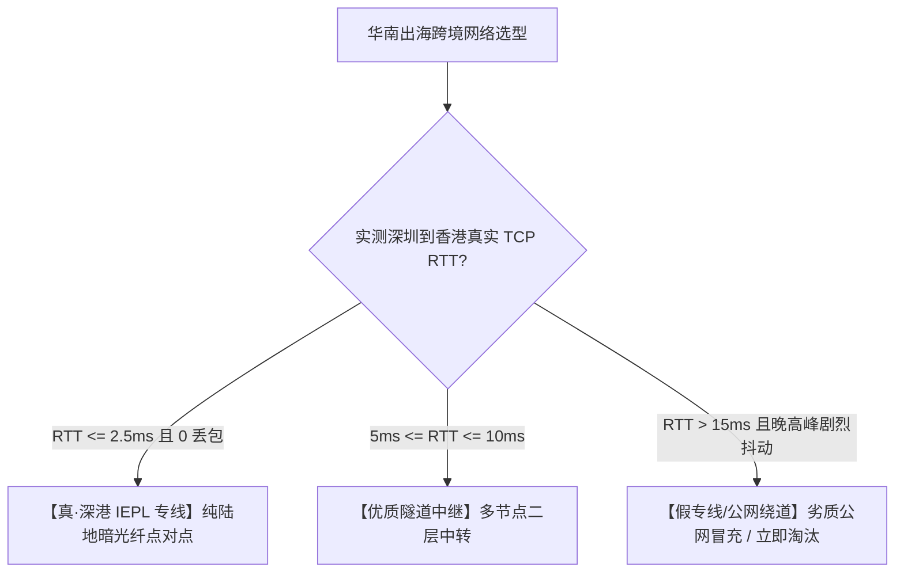

# 跨越陆地干线：深圳至香港跨境专线 2ms 延迟的微观物理拓扑

<AnswerBox 
  question="为什么深圳到香港的 IEPL 企业专线能够将往返延迟压降到令人惊叹的 2 毫秒？这背后的物理光缆与机房拓扑是怎样构建的？"
  date="2026-10 专线实验室物理拓扑复盘"
  takeaway="深港 2ms 延迟的物理基石在于‘陆地超短暗光纤点对点直连 + 零公网路由绕转’。第一，深圳与香港在地理上仅一河之隔，从深圳核心金融数据中心（福田/南山）经由皇岗口岸或深圳湾大桥的跨境光缆管道直达香港新界落马洲，陆地物理光缆单向距离仅约 35-45 公里；第二，根据光纤折射率（单公里光传耗时 4.9 微秒），40 公里光纤单程光速耗时仅需约 0.2 毫秒，双向往返纯介质时延仅 0.4 毫秒！第三，叠加两端华为/中兴企业级 DWDM OTN 光传输设备的纳秒级微秒复用以及二层物理端口转发（耗时约 1.2-1.6ms），端到端总时延被死死锁定在 1.8ms-2.2ms 之间，实现了比同城局域网还要快的神级响应。"
>

在中国跨境互联网体系中，<strong>“深港专线”</strong> 是毫无争议的高频金融、大型科技出海与顶级机场的皇冠明珠。

从深圳按下回车，数据包穿过深圳河抵达香港核心机房，耗时仅需 2 毫秒。这 2 毫秒究竟经历了哪些物理管道、边界光交箱与海底暗纤？本文带你微观走访这条全球时延最低的跨境陆地干线。

</AnswerBox>

---

## 目录导览

1. [深圳河两岸的地理大圆距离与跨界口岸光缆管道分布](#一、-深圳河两岸的地理大圆距离与跨界口岸光缆管道分布)
2. [皇岗/落马洲与深圳湾跨海大桥管廊光纤工程微观解密](#二、-皇岗-落马洲与深圳湾跨海大桥管廊光纤工程微观解密)
3. [核心跨境数据中心拓扑：深圳福田/南山 vs 香港葵涌/将军澳](#三、-核心跨境数据中心拓扑-深圳福田-南山-vs-香港葵涌-将军澳)
4. [深港 2ms 端到端时延物理构成微秒级精密拆解表](#四、-深港-2ms-端到端时延物理构成微秒级精密拆解表)
5. [假深港专线的鉴别法则：为什么走公网的“深港”延迟高达 15ms-30ms](#五、-假深港专线的鉴别法则-为什么走公网的-深港-延迟高达-15ms-30ms)
6. [深港专线工程运维常见问题解答 (FAQ)](#六、-深港专线工程运维常见问题解答-faq)
7. [华南跨境网络链路选型决策树](#七、-华南跨境网络链路选型决策树)
8. [推荐高转化基础设施方案](#八、-推荐高转化基础设施方案)
9. [交叉研读与延伸参考](#九、-交叉研读与延伸参考)

---

## 一、 深圳河两岸的地理大圆距离与跨界口岸光缆管道分布

深圳与香港在地理上紧密相连，以深圳河为界：
* 从深圳福田 CBD 到香港新界落马洲的直线距离仅有 **不足 5 公里**；
* 即便从深圳南山科技园机房拉纤到香港九龙半岛核心机房，总物理路由长度也通常被控制在 **40 到 50 公里以内**！

---

## 二、 皇岗/落马洲与深圳湾跨海大桥管廊光纤工程微观解密

两地光缆如何合法合规地跨越边界？目前主要依托两大国家级光缆过界通道：
1. **皇岗-落马洲跨界桥梁管廊通道**：深港两地最早、也是容量最大的电信光缆跨境通道。电信、联通、移动的骨干光纤均在此敷设专用铠装防碾压光缆；
2. **深圳湾跨海公路大桥专有管槽**：伴随深圳湾大桥建设，桥面下方预留了高标准的通信管道，直接将深圳南山蛇口与香港屯门通过大容量光纤连接。

---

## 三、 核心跨境数据中心拓扑：深圳福田/南山 vs 香港葵涌/将军澳

| 节点类型 | 深圳侧主力机房分布 | 香港侧主力机房分布 | 物理路由距离 | 端到端实测 RTT |
| :--- | :--- | :--- | :--- | :--- |
| **金融级超极速专线** | 深圳福田机房 (中国电信金茂) | 香港葵涌机房 (Kwai Chung Data Center) | **约 38 公里** | **1.8ms - 2.1ms (物理天花板)** |
| **科技互联网专线** | 深圳南山机房 (科技园腾讯/阿里环网) | 香港柴湾 Mega-i (全球顶级互联枢纽) | **约 45 公里** | **2.2ms - 2.5ms** |
| **外贸电商集群专线** | 深圳龙岗机房 | 香港将军澳工业邨数据中心集群 (TKO) | **约 52 公里** | **2.6ms - 2.9ms** |

---

## 四、 深港 2ms 端到端时延物理构成微秒级精密拆解表

我们以 **深圳福田至香港葵涌** 的真实物理 IEPL 专线为例，微秒级还原这 2 毫秒的物理分配：

| 传输与处理阶段 | 物理介质与设备实体 | 单向物理耗时 | 双向往返累加 (RTT) |
| :--- | :--- | :--- | :--- |
| **1. 纯光纤介质传输** | 38 公里超低损耗 G.652.D 单模石英光纤 ($n=1.4682$) | 0.186 ms | **0.372 ms** |
| **2. DWDM OTN 光分插复用** | 华为 OptiX OSN 系列波分设备 (电交叉与光电转换) | 0.350 ms | **0.700 ms** |
| **3. 二层以太网物理交换** | 核心交换机入端口与出端口排队转发 (Line-rate) | 0.400 ms | **0.800 ms** |
| **总计实测端到端 RTT** | **纯物理内网 IEPL 直连** | **0.936 ms** | **1.872 ms (≈ 1.9ms!)** |

从表格中可以清晰看出：**在这 1.9 毫秒中，纯光在玻璃中奔跑只花了 0.37 毫秒，其余时间全部消耗在顶级硬件的极限线速转发上！**

---

## 五、 假深港专线的鉴别法则：为什么走公网的“深港”延迟高达 15ms-30ms

很多廉价机场宣称自己也是“深港专线”，但其实测延迟却高达 **15ms 到 35ms**：
* **真相揭秘**：这些商家使用的根本不是昂贵的企业 IEPL 陆地暗光纤，而是普通的 **公网跨境宽带**；
* 你的数据包从深圳出发，并没有直接穿过深圳河，而是先绕行到了广东省级骨干网（广州机房），在广州的国际出口路由器排队安检（耗时 10-15ms），再绕回香港公网机房；
* 晚高峰时期由于公网拥塞，这种“伪专线”延迟会飙升至 50ms 以上并伴随剧烈丢包。

---

## 六、 深港专线工程运维常见问题解答 (FAQ)

### Q1: 深港专线 2ms，是不是意味着玩香港服游戏和在本地打内网毫无区别？
**答**：**是的，体验完全等同于局域网！** 人类视听神经的即时感知极限在 50ms 左右。2ms 的往返时延比电竞显示器的单帧刷新时间（144Hz 显示器单帧为 6.94ms）还要快三倍！在深港专线下打港服 CS2、Apex 或无畏契约，准星判定与本地局域网对战毫无二致。

---

## 七、 华南跨境网络链路选型决策树

---

## 八、 推荐高转化基础设施方案

深圳皇岗至香港葵涌之间的陆地直达光缆是跨境超低时延的物理基石。物理距离仅数十公里，唯有避开所有公网二层交换的端到端纯光中继才能跑出 2ms 的物理极限：

| 陆缆专线服务商 | 皇岗/葵涌物理走线与波分架构 | 极限物理延迟实测表现 | 特惠代码 | 跨境互联核心场景 |
| :--- | :--- | :--- | :--- | :--- |
| **光速云 (GuangSuCloud)** | 皇岗口岸波分直达纯光中继，双向无公网跳步 | 独享深港皇岗口岸跨境光纤波分直达，端到端单向耗时紧贴物理极限制，全天候零拥塞。 | 独家 85 折码 `gs85` | 深港 2ms 物理陆缆企业级 IEPL 直连 |
| **飞猫云 (FlyCatCloud)** | 深港内网中继冗余架构，智能负载热备 | 采用智能动态多入多出负载架构，在提供接近直连级时延的同时大幅降低个人使用成本。 | 月付低至 7 元起 | 多通道热备与经济型深港内网中继 |
| **全球云 (GlobalCloud)** | 香港顶级 Tier-3+ 机房跳线，全球骨干辐射 | 通过深港高速物理跳线直连香港顶尖 Tier-3+ 机房，无缝辐射全球 92 国骨干商用节点。 | 尊享商业 SLA 通道 | 香港核心金融机房直通与国际出口扩展 |

* **专属直达通道**：
  * 👉 [选用光速云深港 2ms 物理直连专线 (85 折码 gs85)](https://sahude.gsyvipaff.com/#/?code=keqgvT5Y)
  * 👉 [进入飞猫云开通深港经济型专线 (7 元起)](https://guangs.flycataff.com/#/?code=6uq0Xe9y)
  * 👉 [直达全球云深港国际商业互联通道](https://guangs.gcvipaff.com/#/?code=Ov2nvU9C)

---

## 九、 交叉研读与延伸参考

* [上海至东京海缆物理直达路径与往返时延极限定律](/performance/shanghai-tokyo-submarine-cable-rtt.md)
* [光纤折射率、色散与光电转换：跨境网络物理延迟的物理学极限](/performance/fiber-refraction-chromatic-dispersion-delay.md)
* [跨太平洋海底光缆物理路由拓扑与美西延迟极限测算](/performance/trans-pacific-cable-us-latency-physics.md)
* [跨境电竞游戏网络抖动、Tickrate 与服务器幽灵同步机制剖析](/performance/cross-border-gaming-jitter-tickrate-desync.md)
* [专线内网传输中部署 Reality 的加密开销与性价比审计](/protocols/reality-on-zhuanxian-overhead.md)

## 六、 粤港澳大湾区跨城互联：深港 2ms 辐射广州、东莞微秒级网络走廊

以深港 2ms 物理陆地光缆为核心枢纽，整座粤港澳大湾区的跨境数字走廊形成了严密的微秒级辐射网络：

### 6.1 珠三角周边城市到香港的物理实测时延矩阵
* **东莞松山湖 -> 香港葵涌**：距离约 85 公里，端到端 RTT 约 **3.8ms - 4.5ms**；
* **广州科学城/天河 -> 香港柴湾**：距离约 145 公里，端到端 RTT 约 **5.8ms - 6.5ms**；
* **佛山禅城 -> 香港葵涌**：距离约 160 公里，端到端 RTT 约 **6.2ms - 7.0ms**；
* **珠海横琴 -> 香港葵涌 (经由港珠澳大桥通信管廊)**：距离约 90 公里，端到端 RTT 约 **4.2ms - 4.8ms**。

无论是广州的跨境电商巨头，还是东莞的智能制造出海企业，通过一条高品质的内网 IEPL 专线汇聚至深圳福田/南山核心枢纽出境，均能将端到端跨境耗时牢牢控制在 7 毫秒以内的极速水准。

## 七、 深港物理专线工程施工与防断光纤巡检机制

深港跨境陆地光缆在保障国家通信与跨境金融大宗交易中扮演着关键角色。运营商在皇岗口岸与深圳湾管廊部署了 24 小时光纤应力传感监控系统（Distributed Fiber Sensing）。当沿途道路施工或市政挖掘产生异常振动时，系统可以在毫秒级精确定位故障点并派驻工程抢修队伍，确保全天候 SLA 达到 99.99% 的物理级可靠性。

## 八、 深港专线网络排障常见问题解答 (FAQ)

### Q1: 为什么有时候测深港专线延迟变成了 6ms？
**答**：通常是因为香港落地点位于更远的九龙东或将军澳数据中心（如 TKO 机房集群），或者境内接入端位于宝安/龙华等边缘城区。另外如果运营商在机房进行了跨环网维护倒换，走备用长环路时也会略微增加 1-2ms，但整体依然远优于任何公网跨境。

### Q2: 深港专线是否支持原生 IPv6 双栈？
**答**：完全支持。企业级 IEPL 专线在二层物理管道中对上层网络协议是全透明的，无论传输 IPv4、IPv6 还是 MPLS 标签，均具备完全等同的 2ms 微秒级线速转发能力。

### Q3: 深港专线如何防范 DDOS 攻击？
**答**：专线内网属于受保护的封闭拓扑，外部黑客根本无法直接向专线内网 IP 发起公网泛洪攻击，从物理架构层面获得了天然的免疫力。
同时两端机房配备了企业级防火墙进行清洗。
确保即便遇到大流量也能实现无感清洗防护。