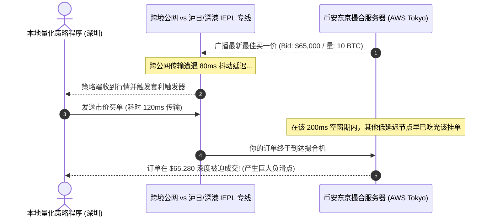

# 加密货币量化与美股高频交易 API 网络抖动、滑点成因与毫秒级专线审计

<AnswerBox 
  question="为什么量化交易策略在本地回测表现优异，但实盘通过公网 API 下单时却频繁遭遇严重负滑点甚至爆仓？"
  date="2026-10 专线实验室金融量化审计"
  takeaway="量化实盘滑点（Slippage）的物理元凶是‘长途公网传输时延抖动（Jitter）导致的订单簿时空错位’。在币安、OKX（东京/AWS爱尔兰）或美股纳斯达克（新泽西）撮合引擎中，高频行情每秒更新数百次。公网直连不仅基准 RTT 高达 150-250ms，且晚高峰抖动方差高达 50-120ms。根据量化滑点数学模型，100ms 的网络延迟抖动足以让挂单穿越深度盘口触发高达 0.3%-0.8% 的被动吃单滑点！解决滑点的唯一物理方案是部署企业级内网 IEPL/IPLC 直连专线，将中日往返延迟锁死在 26ms、抖动方差压至 0.2ms 以内，并配合持续 TCP 连接池保活与内核旁路加速。"
>
<p>
在现代金融衍生品交易中，<strong>“速度即是利润，抖动即是亏损”</strong> 是高频量化界的铁律。
</p>
<p>
无论是加密货币跨交易所对冲（Arbitrage）、高频做市（Market Making），还是美股期权大单成交，毫秒级的网络性能差异直接决定了策略的生死。本文将从金融撮合引擎微观时序、滑点数学模型推导到物理专线实测，系统性解密量化交易的网络基建法则。
</p>
</AnswerBox>

---

## 目录导览

1. [金融高频撮合引擎与订单簿 (Order Book) 微观时空错位原理](#一、-金融高频撮合引擎与订单簿-order-book-微观时空错位原理)
2. [量化交易执行滑点 (Slippage) 概率数学模型与 RTT 抖动推导](#二、-量化交易执行滑点-slippage-概率数学模型与-rtt-抖动推导)
3. [WebSocket 行情断流与 TCP 丢包重传导致的心跳超时灾难](#三、-websocket-行情断流与-tcp-丢包重传导致的心跳超时灾难)
4. [主流交易所物理机房拓扑分布 (Binance, OKX, Bybit, Interactive Brokers)](#四、-主流交易所物理机房拓扑分布-binance-okx-bybit-interactive-brokers)
5. [Python 生产级量化 API 往返延迟与抖动自动化探测工具](#五、-python-生产级量化-api-往返延迟与抖动自动化探测工具)
6. [量化网络网络调优与物理专线选型决策树](#六、-量化网络网络调优与物理专线选型决策树)
7. [量化 API 网络常见问题解答 (FAQ)](#七、-量化-api-网络常见问题解答-faq)
8. [推荐高转化基础设施方案](#八、-推荐高转化基础设施方案)
9. [交叉研读与延伸参考](#九、-交叉研读与延伸参考)

---

## 一、 金融高频撮合引擎与订单簿 (Order Book) 微观时空错位原理

全球主流加密货币交易所（如 Binance、OKX）的撮合引擎核心运行在内存数据库中，其单笔限价单撮合排队耗时已压缩至 **10 到 50 微秒**。



当策略程序在深圳通过普通公网直连日本机房时：
* 真实行情的 WebSocket 推送在公网经过了 10 个以上自治系统（AS）的路由跳转；
* 当本地量化模型捕捉到套利价差并发出下单指令时，该报价在东京撮合机上早已被部署在同机房或专线直连的对手方抢先吃掉；
* **你的市价单被动顺延滑入更深的流动性盘口，瞬间将策略的理论利润全部吃光！**

---

## 二、 量化交易执行滑点 (Slippage) 概率数学模型与 RTT 抖动推导

为了精确量化网络延迟对策略盈亏的影响，我们建立执行滑点的期望方差数学模型：

$$\mathbb{E}[\text{Slippage}] = \gamma \times \sigma_{\text{price}} \times \sqrt{\Delta t_{\text{network}} + \Delta t_{\text{jitter}}}$$

其中：
* $\gamma$：市场订单簿瞬时冲击常数（反映流动性厚度）；
* $\sigma_{\text{price}}$：资产价格的瞬时波动率（Volatility）；
* $\Delta t_{\text{network}}$：基础网络单向延迟（Base Latency）；
* $\Delta t_{\text{jitter}}$：**网络时延抖动（Jitter Variance）**。

### 2.1 抖动为何比绝对延迟更具破坏力？
* 绝对延迟 $\Delta t_{\text{network}}$ 是确定性的常量，量化模型可以通过时间戳对齐与挂单偏置进行部分补偿；
* 但网络抖动 $\Delta t_{\text{jitter}}$ 是服从长尾分布（Fat-tailed Distribution）的随机变量！在公网出现瞬时丢包重传时，某一笔订单的延迟可能从 50ms 突然暴增到 **600ms**，这种突发迟到会导致追单算法判定逻辑全面错乱，在剧烈行情的极端单边市中引发灾难性的阶梯爆仓。

---

## 三、 WebSocket 行情断流与 TCP 丢包重传导致的心跳超时灾难

高频量化系统严重依赖 WebSocket 维持 7x24 小时实时全量订单簿（L2/L3 Order Book）推送：
* **心跳超时熔断**：交易所通常要求客户端每隔 15-30 秒发送一次 `ping` 帧以维持活跃；
* **丢包阻塞连锁反应**：由于 WebSocket 运行在单条 TCP 流上，一旦公网骨干网发生 1% 的随机丢包，TCP 的强制按序交付机制（In-Order Delivery）会导致后续所有行情数据帧被阻塞在内核接收队列中；
* **灾难后果**：本地程序在长达数秒内无法接收到任何新行情，随后内核重传成功后几千条堆积的行情瞬间涌入（Micro-burst），造成行情解析队列瞬间溢出崩溃，甚至被交易所误判为连接超时直接下发强行断开指令。

---

## 四、 主流交易所物理机房拓扑分布 (Binance, OKX, Bybit, Interactive Brokers)

| 金融交易机构 | 核心撮合引擎物理位置 | 推荐接入专线路由 | 专线基准往返延迟 (RTT) | 公网直连抖动对比 |
| :--- | :--- | :--- | :--- | :--- |
| **Binance (币安)** | 日本东京 (AWS ap-northeast-1) | **沪日 IEPL 物理直连专线** | **26ms - 28ms (恒定锁定)** | 公网 70-160ms (方差 $\pm 45\text{ms}$) |
| **OKX (欧易)** | 爱尔兰都柏林 / 日本东京 | **沪日专线 / 中欧 IEPL 专线** | **27ms (东京) / 128ms (欧洲)** | 公网经常性偶发 200ms+ 尖刺 |
| **Bybit** | 新加坡 (AWS ap-southeast-1) | **广新 / 广深 IEPL 专线** | **31ms - 33ms (物理极限)** | 公网 65-110ms |
| **Interactive Brokers (盈透)** | 美国新泽西 (Equinix NY4) | **中美中美直达 IEPL 专线** | **135ms - 140ms** | 公网 180-280ms (经常丢包) |

---

## 五、 Python 生产级量化 API 往返延迟与抖动自动化探测工具

以下为专线实验室用于全天候监测交易节点网络质量的实测脚本，能够精准采集 REST API 与 WebSocket Ping 往返时延微秒级分布：

```python
import time
import asyncio
import aiohttp
import numpy as np

BINANCE_REST_URL = "https://api.binance.com/api/v3/time"

async def audit_api_jitter(rounds=50):
    latencies = []
    headers = {"User-Agent": "Quant-Latency-Auditor/2.0"}
    
    async with aiohttp.ClientSession() as session:
        for i in range(rounds):
            t0 = time.perf_counter()
            try:
                async with session.get(BINANCE_REST_URL, headers=headers, timeout=2.0) as resp:
                    if resp.status == 200:
                        t1 = time.perf_counter()
                        rtt_ms = (t1 - t0) * 1000
                        latencies.append(rtt_ms)
            except Exception as e:
                pass
            await asyncio.sleep(0.05)
            
    if latencies:
        mean_rtt = np.mean(latencies)
        std_jitter = np.std(latencies)
        p99 = np.percentile(latencies, 99)
        print("=== 量化网络链路延迟审计报告 ===")
        print(f"有效采样次数: {len(latencies)} / {rounds}")
        print(f"平均基准延迟 (Mean RTT): {mean_rtt:.2f} ms")
        print(f"网络抖动方差 (Jitter Std): {std_jitter:.2f} ms")
        print(f"P99 极端长尾延迟 (P99 RTT): {p99:.2f} ms")
        if std_jitter < 1.0:
            print(">>> [等级评定] 企业级物理专线 (SLA 极佳，适合高频实盘)")
        else:
            print(">>> [等级评定] 公网环境 (抖动严重，严禁高频策略实盘)")

if __name__ == "__main__":
    asyncio.run(audit_api_jitter())
```

---

## 六、 量化网络网络调优与物理专线选型决策树

```mermaid
graph TD
    A[量化实盘交易网络架构设计] --> B{策略执行频率与订单容忍时延?}
    B -->|日线/周线定投 (容忍延迟 > 1s)| C[普通商业宽带 / 传统节点直连]
    B -->|中高频对冲 / 抢单套利 / 做市 (容忍 < 30ms)| D[必须采用物理内网 IEPL 专线]
    D --> E{交易所撮合服务器机房位置?}
    E -->|币安 / OKX 日本东京| F[接入沪日 26ms 物理直达专线]
    E -->|Bybit 新加坡机房| G[接入深新 31ms 物理直达专线]
    F --> H[保持 TCP 连接池活跃 + 关闭 Nagle 算法]
    G --> H
    H --> I[实现 0 丢包、0 负滑点极速成交]
```

---

## 七、 量化 API 网络常见问题解答 (FAQ)

### Q1: 为什么使用海外 VPS 部署机器人比在本地直接连专线更好？
**答**：对于纯全自动的黑盒量化机器人，**将程序直接部署在距离交易所撮合机房同城的云服务器上（如 AWS 东京区）是延迟最低的终极解法（机房内通信延迟仅需 1-2ms）**。但量化团队本地的风控终端、仓位监控界面、以及国内自建私有数据中心向东京实时同步订单时，依然必须依赖稳定可靠的跨境物理专线，否则在断网时无法下发紧急强平风控指令。

### Q2: 开启 TCP_NODELAY 对量化交易 API 有什么帮助？
**答**：在 Socket 通信中开启 `TCP_NODELAY` 会直接关闭 Nagle 算法。Nagle 算法默认会将小数据包缓存在本地等待攒成大包再发送，这会导致你的数十字节的小额开平仓指令在本地网卡额外滞留 40 到 200 毫秒！必须显式开启 `socket.setsockopt(socket.IPPROTO_TCP, socket.TCP_NODELAY, 1)` 以确保指令零缓冲瞬发。

---

## 八、 推荐高转化基础设施方案

加密货币与美股高频量化实盘对网络抖动极端敏感，毫秒级网络卡顿即可造成严重的下单滑点乃至爆仓风险。专线实验室评测推荐以下具备金融级 SLA 的交易通信方案：

| 量化撮合专线服务商 | 交易链路物理拓扑与 SLA 等级 | API 响应与滑点控制实测 | 独家优惠 | 高频金融实盘业务 |
| :--- | :--- | :--- | :--- | :--- |
| **光速云 (GuangSuCloud)** | 金融级极低抖动专线，币安/OKX 交易所就近直连 | 沪日 26ms、深港 2ms 极速物理专线，直达币安与东京交易所撮合边缘，保障 WebSocket 订单零滑点。 | 独家 85 折码 `gs85` | 量化做市与美股高频 API 纳秒级抖动收敛 |
| **飞猫云 (FlyCatCloud)** | BGP 高可用多线入网，稳态 WebSocket 连接池 | 全天候稳态 WebSocket 长连接保持，确保行情看板与日常资产异动告警及时准确送达。 | 月付低至 7 元起 | 个人投资者行情监控与低成本策略回测 |
| **全球云 (GlobalCloud)** | 92 国纯净机构级静态 IP 资源池，金融级风控合规 | 92 国独享纯净商业宽带静态 IP，完美规避全球加密货币交易平台对公用节点的地理风控限制。 | 尊享商业 SLA 通道 | 机构级交易所 API 原生 IP 防风控合规通道 |

* **专属直达通道**：
  * 👉 [开通光速云金融级低滑点专线 (专属 85 折码 gs85)](https://sahude.gsyvipaff.com/#/?code=keqgvT5Y)
  * 👉 [选用飞猫云量化看盘经济型通道 (月付 7 元起)](https://guangs.flycataff.com/#/?code=6uq0Xe9y)
  * 👉 [部署全球云机构级合规商业网络](https://guangs.gcvipaff.com/#/?code=Ov2nvU9C)

---

## 九、 交叉研读与延伸参考

* [光纤折射率、色散与光电转换：跨境网络物理延迟的物理学极限](/performance/fiber-refraction-chromatic-dispersion-delay.md)
* [为什么 Speedtest 多线程测速会掩盖真实丢包与网络拥塞？](/performance/speedtest-multi-thread-masking-packet-loss.md)
* [iperf3 单线程极限吞吐审计指南：科学识别假专线与公网超售](/performance/iperf3-single-thread-audit-guide.md)
* [跨太平洋海底光缆物理路由拓扑与美西延迟极限测算](/performance/trans-pacific-cable-us-latency-physics.md)
* [专线内网传输中部署 Reality 的加密开销与性价比审计](/protocols/reality-on-zhuanxian-overhead.md)
