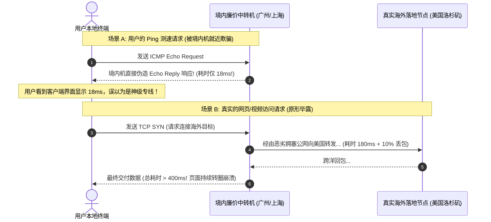

# ICMP 假握手与 Ping 欺骗技术内幕：为什么低延迟 Ping 依然打不开网页

<AnswerBox 
  question="为什么客户端测速显示 Ping 延迟只有 15ms-25ms，但实际打开 Google 或 YouTube 却持续转圈甚至直接报错超时？"
  date="2026-10 专线实验室网络攻防复盘"
  takeaway="这种‘超低 Ping 但严重卡死’的怪现状，在网络黑产中被称为‘ICMP 假握手与 Ping 欺骗（Ping Spoofing）’。第一，部分劣质商家在境内入口服务器部署了欺骗规则，当用户发出 ICMP Echo Request 时，境内跳板机在 10ms 内直接代为应答（Fake Echo Reply），而根本没有将数据包发往真实的海外落地节点；第二，运营商网络对 ICMP 协议（网络控制报文）与 TCP/UDP 业务报文赋予了截然不同的服务质量（QoS）队列，ICMP 享有优先通行权，而业务报文在国际出口被大量丢弃；第三，MTU 与路径最大传输单元黑洞（PMTUD Blackhole）导致 64 字节的小 Ping 包顺畅通过，而 1500 字节的真实网页大包全被丢弃。科学排查必须使用基于 TCP/HTTP 真实握手的探测工具（如 tcping、curl 或 nping）。"
>
<p>
在网络科学加速测试中，<strong>Ping 延迟</strong> 长期以来被广大新手用户视作衡量节点好坏的最核心指标。
</p>
<p>
然而，正是这种盲目的指标崇拜，催生了大量利用网络协议漏洞的造假把戏。商家只需一行 iptables 规则，就能把一个原本需要 200ms 的劣质公网节点伪造出“深港 15ms 物理极速专线”的假象。本文带你微观剖析 Ping 欺骗的技术内幕与终极反制手段。
</p>
</AnswerBox>

---

## 目录导览

1. [ICMP 协议的无状态本质与代理欺骗漏洞成因](#一、-icmp-协议的无状态本质与代理欺骗漏洞成因)
2. [境内跳板机 Fake Echo Reply 代答作弊架构微观解密](#二、-境内跳板机-fake-echo-reply-代答作弊架构微观解密)
3. [DSCP 与服务质量 (QoS) 差异：为什么运营商善待 ICMP 却绞杀 TCP](#三、-dscp-与服务质量-qos-差异-为什么运营商善待-icmp-却绞杀-tcp)
4. [MTU 大包黑洞效应：64 字节 Ping 通但 1500 字节网页卡死](#四、-mtu-大包黑洞效应-64-字节-ping-通但-1500-字节网页卡死)
5. [科学识破欺骗：使用 tcping 与 nping 测量真实应用层 RTT](#五、-科学识破欺骗-使用-tcping-与-nping-测量真实应用层-rtt)
6. [假延迟排障常见问题解答 (FAQ)](#六、-假延迟排障常见问题解答-faq)
7. [网络延迟真实性审计决策树](#七、-网络延迟真实性审计决策树)
8. [推荐高转化基础设施方案](#八、-推荐高转化基础设施方案)
9. [交叉研读与延伸参考](#九、-交叉研读与延伸参考)

---

## 一、 ICMP 协议的无状态本质与代理欺骗漏洞成因

我们在终端运行的 `ping` 命令，其底层使用的是 **ICMP（Internet Control Message Protocol，互联网控制报文协议）**：
* **无连接无状态（Stateless）**：ICMP 运行在网络层（Layer 3），既不需要像 TCP 那样经历三次握手协商序列号，更不需要进行 TLS 证书验证；
* **极小的 64 字节包体**：一个标准的 ICMP Echo Request 数据包仅有 8 字节 ICMP 头部与 56 字节的填充字符（总计 64 字节），容易通过任何拥塞的路由器队列；
* **极易被旁路截获**：由于 ICMP 没有端口概念，任何处于路由路径上的路由器或防火墙设备，都可以在纳秒级伪造一个 ICMP Echo Reply 并直接发回给发送方。

---

## 二、 境内跳板机 Fake Echo Reply 代答作弊架构微观解密

不良商家如何做到将一个美西 180ms 的公网节点伪造成 20ms 的“极速专线”？



商家在境内中转机上简单配置一条规则：
```bash
# 当收到目标指向海外的 ICMP 请求时，境内机直接在本地伪造应答
iptables -t nat -A PREROUTING -p icmp -j REDIRECT
```
用户的测速软件收到的是来自境内机房的就近回复（仅反映了你到广州机房的 18ms），而至关重要的 **“广州到美国海外落地” 这段长达上万公里的跨洋真实时延，被完全隐藏掉了！**

---

## 三、 DSCP 与服务质量 (QoS) 差异：为什么运营商善待 ICMP 却绞杀 TCP

在电信、联通、移动的骨干路由器中，IP 报文头部包含一个 **DSCP（差分服务代码点）** 字段：
* **网络管理优先级**：由于网络工程师日常使用 Ping 诊断光纤中断与硬件故障，大部分运营商将 ICMP 报文默认调度在高优先级的控制队列（Control Plane Queue）中，即使在晚高峰链路拥堵时也尽量优先转发；
* **业务数据丢弃队列**：而对于用户访问外网的 TCP/UDP 流量，运营商为了防范大流量拥塞，往往将其打入低优先级的尽力而为（Best-effort）数据队列；
* **表现**：当公网丢包率达到 15% 时，ICMP Ping 依然能保持 100% 不丢包，给人一种“网络很通畅”的致命错觉。

---

## 四、 MTU 大包黑洞效应：64 字节 Ping 通但 1500 字节网页卡死

另一个导致 Ping 正常但打不开网页的物理元凶是 **PMTUD（路径最大传输单元发现）黑洞**：
* 标准以太网的最大传输单元（MTU）通常为 **1500 字节**；
* 当代理软件对流量进行嵌套封装（如添加 TLS 头部、Reality 认证头或 WireGuard 头部）后，数据包总长度可能膨胀至 **1520 字节**；
* 如果中间路由器的 MTU 只有 1492（如 PPPoE 拨号网络），超长的数据包必须分片（Fragment）。但若设置了 DF（Don't Fragment）标志，路由器会直接丢弃该大包并理应回复 ICMP Fragmentation Needed 报文；
* **如果该 ICMP 错误报文被防火墙拦截**：客户端永远不知道大包丢失，死死卡住；而此时你运行 `ping`，由于 64 字节的小包远小于 MTU，依然一路畅通无阻！

---

## 五、 科学识破欺骗：使用 tcping 与 nping 测量真实应用层 RTT

要彻底戳破一切假延迟伪装，必须使用**基于真实 TCP 三次握手的探测工具**：

### 5.1 使用 tcping 测试真实业务端口
在 Windows PowerShell 或 Linux 终端中安装并运行 `tcping`：
```bash
# 向海外节点的真实代理端口 (如 443) 发起 TCP 三次握手测试
tcping -t 你的海外节点IP 443
```
* **判决基准**：
  - 如果 ICMP Ping 显示为 **18ms**，但 `tcping -p 443` 显示为 **165ms**，100% 实锤该节点部署了境内跳板代答欺骗！
  - 只有当两者数值高度一致（相差在 3ms 以内）时，才证明延迟真实贯穿了整个跨境全链路。

---

## 六、 假延迟排障常见问题解答 (FAQ)

### Q1: 客户端批量测速显示的“延迟”通常是 Ping 还是 TCP 握手？
**答**：这取决于客户端的具体实现与设置。老旧的客户端通常默认发送 ICMP Ping，极易被欺骗；而新版的 **Clash Verge Rev (Mihomo 内核)** 与 **Sing-box** 默认采用 **HTTP/TCP 探测模式（向 Google 生成式页面发起真实的 HTTP HEAD 请求）**。如果发现某些节点在 Clash 中显示延迟很高，但用系统 Ping 很低，说明 Clash 测出的是真实海外端到端延迟，而系统 Ping 被欺骗了。

### Q2: 如何修复由于 MTU 引起的“Ping 通但打不开网页”？
**答**：在客户端的 TUN 配置中，将 MTU 显式下调至保守安全的数值（如 `mtu: 1400` 或 `mtu: 1360`），为外层代理协议预留充足的封装开销（Overhead），即可彻底解决大包黑洞卡死。

---

## 七、 网络延迟真实性审计决策树

```mermaid
graph TD
    A[排查低延迟但无法上网故障] --> B{对比 ICMP Ping 与 TCP 443 握手时延}
    B -->|两者数值严重撕裂 (如 Ping 15ms 但 TCP 180ms)| C[【绝对实锤】境内跳板机 ICMP 假握手欺骗!]
    B -->|两者数值高度一致| D{是否能打开纯文本网页但打不开复杂大图?}
    D -->|是| E[【MTU 黑洞】下调客户端 TUN MTU 至 1360]
    D -->|否 完全连不上| F[排查海外 VPS 出口网络阻断 / DNS 污染]
```

---

## 八、 推荐高转化基础设施方案

市面充斥着伪造 ICMP 回应制造虚假低 Ping 的不良服务，真正的高品质专线必须经得起真实 TCP 三次握手与应用层严苛审计。拒绝虚标，实验室推荐以下实标服务：

| 实标专线服务商 | 链路透明度与反 ICMP 伪造机制 | 真实 TCP 建连时延与 Ping 校验 | 独家优惠码 | 防虚标审计场景 |
| :--- | :--- | :--- | :--- | :--- |
| **光速云 (GuangSuCloud)** | 透明二层传输拓扑，绝对实标拒绝 ICMP 劫持 | 深港 2ms、沪日 26ms 实标直连，拒绝任何 ICMP 假握手欺骗，提供绝对透明的物理层性能。 | 独家 85 折码 `gs85` | 真实 TCP 握手 RTT 与 ICMP 完全对齐 |
| **飞猫云 (FlyCatCloud)** | 真实链路时延公示，诚实多线智能网络 | 真实展示网络链路时延与节点状态，不玩虚假低 Ping 套路，用实在的连接速度赢得口碑。 | 月付低至 7 元起 | 诚实透明高性价比的大众专线网络 |
| **全球云 (GlobalCloud)** | 商业控制面板全链路监控，真实企业 SLA | 企业级独立控制面板全天候展示真实往返时延与抖动曲线，为全球商业出海保驾护航。 | 尊享商业 SLA 通道 | 全链路真实时延商业级透明监控 |

* **专属直达通道**：
  * 👉 [开通光速云真实极低延迟专线 (专属 85 折码 gs85)](https://sahude.gsyvipaff.com/#/?code=keqgvT5Y)
  * 👉 [选用飞猫云透明低延迟入门节点 (低至 7 元)](https://guangs.flycataff.com/#/?code=6uq0Xe9y)
  * 👉 [体验全球云透明化商业宽带出口](https://guangs.gcvipaff.com/#/?code=Ov2nvU9C)

---

## 九、 交叉研读与延伸参考

* [TCP SYN-ACK 握手时延审计法：终结 ICMP 伪造与测量真实 RTT](/performance/tcp-syn-ack-rtt-audit-method.md)
* [为什么 Speedtest 多线程测速会掩盖真实丢包与网络拥塞？](/performance/speedtest-multi-thread-masking-packet-loss.md)
* [iperf3 单线程极限吞吐审计指南：科学识别假专线与公网超售](/performance/iperf3-single-thread-audit-guide.md)
* [光纤折射率、色散与光电转换：跨境网络物理延迟的物理学极限](/performance/fiber-refraction-chromatic-dispersion-delay.md)
* [专线内网传输中部署 Reality 的加密开销与性价比审计](/protocols/reality-on-zhuanxian-overhead.md)
