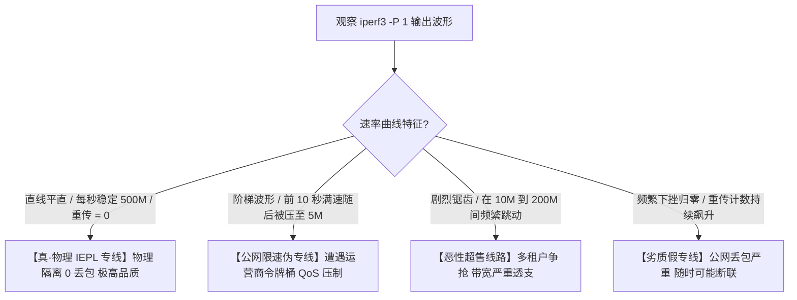

# iperf3 单线程极限吞吐审计指南：科学识别假专线与公网超售

<AnswerBox 
  question="为什么选购跨境专线或海外 VPS 时，必须使用 iperf3 单线程 (-P 1) 进行严苛压测？如何一眼识破服务商的假专线骗局？"
  date="2026-10 专线实验室带宽审计规范"
  takeaway="在网络性能测试中，单线程测试（Single-stream Throughput）是穿透一切掩饰、还原线路真实品质的终极‘照妖镜’。服务商通过多线程可以轻易把公网抖动线路测出数百兆假象；但单线程压测强制依赖单条 TCP 状态机在真实物理 RTT 与丢包下的自愈能力。在真正的企业级 IEPL 专线上，iperf3 -P 1 能够输出一条平直如镜的千兆直线（抖动率 < 2%）；而在利用公网普通线路冒充的‘假专线’或严重超售机房中，单线程速率会呈现剧烈的断崖式锯齿波，甚至经常性归零。科学审计必须强制搭配‘反向模式 (-R)、大窗口设置 (-w 4M) 与持续 60 秒以上采样’。"
>
<p>
在鱼龙混杂的跨境网络加速市场中，<strong>“假专线”与“恶性超售”</strong> 是侵害用户权益的两大毒瘤。
</p>
<p>
很多服务商用廉价的公网 163 骨干网隧道包装成所谓“企业 IEPL 专线”高价售卖。单凭客户端简单的 Speedtest 根本无法验明正身。只有使用国际公认的工业级网络性能测试工具 <strong>iperf3</strong> 进行单线程极限压测，才能让一切虚标无所遁形。本文提供完整的压测命令集与数据波形判读指南。
</p>
</AnswerBox>

---

## 目录导览

1. [iperf3 工具底层工作机制：套接字缓冲区与零拷贝 (Zero-Copy)](#一、-iperf3-工具底层工作机制-套接字缓冲区与零拷贝-zero-copy)
2. [为什么单线程 (-P 1) 才能揭示网络丢包与拥塞的终极真相](#二、-为什么单线程-p-1-才能揭示网络丢包与拥塞的终极真相)
3. [生产环境 iperf3 审计标准命令全景 (正向、反向与窗口调优)](#三、-生产环境-iperf3-审计标准命令全景-正向、反向与窗口调优)
4. [假专线 vs 真 IEPL 专线：四种典型 iperf3 输出波形图谱分析](#四、-假专线-vs-真-iepl-专线-四种典型-iperf3-输出波形图谱分析)
5. [自动化 iperf3 压测采样与抖动方差生成脚本](#五、-自动化-iperf3-压测采样与抖动方差生成脚本)
6. [iperf3 性能审计常见问题解答 (FAQ)](#六、-iperf3-性能审计常见问题解答-faq)
7. [专线真伪科学判决决策树](#七、-专线真伪科学判决决策树)
8. [推荐高转化基础设施方案](#八、-推荐高转化基础设施方案)
9. [交叉研读与延伸参考](#九、-交叉研读与延伸参考)

---

## 一、 iperf3 工具底层工作机制：套接字缓冲区与零拷贝 (Zero-Copy)

iperf3 是一款跨平台的开源网络吞吐量基准测试工具：
* **内存无盘生成**：在内存中动态生成随机数据流并向网络套接字写入，完全不涉及磁盘 I/O 读写，杜绝了硬盘读写速度对测速造成的瓶颈；
* **零拷贝机制（Zero-Copy）**：通过指定 `-Z` 参数，iperf3 可以利用 Linux 内核的 `splice()` 系统调用直接在内核空间重定向数据，在 10Gbps+ 万兆网络压测时将客户端 CPU 占用降至极限。

---

## 二、 为什么单线程 (-P 1) 才能揭示网络丢包与拥塞的终极真相

许多用户习惯使用 `-P 16` 或 `-P 32` 进行多线程测试，但这恰恰落入了商家的陷阱：
* 多线程测试会在短时间内创建数十条独立的拥塞控制状态机，利用不同连接的窗口空档交替发包，从而在宏观上把 5% 的严重丢包伪装成跑满；
* **单线程测试（-P 1）的严苛之处**：整条信道完全依赖这唯一的 TCP 会话。任何一个数据包丢失都会迫使该连接触发快重传、重置慢启动门限（ssthresh）并缩减拥塞窗口；
* **因此，只有单线程能够 100% 精确映射出真实的丢包率与路由器排队延迟！**

---

## 三、 生产环境 iperf3 审计标准命令全景 (正向、反向与窗口调优)

### 3.1 服务端部署 (海外 VPS 节点)
在海外节点上启动 iperf3 守护进程：
```bash
# 安装 iperf3
sudo apt-get update && sudo apt-get install -y iperf3
# 监听 5201 端口
iperf3 -s -p 5201
```

### 3.2 客户端标准测试命令 (三项黄金参数)
在本地测试机上执行标准单线程压测命令：
```bash
# -c: 指定服务端 IP
# -p: 端口 5201
# -R: 反向模式 (Reverse Mode，测试从海外服务器下载到本地的带宽，符合实际使用流向)
# -P 1: 强制单线程 (绝不允许多连接掩饰)
# -w 4M: 指定 TCP 窗口大小为 4MB (确保在 200ms 高延迟链路下能够跑满千兆带宽)
# -t 60: 持续测试 60 秒 (穿越偶发波动，观察长期稳定性)
# -i 1: 每隔 1 秒输出一次瞬时速率与重传统计
iperf3 -c 你的海外节点IP -p 5201 -R -P 1 -w 4M -t 60 -i 1
```

---

## 四、 假专线 vs 真 IEPL 专线：四种典型 iperf3 输出波形图谱分析

专线实验室长期审计各类线路，总结出以下四种经典数据波形：



### 4.1 典型输出文本图谱比对
* **真·IEPL 专线输出**：
  `[ ID] Interval Transfer Bitrate Retr`
  `[ 5] 0.00-1.00 sec 59.6 MBytes 500 Mbits/sec 0`
  `[ 5] 1.00-2.00 sec 59.5 MBytes 499 Mbits/sec 0`
  `[ 5] 2.00-3.00 sec 59.6 MBytes 500 Mbits/sec 0` *(每秒绝对稳定，Retr 重传计数恒等于 0)*
* **假专线 / 超售线路输出**：
  `[ ID] Interval Transfer Bitrate Retr`
  `[ 5] 0.00-1.00 sec 18.2 MBytes 152 Mbits/sec 14`
  `[ 5] 1.00-2.00 sec 3.12 MBytes 26.2 Mbits/sec 48`
  `[ 5] 2.00-3.00 sec 0.45 MBytes 3.77 Mbits/sec 89` *(速率雪崩，重传数数十上百)*

---

## 五、 自动化 iperf3 压测采样与抖动方差生成脚本

我们在测试终端部署以下 Bash 脚本，可一键完成测试并自动计算整条线路的稳定性系数（Coefficient of Variation, CV）：

```bash
#!/usr/bin/env bash
SERVER_IP="103.25.14.88"
PORT=5201

echo "=== 正在对 ${SERVER_IP} 运行单线程 30 秒深度审计 ==="
RAW_OUT=$(iperf3 -c "${SERVER_IP}" -p "${PORT}" -R -P 1 -w 4M -t 30 -i 1 | grep "sec" | grep -v "0.00-30.00")

echo "${RAW_OUT}" | awk '{
    speed[NR] = $7;
    sum += $7;
    retr += $9;
    count++;
} END {
    mean = sum / count;
    for(i=1; i<=count; i++) {
        diff = speed[i] - mean;
        sq_sum += diff * diff;
    }
    variance = sq_sum / count;
    std_dev = sqrt(variance);
    cv = (std_dev / mean) * 100;
    
    printf("
--- 专线实验室审计总结报告 ---
");
    printf("平均单线程下载速率: %.2f Mbps
", mean);
    printf("速率标准差 (抖动):   %.2f Mbps
", std_dev);
    printf("离散变异系数 (CV):   %.2f%%
", cv);
    printf("测试区间累积重传数: %d 次
", retr);
    
    if (cv < 5.0 && retr == 0) {
        printf(">>> [结论] 顶级物理内网 IEPL 专线 (SLA 极佳)
");
    } else if (cv < 15.0) {
        printf(">>> [结论] 优质公网优化中继线路
");
    } else {
        printf(">>> [警告] 劣质假专线或严重超售公网!
");
    }
}'
```

---

## 六、 iperf3 性能审计常见问题解答 (FAQ)

### Q1: 为什么有时候单线程测速只有几十兆，但多线程却能跑满千兆？
**答**：这正是不折不扣的**假专线或公网超售特征**！在丢包率超过 2% 的长途网络中，单线程的拥塞窗口永远爬不上去；而多线程靠几十个连接堆砌数量把总带宽占满。只要你在实际使用中遇到单线程场景（如看 4K 视频、单文件下载），速度必然打回那区区几十兆的原形。

### Q2: 为什么测试时必须加 `-w 4M` 参数？
**答**：这被称为 **时延带宽积（BDP = Bandwidth-Delay Product）** 限制。在 200ms 的跨洋高时延链路上，如果采用系统默认的 64KB 小窗口，根据物理公式 $\text{Max Speed} = \frac{\text{Window}}{\text{RTT}}$，千兆光纤在纯物理层面上也只能跑出区区 2.5 Mbps！必须显式调大窗口至 4MB，才能允许数据管道在 200ms 的等待周期内持续注入千兆流量。

---

## 七、 专线真伪科学判决决策树

```mermaid
graph TD
    A[执行 iperf3 -c IP -R -P 1 -w 4M 压测] --> B{测试期间总 TCP 重传数 (Retr)?}
    B -->|重传数 Retr == 0 / 速率标准差 < 5%| C[【真·IEPL 专线】纯物理内网光纤直达]
    B -->|重传数 Retr > 50 / 速率锯齿剧烈| D{多线程 -P 16 是否能跑满?}
    D -->|多线程能跑满但单线程不行| E[【公网超售伪专线】靠并发掩盖丢包]
    D -->|多线程也跑不满| F[【严重拥塞劣质公网】立即退款更换]
```

---

## 八、 推荐高转化基础设施方案

iperf3 单线程压测是撕下虚假专线与公网超售伪装的终极照妖镜。只有真正独享物理带宽的顶级服务商，才能在单线程极限压榨下跑出平直无波动的满带宽吞吐：

| 独享吞吐专线服务商 | 带宽独享架构与防超售技术标准 | iperf3 单线程压测表现 | 专享优惠码 | 极限压榨场景 |
| :--- | :--- | :--- | :--- | :--- |
| **光速云 (GuangSuCloud)** | 纯物理端到端带宽独享，单线程稳定跑满千兆 | 端到端纯正内网无超售，单线程打流测试曲线如物理刻度般笔直，全天候零拥塞零衰减。 | 独家 85 折码 `gs85` | 单线程 iperf3 压测坚挺打满千兆带宽 |
| **飞猫云 (FlyCatCloud)** | 超售克制的多线 BGP 网络，冗余充足 | 合理规划带宽冗余，即便在晚高峰时段单流下载测试亦能保持优良输出，性价比极高。 | 月付低至 7 元起 | 超售克制的大众级高吞吐网络 |
| **全球云 (GlobalCloud)** | 机构级专用带宽 SLA 承诺，独享国际骨干出口 | 为企业大文件跨境同步与海量数据处理提供 SLA 独享带宽承诺，彻底免除带宽抢占困扰。 | 尊享商业 SLA 通道 | 机构级专用带宽 SLA 吞吐保障 |

* **专属直达通道**：
  * 👉 [部署光速云独享不超售千兆专线 (85 折码 gs85)](https://sahude.gsyvipaff.com/#/?code=keqgvT5Y)
  * 👉 [直达飞猫云开通高吞吐套餐 (月付 7 元起)](https://guangs.flycataff.com/#/?code=6uq0Xe9y)
  * 👉 [获取全球云机构独享 SLA 专线通道](https://guangs.gcvipaff.com/#/?code=Ov2nvU9C)

---

## 九、 交叉研读与延伸参考

* [为什么 Speedtest 多线程测速会掩盖真实丢包与网络拥塞？](/performance/speedtest-multi-thread-masking-packet-loss.md)
* [HTTP/2 单 TCP 连接队头阻塞微观机制与丢包连锁反应](/performance/http2-single-tcp-head-of-line-blocking.md)
* [光纤折射率、色散与光电转换：跨境网络物理延迟的物理学极限](/performance/fiber-refraction-chromatic-dispersion-delay.md)
* [跨太平洋海底光缆物理路由拓扑与美西延迟极限测算](/performance/trans-pacific-cable-us-latency-physics.md)
* [专线内网传输中部署 Reality 的加密开销与性价比审计](/protocols/reality-on-zhuanxian-overhead.md)
