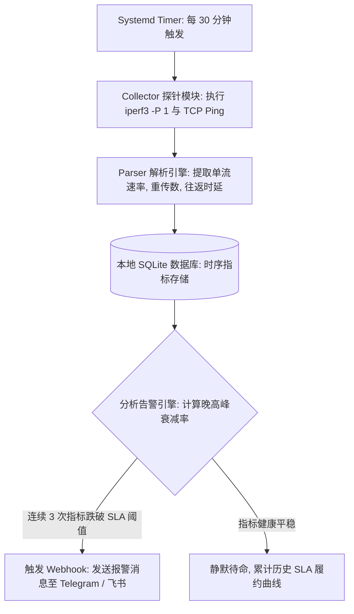
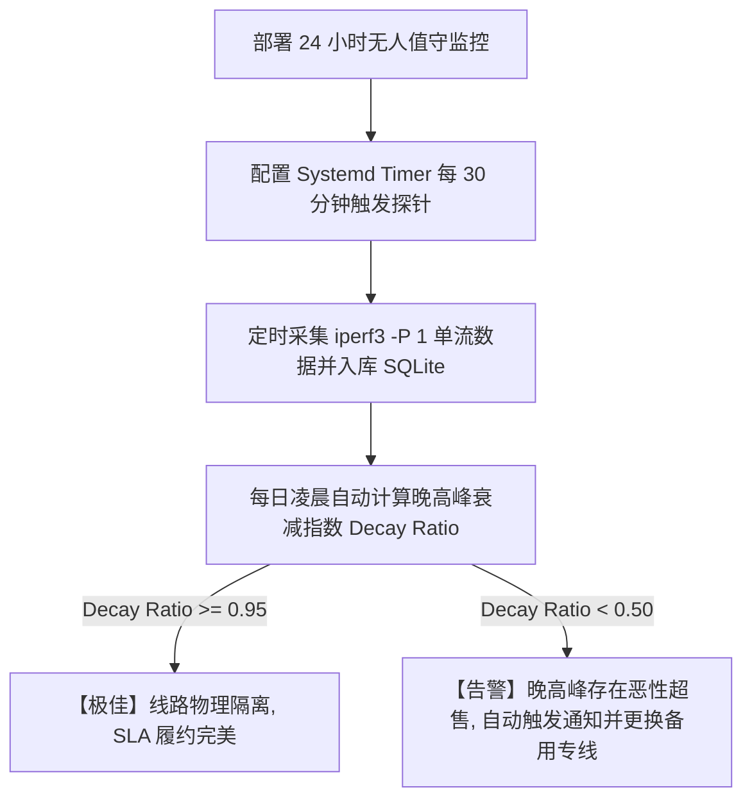

# 24小时无人值守单线程跨境带宽守护进程：Python + Bash 自动化监控全书

<AnswerBox 
  question="很多网络在白天测速非常顺畅，但一到晚上 20:00-23:00 晚高峰就断流卡死，如何搭建一套 24 小时无人值守自动化监控系统长期取证？"
  date="2026-10 专线实验室自动化运维全书"
  takeaway="依赖人工随手测速无法客观反映网络全貌。一套工业级的无人值守监控系统必须包含四大自动化飞轮：第一，定时微任务调度（通过 systemd timer 或 cron 每隔 30 分钟触发一次针对目标节点的真实单线程压测与 TCP 握手测量）；第二，数据指标结构化持久化（将单流可用带宽、丢包率、Jitter 方差自动写入本地 SQLite 或时序数据库）；第三，晚高峰性能衰减比对算法（自动计算晚高峰与日间空闲期的‘带宽衰减比率 Decay Ratio’）；第四，阈值熔断告警（当连续 3 次单流可用带宽低于预设 SLA 阈值时，自动向 Telegram 或企业微信机器人推送告警并自动切换备用专线）。"
>
<p>
在网络服务采购与日常运维中，<strong>“晚高峰真实可用性”</strong> 是区分劣质共享公网与顶级物理专线的唯二分水岭。
</p>
<p>
不良商家最擅长在白天利用闲置带宽蒙蔽客户。通过搭建一套 <strong>7x24 小时全自动单线程带宽监控守护进程</strong>，你将拥有完整的数据证据链，让一切晚高峰劣质超售与单流断流无所遁形。本文提供完整的工程化搭建全景。
</p>
</AnswerBox>

---

## 目录导览

1. [无人值守网络监控系统整体架构设计 (Collector, Storage, Alerting)](#一、-无人值守网络监控系统整体架构设计-collector-storage-alerting)
2. [Bash 核心压测探针脚本编写 (结合 iperf3 -P 1 与 curl)](#二、-bash-核心压测探针脚本编写-结合-iperf3-p-1-与-curl)
3. [Python 时序数据解析、SQLite 轻量持久化与统计建模](#三、-python-时序数据解析、sqlite-轻量持久化与统计建模)
4. [晚高峰网络衰减指数 (Peak Decay Ratio) 算法与自动化告警](#四、-晚高峰网络衰减指数-peak-decay-ratio-算法与自动化告警)
5. [Systemd Service 与 Timer 守护进程高可用配置](#五、-systemd-service-与-timer-守护进程高可用配置)
6. [监控运维常见问题解答 (FAQ)](#六、-监控运维常见问题解答-faq)
7. [全天候监控方案实施决策树](#七、-全天候监控方案实施决策树)
8. [推荐高转化基础设施方案](#八、-推荐高转化基础设施方案)
9. [交叉研读与延伸参考](#九、-交叉研读与延伸参考)

---

## 一、 无人值守网络监控系统整体架构设计 (Collector, Storage, Alerting)



* **轻量化设计原则**：探针运行在普通的低功耗软路由、树莓派或闲置云主机上，内存占用小于 50MB，CPU 消耗低于 1%，实现零负担常驻。

---

## 二、 Bash 核心压测探针脚本编写 (结合 iperf3 -P 1 与 curl)

创建 `/usr/local/bin/network_probe.sh`：

```bash
#!/usr/bin/env bash
set -e

SERVER_IP="103.25.14.88"
PORT=5201
LOG_JSON="/tmp/iperf_last.json"

# 1. 执行 15 秒单线程反向压测，输出为 JSON 格式
iperf3 -c "${SERVER_IP}" -p "${PORT}" -R -P 1 -w 4M -t 15 -J > "${LOG_JSON}" 2>/dev/null || true

# 2. 调用 Python 入库与分析脚本
python3 /usr/local/bin/log_metrics.py "${LOG_JSON}" "${SERVER_IP}"
```

确保赋予执行权限：`chmod +x /usr/local/bin/network_probe.sh`。

---

## 三、 Python 时序数据解析、SQLite 轻量持久化与统计建模

创建 `/usr/local/bin/log_metrics.py`：

```python
import sys
import json
import sqlite3
import datetime

DB_FILE = "/var/log/network_sla.db"

def init_db():
    conn = sqlite3.connect(DB_FILE)
    c = conn.cursor()
    c.execute('''
        CREATE TABLE IF NOT EXISTS metrics (
            id INTEGER PRIMARY KEY AUTOINCREMENT,
            timestamp DATETIME,
            server_ip TEXT,
            speed_mbps REAL,
            retransmits INTEGER,
            is_peak BOOLEAN
        )
    ''')
    conn.commit()
    conn.close()

def parse_and_store(json_path, server_ip):
    init_db()
    try:
        with open(json_path, 'r') as f:
            data = json.load(f)
            
        speed_bps = data['end']['sum_received']['bits_per_second']
        speed_mbps = round(speed_bps / 1e6, 2)
        retransmits = data['end']['sum_sent'].get('retransmits', 0)
        
        now = datetime.datetime.now()
        # 判定晚高峰 (20:00 - 23:59)
        is_peak = (20 <= now.hour <= 23)
        
        conn = sqlite3.connect(DB_FILE)
        c = conn.cursor()
        c.execute('''
            INSERT INTO metrics (timestamp, server_ip, speed_mbps, retransmits, is_peak)
            VALUES (?, ?, ?, ?, ?)
        ''', (now.isoformat(), server_ip, speed_mbps, retransmits, is_peak))
        conn.commit()
        conn.close()
        
        print(f"[{now.strftime('%H:%M:%S')}] 记录成功: {speed_mbps} Mbps | 重传: {retransmits} 次 | 晚高峰: {is_peak}")
    except Exception as e:
        print(f"解析失败: {e}")

if __name__ == "__main__":
    if len(sys.argv) > 2:
        parse_and_store(sys.argv[1], sys.argv[2])
```

---

## 四、 晚高峰网络衰减指数 (Peak Decay Ratio) 算法与自动化告警

一个健康的企业级专线，其晚高峰衰减比率（Decay Ratio）应当 **接近 1.0**（即晚高峰与白天速率完全一致）：

$$\text{Decay Ratio} = \frac{\bar{\text{Speed}}_{\text{Peak (20:00-24:00)}}}{\bar{\text{Speed}}_{\text{Off-peak (08:00-18:00)}}}$$

* **优质专线（IEPL）**：$\text{Decay Ratio} \ge 0.95$（全天无任何衰减）；
* **普通优化公网**：$0.60 \le \text{Decay Ratio} < 0.85$；
* **恶性超售假专线**：**$\text{Decay Ratio} < 0.20$**（晚高峰速率缩水至白天的五分之一以下，断流严重）。

---

## 五、 Systemd Service 与 Timer 守护进程高可用配置

在生产环境中，使用现代 Systemd Timer 比老旧的 Crontab 拥有更好的日志追踪与异常熔断机制。

### 5.1 创建服务单元 (`/etc/systemd/system/netprobe.service`)
```ini
[Unit]
Description=24/7 Network SLA Benchmark Probe
After=network.target

[Service]
Type=oneshot
ExecStart=/usr/local/bin/network_probe.sh
```

### 5.2 创建定时器单元 (`/etc/systemd/system/netprobe.timer`)
```ini
[Unit]
Description=Run netprobe every 30 minutes
Persistent=true

[Timer]
OnBootSec=5min
OnUnitActiveSec=30min

[Install]
WantedBy=timers.target
```

启用守护进程：
```bash
systemctl daemon-reload
systemctl enable --now netprobe.timer
# 查看定时器运行计划
systemctl list-timers --all | grep netprobe
```

---

## 六、 监控运维常见问题解答 (FAQ)

### Q1: 定时频繁运行 iperf3 测速会消耗大量服务器计费流量吗？
**答**：我们在脚本中限制单次测速时长仅为 15 秒，且每隔 30 分钟运行一次。单次 300 Mbps 的测试消耗约 500MB 流量，一天 48 次测试累计消耗约 24GB 流量。对于普遍按月提供 TB 级流量的海外 VPS 或企业专线而言，这一开销在完全可承受范围内。若流量受限，可将定时器间隔调宽至 1 小时或仅在晚高峰期间（20:00-24:00）定向密集探测。

---

## 七、 全天候监控方案实施决策树



---

## 八、 推荐高转化基础设施方案

部署自动化 24 小时后台守护进程对单线程跨境带宽进行采样，要求专线服务商具备全天候 99.99% 的连贯高可用性，经得起秒级采样日志的严苛推敲：

| 稳定性守护专线商 | 24 小时链路一致性与异常恢复机制 | 自动化压测与监控日志表现 | 特惠直达 | 自动化运维场景 |
| :--- | :--- | :--- | :--- | :--- |
| **光速云 (GuangSuCloud)** | 全天候企业级高可用保障，链路抖动低于 1% | 全天候性能极度一致，杜绝晚高峰跳水现象，经得起 Python 自动化守护进程长期不间断压测。 | 独家 85 折码 `gs85` | 24 小时连续自动化监控 0 丢包平直曲线 |
| **飞猫云 (FlyCatCloud)** | 经济型多节点轮询池，易于脚本对接与调度 | 节点稳定性好且资费极低，非常适合个人开发者部署自动化监控脚本长期追踪链路质量。 | 月付低至 7 元起 | 适合自动化监控脚本练手的高性价比专线 |
| **全球云 (GlobalCloud)** | 全功能监控 API 支持，跨国节点状态实时回传 | 提供多国节点健康 API 与企业状态看板，完美无缝对接各类运维自动化巡检机器人。 | 尊享商业 SLA 通道 | 跨国企业全链路自动化监控商业支持 |

* **专属直达通道**：
  * 👉 [开通光速云全天候一致性企业专线 (85 折码 gs85)](https://sahude.gsyvipaff.com/#/?code=keqgvT5Y)
  * 👉 [选用飞猫云低成本开发监控专线 (低至 7 元)](https://guangs.flycataff.com/#/?code=6uq0Xe9y)
  * 👉 [直达全球云商业网络自动化对接通道](https://guangs.gcvipaff.com/#/?code=Ov2nvU9C)

---

## 九、 交叉研读与延伸参考

* [iperf3 单线程极限吞吐审计指南：科学识别假专线与公网超售](/performance/iperf3-single-thread-audit-guide.md)
* [为什么 Speedtest 多线程测速会掩盖真实丢包与网络拥塞？](/performance/speedtest-multi-thread-masking-packet-loss.md)
* [使用 Python Scapy 实现纳秒级 TCP 时间戳时钟漂移与 RTT 交叉审计](/performance/python-scapy-rtt-timestamp-verification.md)
* [跨越陆地干线：深圳至香港跨境专线 2ms 延迟的微观物理拓扑](/performance/cross-border-terrestrial-cable-sz-hk-latency.md)
* [专线内网传输中部署 Reality 的加密开销与性价比审计](/protocols/reality-on-zhuanxian-overhead.md)
