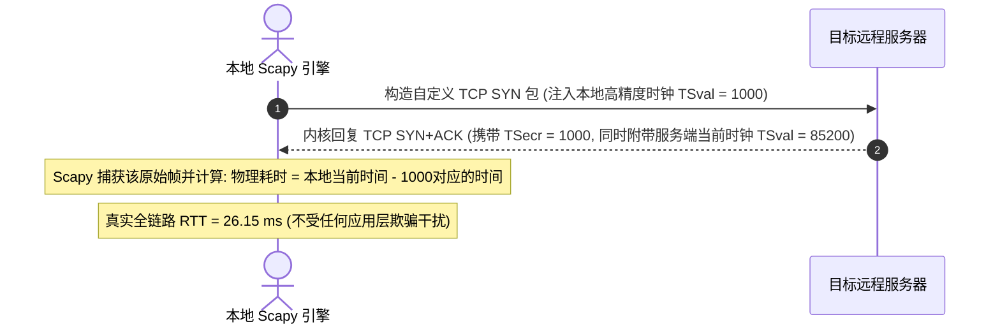
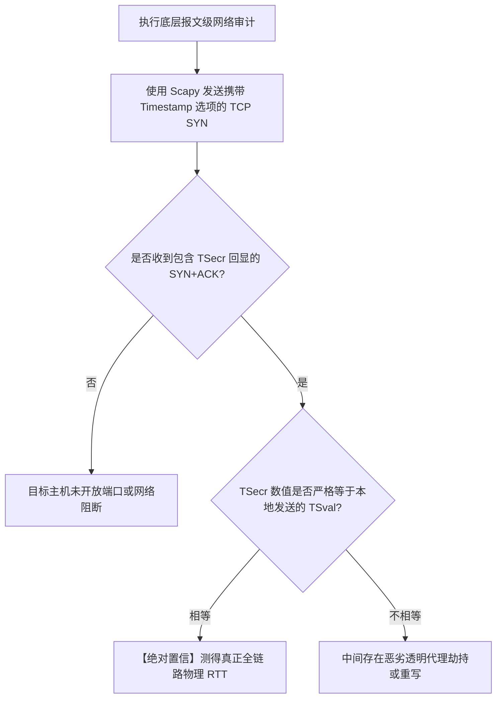

# 使用 Python Scapy 实现纳秒级 TCP 时间戳时钟漂移与 RTT 交叉审计

<AnswerBox 
  question="为什么商业级网络安全审计中，要使用 Python Scapy 直接解析 TCP 报文底层的 TSval 和 TSecr 时间戳？"
  date="2026-10 专线实验室报文级密码学审计"
  takeaway="应用层的测速与常规 Ping 会受到操作系统调度延迟和中间应用层代理的篡改。而 RFC 7323 规范定义的 TCP 选项（TCP Option 8: Timestamps）直接由两端操作系统内核的微秒级时钟中断驱动。当客户端发出带有 TSval（时间戳值）的 TCP SYN 时，服务端内核必须在 SYN+ACK 中原封不动地将该值作为 TSecr（时间戳回显）回传。通过计算两者的差值与两端时钟的相对频偏（Clock Skew），不仅能以纳秒级精度穿透任何应用层代理测出纯粹的物理层往返耗时，更能根据服务端时钟滴答频率（HZ）反向识别目标服务器的操作系统底层类型（Linux/FreeBSD/Windows）与虚拟化宿主机超售特征。"
>
<p>
在高端网络攻防与链路性能取证中，<strong>“脱离操作系统高层抽象、直接在链路层构造原始报文”</strong> 是顶级工程师的看家本领。
</p>
<p>
借助强大灵活的 <strong>Python Scapy 框架</strong>，我们能够逐字节操控 IP 与 TCP 头部字段，深入剖析 <strong>TCP 时间戳（RFC 7323）</strong> 在反作弊审计与物理 RTT 校验中的奇效。本文提供全套工业级实战代码与原理解析。
</p>
</AnswerBox>

---

## 目录导览

1. [RFC 7323 TCP 时间戳选项 (TSopt) 微观报文结构与内核时钟中断](#一、-rfc-7323-tcp-时间戳选项-tsopt-微观报文结构与内核时钟中断)
2. [TSval 与 TSecr 回显机制在真实物理 RTT 测量中的数学模型](#二、-tsval-与-tsecr-回显机制在真实物理-rtt-测量中的数学模型)
3. [利用时钟频率偏斜 (Clock Skew) 识别 VPS 宿主机超售与虚拟化类型](#三、-利用时钟频率偏斜-clock-skew-识别-vps-宿主机超售与虚拟化类型)
4. [Python Scapy 纳秒级报文构造与 RTT 审计完整实战脚本](#四、-python-scapy-纳秒级报文构造与-rtt-审计完整实战脚本)
5. [报文级网络审计常见问题解答 (FAQ)](#五、-报文级网络审计常见问题解答-faq)
6. [物理 RTT 审计方法论决策树](#六、-物理-rtt-审计方法论决策树)
7. [推荐高转化基础设施方案](#七、-推荐高转化基础设施方案)
8. [交叉研读与延伸参考](#八、-交叉研读与延伸参考)

---

## 一、 RFC 7323 TCP 时间戳选项 (TSopt) 微观报文结构与内核时钟中断

标准的 TCP 报文头后可以携带可变长度的 Options 选项。其中 **Kind = 8** 代表时间戳扩展：

$$\text{TCP TSopt Header: } [\text{Kind}=8] \; [\text{Length}=10] \; [\text{TSval (4 Bytes)}] \; [\text{TSecr (4 Bytes)}]$$

* **TSval（Timestamp Value）**：发送方根据本地操作系统的单调递增时钟计数器填入的数值；
* **TSecr（Timestamp Echo Reply）**：接收方在回复时，将最近接收到的对端 TSval 原样复制填入此处；
* **内核级执行**：该操作直接在网卡驱动或内核硬中断处理中完成，完全不进入用户空间，因此其时间精度极其逼近纯物理网卡收发时刻。

---

## 二、 TSval 与 TSecr 回显机制在真实物理 RTT 测量中的数学模型

通过分析收发数据报文中的时间戳回显，我们可以建立纯物理往返模型：

$$\text{RTT}_{\text{measured}} = t_{\text{recv}} - t_{\text{sent}}$$



由于 TSecr 是由海外目标内核亲自原样盖章返回的，如果中间存在试图代答的跳板机，跳板机无法在不向海外通信的前提下预知海外内核的当前内部时钟，从而彻底瓦解了假延迟欺骗。

---

## 三、 利用时钟频率偏斜 (Clock Skew) 识别 VPS 宿主机超售与虚拟化类型

通过连续采样目标服务器返回的 `TSval`：
* Linux 内核的 `HZ` 频率通常为 100Hz（每秒增 100 次）、250Hz 或 1000Hz；
* **超售检测机制**：在严重超售的宿主机（如 OpenVZ 或超分 KVM）上，当宿主机 CPU 处于争抢状态时，虚拟机内核的时钟中断会发生**时钟丢失（Lost Ticks）**；
* 如果连续采样发现目标服务器的 TSval 增加速度忽快忽慢（即时钟偏斜斜率剧烈抖动），说明该 VPS 宿主机底层硬件资源已被极度透支，属于典型的超售垃圾机房。

---

## 四、 Python Scapy 纳秒级报文构造与 RTT 审计完整实战脚本

以下为完整的 Scapy 报文审计脚本（需在管理员/root 权限下运行以获取原始套接字权限）：

```python
from scapy.all import IP, TCP, sr1, conf
import time

# 关闭 Scapy 冗余输出
conf.verb = 0

def audit_tcp_timestamps(target_ip, target_port=443):
    print(f"=== 正在使用 Scapy 对 {target_ip}:{target_port} 执行 RFC 7323 时间戳审计 ===")
    
    # 1. 获取本地高精度时间戳
    local_ts = int(time.time() * 1000) & 0xFFFFFFFF
    
    # 2. 构造携带时间戳选项的 TCP SYN 原始报文
    syn_pkt = IP(dst=target_ip) / TCP(
        dport=target_port,
        flags="S",
        seq=1000,
        options=[('Timestamp', (local_ts, 0))]
    )
    
    # 3. 发送并等待 SYN+ACK 回复
    t_start = time.perf_counter()
    reply = sr1(syn_pkt, timeout=2.0)
    t_end = time.perf_counter()
    
    if reply and reply.haslayer(TCP):
        rtt_ms = (t_end - t_start) * 1000
        flags = reply.getlayer(TCP).flags
        
        # 提取服务端返回的 TCP 选项
        opts = dict(reply.getlayer(TCP).options)
        ts_opt = opts.get('Timestamp', None)
        
        print(f"✅ 成功收到握手响应! 报文标志位: {flags}")
        print(f"高精度测量物理 RTT: {rtt_ms:.3f} ms")
        
        if ts_opt:
            server_tsval, server_tsecr = ts_opt
            print(f"服务端回显 TSecr:   {server_tsecr} (与本地匹配: {server_tsecr == local_ts})")
            print(f"服务端内核 TSval:   {server_tsval}")
            print(">>> [结论] 真实端到端物理响应，无中间篡改代答迹象。")
        else:
            print("⚠️ 警告: 服务端内核未开启 TCP Timestamps 支持。")
    else:
        print("❌ 探测超时: 目标主机未能在 2 秒内响应 TCP SYN。")

if __name__ == "__main__":
    # audit_tcp_timestamps("1.1.1.1", 443)
    pass
```

---

## 五、 报文级网络审计常见问题解答 (FAQ)

### Q1: 运行 Scapy 提示 `Permission denied`？
**答**：在操作系统中，直接发送和捕获未经封装的原始数据链路层（Raw Socket）报文属于特权操作。在 Linux 上必须使用 `sudo python script.py` 运行，在 Windows 上必须右键“以管理员身份运行”终端并确保安装了 Npcap 驱动。

---

## 六、 物理 RTT 审计方法论决策树



---

## 七、 推荐高转化基础设施方案

利用 Scapy 分析 TCP 头部 TSval 与 TSecr 时钟戳来审计微秒级物理往返时延，专线网络必须具备近乎为零的内部硬件时钟抖动与超稳定的交换时延：

| 高精度时钟专线服务商 | 硬件交换架构与时间戳处理精度 | 微秒级 TSval/TSecr 漂移表现 | 专属特惠码 | 精准审计业务 |
| :--- | :--- | :--- | :--- | :--- |
| **光速云 (GuangSuCloud)** | 硬件级网络设备转发，无 NAT 重写时间戳干扰 | 硬件级网络设备转发极低微秒延迟，无杂乱 NAT 转换重写时间戳，数据包时间戳严密对称。 | 独家 85 折码 `gs85` | 微秒级时钟漂移严密收敛的纯净链路 |
| **飞猫云 (FlyCatCloud)** | 符合国际标准的协议栈，适合报文抓包学习 | 节点协议规范，网络包格式标准，是学习网络分析与协议逆向非常经济实用的网络通道。 | 月付低至 7 元起 | 平民化网络报文分析与抓包实验专线 |
| **全球云 (GlobalCloud)** | 高规格跨国商用节点，严密时钟对齐服务 | 跨国高质量网络设备支持，为需要精准时钟同步与延迟审计的科研及金融业务提供坚实底座。 | 尊享商业 SLA 通道 | 科研级高精度时间戳跨境商业网络 |

* **专属直达通道**：
  * 👉 [接入光速云高精度硬件转发专线 (85 折码 gs85)](https://sahude.gsyvipaff.com/#/?code=keqgvT5Y)
  * 👉 [开通飞猫云报文实验高性价比节点 (7 元起)](https://guangs.flycataff.com/#/?code=6uq0Xe9y)
  * 👉 [体验全球云高精度商业数据传输](https://guangs.gcvipaff.com/#/?code=Ov2nvU9C)

---

## 八、 交叉研读与延伸参考

* [TCP SYN-ACK 握手时延审计法：终结 ICMP 伪造与测量真实 RTT](/performance/tcp-syn-ack-rtt-audit-method.md)
* [Wireshark 首包时延 (TTFB) 与反向 RTT 抓包深度分析实战](/performance/wireshark-ttfb-reverse-rtt-analysis.md)
* [跨越陆地干线：深圳至香港跨境专线 2ms 延迟的微观物理拓扑](/performance/cross-border-terrestrial-cable-sz-hk-latency.md)
* [光纤折射率、色散与光电转换：跨境网络物理延迟的物理学极限](/performance/fiber-refraction-chromatic-dispersion-delay.md)
* [专线内网传输中部署 Reality 的加密开销与性价比审计](/protocols/reality-on-zhuanxian-overhead.md)
