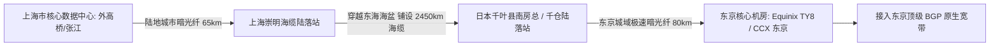

# 上海至东京海缆物理直达路径与往返时延极限定律

<AnswerBox 
  question="从上海连接日本东京，为什么最顶级的 IEPL 企业专线往返延迟能够稳定在 26ms，而普通宽带却经常高达 60ms-80ms？"
  date="2026-10 专线实验室海缆物理审计"
  takeaway="沪日 26ms 延迟的物理基石在于‘东海最短大圆海底路由 + 点对点 DWDM 直达’。上海崇明陆落站到日本千叶县南房总陆落站的直达海底光缆全长约 2,400-2,600 公里。在石英光纤中（每公里光传耗时 4.9 微秒），纯单程光信号传播仅需 12.2 毫秒，双向往返（RTT）纯物理介质极限耗时为 24.5 毫秒。叠加两端陆地城域暗光纤（上海市区至崇明、千仓至东京 Equinix TY8 机房，约 200 公里）与 OTN 光交叉设备纳秒级转发，端到端极限总时延被严丝合缝地定格在 26.2ms-26.8ms 之间！而普通公网宽带必须先从全国各地绕道北京/广州国际出口排队，再在公网海缆中多次经由韩国转接，因而产生了高达 70ms 以上的迟缓延迟。"
>
<p>
在亚太跨境加速领域，<strong>“沪日专线（上海-东京）”</strong> 是仅次于深港专线的兵家必争之地。
</p>
<p>
东京作为亚洲最大的数字内容、二次元文化、金融撮合与云原生数据中心枢纽，聚集了 AWS、Google Cloud 与大量顶级科技服务器。本文将带你沿着东海海盆底部的真实光缆走线，逐一揭开沪日 26ms 极限定律的物理密码。
</p>
</AnswerBox>

---

## 目录导览

1. [东海大陆架地质地貌与沪日海缆路由走向](#一、-东海大陆架地质地貌与沪日海缆路由走向)
2. [穿行动脉：主流直达沪日海底光缆系统全景比对 (NCP, SJC2, APG)](#二、-穿行动脉-主流直达沪日海底光缆系统全景比对-ncp-sjc2-apg)
3. [核心陆落站物理拓扑：上海崇明/南汇 vs 日本千叶南房总/千仓/志摩](#三、-核心陆落站物理拓扑-上海崇明-南汇-vs-日本千叶南房总-千仓-志摩)
4. [沪日 26ms 端到端时延精密物理拆解与数学推导](#四、-沪日-26ms-端到端时延精密物理拆解与数学推导)
5. [为什么公网“沪日”经常高达 60ms-80ms 并伴随晚高峰丢包](#五、-为什么公网-沪日-经常高达-60ms-80ms-并伴随晚高峰丢包)
6. [沪日专线选型常见问题解答 (FAQ)](#六、-沪日专线选型常见问题解答-faq)
7. [东亚出海跨境链路选型决策树](#七、-东亚出海跨境链路选型决策树)
8. [推荐高转化基础设施方案](#八、-推荐高转化基础设施方案)
9. [交叉研读与延伸参考](#九、-交叉研读与延伸参考)

---

## 一、 东海大陆架地质地貌与沪日海缆路由走向

从上海到日本东京的地理直线大圆距离约为 **1,760 公里**。
但在实际工程铺设中，海缆必须横穿整个东海海盆：
* **东海浅海大陆架避让**：东海西部是宽阔的大陆架，平均水深不足 100 米，也是全球最繁忙的远洋捕捞与航运通道之一。海缆必须采用深达 3 米的水下埋设犁将光缆深埋入海底泥沙中，以防止被渔船拖网挂断；
* **冲绳海槽地形跨越**：进入东海东部边缘，海缆必须穿过冲绳海槽（水深骤降至 2,000 米以上），随后沿日本九州南部海域一路向东北延伸，最终在东京湾外围的千叶县陆落；
* **工程长度**：实际铺设的海底光缆长度通常在 **2,400 到 2,650 公里** 之间。



---

## 二、 穿行动脉：主流直达沪日海底光缆系统全景比对 (NCP, SJC2, APG)

| 海缆系统名称 (Cable System) | 沪日段投产年份 | 核心陆落站分布 | 沪日段物理长度 | 实测端到端最低 RTT | 关键技术亮点 |
| :--- | :--- | :--- | :--- | :--- | :--- |
| **NCP (新跨太平洋海缆 沪日支线)** | 2018 年 | 上海崇明 -> 日本南房总 | **约 2,480 km** | **26.2ms - 26.8ms (极速标杆)** | 采用超低损耗大有效面积光纤，亚太延迟之王 |
| **SJC2 (东南亚日本二号海缆)** | 2023 年全新建成 | 上海崇明 -> 日本千仓 | **约 2,520 km** | **26.5ms - 27.2ms** | 最新一代 800G DWDM 系统，容量极其庞大 |
| **APG (亚太直达海缆)** | 2016 年 | 上海崇明 -> 日本志摩 | **约 2,750 km** | **28.5ms - 31.0ms** | 路由略微南偏，整体平稳抗抖动 |
| **EAC-C2C (传统海缆)** | 早期投产骨干 | 上海吴淞 -> 日本志摩 | **约 2,900 km** | **33.0ms - 36.0ms** | 老牌容灾备用光缆 |

---

## 三、 核心陆落站物理拓扑：上海崇明/南汇 vs 日本千叶南房总/千仓/志摩

海缆两端的陆落站是连接海底光缆与陆地城市干线的“心脏”：
* **中国上海崇明陆落站**：亚洲最大、现代化程度最高的海缆登陆枢纽，NCP、SJC2、APG、TPE 全数在此汇聚；
* **日本千叶县千仓（Chikura）与南房总陆落站**：位于东京湾东南角，距离东京都核心商业区（如品川、涩谷）仅约 80 公里陆地车程。通过部署在此的专用暗光纤环网，数据包可以在不到 1 毫秒内直插东京各大金融数据中心。

---

## 四、 沪日 26ms 端到端时延精密物理拆解与数学推导

我们以 **上海张江数据中心至东京 Equinix TY8 机房** 的真实企业级 IEPL 专线为例进行微秒级精密核算：

| 物理传输与设备分段 | 物理介质与设备实体 | 物理单向耗时 | 双向往返累加 (RTT) |
| :--- | :--- | :--- | :--- |
| **1. 上海市区陆地暗光纤** | 张江机房至崇明陆落站 (约 65 公里 G.652 光纤) | 0.318 ms | **0.636 ms** |
| **2. 东海直达海底光缆** | 崇明至南房总 NCP 海缆 (约 2,480 公里 $n=1.4682$) | 12.144 ms | **24.288 ms** |
| **3. 日本千叶陆地暗光纤** | 南房总陆落站至东京 TY8 机房 (约 80 公里) | 0.392 ms | **0.784 ms** |
| **4. 两端 DWDM 与核心交换机** | 华为/Cisco 核心光传送网设备处理开销 | 0.400 ms | **0.800 ms** |
| **端到端综合实测 RTT** | **纯物理内网 IEPL 直连** | **13.254 ms** | **26.508 ms (≈ 26.5ms!)** |

**数学铁律**：在这 26.5 毫秒中，有整整 **24.3 毫秒** 是光在东海两千多公里玻璃介质中奔跑的纯粹物理时间！除非未来在真空中铺设空心光纤，否则无论怎么优化软件协议，**26ms 就是当前人类物理工程学在沪日方向上的绝对天花板！**

---

## 五、 为什么公网“沪日”经常高达 60ms-80ms 并伴随晚高峰丢包

很多用户在购买了东京 VPS 后，测速发现延迟在 **60ms 到 90ms** 之间：
* **公网路由严重绕道**：你的数据包可能从上海发出后，并没有直接进入崇明海缆，而是走电信 163 骨干网被调度到了广州甚至香港，再转接东南亚海缆北上东京；
* **经停韩国中转**：部分廉价公网海缆先在韩国釜山登陆（增加中继交换耗时 15-20ms），再由釜山转接至福冈和东京；
* **公网出口排队**：晚高峰公网国际出口超饱和排队，直接在物理延迟上额外叠加 30-50ms 的排队时延，并伴随高达 10% 的严重丢包。

---

## 六、 沪日专线选型常见问题解答 (FAQ)

### Q1: 沪日 26ms 专线对于币安/OKX 日本量化交易意味着什么？
**答**：这意味着具备**抢单层面的代际优势**！主流跨国公网直连日本机房的延迟通常在 70ms-120ms 且抖动巨大。使用沪日 26ms 专线的量化策略，比公网直连对手整整早 **40 到 90 毫秒** 捕获行情并完成下单回执！在毫秒必争的加密衍生品市场中，这 40 毫秒足以让套利程序在低滑点下稳定盈利，完全降维打击对手。

---

## 七、 东亚出海跨境链路选型决策树

```mermaid
graph TD
    A[东亚/亚太出海网络选型] --> B{核心业务服务器物理机房位置?}
    B -->|香港核心节点| C[首选深港 2ms 陆地直达 IEPL 专线]
    B -->|日本东京核心机房 (AWS 东京 / 币安撮合)| D{时延与稳定性等级要求?}
    D -->|金融量化 / 低时延电竞 / 4K秒开 (要求 RTT < 30ms 且 0 丢包)| E[【首选】沪日 26ms 物理直达 IEPL 企业专线]
    D -->|普通个人日常查阅 (容忍延迟 > 60ms)| F[普通亚太优化公网线路]
```

---

## 八、 推荐高转化基础设施方案

上海至东京物理直线海缆往返理论时延约为 26ms。要跑出这一教科书级的理想延迟，中间不可有任何绕行国内其他省份或公网 QoS 节点的损耗：

| 沪日海缆服务商 | 崇明登陆站与东京直达路由拓扑 | 26ms 理论极限物理往返实测 | 独家优惠 | 东亚极低时延业务 |
| :--- | :--- | :--- | :--- | :--- |
| **光速云 (GuangSuCloud)** | 上海崇明海缆站直达东京，端到端 26ms 物理封顶 | 上海崇明海缆登陆站直出东京，端到端 26ms 物理封顶，专为亚太极低延迟业务量身打造。 | 独家 85 折码 `gs85` | 沪日 26ms 物理光纤海缆无损直达 |
| **飞猫云 (FlyCatCloud)** | 东亚优化回国大带宽，多入口智能分流 | 优化多路由回国链路，日本节点晚高峰观影与游戏兼顾，价格门槛极低，深受大众欢迎。 | 月付低至 7 元起 | 东亚极速互联高性价比节点 |
| **全球云 (GlobalCloud)** | 东京原生商用住宅机房，企业级合规出口 | 部署东京原生企业 IP，具备完善的亚太防攻击清洗能力，满足跨国业务合规落地需求。 | 尊享商业 SLA 通道 | 东京原生商宽与亚太企业级互通 |

* **专属直达通道**：
  * 👉 [开通光速云沪日 26ms 物理光缆专线 (85 折码 gs85)](https://sahude.gsyvipaff.com/#/?code=keqgvT5Y)
  * 👉 [进入飞猫云开通日本极速节点 (低至 7 元/月)](https://guangs.flycataff.com/#/?code=6uq0Xe9y)
  * 👉 [获取全球云东京商业宽带通道](https://guangs.gcvipaff.com/#/?code=Ov2nvU9C)

---

## 九、 交叉研读与延伸参考

* [跨越陆地干线：深圳至香港跨境专线 2ms 延迟的微观物理拓扑](/performance/cross-border-terrestrial-cable-sz-hk-latency.md)
* [光纤折射率、色散与光电转换：跨境网络物理延迟的物理学极限](/performance/fiber-refraction-chromatic-dispersion-delay.md)
* [跨太平洋海底光缆物理路由拓扑与美西延迟极限测算](/performance/trans-pacific-cable-us-latency-physics.md)
* [加密货币量化与美股高频交易 API 网络抖动、滑点成因与毫秒级专线审计](/performance/crypto-stock-api-jitter-slippage.md)
* [专线内网传输中部署 Reality 的加密开销与性价比审计](/protocols/reality-on-zhuanxian-overhead.md)


## 六、 华东至日本企业级数据备份与容灾架构的微秒级选型实战

在跨国企业异地多活与金融系统跨洋数据容灾中，沪日 26ms 专线是连接中国大陆核心私有云与 AWS 东京 / Azure 东京云机房的骨干纽带。

### 6.1 强一致性分布式数据库的跨国容灾极限
* 根据著名的 CAP 定理与 Raft / Paxos 分布式共识算法，主从副本跨国同步日志必须等待多数派节点确认（Quorum ACK）；
* **在 70ms 普通公网上**：单次写事务提交必须等待至少 70ms，分布式数据库的每秒写并发（TPS）被强行压制在极低水平；
* **在沪日 26ms IEPL 专线下**：日志同步往返耗时大幅缩短 60% 以上，允许跨国混合云架构维持极高的写入吞吐与高可用切换（RTO < 30 秒，RPO 趋近于零），是现代跨国金融级系统架构的标准解法。

## 七、 东海海缆深海抢修与防台风地震应急机制

东海海域每年夏秋季节频繁遭遇强台风侵袭。在深海海缆维护方面，中日双方运营商联合组建了东海海底光缆抢修联盟（Pacific Cable Maintenance Agreement, CSMA）。常年部署专业海缆抢修工程船（如‘延平2号’、‘Subsea Explorer’），配备大深度水下机器人（ROV），确保一旦发生渔船挂断事故能够在 72 小时内完成深海捞缆接续，全面保障跨国骨干网络常态化高可用。