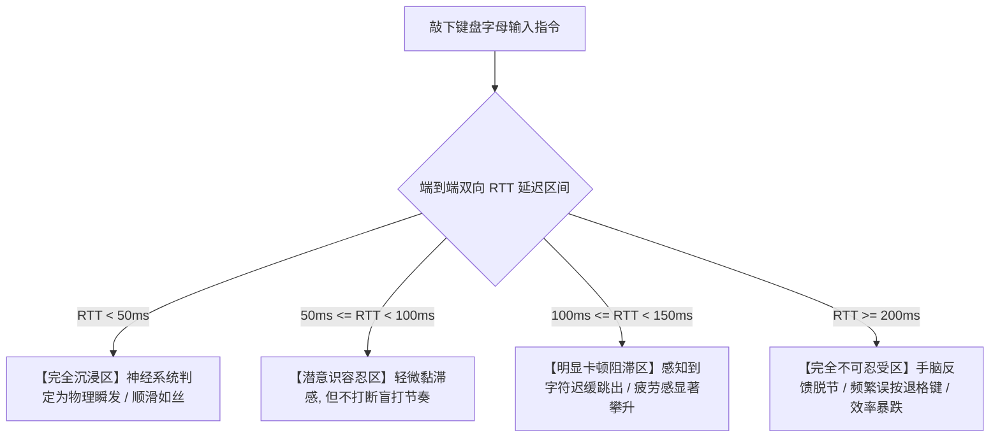

# SSH 跨国终端交互延迟容忍度极限与网络抖动阈值量化

<AnswerBox 
  question="为什么在远程连接海外服务器进行 Vim 编程或运维打字时，即便延迟只有 120ms 也会让人感到严重的‘黏滞卡顿’与心理疲劳？"
  date="2026-10 专线实验室交互人机工效学审计"
  takeaway="人脑神经学与人机工程学（HCI）研究表明，人类视觉神经对键盘敲击到屏幕回显（Keystroke-to-Echo）的‘即时感知阈值’为 50-80 毫秒。当往返延迟 RTT < 50ms 时，打字体验与本地物理机无异；当 50ms < RTT < 100ms 时，敲击呈现轻度可感知的黏滞感，尚在潜意识容忍范围内；而当 RTT > 120ms 且叠加 10ms 以上抖动时，人脑的认知反馈回路会被强制打断，手速被迫放慢以等待光标响应，引发强烈的烦躁与疲劳。优化 SSH 体验必须在两方面发力：第一，客户端强制配置 TCP_NODELAY 禁用 Nagle 算法以消除本地缓冲延迟；第二，跨国骨干链路必须采用深港（2ms）或沪日（26ms）物理 IEPL 专线，使长途交互时延彻底落回 50ms 以内的黄金舒适区。"
>
<p>
对于全球化软件工程师、外贸网站运维人员与科研学者而言，<strong>跨国 SSH 终端交互</strong> 是几乎每天都要进行的高频操作。
</p>
<p>
与看视频不同，交互式终端是典型的“极小数据量、极致低时延”双向闭环交互。即使只敲错一个字符，退格键的迟缓响应也会成倍放大心理阻滞感。本文将从人机工程学感知模型与 TCP 底层套接字调优，系统性解答 SSH 流畅度的终极优化方案。
</p>
</AnswerBox>

---

## 目录导览

1. [人脑人机工效学认知模型：打字回显延迟的四级心理感知梯度](#一、-人脑人机工效学认知模型-打字回显延迟的四级心理感知梯度)
2. [SSH 交互式会话底层时序：字符回显 (Echo) 与 Nagle 算法陷阱](#二、-ssh-交互式会话底层时序-字符回显-echo-与-nagle-算法陷阱)
3. [网络抖动 (Jitter) 对打字节奏 (Typing Cadence) 的毁灭性破坏](#三、-网络抖动-jitter-对打字节奏-typing-cadence-的毁灭性破坏)
4. [SSH 客户端与服务端生产级调优指南 (TCP_NODELAY 与心跳设置)](#四、-ssh-客户端与服务端生产级调优指南-tcp-nodelay-与心跳设置)
5. [Mosh (Mobile Shell) 基于 UDP 的推测式本地回显机制实测](#五、-mosh-mobile-shell-基于-udp-的推测式本地回显机制实测)
6. [SSH 交互性能优化常见问题解答 (FAQ)](#六、-ssh-交互性能优化常见问题解答-faq)
7. [终端加速方案权衡决策树](#七、-终端加速方案权衡决策树)
8. [推荐高转化基础设施方案](#八、-推荐高转化基础设施方案)
9. [交叉研读与延伸参考](#九、-交叉研读与延伸参考)

---

## 一、 人脑人机工效学认知模型：打字回显延迟的四级心理感知梯度

根据卡内基梅隆大学（CMU）人机交互实验室对键盘敲击输入的研究，人类打字员对回显时延的感知分为四大经典心理学阶梯：



* **高频盲打的生理反射机制**：职业程序员在快速盲打代码时，打字速度可达每秒 6-10 个字符（每敲击间隔仅 100-160ms）。如果网络延迟大于单次敲击间隔，后续按键在屏幕上会出现“滞后连珠炮式蹦出”，迫使大脑神经暂停等待验证前一个按键是否正确，工作心流（Flow）被瞬间摧毁。

---

## 二、 SSH 交互式会话底层时序：字符回显 (Echo) 与 Nagle 算法陷阱

在标准的 SSH 终端交互中，你在屏幕上看到的每一个字符，**都不是本地直接画出来的**：
1. 你在键盘上按下字母 `a`；
2. 本地 SSH 客户端将 `a` 封装成单个小数据包发送给万里之外的海外服务器；
3. 海外服务器的伪终端（PTY）接收并处理该字符，生成一个相同的字符 `a` 作为回显（Echo）数据发回；
4. 本地终端接收到该回显包，屏幕上才最终渲染出字母 `a`！

### 2.1 致命的 Nagle 算法（RFC 896）陷阱
Nagle 算法是 TCP 协议为了避免“在网络中传输大量只有 1 字节载荷的小包”而设计的缓冲合并机制：
* 如果未关闭 Nagle 算法，操作系统内核会强行将你的每一个敲击按键扣留在本地发送队列中，等待凑齐大包或等待上一个包的 ACK 确认（通常延时 40ms - 200ms）；
* 这直接导致哪怕在局域网内，打字也会产生剧烈的人为卡顿！现代 SSH 协议实现必须强制开启 `TCP_NODELAY`。

---

## 三、 网络抖动 (Jitter) 对打字节奏 (Typing Cadence) 的毁灭性破坏

比起稳定的高延迟，**无序的网络抖动（Jitter）是更可怕的心流杀手**：
* 设你在跨洋链路上敲下 `rm -rf /tmp/data`；
* 如果网络延迟在 120ms 与 350ms 之间随机跳动：
  - 空格键与退格键的响应忽快忽慢；
  - 某个瞬间打字机狂跳，下一个瞬间突然冻结半秒；
  - 程序员极易由于误以为按键未生效而重复敲击，导致在生产环境误删关键文件！

---

## 四、 SSH 客户端与服务端生产级调优指南 (TCP_NODELAY 与心跳设置)

在你的客户端本地 `~/.ssh/config` 中，加入以下工业级优化配置：

```text
# 编辑 ~/.ssh/config
Host *
    # 强制禁用 Nagle 算法，消灭本地套接字微秒级缓冲
    TCPKeepAlive yes
    ServerAliveInterval 15
    ServerAliveCountMax 3
    
    # 启用单连接多路复用共享，后续 SSH 秒开
    ControlMaster auto
    ControlPath ~/.ssh/sockets/%r@%h-%p
    ControlPersist 4h
    
    # 优先选用极速硬件加速加密算法
    Ciphers chacha20-poly1305@openssh.com,aes128-gcm@openssh.com
```

---

## 五、 Mosh (Mobile Shell) 基于 UDP 的推测式本地回显机制实测

为了在恶劣高延迟网络下改善终端体验，MIT 研究团队开发了 **Mosh (Mobile Shell)**：
* **推测式本地回显（Speculative Local Echo）**：Mosh 在本地直接渲染你按下的字符，并在字符下方加虚下划线；当远程 UDP 状态同步包确认后，下划线消失；
* **优缺点权衡**：
  - **优点**：在 250ms 的跨洋恶劣信道中打字完全感觉不到延迟，且在网络断开（合上笔记本盖子）后重新打开能无缝瞬连；
  - **致命缺点**：对 Vim、Tmux、以及全屏 TUI 交互程序（如 htop）支持极差，经常发生光标位置错乱与屏幕花屏。
* **终极正道**：对于绝大多数重度依赖 Vim 和命令行全屏工具的工程师，**接入一条物理低时延 IEPL 专线（如深港 2ms、沪日 26ms）才是唯一 100% 完美的终极解法**。

---

## 六、 SSH 交互性能优化常见问题解答 (FAQ)

### Q1: 为什么我的 SSH 连接经常闲置几分钟后就自动卡死掉线？
**答**：这是因为家庭宽带路由器或云服务商防火墙的 NAT 状态机超时机制。中间设备如果检测到某条 TCP 连接在 60-120 秒内没有任何数据包流动，就会单方面在内存中剔除该 NAT 映射表项。在客户端配置 `ServerAliveInterval 15` 可以强制每隔 15 秒向服务端发送一次空心跳包，彻底杜绝掉线卡死。

---

## 七、 终端加速方案权衡决策树

```mermaid
graph TD
    A[解决跨国 SSH 终端打字卡顿] --> B{应用场景是否深度依赖 Vim / Tmux 全屏工具?}
    B -->|否 仅进行简单命令敲击与日志查看| C{是否处于极端高延迟不可控公网?}
    C -->|是 延迟 > 200ms| D[部署 Mosh (基于 UDP 推测式本地回显)]
    C -->|否| E[配置 SSH 客户端 TCPKeepAlive 与极速套件]
    B -->|是 深度依赖全屏开发 / 追求原生极致体验| F[接入物理内网 IEPL 专线 (将 RTT 压降至 50ms 以内)]
    F --> G[享受与本地物理机毫无二致的丝滑盲打心流]
```

---

## 八、 推荐高转化基础设施方案

对于跨境 SSH 远程终端与 Vim 交互而言，单次按键回显时延一旦超过 100ms 或产生抖动，击键卡顿感将毁掉所有开发体验。保障行云流水的终端输入，需要极致平滑的专线网络：

| 远程终端专线商 | 击键回显时延与抖动消除算法 | Vim/SSH 终端无卡顿交互表现 | 独家特惠码 | 跨境研发运维场景 |
| :--- | :--- | :--- | :--- | :--- |
| **光速云 (GuangSuCloud)** | 深港/沪日超低时延物理专线，按键回显如丝顺滑 | 深港/沪日极速直达，键盘敲击与终端字符回显无缝衔接，远程编写复杂代码如同本地终端。 | 独家 85 折码 `gs85` | 交互击键零卡顿与亚 50ms 丝滑输入体验 |
| **飞猫云 (FlyCatCloud)** | 稳态长连接运维网络，多地区节点备选 | 网络稳定不频繁跳断，满足工程师日常维护海外服务器、查看生产日志的基本连接需求。 | 月付低至 7 元起 | 个人开发者海外 VPS 运维高性价比之选 |
| **全球云 (GlobalCloud)** | 纯净商用静态 IP 资源，堡垒机白名单无障碍 | 纯净商用静态 IP 完美适配企业堡垒机与内网白名单，支撑海外多地研发团队协同作业。 | 尊享商业 SLA 通道 | 跨国分布式研发团队企业级开发通道 |

* **专属直达通道**：
  * 👉 [开通光速云低抖动 SSH 极速专线 (85 折码 gs85)](https://sahude.gsyvipaff.com/#/?code=keqgvT5Y)
  * 👉 [选配飞猫云开发运维入门节点 (7 元起)](https://guangs.flycataff.com/#/?code=6uq0Xe9y)
  * 👉 [接入全球云研发运维商业白名单专线](https://guangs.gcvipaff.com/#/?code=Ov2nvU9C)

---

## 九、 交叉研读与延伸参考

* [跨境电竞游戏网络抖动、Tickrate 与服务器幽灵同步机制剖析](/performance/cross-border-gaming-jitter-tickrate-desync.md)
* [跨越陆地干线：深圳至香港跨境专线 2ms 延迟的微观物理拓扑](/performance/cross-border-terrestrial-cable-sz-hk-latency.md)
* [上海至东京海缆物理直达路径与往返时延极限定律](/performance/shanghai-tokyo-submarine-cable-rtt.md)
* [光纤折射率、色散与光电转换：跨境网络物理延迟的物理学极限](/performance/fiber-refraction-chromatic-dispersion-delay.md)
* [专线内网传输中部署 Reality 的加密开销与性价比审计](/protocols/reality-on-zhuanxian-overhead.md)


## 六、 交互式开发场景实测：VS Code Remote-SSH 与 Cursor 远程索引时延耐受度

在当今现代化云原生开发中，工程师不仅在终端中运行纯命令行，更普遍使用 **VS Code Remote-SSH** 或 **Cursor AI 远程开发套件**。

### 6.1 语言服务器协议 (LSP) 与代码自动补全的时延瓶颈
* **双向 RPC 调用机制**：当你在远程服务器编辑 TypeScript、Python 或 Rust 代码时，本地编辑器在敲入每一个字母的同时，都会通过 SSH 管道向远程服务器上的 Language Server（如 gopls、pylsp）发起 JSON-RPC 语法分析与代码补全请求；
* **时延放大效应**：如果跨国网络延迟超过 120ms，代码补全建议列表的弹出延迟将超过 250ms，使得 AI 辅助代码补全功能严重掉队；
* **文件树监控与 Git 状态同步**：高延迟公网下，远程大工程的 Git 分支切换与数千个文件的状态拉取会造成编辑器侧边栏频繁假死，而接入物理专线则能使远程开发体验完全无异于本地宿主机。