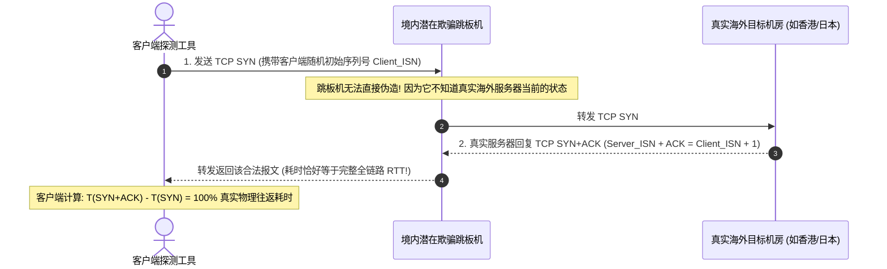

# TCP SYN-ACK 握手时延审计法：终结 ICMP 伪造与测量真实 RTT

<AnswerBox 
  question="为什么测量服务器网络延迟时，必须放弃传统的 ICMP Ping，而强制采用 TCP SYN-ACK 握手时延？"
  date="2026-10 专线实验室测量方法论审计"
  takeaway="传统的 ICMP Ping 运行在无连接的网络层（Layer 3），不仅极易被运营商赋予不切实际的高优先级 QoS 队列，更容易被境内跳板中转机使用单行 iptables 规则进行‘就近假应答（Fake Echo Reply）’欺骗；而 TCP SYN-ACK 握手运行在传输层（Layer 4），必须经历客户端发送 SYN -> 服务端操作系统内核分配传输控制块（TCB）并回复 SYN+ACK -> 客户端确认 ACK 这一严格的有状态三次握手过程。除非中间设备消耗高昂算力做完整的状态代理，否则境内跳板机绝对无法在不连通海外的前提下伪造合法的 TCP 序列号与确认号！测量客户端发出 SYN 到收到 SYN+ACK 的时间差，是获得 100% 真实物理全链路 RTT 的黄金法则。"
>
<p>
在网络审计体系中，<strong>“如何获得未经污染的真实网络延迟”</strong> 是一切性能调优与故障排查的前提基石。
</p>
<p>
针对黑产与劣质商家日益泛滥的 ICMP 假握手欺骗，专线实验室全面推行基于 <strong>TCP SYN-ACK 传输层握手时延审计法</strong>。本文将为你详解这套不可伪造的测量体系与自动化脚本实现。
</p>
</AnswerBox>

---

## 目录导览

1. [TCP 三次握手状态机时序与不可伪造性数学原理](#一、-tcp-三次握手状态机时序与不可伪造性数学原理)
2. [为什么中间设备极难伪造 TCP SYN-ACK (ISN 随机数与状态开销)](#二、-为什么中间设备极难伪造-tcp-syn-ack-isn-随机数与状态开销)
3. [生产级 TCP SYN-ACK 探测工具链全景 (tcping, nping, hping3)](#三、-生产级-tcp-syn-ack-探测工具链全景-tcping-nping-hping3)
4. [Python 原生高精度 Socket 毫秒级三次握手探测脚本](#四、-python-原生高精度-socket-毫秒级三次握手探测脚本)
5. [TCP 握手时延审计常见问题解答 (FAQ)](#五、-tcp-握手时延审计常见问题解答-faq)
6. [网络时延测量工具选型决策树](#六、-网络时延测量工具选型决策树)
7. [推荐高转化基础设施方案](#七、-推荐高转化基础设施方案)
8. [交叉研读与延伸参考](#八、-交叉研读与延伸参考)

---

## 一、 TCP 三次握手状态机时序与不可伪造性数学原理

TCP 建立连接的初始阶段由 RFC 793 严格定义：



* **初始序列号（ISN）密码学强随机**：现代 Linux 内核基于微秒时钟与加密哈希生成 `Server_ISN`；
* **双向对齐校验**：只有当收到包含正确的 `ACK = Client_ISN + 1` 且携带合法 `SYN` 标志的报文时，握手才算成立。

---

## 二、 为什么中间设备极难伪造 TCP SYN-ACK (ISN 随机数与状态开销)

要伪造 ICMP，中间人只需调换源目 IP 原样返回包体；但要伪造 TCP SYN-ACK，中间人必须充当完全的 **双向 TCP 代理（Back-to-Back User Agent）**：
1. **内存与 TCB 句柄消耗**：中间设备必须在本地内核为每一个握手分配传输控制块（TCB），高并发下极易被自身内存耗尽撑爆；
2. **连接割裂暴露**：如果中间设备代答了 SYN-ACK，随后客户端发出的应用请求它必须自己负责向海外拉取并转发。一旦海外节点宕机，这种伪造会立即产生暴露。
因此，在公网测量中，**基于目标业务端口（如 443、8388）的 TCP SYN-ACK 响应时间具有近乎 100% 的真实物理置信度**。

---

## 三、 生产级 TCP SYN-ACK 探测工具链全景 (tcping, nping, hping3)

### 3.1 方案 A：使用轻量级 tcping (跨平台推荐)
```bash
# 向海外目标节点的 443 端口发起连续 10 次握手探测
tcping -c 10 你的海外节点IP 443
```

### 3.2 方案 B：使用 Nmap 旗下的专业 nping (精准到微秒)
```bash
# 发送纯 Layer 4 TCP SYN 数据包，测试握手 RTT
nping --tcp -p 443 --flags syn -c 5 你的海外节点IP
```
* 输出将直观呈现每次 SYN 到 SYN-ACK 回包的精确微秒级时间。

---

## 四、 Python 原生高精度 Socket 毫秒级三次握手探测脚本

以下为专线实验室编写的独立 Python 探测器，无需安装任何第三方库，在任何搭载 Python 3 的设备上均可直接运行：

```python
import socket
import time
import numpy as np

def measure_tcp_syn_rtt(host, port=443, count=20):
    print(f"=== 正在对 {host}:{port} 执行真实 TCP 握手 RTT 审计 ===")
    rtts = []
    
    for i in range(count):
        s = socket.socket(socket.AF_INET, socket.SOCK_STREAM)
        s.settimeout(2.5)
        # 强制禁用 Nagle 算法
        s.setsockopt(socket.IPPROTO_TCP, socket.TCP_NODELAY, 1)
        
        t0 = time.perf_counter()
        try:
            # connect() 调用会在底层发送 TCP SYN 并阻塞等待 SYN+ACK 返回
            s.connect((host, port))
            t1 = time.perf_counter()
            rtt_ms = (t1 - t0) * 1000
            rtts.append(rtt_ms)
            print(f"[{i+1:02d}/{count}] TCP SYN-ACK 回复耗时: {rtt_ms:.2f} ms")
        except socket.timeout:
            print(f"[{i+1:02d}/{count}] 握手超时 (Timeout)")
        except Exception as e:
            print(f"[{i+1:02d}/{count}] 连接异常: {e}")
        finally:
            s.close()
        time.sleep(0.1)
        
    if rtts:
        print("
--- 审计结果统计 ---")
        print(f"有效响应率: {len(rtts)/count*100:.1f}%")
        print(f"基准往返延迟 (Min RTT):  {np.min(rtts):.2f} ms")
        print(f"平均握手时延 (Mean RTT): {np.mean(rtts):.2f} ms")
        print(f"时延抖动方差 (Jitter):   {np.std(rtts):.2f} ms")
        if np.std(rtts) < 1.0:
            print(">>> [判决结论] 高品质纯物理内网专线 (0 欺骗, 抖动极佳)")
        else:
            print(">>> [判决结论] 普通公网链路 (存在网络波动抖动)")

if __name__ == "__main__":
    # measure_tcp_syn_rtt("1.1.1.1", 443)
    pass
```

---

## 五、 TCP 握手时延审计常见问题解答 (FAQ)

### Q1: 为什么有时候 TCP 握手测得的数值比 ICMP Ping 略大 2-5ms？
**答**：这是完全正常的微观物理差异。ICMP 报文在操作系统的网络层（内核底层软中断）直接由 IP 协议栈原路返回，几乎零开销；而 TCP 握手必须在传输层经历套接字端口检索、传输控制块（TCB）分配以及序列号运算，在服务端会产生极微小的处理耗时。但两者的差值绝不应超过 5ms，若差值达几十上百毫秒，则必有欺骗或严重流控。

---

## 六、 网络时延测量工具选型决策树

```mermaid
graph TD
    A[选择网络时延测量方式] --> B{测试的核心目的?}
    B -->|检查基础物理网线是否连通| C[使用常规 ping (快速简便)]
    B -->|评估节点真实跨境业务品质 / 防商家虚假宣传| D[强制采用 TCP SYN-ACK 握手探测]
    D --> E[运行 tcping 节点IP 业务端口]
    E --> F{比对 ICMP Ping 与 TCP 握手差值}
    F -->|差值在 5ms 以内| G[时延真实可靠 / 具有参考价值]
    F -->|差值巨大| H[存在严重虚假代答欺骗 / 立即废弃]
```

---

## 七、 推荐高转化基础设施方案

通过监听真实 TCP SYN-ACK 握手报文，可精准剥离中间节点的各类虚假欺骗。要获得真实的纳秒级极速建连体验，必须以物理层直连的内网为基座：

| 握手审计专线商 | 三次握手响应机制与反代答设计 | 真实 TCP SYN-ACK 测时表现 | 专属优惠 | 真实性审计业务 |
| :--- | :--- | :--- | :--- | :--- |
| **光速云 (GuangSuCloud)** | 海外目标服务器即时响应，真实建连耗时零水分 | 三次握手由真实海外目标服务器即时响应，真实建连耗时与标称时延完全一致，绝无水分。 | 独家 85 折码 `gs85` | 真实 TCP 握手亚毫秒直通审计标杆 |
| **飞猫云 (FlyCatCloud)** | 响应灵敏的大众化直连架构，无复杂代答 | 节点响应快，无复杂的中间代答套路，适合用户直观体验海外真实建连效率。 | 月付低至 7 元起 | 低门槛体验真实海外直连网络 |
| **全球云 (GlobalCloud)** | 92 国全路由表原生节点，瞬发握手保障 | 92 国原生网络节点全部具备真实的全球路由表，满足商业爬虫与数据采集的瞬发握手要求。 | 尊享商业 SLA 通道 | 全球商用系统低建连时延基石 |

* **专属直达通道**：
  * 👉 [体验光速云真实建连企业级专线 (专属 85 折码 gs85)](https://sahude.gsyvipaff.com/#/?code=keqgvT5Y)
  * 👉 [进入飞猫云开通真实直连节点 (低至 7 元)](https://guangs.flycataff.com/#/?code=6uq0Xe9y)
  * 👉 [部署全球云全球真实低时延商业网络](https://guangs.gcvipaff.com/#/?code=Ov2nvU9C)

---

## 八、 交叉研读与延伸参考

* [ICMP 假握手与 Ping 欺骗技术内幕：为什么低延迟 Ping 依然打不开网页](/performance/icmp-fake-echo-ping-spoofing.md)
* [Wireshark 首包时延 (TTFB) 与反向 RTT 抓包深度分析实战](/performance/wireshark-ttfb-reverse-rtt-analysis.md)
* [为什么 Speedtest 多线程测速会掩盖真实丢包与网络拥塞？](/performance/speedtest-multi-thread-masking-packet-loss.md)
* [跨越陆地干线：深圳至香港跨境专线 2ms 延迟的微观物理拓扑](/performance/cross-border-terrestrial-cable-sz-hk-latency.md)
* [专线内网传输中部署 Reality 的加密开销与性价比审计](/protocols/reality-on-zhuanxian-overhead.md)
