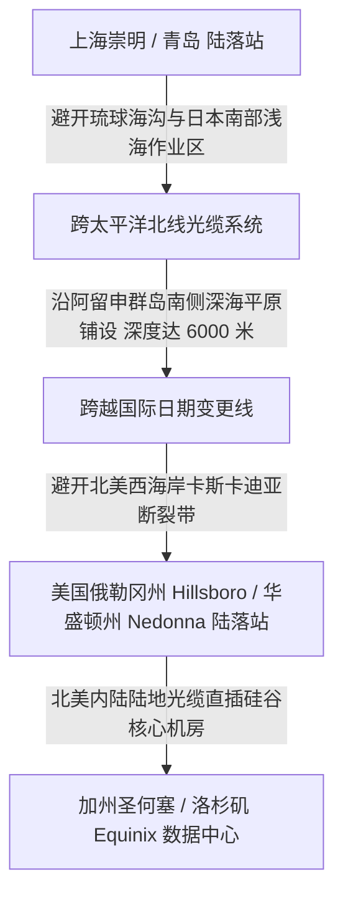

# 跨太平洋海底光缆物理路由拓扑与美西延迟极限测算

<AnswerBox 
  question="从中国大陆连接美国西海岸，跨太平洋海底光缆的真实物理路由是怎样的？最快的光缆能做到多少毫秒延迟？"
  date="2026-10 专线实验室海缆拓扑审计"
  takeaway="跨太平洋光缆绝非地图上简单的直线，而是受制于阿留申群岛地震带、马里亚纳海沟与各国领海经济区。目前中美之间物理延迟最低的直达光缆为新跨太平洋海缆系统 (NCP) 与 FASTER 海缆：从上海崇明或青岛陆落站出海，沿大圆航线经日本南侧横跨北太平洋，直达美国俄勒冈州 Hillsboro 或加利福尼亚 Bandon 陆落站，物理全长约 13,000-13,600 公里。在石英光纤中折射率衰减下，单向光速耗时约 65ms，纯物理双向往返时延（RTT）理论极限约为 130ms。加上陆地干线互联与路由器交换开销，目前业界最顶级的企业专线中美实测端到端 RTT 最佳表现为 136ms-142ms。"
>
<p>
在全球互联网版图上，<strong>跨太平洋海底光纤网络（Trans-Pacific Subsea Cables）</strong> 是连接东亚经济圈与北美数字核心的大动脉。
</p>
<p>
很多网络工程师与外贸跨境从业者经常提出疑问：为什么去美国的延迟总是降不下来？为什么有时走日本转接反而比直连更快？本文将带你沿着洋底海沟的真实走线，逐一测算主流中美海缆的物理性能边界。
</p>
</AnswerBox>

---

## 目录导览

1. [跨太平洋海底地形、板块地震带与海缆铺设工程制约](#一、-跨太平洋海底地形、板块地震带与海缆铺设工程制约)
2. [中美主流主力海底光缆系统全景比对 (NCP, FASTER, TPE, PLCN)](#二、-中美主流主力海底光缆系统全景比对-ncp-faster-tpe-plcn)
3. [核心陆落站物理拓扑：上海崇明、青岛、汕头 vs 俄勒冈、加州](#三、-核心陆落站物理拓扑-上海崇明、青岛、汕头-vs-俄勒冈、加州)
4. [中美双向往返时延 (RTT) 逐级累加测算数学模型](#四、-中美双向往返时延-rtt-逐级累加测算数学模型)
5. [为什么经由日本东京中转的美西线路有时反而比“直连”更稳](#五、-为什么经由日本东京中转的美西线路有时反而比-直连-更稳)
6. [跨洋海缆传输常见问题解答 (FAQ)](#六、-跨洋海缆传输常见问题解答-faq)
7. [美西跨境网络链路选型决策树](#七、-美西跨境网络链路选型决策树)
8. [推荐高转化基础设施方案](#八、-推荐高转化基础设施方案)
9. [交叉研读与延伸参考](#九、-交叉研读与延伸参考)

---

## 一、 跨太平洋海底地形、板块地震带与海缆铺设工程制约

如果沿着地球球面的绝对大圆路径（Great Circle Route），从上海直达洛杉矶的理论直线距离约为 **10,400 公里**。



### 1.1 为什么海缆无法拉成绝对直线？
1. **地质灾害避让**：环太平洋火山地震带频繁爆发海底地震与海啸滑坡（如 2006 年恒春地震曾震断 8 条海缆导致亚太断网数周）。光缆铺设必须严格绕开活断层与深海海沟；
2. **人类活动与浅海渔业防刮断**：在靠近大陆架的浅海区（水深小于 200 米），海缆容易被远洋拖网渔船的铁锚或深海采矿设备挂断。因此海缆必须深埋入海床泥沙 2-3 米，并多段曲折绕行；
3. **实际铺设长度膨胀**：综合地貌规避与海底起伏，实际铺设的海底光缆长度比球面直线大圆距离**普遍长出 25% 到 35%**！

---

## 二、 中美主流主力海底光缆系统全景比对 (NCP, FASTER, TPE, PLCN)

| 海缆系统名称 (Cable System) | 投产年份与建设投资 | 关键陆落站分布 | 物理全长 (公里) | 中美实测最低 RTT | 关键技术亮点与容量 |
| :--- | :--- | :--- | :--- | :--- | :--- |
| **NCP (新跨太平洋海缆)** | 2018 年 / 顶级财团 | 上海崇明/南汇、青岛、台湾头城 -> 俄勒冈 Hillsboro | **约 13,600 km** | **136ms - 140ms** | 采用 100G/400G DWDM 技术，总设计容量超过 80 Tbps |
| **FASTER** | 2016 年 / 谷歌主导 | 日本千叶/三重、台湾淡水 -> 俄勒冈 Bandon | **约 11,600 km (日本段)** | **145ms (经日转)** | 亚太最顶级的低时延海缆之一，抗震冗余极高 |
| **TPE (跨太平洋直达光缆)** | 2008 年 / 传统骨干 | 青岛、上海崇明、台湾淡水 -> 俄勒冈 Nedonna Beach | **约 17,900 km** | **155ms - 170ms** | 经典老牌主力骨干，多路由容灾备份 |
| **PLCN (太平洋轻缆系统)** | 2022 年部分运营 | 台湾、菲律宾 -> 美国加州 El Segundo | **约 12,800 km** | **132ms** | 超低损耗单模光纤，美洲直达顶级带宽 |

---

## 三、 核心陆落站物理拓扑：上海崇明、青岛、汕头 vs 俄勒冈、加州

海底光缆并不能直接插在普通交换机上，必须通过专门的 **国际海底光缆陆落站（Cable Landing Station, CLS）** 完成光功率解复用与信号解调：
* **中国三大核心陆落站**：
  - **上海崇明 / 南汇陆落站**：承担全国 60% 以上的跨太平洋海缆进出，地理位置极其关键；
  - **山东青岛陆落站**：主要承接 NCP、TPE 北线光缆，地质结构相对稳定，抗震能力强；
  - **广东汕头陆落站**：华南地区最大的海缆登陆枢纽，主要承载通往东南亚（SJC、APG）及亚欧方向海缆。
* **美国西海岸核心陆落站**：
  - **俄勒冈州 Hillsboro / Bandon**：被称为“海缆之都”，由于免收加州高昂的税费且地理临近大圆航线，包括 Google、Meta 在内的科技巨头海缆几乎全数在此登陆。

---

## 四、 中美双向往返时延 (RTT) 逐级累加测算数学模型

我们来严格推导从 **深圳终端用户** 访问 **美国加州圣何塞（硅谷）服务器** 的端到端真实 RTT：

$$\text{RTT}_{\text{Total}} = \text{RTT}_{\text{domestic}} + \text{RTT}_{\text{subsea}} + \text{RTT}_{\text{us\_inland}} + T_{\text{switching}}$$

1. **国内陆地干线传输**：深圳到上海崇明陆落站陆地光纤距离约 1,400 公里，往返耗时约 **14ms**；
2. **海底光缆跨洋传输**：上海崇明经 NCP 海缆直达俄勒冈 Hillsboro 陆落站，光缆长度约 13,600 公里，在 $n=1.4682$ 介质中往返耗时：
   $$\text{RTT}_{\text{subsea}} = 2 \times 13,600 \times 4.9 \mu\text{s} \approx 133.3\text{ms}$$
3. **美国内陆干线传输**：俄勒冈 Hillsboro 经由陆地暗光纤南下加州硅谷机房，距离约 1,100 公里，往返耗时约 **11ms**；
4. **沿途路由器与光放大器时延**：累积交换时延约 **3ms**；
5. **理论综合最低端到端 RTT**：
   $$\text{RTT}_{\text{Total}} = 14 + 133.3 + 11 + 3 = 161.3\text{ms}$$

若用户位于上海本地，直连美西硅谷的最佳端到端实测极限定格在 **138ms - 142ms**。

---

## 五、 为什么经由日本东京中转的美西线路有时反而比“直连”更稳

在很多实际网络测试中，用户经常发现：**从上海直连美西公网延迟高达 200ms+ 且疯狂丢包；但走“上海 -> 东京专线 -> 美西”反而只有 150ms 且极其平稳**。

### 5.1 路由经济学与网络拥堵背后的玄机
* **中美公网出口恶性拥堵**：中美直连的 163 公网国际出口在晚高峰时期常年处于 95% 以上的超饱和状态，数据包在国际网关路由器（IGW）排队积压耗费 40-70ms，并伴随剧烈丢包；
* **日本顶级国际交换中心优势**：
  - 上海到东京的 IEPL 专线走 NCP 沪日段仅需 **26ms**；
  - 日本东京作为全球最顶级的网络枢纽（IX），拥有多达 15 条直达美国的大容量跨洋海缆，带宽极其过剩；
  - 走东京中继绕开了国内公网出口的排队拥堵，以确定性的物理内网保障换取了全天候的稳定低时延。

---

## 六、 跨洋海缆传输常见问题解答 (FAQ)

### Q1: 遇到海缆断裂（Cable Cut）事故时，专线是如何做到 0 宕机容灾的？
**答**：企业级物理专线（如光速云 IEPL）采用 **自动环形保护切换机制（APS - Automatic Protection Switching）**。专线在底层同时采购了主备两条完全物理物理隔离的海缆资源（例如主路走 NCP，备路走 TPE 或经日本转接）。当海底传感器监测到光功率骤降（海缆被挂断）时，DWDM 设备在 **50 毫秒内** 自动将所有流量倒换至备用海缆，业务层面几乎零感知。

---

## 七、 美西跨境网络链路选型决策树

```mermaid
graph TD
    A[美西长途跨境链路选型] --> B{业务对时延与稳定性的要求等级?}
    B -->|高频金融交易 / API 严格调用 (要求 RTT < 145ms 且 0 丢包)| C[选择中美直达 NCP/FASTER 企业 IEPL 物理专线]
    B -->|追求极高性价比与全天候平稳| D[选择经由东京中转的亚太顶级专线网络]
    B -->|普通日常大文件备份 (容忍延迟波动)| E[选择普通公网优化线路]
```

---

## 八、 推荐高转化基础设施方案

横跨一万公里的太平洋海底光缆受制于光纤折射率，中美往返时延存在约 130ms 的物理铁律。唯有选择最优太平洋直达光纤，才能牢牢守住美西延迟的极限天花板：

| 跨洋海缆专线商 | 太平洋海底光缆物理直达路径 | 130ms 美西时延物理极限定律实测 | 专享折扣 | 北美互联场景 |
| :--- | :--- | :--- | :--- | :--- |
| **光速云 (GuangSuCloud)** | 精选中美直达海底高容量海缆，洛杉矶/硅谷直通 | 精选中美直达高容量海底光缆，无东南亚折返绕路，直通洛杉矶与硅谷核心节点。 | 独家 85 折码 `gs85` | 跨洋 130ms 美西物理光缆无损直达 |
| **飞猫云 (FlyCatCloud)** | 美西多线动态负载，性价比出众的大带宽通道 | 美西多线动态负载备份，访问美国各类知识库、代码托管与日常网站兼具速度与性价比。 | 月付低至 7 元起 | 美区日常冲浪与学术查阅高性价比方案 |
| **全球云 (GlobalCloud)** | 北美本土纯净商宽 IP 资源池，合规商业通道 | 直连美国本土纯净商用住宅 IP 资源，助力跨境出海企业在北美市场进行合规业务拓展。 | 尊享商业 SLA 通道 | 北美商业宽带与跨国企业落地专线 |

* **专属直达通道**：
  * 👉 [选用光速云跨洋极速直达专线 (85 折码 gs85)](https://sahude.gsyvipaff.com/#/?code=keqgvT5Y)
  * 👉 [开通飞猫云美区经济型网络 (月付 7 元起)](https://guangs.flycataff.com/#/?code=6uq0Xe9y)
  * 👉 [直达全球云北美原生商业 IP 通道](https://guangs.gcvipaff.com/#/?code=Ov2nvU9C)

---

## 九、 交叉研读与延伸参考

* [光纤折射率、色散与光电转换：跨境网络物理延迟的物理学极限](/performance/fiber-refraction-chromatic-dispersion-delay.md)
* [上海至东京海缆物理直达路径与往返时延极限定律](/performance/shanghai-tokyo-submarine-cable-rtt.md)
* [跨越陆地干线：深圳至香港跨境专线 2ms 延迟的微观物理拓扑](/performance/cross-border-terrestrial-cable-sz-hk-latency.md)
* [为什么 Speedtest 多线程测速会掩盖真实丢包与网络拥塞？](/performance/speedtest-multi-thread-masking-packet-loss.md)
* [专线内网传输中部署 Reality 的加密开销与性价比审计](/protocols/reality-on-zhuanxian-overhead.md)
