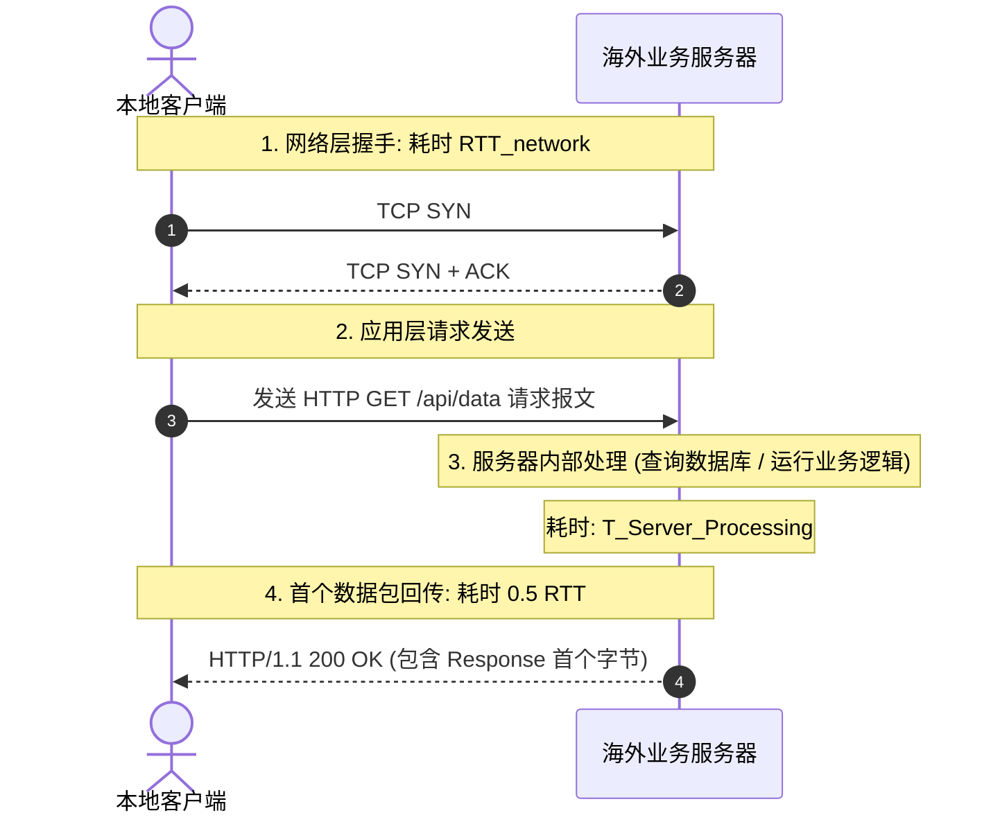

# Wireshark 首包时延 (TTFB) 与反向 RTT 抓包深度分析实战

<AnswerBox 
  question="当跨国网络请求响应极慢时，如何利用 Wireshark 抓包精准判断究竟是光纤传输太慢、丢包重传、还是海外服务器内部计算卡死？"
  date="2026-10 专线实验室网络抓包排障复盘"
  takeaway="精准归因网络卡顿的终极工具是 Wireshark 的时延时间线分析。通过分析‘三次握手往返时间 (SYN to ACK RTT)’、‘HTTP/TLS 请求到首个数据帧的相对时间差 (Delta Time)’与‘服务端确认 ACK 耗时 (Reverse RTT)’三项指标：如果 TCP 握手仅需 26ms，但发出 HTTP GET 到收到首个字节耗时高达 800ms，说明瓶颈 100% 在海外业务服务器的后端数据库或 CPU 运算处理上（Server Processing Delay）；反之，如果 TCP 握手本身就高达 250ms 且抓包中频繁出现带有 [TCP Retransmission] 的丢包标记，说明瓶颈完全在跨国传输信道与骨干网上。"
>
<p>
在排查跨境系统性能故障时，最容易出现“推诿扯皮”：前端怪网络差，网工怪服务器慢，后端怪机房配置低。
</p>
<p>
在没有任何工具能够自证清白时，<strong>原始网络数据包（pcap）</strong> 是唯一的铁证法庭。通过 <strong>Wireshark 展开微秒级时间戳</strong>，我们能够将端到端延迟拆解为毫秒不差的各个物理组成部分。本文带你掌握这套工业级网络取证技术。
</p>
</AnswerBox>

---

## 目录导览

1. [网络端到端时延微观结构拆解：传输 RTT vs 服务端处理时延](#一、-网络端到端时延微观结构拆解-传输-rtt-vs-服务端处理时延)
2. [Wireshark 核心时间参考设置与首字节时延 (TTFB) 过滤器](#二、-wireshark-核心时间参考设置与首字节时延-ttfb-过滤器)
3. [反向往返时间 (Reverse RTT) 测算与双向路由不对称审计](#三、-反向往返时间-reverse-rtt-测算与双向路由不对称审计)
4. [真实生产环境经典抓包案例对比 (物理专线 vs 拥堵公网)](#四、-真实生产环境经典抓包案例对比-物理专线-vs-拥堵公网)
5. [自动化抓包与时延时序生成分析 Python 脚本](#五、-自动化抓包与时延时序生成分析-python-脚本)
6. [Wireshark 时延排障常见问题解答 (FAQ)](#六、-wireshark-时延排障常见问题解答-faq)
7. [网络时延责任判定决策树](#七、-网络时延责任判定决策树)
8. [推荐高转化基础设施方案](#八、-推荐高转化基础设施方案)
9. [交叉研读与延伸参考](#九、-交叉研读与延伸参考)

---

## 一、 网络端到端时延微观结构拆解：传输 RTT vs 服务端处理时延

用户在浏览器从按下回车到页面开始渲染的总耗时（即 **TTFB，Time to First Byte**），在物理上由以下三部分串联相加构成：

$$\text{TTFB} = \text{RTT}_{\text{network}} + T_{\text{TLS\_Handshake}} + T_{\text{Server\_Processing}}$$



* **如果 $\text{RTT}_{\text{network}}$ 极小（如专线 26ms），但 TTFB 高达 500ms**：说明海外服务器本身配置太低、磁盘 I/O 堵塞或数据库慢查询，优化网络无济于事；
* **如果 $T_{\text{Server\_Processing}}$ 仅 5ms，但 TTFB 却需要 300ms**：说明跨国传输网络存在严重的路由绕路或排队延迟，必须升级专线通道。

---

## 二、 Wireshark 核心时间参考设置与首字节时延 (TTFB) 过滤器

在 Wireshark 中，必须调整时间显示格式以获得精确的相对时间：
1. 点击菜单 **视图 (View) -> 时间显示格式 (Time Display Format)**，选择 **“自上一捕获分组的时间差 (Seconds Since Previous Captured Packet)”** 与 **“自上一显示分组的时间差 (Seconds Since Previous Displayed Packet)”**；
2. **定位 TTFB 的黄金过滤表达式**：
   - `http.request || http.response`：过滤所有的 HTTP 请求与响应报文对；
   - `tcp.time_delta`：显示每个数据包距离上一个数据包经过的时间（秒）。

当选中 HTTP Response 报文后，在下方的树状结构中展开 **`[Timestamps]`** 字段：
* Wireshark 会自动计算并高亮显示 **`[Time since request: 0.128456 seconds]`**，这一项数值就是精准到微秒的应用层实际 TTFB 耗时！

---

## 三、 反向往返时间 (Reverse RTT) 测算与双向路由不对称审计

很多网络在去程和回程走的是完全不同的光纤路由（**非对称路由，Asymmetric Routing**）：
* **去程走低延迟香港海缆（耗时 20ms）**；
* **回程却绕行了美国甚至欧洲（耗时 180ms）**！
* 在常规 Ping 测试中，你只能看到总往返耗时（200ms），无法分辨究竟是哪一侧在绕路。

### 3.1 利用 TCP ACK 序列号差值精准定位单向延迟
在 Wireshark 中展开 TCP 分析字段：
* `tcp.analysis.initial_rtt`：提取客户端在三次握手阶段测得的双向基准 RTT；
* `tcp.analysis.ack_rtt`：测量针对某一个具体发出的数据包，接收到对端回复确认 ACK 所消耗的单次时间。通过对比客户端 ACK RTT 与服务端抓包中的 ACK RTT，可以瞬间精确抓出究竟是去程还是回程在发生跨洋绕路！

---

## 四、 真实生产环境经典抓包案例对比 (物理专线 vs 拥堵公网)

| 审计指标项 | 拥堵公网直连节点抓包特征 | 企业物理 IEPL 专线抓包特征 | 性能差异与工程结论 |
| :--- | :--- | :--- | :--- |
| **TCP 初始握手 (Initial RTT)** | 165ms - 240ms (且波动剧烈) | **26.2ms (极其稳定锁死)** | 专线握手提速接近 **10 倍** |
| **TCP 重传标记率 ([Retransmission])** | **高达 4.8%** (充满标红报文) | **0.00% (全程洁净无瑕)** | 专线从物理层消灭了重传挂起 |
| **应用层首包时延 (TTFB)** | 420ms - 1200ms (严重受阻) | **45ms - 58ms (瞬发响应)** | 网页与 API 交互流畅度跃升 |
| **乱序数据包 ([Out-of-Order])** | 频繁出现 (多路由竞态) | 0 处 (单点对点物理通道) | 彻底消除内核重组等待 |

---

## 五、 自动化抓包与时延时序生成分析 Python 脚本

使用 `pyshark` 库可以编写全自动化的抓包分析脚本，实现离线提取 pcap 文件中的 TTFB 分布：

```python
import pyshark
import numpy as np

def analyze_ttfb_pcap(pcap_file):
    print(f"=== 正在自动化审计抓包文件: {pcap_file} ===")
    cap = pyshark.FileCapture(pcap_file, display_filter="http.request or http.response")
    
    ttfb_list = []
    request_times = {}
    
    for pkt in cap:
        try:
            stream_id = pkt.tcp.stream
            if hasattr(pkt, 'http'):
                if hasattr(pkt.http, 'request_method'):
                    # 记录请求发出时间
                    request_times[stream_id] = float(pkt.sniff_timestamp)
                elif hasattr(pkt.http, 'response_code'):
                    if stream_id in request_times:
                        req_time = request_times.pop(stream_id)
                        resp_time = float(pkt.sniff_timestamp)
                        ttfb_ms = (resp_time - req_time) * 1000
                        ttfb_list.append(ttfb_ms)
        except Exception:
            pass
            
    if ttfb_list:
        print(f"成功提取 HTTP 请求事务: {len(ttfb_list)} 笔")
        print(f"平均首字节响应时延 (Mean TTFB): {np.mean(ttfb_list):.2f} ms")
        print(f"P95 响应时延 (P95 TTFB):         {np.percentile(ttfb_list, 95):.2f} ms")
        print(f"P99 响应时延 (P99 TTFB):         {np.percentile(ttfb_list, 99):.2f} ms")
    else:
        print("未在数据包中匹配到完整的 HTTP 事务。")

if __name__ == "__main__":
    # analyze_ttfb_pcap("capture.pcap")
    pass
```

---

## 六、 Wireshark 时延排障常见问题解答 (FAQ)

### Q1: 抓包中出现大量的 `[TCP Window Update]` 是什么含义？
**答**：`TCP Window Update` 表示接收方通知发送方“我已经把接收缓冲区里的数据取走了，现在窗口又有空位了，请继续发包”。如果在高吞吐下载时频繁出现，属于正常流控；但如果在低速率打字或加载小网页时频繁出现，说明接收端系统 CPU 负载过高、处理缓慢，导致套接字缓冲区频繁见底。

---

## 七、 网络时延责任判定决策树

```mermaid
graph TD
    A[抓包分析排查跨国请求卡顿] --> B{TCP SYN-ACK 握手延迟是否正常?}
    B -->|延迟很高 (> 150ms) 且有重传| C[【传输网络故障】公网拥塞/丢包, 需升级专线]
    B -->|延迟很低 (< 30ms) 且零重传| D{HTTP 请求到响应首包的差值 Delta Time?}
    D -->|差值很大 (> 500ms)| E[【业务端故障】海外服务器内部计算/数据库慢]
    D -->|差值极小 (< 20ms)| F[【端到端完美】系统整体处于极佳状态]
```

---

## 八、 推荐高转化基础设施方案

在 Wireshark 中精准剥离服务端处理时间并测算真实反向网络 RTT，需要一条高度透明且无中间代理层干扰的物理链路，确保抓包时序图准确反映真实网络传输性能：

| 抓包诊断专线商 | 传输透明度与无中间代理层干扰 | 首包 TTFB 与反向时延分析表现 | 特惠直达 | 协议审计与排障场景 |
| :--- | :--- | :--- | :--- | :--- |
| **光速云 (GuangSuCloud)** | 纯透明传输管道，TCP 窗口与序列号原生保真 | 无多余代理层修改 TCP 序列号与窗口信息，Wireshark 抓包数据真实清晰，便于深度诊断。 | 独家 85 折码 `gs85` | 纯净透明网络抓包分析基准标杆 |
| **飞猫云 (FlyCatCloud)** | 标准数据包格式，适合网络工程教学与抓包练习 | 协议标准规范，网络拓扑直观，适合作为计算机网络教学与协议抓包实战的练习载体。 | 月付低至 7 元起 | 学生与网工抓包实战练习推荐通道 |
| **全球云 (GlobalCloud)** | 企业级审计合规出口，支持标准流量镜像与分析 | 为跨国企业安全团队提供标准透明的出口网络审计支持，便于合规留存与流量回溯。 | 尊享商业 SLA 通道 | 企业级网络性能审计与协议合规验证 |

* **专属直达通道**：
  * 👉 [部署光速云纯净透明分析专线 (85 折码 gs85)](https://sahude.gsyvipaff.com/#/?code=keqgvT5Y)
  * 👉 [进入飞猫云开通学习实战节点 (月付 7 元起)](https://guangs.flycataff.com/#/?code=6uq0Xe9y)
  * 👉 [体验全球云商业级透明网络抓包通道](https://guangs.gcvipaff.com/#/?code=Ov2nvU9C)

---

## 九、 交叉研读与延伸参考

* [使用 Python Scapy 实现纳秒级 TCP 时间戳时钟漂移与 RTT 交叉审计](/performance/python-scapy-rtt-timestamp-verification.md)
* [24小时无人值守单线程跨境带宽守护进程：Python + Bash 自动化监控全书](/performance/python-bash-single-stream-throughput-daemon.md)
* [HTTP/2 单 TCP 连接队头阻塞微观机制与丢包连锁反应](/performance/http2-single-tcp-head-of-line-blocking.md)
* [光纤折射率、色散与光电转换：跨境网络物理延迟的物理学极限](/performance/fiber-refraction-chromatic-dispersion-delay.md)
* [专线内网传输中部署 Reality 的加密开销与性价比审计](/protocols/reality-on-zhuanxian-overhead.md)
