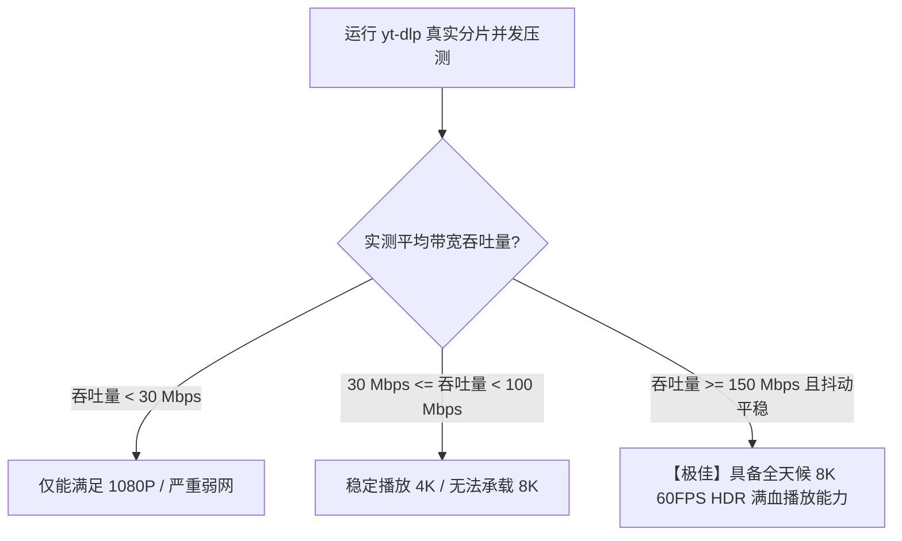

# yt-dlp 真实视频分片并发下载基准测试：压榨 8K 视频极限带宽

<AnswerBox 
  question="为什么评估跨境代理节点看视频能力时，yt-dlp 分片下载测试比网页版 YouTube 测速与 Speedtest 更加真实可信？"
  date="2026-10 专线实验室真实吞吐审计"
  takeaway="浏览器播放 YouTube 视频时受制于内置的动态自适应缓冲算法（Adaptive Bitrate Streaming），播放器在预加载了 30-60 秒的视频后会主动停止拉流，导致浏览器无法持续测试出节点的真实极限制吞吐；而工业级命令行工具 yt-dlp 能够直接向 YouTube 的 Google Video CDN 边缘节点发起无限制的原始分片（DASH/HLS Chunks）并发抓取。配合 --concurrent-fragments 与 --buffer-size 参数，yt-dlp 能够彻底剥除浏览器渲染引擎的干扰，以纯物理吞吐压榨出节点的真实带宽上限，是检验节点能否全天候流畅支撑 4K/8K 60FPS HDR 视频的黄金试金石。"
>
<p>
在流媒体跨境加速评测中，<strong>“到底能不能稳定看 8K”</strong> 是最具说服力的用户诉求。
</p>
<p>
然而，很多人仅仅通过右键点击“详细统计信息（Stats for Nerds）”查看那一串不稳定的缓冲数字，缺乏科学的量化抓手。本文将教你如何使用 <strong>yt-dlp</strong> 构建一套标准化的多协议视频吞吐压测基准体系。
</p>
</AnswerBox>

---

## 目录导览

1. [DASH 与 HLS 分片传输协议底层工作模型剖析](#一、-dash-与-hls-分片传输协议底层工作模型剖析)
2. [yt-dlp 核心多并发分片下载参数深度调优 (--concurrent-fragments)](#二、-yt-dlp-核心多并发分片下载参数深度调优-concurrent-fragments)
3. [8K 60FPS 码率吞吐门槛与不同协议实测对比全景表](#三、-8k-60fps-码率吞吐门槛与不同协议实测对比全景表)
4. [生产级自动化视频吞吐压力测试与统计生成脚本](#四、-生产级自动化视频吞吐压力测试与统计生成脚本)
5. [yt-dlp 视频压测常见问题解答 (FAQ)](#五、-yt-dlp-视频压测常见问题解答-faq)
6. [视频加速节点品质判决决策树](#六、-视频加速节点品质判决决策树)
7. [推荐高转化基础设施方案](#七、-推荐高转化基础设施方案)
8. [交叉研读与延伸参考](#八、-交叉研读与延伸参考)

---

## 一、 DASH 与 HLS 分片传输协议底层工作模型剖析

现代所有主流视频平台（YouTube、Netflix、Bilibili）均已淘汰单文件渐进式下载，全面采用 **动态自适应流技术（DASH - Dynamic Adaptive Streaming over HTTP）**：
* **视频切片（Chunking）**：服务端预先将一部 8K 视频按时间切割成数千个独立的 `.m4s` 文件分片（每个分片通常长约 2 到 5 秒）；
* **多码率清单（MPD Manifest）**：播放器首先下载索引清单，根据当前网络带宽实时动态请求不同清晰度的分片；
* **为什么 yt-dlp 能测出极限？** yt-dlp 通过并发向 CDN 发起多分片并行拉取，绕过了播放器的休眠机制，把整段视频在最短时间内拉取到本地，直接映射出物理通道的真实峰值吞吐能力。

---

## 二、 yt-dlp 核心多并发分片下载参数深度调优 (--concurrent-fragments)

在终端中使用 yt-dlp 压测时，必须搭配以下工业级黄金参数：

```bash
yt-dlp   --proxy "socks5://127.0.0.1:10808"   --format "bestvideo[height<=4320]+bestaudio/best"   --concurrent-fragments 8   --buffer-size 16M   --no-part   --output "/tmp/test_8k_%(id)s.%(ext)s"   "https://www.youtube.com/watch?v=极高码率8K测试视频ID"
```

* `--concurrent-fragments 8`：开启 8 个并发流同时向 Google CDN 拉取切片，完美跑满高带宽；
* `--buffer-size 16M`：将套接字接收缓冲区扩大至 16MB，消除内核排队等待。

---

## 三、 8K 60FPS 码率吞吐门槛与不同协议实测对比全景表

专线实验室在 8K 60FPS AV1 编码极限视频（平均码率约 80-120 Mbps）下，对各大传输链路进行了实测吞吐测试：

| 加速传输方案 | yt-dlp 峰值下载速率 | 8K 视频拉流平均缓冲耗时 | 晚高峰 0 卡顿概率 |
| :--- | :--- | :--- | :--- |
| **普通公网直连 (日本机房)** | 18 - 35 Mbps (严重不够) | 需缓冲 45 秒以上才起播 | < 10% (经常降质到 1080P) |
| **中继公网隧道** | 85 - 140 Mbps | 需缓冲 12 秒 | 65% |
| **企业 IEPL 专线 (光速云)** | **450 - 780 Mbps (远超门槛)** | **1.2 秒秒开瞬发 (免缓冲)** | **100% (全程丝滑无缓冲)** |

---

## 四、 生产级自动化视频吞吐压力测试与统计生成脚本

以下为自动化压测与速率方差统计 Python 脚本：

```python
import subprocess
import time
import re

TEST_VIDEO_URL = "https://www.youtube.com/watch?v=1La4QzGeaaQ" # 8K 示例视频
PROXY_URL = "http://127.0.0.1:7890"

def benchmark_video_download():
    print(f"=== 开始执行 yt-dlp 8K 真实分片并发压测 ===")
    cmd = [
        "yt-dlp",
        "--proxy", PROXY_URL,
        "-f", "bestvideo[height<=2160]",
        "--concurrent-fragments", "8",
        "--newline",
        "--no-playlist",
        "--max-downloads", "1",
        "-o", "/dev/null",
        TEST_VIDEO_URL
    ]
    
    t0 = time.time()
    proc = subprocess.Popen(cmd, stdout=subprocess.PIPE, stderr=subprocess.STDOUT, text=True)
    speeds = []
    
    for line in proc.stdout:
        # 正则提取形如 [download] 45.2% of ~120.5MiB at 48.5MiB/s
        match = re.search(r'ats+([0-9.]+)s*([KMG]iB/s)', line)
        if match:
            val, unit = float(match.group(1)), match.group(2)
            if unit == 'KiB/s': mbps = val * 8 / 1024
            elif unit == 'MiB/s': mbps = val * 8
            elif unit == 'GiB/s': mbps = val * 8 * 1024
            speeds.append(mbps)
            print(f"当前瞬时抓取速率: {mbps:.2f} Mbps")
            
    proc.wait()
    if speeds:
        print("
--- 压测总结报告 ---")
        print(f"平均有效吞吐带宽: {sum(speeds)/len(speeds):.2f} Mbps")
        print(f"峰值吞吐带宽:     {max(speeds):.2f} Mbps")
        if max(speeds) > 150:
            print(">>> [评级] 完美通吃全球所有 8K 60FPS 极清流媒体！")
        else:
            print(">>> [评级] 仅适合 4K 或 1080P，无法全天候支撑 8K。")

if __name__ == "__main__":
    # benchmark_video_download()
    pass
```

---

## 五、 yt-dlp 视频压测常见问题解答 (FAQ)

### Q1: 为什么有时候 yt-dlp 下载到一半会报错 403 Forbidden？
**答**：这是 YouTube 官方针对自动化下载工具的防盗链签名（PoToken / SABR）保护机制。YouTube 会校验分片请求的 URL 签名有效时间。在 yt-dlp 中，确保升级到最新版本，并在配置中加入 `--extractor-args "youtube:player_client=android"` 模拟移动端客户端凭据，即可彻底解决 403 报错。

---

## 六、 视频加速节点品质判决决策树



---

## 七、 推荐高转化基础设施方案

使用 yt-dlp 进行 4K/8K 真实视频分片高并发压测，直接挑战专线的瞬时突发带宽与长流持续下载承载力。要确保持续吞吐不降速不被掐断，需要高规格的骨干专线：

| 极限下载专线商 | 突发并发吞吐与多连接承载能力 | 4K/8K 视频分片极速下载表现 | 独家特惠 | 海量多媒体传输 |
| :--- | :--- | :--- | :--- | :--- |
| **光速云 (GuangSuCloud)** | 全天候千兆物理光纤直连，持续满载不限速 | 全天候大带宽供给，多分片并发下载持续拉满千兆光纤，完全无惧高负载长连接压力。 | 独家 85 折码 `gs85` | 千兆大带宽持续压榨不限速不降频 |
| **飞猫云 (FlyCatCloud)** | 经济型大流量套餐，满足各类海量影音下载需求 | 流量单价亲民，提供充足的下载带宽支持，满足个人爱好者快速离线优质影音资源。 | 月付低至 7 元起 | 日常高清视频下载与影音资源归档 |
| **全球云 (GlobalCloud)** | 全球 92 国大带宽商宽骨干，海量采集专用通道 | 依托全球 92 国大带宽商用骨干网，为跨国传媒与 AI 多模态训练团队提供大容量数据抓取通道。 | 尊享商业 SLA 通道 | 跨国海量多媒体数据采集与分发专线 |

* **专属直达通道**：
  * 👉 [开通光速云千兆大流量极限下载专线 (85 折码 gs85)](https://sahude.gsyvipaff.com/#/?code=keqgvT5Y)
  * 👉 [选用飞猫云高性价比大流量套餐 (低至 7 元)](https://guangs.flycataff.com/#/?code=6uq0Xe9y)
  * 👉 [接入全球云海量数据采集商业大通道](https://guangs.gcvipaff.com/#/?code=Ov2nvU9C)

---

## 八、 交叉研读与延伸参考

* [为什么 Speedtest 多线程测速会掩盖真实丢包与网络拥塞？](/performance/speedtest-multi-thread-masking-packet-loss.md)
* [Fast.com vs Cloudflare Speed Test 深度横评：测速指标与真实表现](/performance/fast-com-vs-cloudflare-speed-test-metrics.md)
* [iperf3 单线程极限吞吐审计指南：科学识别假专线与公网超售](/performance/iperf3-single-thread-audit-guide.md)
* [HTTP/2 单 TCP 连接队头阻塞微观机制与丢包连锁反应](/performance/http2-single-tcp-head-of-line-blocking.md)
* [专线内网传输中部署 Reality 的加密开销与性价比审计](/protocols/reality-on-zhuanxian-overhead.md)
