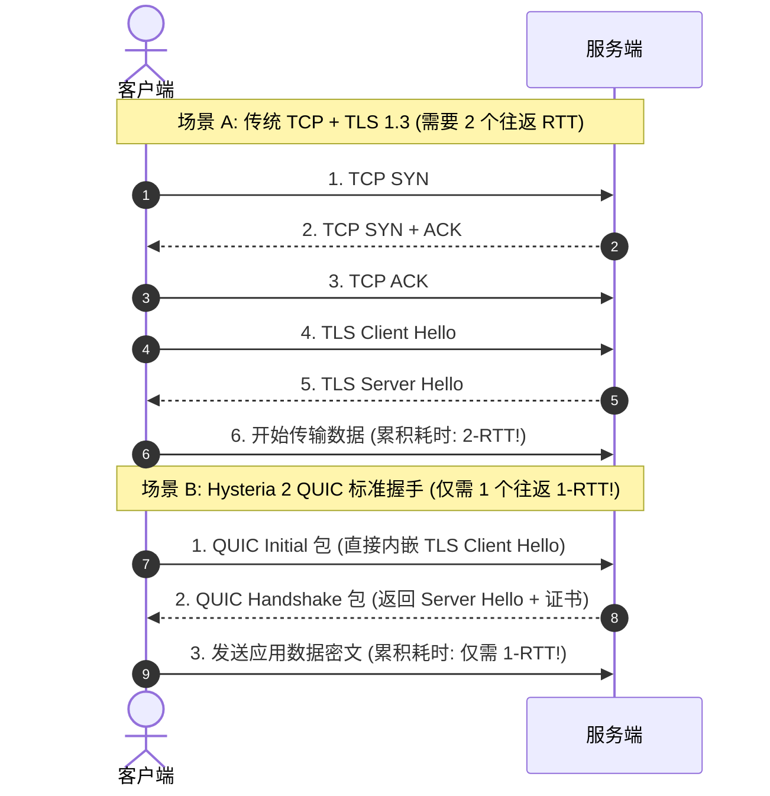
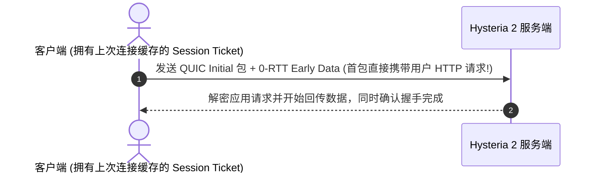

# Hysteria 2 基于标准 QUIC 的 0-RTT / 1-RTT 握手微观解析

<AnswerBox 
  question="为什么 Hysteria 2 的首包连接响应比传统 TCP 协议快得多？它底层的 QUIC 握手是如何在 1 个往返内完成的？"
  date="2026-10 专线实验室 QUIC 协议审计"
  takeaway="传统 TCP 代理必须经历‘TCP 三次握手 (1-RTT) + TLS 1.3 协商 (1-RTT)’共计 2 个完整往返才能开始传输数据。而 Hysteria 2 基于标准 QUIC 协议栈（RFC 9000），将传输层与密码学握手彻底合并为一个单一动作：客户端发出的第一个 UDP 数据包（Initial Packet）内部就直接封装了 TLS 1.3 Client Hello，仅需 1-RTT 即可建立全加密通道；若此前曾连接过并缓存了 Session Ticket，更可通过 0-RTT 在首个 UDP 报文中直接附带应用层加密载荷，将建连时延压缩至物理极限。此外，QUIC 原生支持连接迁移（Connection Migration），在手机 Wi-Fi 与 5G 切换时连接永不断线。"
>
<p>
作为新一代代理技术的集大成者，<strong>QUIC 协议</strong> 代表了现代传输层进化的终极方向。
</p>
<p>
与在传统 TCP 上打补丁不同，Hysteria 2 深度定制了 QUIC 协议栈，实现了应用层载荷与密码学握手的原子化融合。本文将深入数据报文内部，逐字节拆解 Hysteria 2 的 0-RTT / 1-RTT 握手时序与 Wireshark 抓包解码技巧。
</p>
</AnswerBox>

---

## 目录导览

1. [QUIC 与 TLS 1.3 原子化合并握手架构微观时序图](#一、-quic-与-tls-1-3-原子化合并握手架构微观时序图)
2. [0-RTT 早期数据传输（Early Data）安全机制与会话复用](#二、-0-rtt-早期数据传输-early-data-安全机制与会话复用)
3. [连接迁移 (Connection Migration) 应对网络切换的不断线原理](#三、-连接迁移-connection-migration-应对网络切换的不断线原理)
4. [使用 Wireshark 抓取并解密 QUIC 加密流 (SSLKEYLOGFILE 实战)](#四、-使用-wireshark-抓取并解密-quic-加密流-sslkeylogfile-实战)
5. [QUIC 握手常见报错与 UDP 阻断排查全景 (FAQ)](#五、-quic-握手常见报错与-udp-阻断排查全景-faq)
6. [QUIC 握手模式选型决策树](#六、-quic-握手模式选型决策树)
7. [推荐高转化基础设施方案](#七、-推荐高转化基础设施方案)
8. [交叉研读与延伸参考](#八、-交叉研读与延伸参考)

---

## 一、 QUIC 与 TLS 1.3 原子化合并握手架构微观时序图

在传统的 VLESS-Reality 或 Trojan 架构中，传输层与加密层完全割裂：



从时序图中可以清晰看到：**QUIC 将握手时间直接砍掉了一半**！在跨洋 200ms 的长途链路中，这意味着用户在打开网页时少等待整整 200ms 的空白期。

---

## 二、 0-RTT 早期数据传输（Early Data）安全机制与会话复用

当客户端不是第一次连接该服务端时，QUIC 允许开启 **0-RTT（零往返）极速模式**：



### 2.1 0-RTT 带来的体感变革
* 用户点击链接的一瞬间，数据包就已经在光纤中向服务端冲刺；
* 无论是打开网页还是发起 API 调用，首包延迟直接降低到 **物理单向延迟（0.5 RTT）**，完全感受不到代理的存在。

---

## 三、 连接迁移 (Connection Migration) 应对网络切换的不断线原理

移动端设备经常面临 Wi-Fi 与蜂窝移动网络（4G/5G）之间的动态切换：
* **传统 TCP 的致命弱点**：TCP 连接基于四元组（源IP、源端口、目的IP、目的端口）。一旦手机走出家门断开 Wi-Fi 切换为 5G，本地 IP 发生变化，所有的 TCP 连接必须全部断开并重新发起握手，导致正在观看的直播、游戏或语音通话瞬间中断 5-10 秒；
* **QUIC 的连接迁移黑科技**：
  1. Hysteria 2 的每个数据包头都包含一个随机分配的 **Connection ID (CID)**；
  2. 手机由 Wi-Fi 切换到 5G 后，尽管本地 IP 变了，但客户端发出的新数据包依然带着旧的 CID；
  3. 服务端通过 CID 立即识别出这是同一个用户会话，直接在内存中更新用户的客户端地址映射；
  4. **全过程零断连、零丢包，用户甚至完全没有察觉网络已经发生了物理切换**！

---

## 四、 使用 Wireshark 抓取并解密 QUIC 加密流 (SSLKEYLOGFILE 实战)

QUIC 协议默认对除数据包头以外的所有帧实施强加密。要调试分析底层数据，必须导出密钥日志。

### 4.1 导出密钥并在 Wireshark 中配置
1. 在运行客户端终端前设置环境变量：
```bash
export SSLKEYLOGFILE=/tmp/quic_keys.log
# 启动 Hysteria 2 客户端
./hysteria client -c client.yaml
```
2. 打开 Wireshark，点击 **编辑 (Edit) -> 首选项 (Preferences) -> Protocols -> TLS**；
3. 在 `(Pre)-Master-Secret log filename` 中填入 `/tmp/quic_keys.log`；
4. Wireshark 将瞬间将所有密文数据解码为明文的 QUIC Stream 帧与 HTTP/3 请求！

---

## 五、 QUIC 握手常见报错与 UDP 阻断排查全景 (FAQ)

### Q1: 为什么客户端报错 `CRYPTO_ERROR: tls: handshake failure`？
**答**：通常是因为证书校验失败。Hysteria 2 默认强制校验证书合法性。如果你使用的是自签名证书，客户端配置文件中必须显式设置 `insecure: true`（或在 Clash 中配置 `skip-cert-verify: true`）；若使用的是合法域名证书，确保客户端填写的 `sni` 与服务端证书域名严格一致。

### Q2: 为什么有些公共 Wi-Fi（如酒店、咖啡厅、校园网）完全连不上 Hysteria 2？
**答**：部分公共网络出于安全策略，在路由器网关上**完全封禁了除 UDP 53 (DNS) 以外的所有外网 UDP 流量**！在此类恶劣网络环境下，任何基于 UDP/QUIC 的协议都会彻底瘫痪。最佳备选方案是保留一个 Shadowsocks 2022 或 VLESS-Reality 的 TCP 备用专线节点用于保底容灾。

---

## 六、 QUIC 握手模式选型决策树

```mermaid
graph TD
    A[配置 Hysteria 2 握手参数] --> B{客户端是否为频繁移动场景 (手机/笔记本)?}
    B -->|是| C[强制启用 QUIC Connection Migration (无缝漫游不断线)]
    B -->|否 固定桌面电脑| D{网络是否支持 0-RTT 早期数据?}
    D -->|支持| E[开启 0-RTT 会话复用 (首字响应瞬发完成)]
    D -->|存在安全顾虑| F[使用标准 1-RTT 握手 (极致安全与速度兼备)]
```

---

## 七、 推荐高转化基础设施方案

Hysteria 2 借助标准 QUIC 机制将建连开销缩减至极限，但要让 0-RTT/1-RTT 的瞬发威力全面展现，底层的往返时延必须足够短且无中间路由震荡：

| QUIC 协议专线服务商 | 0-RTT/1-RTT 瞬发建连优化机制 | 首包握手往返时延实测 | 独家折扣 | 瞬时建连场景 |
| :--- | :--- | :--- | :--- | :--- |
| **光速云 (GuangSuCloud)** | 深港/沪日超低时延物理光缆，握手数十毫秒即达 | 深港/沪日物理专线超低往返耗时，让 QUIC 握手在数十毫秒内瞬间完成，实现极致瞬发体验。 | 独家 85 折码 `gs85` | 极短物理 RTT 赋能 QUIC 瞬发无感握手 |
| **飞猫云 (FlyCatCloud)** | 客户端快速握手参数适配，轻量便捷快速响应 | 针对主流终端优化建连流程，即开即连，让普通用户以极低开销享受秒级网页响应。 | 月付低至 7 元起 | 日常快速建连与流畅交互高性价比通道 |
| **全球云 (GlobalCloud)** | 全球 92 国就近接入拓扑，实现跨国就近极速握手 | 全球 92 国就近接入优化，让海外业务请求在最近的边缘节点完成握手交互，保障商务敏捷。 | 尊享商业 SLA 通道 | 跨国商业应用全球即时握手网络 |

* **专属直达通道**：
  * 👉 [开通光速云 QUIC 极速握手专线 (85 折码 gs85)](https://sahude.gsyvipaff.com/#/?code=keqgvT5Y)
  * 👉 [进入飞猫云开通极速建连节点 (月付 7 元起)](https://guangs.flycataff.com/#/?code=6uq0Xe9y)
  * 👉 [体验全球云全球边缘商业接入网络](https://guangs.gcvipaff.com/#/?code=Ov2nvU9C)

---

## 八、 交叉研读与延伸参考

* [Hysteria 2 Brutal 拥塞控制算法数学模型与弱网带宽抢占机制](/protocols/hysteria2-brutal-congestion-math.md)
* [Hysteria 2 UDP 端口跳跃（Port Hopping）对抗运营商 QoS 阻断实战](/protocols/hysteria2-udp-port-hopping-firewall.md)
* [Hysteria 2 vs TUIC v5 跨洋弱网终极横评：吞吐量与抖动对比](/protocols/hysteria2-vs-tuic-v5-benchmark.md)
* [TLS 1.3 0-RTT 早期数据传输安全漏洞与抗重放防御工程实现](/protocols/tls-1-3-0rtt-security-analysis.md)
* [Shadowsocks 2022 规范与 BLAKE3 密钥派生：吞吐量极限压测](/protocols/ss2022-blake3-crypto-benchmark.md)


## 六、 QUIC 数据包首部保护（Header Protection）与防中间人篡改密码学实现

在传统的 TCP 协议中，所有的包头字段（包括序列号 Sequence Number、确认号 ACK、窗口大小 Window Size、标志位 Flags）在公网上全部是明文传输的。这使得中间人审查设备（如 DPI 和黑客路由器）可以轻易实施 TCP RST 劫持、序列号预测伪造以及流控重置攻击。

而 QUIC 协议（RFC 9001）引入了革命性的 **首部保护机制（Header Protection）**：
1. **采样密文计算掩码**：QUIC 从每个加密载荷（Payload）中截取特定长度的密文字节作为采样样本（Sample）；
2. **AES-ECB / ChaCha20 掩码生成器**：将采样样本输入专门的首部保护密钥（Header Protection Key），生成 5 字节的掩码（Mask）；
3. **异或掩盖关键控制位**：将掩码与 QUIC 报文首字节的保留标志位、键控位（Key Phase）以及可变长度的 Packet Number 进行按位异或（XOR）混淆。

### 6.1 保护效果与抗网络审查优势
* **中间人无法读取真实包序列号**：外部监控设备在截获 UDP 报文后，根本无法得知当前数据包在流中的绝对序号，彻底粉碎了基于序列号的主动探测和伪造注入；
* **防关联与防统计分析**：即便多个数据包属于同一个会话流，外部观察者也无法通过首字节标志位推断出连接的状态迁移过程；
* **结合 Hysteria 2 自定义混淆**：Hysteria 2 在此基础上支持对 QUIC 的固定魔数与 Initial 字段进行可选的置换混淆，使整个数据流在公网骨干网络中表现为完全无特征的熵增伪随机白噪声。