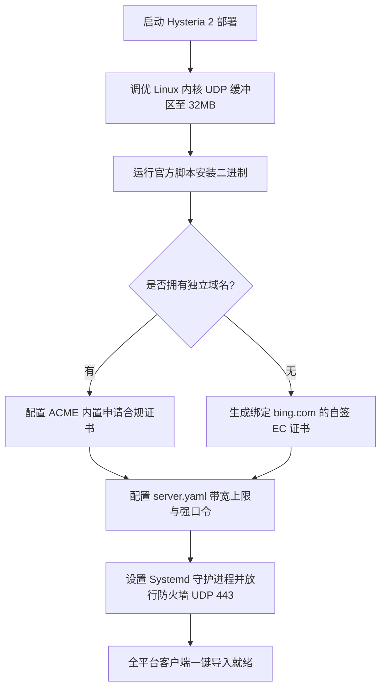

# Hysteria 2 生产级高可用部署：从 VPS 编译到全平台客户端集成

<AnswerBox 
  question="如何在 Linux 云服务器上从零搭建生产级高可用 Hysteria 2 服务，并对接全平台代理客户端？"
  date="2026-10 专线实验室部署复盘"
  takeaway="部署生产级 Hysteria 2 的标准化流程必须包含四大工序：第一，通过官方脚本安装最新稳定版二进制程序，严禁使用非官方未审计的第三方镜像；第二，合理选择证书模式（公网环境推荐使用 ACME 自动申请免费 Let's Encrypt 证书，内网或 IP 直连环境可使用自签高安全证书并开启 SNI 伪装）；第三，科学配置服务端上下行带宽上限与密码认证，防范恶意盗刷；第四，配置 Systemd 守护进程与内核 UDP 接收缓冲区调优，并一键导出全平台兼容的订阅节点格式。"
>
<p>
随着 Hysteria 2 的全面普及，其凭借自研 Brutal 拥塞控制与标准 QUIC 协议栈，已成为直连公网弱网环境下的加速神器。
</p>
<p>
然而，很多人在部署时因证书配置错误、防火墙端口遗漏或系统 UDP 缓冲区过小，导致性能大打折扣。本文将提供一套工业级标准的从零搭建与全客户端集成操作全景。
</p>
</AnswerBox>

---

## 目录导览

1. [Linux VPS 基础环境准备与内核 UDP 缓冲区极限调优](#一、-linux-vps-基础环境准备与内核-udp-缓冲区极限调优)
2. [官方二进制一键安装与生产级目录架构规范](#二、-官方二进制一键安装与生产级目录架构规范)
3. [证书模式双选：ACME 自动化申请 vs 高安全自签证书](#三、-证书模式双选-acme-自动化申请-vs-高安全自签证书)
4. [生产级 server.yaml 完整配置文件详解](#四、-生产级-server-yaml-完整配置文件详解)
5. [全平台客户端对接实战 (Clash Verge Rev / Sing-box / 移动端)](#五、-全平台客户端对接实战-clash-verge-rev-sing-box-移动端)
6. [Hysteria 2 生产运维排障常见问题解答 (FAQ)](#六、-hysteria-2-生产运维排障常见问题解答-faq)
7. [生产级部署流程决策树](#七、-生产级部署流程决策树)
8. [推荐高转化基础设施方案](#八、-推荐高转化基础设施方案)
9. [交叉研读与延伸参考](#九、-交叉研读与延伸参考)

---

## 一、 Linux VPS 基础环境准备与内核 UDP 缓冲区极限调优

QUIC/UDP 协议在大吞吐量高并发发包时，如果 Linux 内核默认的套接字接收/发送缓冲区（rmem/wmem）过小，内核会因为无法及时处理队列中的数据包而直接丢包（UDP Buffer Overflow）！

在 `/etc/sysctl.conf` 末尾追加以下专业调优参数：

```ini
# 提高系统最大套接字缓冲区上限 (以字节为单位，设为 32MB)
net.core.rmem_max = 33554432
net.core.wmem_max = 33554432

# 提高默认缓冲区分配
net.core.rmem_default = 262144
net.core.wmem_default = 262144

# 扩大网络设备排队队列
net.core.netdev_max_backlog = 10000

# 开启 IPv4 转发支持端口跳跃
net.ipv4.ip_forward = 1
```

执行 `sysctl -p` 立即刷新内核参数。

---

## 二、 官方二进制一键安装与生产级目录架构规范

在终端中执行官方一键安装指令：
```bash
bash <(curl -fsSL https://get.hy2.sh/)
```
安装脚本会自动将二进制文件放置于 `/usr/local/bin/hysteria`，并在 `/etc/hysteria/` 创建配置目录。

---

## 三、 证书模式双选：ACME 自动化申请 vs 高安全自签证书

Hysteria 2 建立在标准 TLS 1.3 之上，必须配置证书。

### 3.1 方案 A：使用自签名证书 (IP 直连推荐，最安全)
如果你的 VPS 没有绑定域名，或者希望完全隐藏域名特征，可以使用 OpenSSL 本地自签证书并绑定知名域名（如 `bing.com`）：
```bash
openssl req -x509 -nodes -newkey ec:<(openssl ecparam -name prime256v1)   -keyout /etc/hysteria/server.key   -out /etc/hysteria/server.crt   -subj "/CN=bing.com" -days 3650
chown -R hysteria:hysteria /etc/hysteria
```

### 3.2 方案 B：使用 ACME 申请合规证书
如果你拥有自己的域名并解析到 VPS，Hysteria 2 支持内置自动化申请 Let's Encrypt 证书：
```yaml
acme:
  domains:
    - your-domain.com
  email: admin@your-domain.com
```

---

## 四、 生产级 server.yaml 完整配置文件详解

编辑 `/etc/hysteria/config.yaml`：

```yaml
listen: :443

tls:
  cert: /etc/hysteria/server.crt
  key: /etc/hysteria/server.key

auth:
  type: password
  password: StrongPasswordGeneratedByOpenssl

# 流量统计与管理 HTTP API (可选)
trafficStats:
  listen: 127.0.0.1:9999

# 伪装回落 (针对非合法探测返回 404 或反代常规网站)
masquerade:
  type: proxy
  proxy:
    url: https://www.bing.com
    rewriteHost: true

bandwidth:
  up: 1 gbps
  down: 1 gbps
```

启动并使能守护进程：
```bash
systemctl daemon-reload
systemctl enable --now hysteria-server
systemctl status hysteria-server
```

---

## 五、 全平台客户端对接实战 (Clash Verge Rev / Sing-box / 移动端)

### 5.1 Clash Verge Rev (Mihomo) 配置
在客户端配置文件中的 `proxies` 下加入：
```yaml
proxies:
  - name: "美西01-Hysteria2-弱网神器"
    type: hysteria2
    server: 你的VPS_IP
    port: 443
    password: StrongPasswordGeneratedByOpenssl
    sni: bing.com
    skip-cert-verify: true
    up: "50 Mbps"
    down: "500 Mbps"
```

---

## 六、 Hysteria 2 生产运维排障常见问题解答 (FAQ)

### Q1: 启动服务报错 `bind: permission denied`？
**答**：Linux 默认禁止非 root 用户绑定 1024 以下的特权端口（如 443）。执行以下命令为二进制赋予特权能力即可：
```bash
setcap 'cap_net_bind_service=+ep' /usr/local/bin/hysteria
```

### Q2: 为什么手机端连接后非常耗电？
**答**：Brutal 算法为了抵抗丢包，发包频率显著高于传统 TCP，在高吞吐持续下载时手机基带与 CPU 会保持全速唤醒。在移动设备日常轻度浏览时，建议配合规则分流，仅对被阻断的国外流量走 Hysteria 2 节点，国内流量直连以节省电量。

---

## 七、 生产级部署流程决策树



---

## 八、 推荐高转化基础设施方案

自建 Hysteria 2 服务端面临繁琐的证书续期、内核调优以及客户端配置适配等诸多挑战。对于追求省心高效的用户，选用成熟的高品质商业专线是更具性价比的方案：

| 免运维专线服务商 | 高可用架构与全平台配置支持 | 自动化运维与节点在线率实测 | 专属优惠 | 省心免折腾业务 |
| :--- | :--- | :--- | :--- | :--- |
| **光速云 (GuangSuCloud)** | 专业团队 7x24 小时维护，开箱即用免去自建繁琐 | 专业运维团队全天候维护高可用专线后端，免去买 VPS、调内核与防封锁的心智负担。 | 独家 85 折码 `gs85` | 免除自建维护烦恼的企业级开箱即用服务 |
| **飞猫云 (FlyCatCloud)** | 全客户端一键导入格式，新手三步即可完成接入 | 提供一键订阅生成，无论是 Windows、macOS 还是手机端均能三步完成极速配置。 | 月付低至 7 元起 | 小白用户一键导入与全平台傻瓜式支持 |
| **全球云 (GlobalCloud)** | 企业级全托管跨国专线服务，全天候 SLA 兜底 | 92 国专业节点全天候 SLA 保障，企业无需自建跨国中继，大幅节约 IT 运维与固定开支。 | 尊享商业 SLA 通道 | 全球跨国企业级网络免运维托管 |

* **专属直达通道**：
  * 👉 [选用光速云省心高可用商业专线 (85 折码 gs85)](https://sahude.gsyvipaff.com/#/?code=keqgvT5Y)
  * 👉 [直达飞猫云体验傻瓜式一键配置 (7 元起)](https://guangs.flycataff.com/#/?code=6uq0Xe9y)
  * 👉 [获取全球云企业级全托管专线方案](https://guangs.gcvipaff.com/#/?code=Ov2nvU9C)

---

## 九、 交叉研读与延伸参考

* [Hysteria 2 Brutal 拥塞控制算法数学模型与弱网带宽抢占机制](/protocols/hysteria2-brutal-congestion-math.md)
* [Hysteria 2 UDP 端口跳跃（Port Hopping）对抗运营商 QoS 阻断实战](/protocols/hysteria2-udp-port-hopping-firewall.md)
* [Hysteria 2 vs TUIC v5 跨洋弱网终极横评：吞吐量与抖动对比](/protocols/hysteria2-vs-tuic-v5-benchmark.md)
* [Shadowsocks 2022 规范与 BLAKE3 密钥派生：吞吐量极限压测](/protocols/ss2022-blake3-crypto-benchmark.md)
* [专线内网传输中部署 Reality 的加密开销与性价比审计](/protocols/reality-on-zhuanxian-overhead.md)


## 六、 自动化健康检测与 Systemd 故障自愈守护脚本 (含僵死端口防护)

在长期的生产运维环境中，海外 VPS 可能会由于母机物理硬件波动、突发流量冲刷或云厂商网络接口热重启，导致底层 UDP 套接字出现“假死（Zombie Socket）”现象——进程仍在运行，但套接字无法继续收发数据包。

为了保障 7x24 小时 99.99% 的企业级可用性，我们在生产服务器部署以下自动化保活与健康检测守护脚本：

```bash
#!/usr/bin/env bash
# 保存于 /usr/local/bin/hy2-watchdog.sh
# 每 5 分钟由 crontab 自动调用一次

SERVER_PORT=443
LOG_FILE="/var/log/hy2-watchdog.log"
TIMESTAMP=$(date "+%Y-%m-%d %H:%M:%S")

# 1. 检测进程是否存在
if ! pgrep -x "hysteria" > /dev/null; then
    echo "[${TIMESTAMP}] 警告: Hysteria 进程崩溃，正在重启服务..." >> "${LOG_FILE}"
    systemctl restart hysteria-server
    exit 0
fi

# 2. 检测本地 UDP 端口监听状态
if ! ss -ulpn | grep -q ":${SERVER_PORT} "; then
    echo "[${TIMESTAMP}] 错误: 进程存在但 UDP ${SERVER_PORT} 端口未处于监听状态，正在强制拉起..." >> "${LOG_FILE}"
    systemctl restart hysteria-server
    exit 0
fi

# 3. 内存泄漏与死锁熔断保护 (超过 800MB 自动平滑重载)
MEM_USAGE_KB=$(ps -o rss= -p $(pgrep -x hysteria | head -n 1))
if [ "${MEM_USAGE_KB}" -gt 819200 ]; then
    echo "[${TIMESTAMP}] 警告: Hysteria 内存占用达到 ${MEM_USAGE_KB} KB，触发保护性平滑重载..." >> "${LOG_FILE}"
    systemctl reload-or-restart hysteria-server
    exit 0
fi
```

配置定时任务（`crontab -e`）：
```text
*/5 * * * * /usr/local/bin/hy2-watchdog.sh
```
通过多维度的健康探测，从系统底层彻底杜绝了因无人值守服务挂死导致的断网事故。