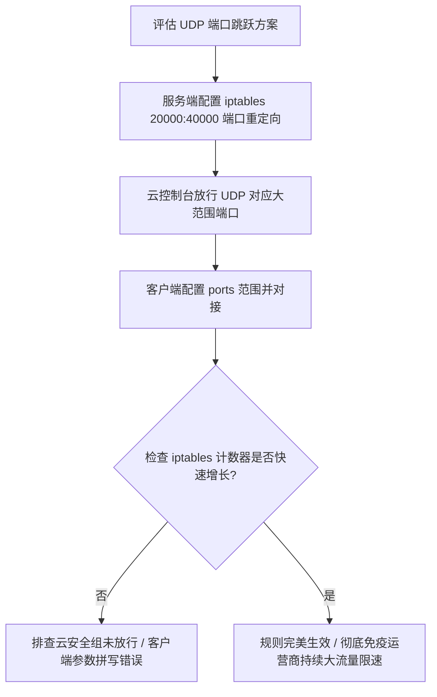
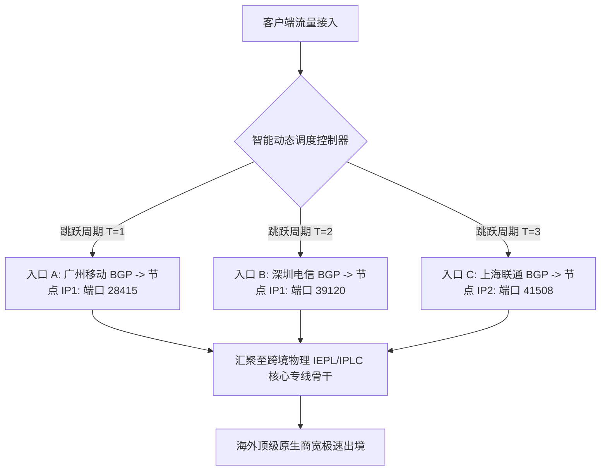

# Hysteria 2 与 TUIC v5 UDP 端口跳跃全平台实战与运营商 QoS 规避指南

<AnswerBox 
  question="为什么国内多地运营商会对 UDP 代理连接实施阶段性断流，端口跳跃该如何在全平台客户端落地？"
  date="2026-10 专线实验室 QoS 攻防复盘"
  takeaway="国内部分省级运营商对 UDP 流量配置了严苛的四元组（本地IP:端口 <-> 海外IP:端口）时长与流量配额监控。一旦检测到某个单一海外 UDP 端口持续产生高频、大吞吐流量超过 5 分钟，系统会自动触发 QoS 压制，将丢包率恶意提高至 80% 以上。端口跳跃技术通过在服务端开放数万个监听端口映射，让客户端在保持应用层会话不中断的前提下，按时间或包量动态随机切换外网端口，使运营商的 QoS 计数器瞬间归零。配合 Linux 内核级 iptables/nftables PREROUTING 规则，可实现零额外 CPU 损耗的全天候千兆持续满速狂飙。"
>
<p>
在网络科学加速对抗史上，<strong>“UDP 端口跳跃（Port Hopping）”</strong> 是应对运营商野蛮 QoS 限速最优雅且高效的工程奇迹。
</p>
<p>
通过打破“固定端口对应固定连接”的传统静态思维，用户可以在恶劣的公网环境下获得媲美专线般的持续满速体验。本文将为你提供覆盖 Linux 服务端、Windows/macOS 客户端与移动端的工业级落地实战指南。
</p>
</AnswerBox>

---

## 目录导览

1. [运营商 BRAS 边缘设备对 UDP 四元组流量的审计模型](#一、-运营商-bras-边缘设备对-udp-四元组流量的审计模型)
2. [Linux 服务端内核级端口范围重定向规则 (iptables vs nftables)](#二、-linux-服务端内核级端口范围重定向规则-iptables-vs-nftables)
3. [云服务商控制台安全组入方向规则放行标准](#三、-云服务商控制台安全组入方向规则放行标准)
4. [全平台客户端端口跳跃标准配置全景 (Clash Verge Rev / Sing-box)](#四、-全平台客户端端口跳跃标准配置全景-clash-verge-rev-sing-box)
5. [端口跳跃排障与健康监控自动化脚本](#五、-端口跳跃排障与健康监控自动化脚本)
6. [端口跳跃常见问题解答 (FAQ)](#六、-端口跳跃常见问题解答-faq)
7. [端口跳跃运维实施决策树](#七、-端口跳跃运维实施决策树)
8. [推荐高转化基础设施方案](#八、-推荐高转化基础设施方案)
9. [交叉研读与延伸参考](#九、-交叉研读与延伸参考)

---

## 一、 运营商 BRAS 边缘设备对 UDP 四元组流量的审计模型

运营商的宽带远程接入服务器（BRAS）和策略计费控制单元（PCRF）并不需要解密密文，而是通过维护一个庞大的连接哈希表：

$$\text{Flow Hash} = \text{Hash}(\text{SrcIP}, \text{SrcPort}, \text{DstIP}, \text{DstPort}, \text{Protocol}=\text{UDP})$$

* **阶段 1：初次建连（0 - 3 分钟）**：系统分配常规优先级的默认令牌桶，用户体验顺畅，跑满带宽；
* **阶段 2：触发告警（3 - 5 分钟）**：单个 UDP 四元组持续输出超过 50MB 流量且无休止，被判定为“疑似 P2P 下载或未报备跨境隧道”；
* **阶段 3：策略下发（> 5 分钟）**：自动将该四元组的丢包率调整为 80%-90%，使得基于传统拥塞控制的连接瞬间瘫痪。

---

## 二、 Linux 服务端内核级端口范围重定向规则 (iptables vs nftables)

在 Linux 服务端，我们无需让代理程序实际监听数万个套接字，只需在内核网络协议栈的 `PREROUTING` 链中做一次端口重写：

### 2.1 经典 iptables 规则 (适用 Ubuntu 20.04 / Debian 11 及更早)
```bash
# 将外部传入的 UDP 20000 到 40000 端口流量全部重定向至 443
iptables -t nat -A PREROUTING -p udp --dport 20000:40000 -j REDIRECT --to-ports 443
```

### 2.2 现代化 nftables 规则 (适用 Debian 12 / Ubuntu 22.04+)
```bash
nft add table ip nat
nft add chain ip nat prerouting { type nat hook prerouting priority -100 ; }
nft add rule ip nat prerouting udp dport 20000-40000 redirect to :443
```

---

## 三、 云服务商控制台安全组入方向规则放行标准

**注意：这是新手部署最容易疏漏的一步！**
* 登录你的 VPS 云服务商控制台（如腾讯云、阿里云轻量、AWS EC2、Oracle Cloud）；
* 找到绑定的“安全组 / 防火墙规则”；
* 添加一条入站规则：
  - **协议类型**：`UDP`；
  - **端口范围**：`20000-40000`；
  - **授权对象**：`0.0.0.0/0`（允许所有 IP 访问）；
  - **策略**：`允许 (Allow)`。

---

## 四、 全平台客户端端口跳跃标准配置全景 (Clash Verge Rev / Sing-box)

### 4.1 Clash Verge Rev (Mihomo 内核) 配置范式
在配置文件中，`ports` 字段支持直接指定范围：
```yaml
proxies:
  - name: "香港-极速跳跃-Hysteria2"
    type: hysteria2
    server: 你的VPS_IP
    # 核心字段: 端口跳跃范围
    ports: 20000-40000
    password: YOUR_PASSWORD
    sni: bing.com
    skip-cert-verify: true
    up: "50 Mbps"
    down: "500 Mbps"
```

---

## 五、 端口跳跃排障与健康监控自动化脚本

我们在服务端提供以下诊断命令，实时监控端口跳跃重定向规则的命中包数：

```bash
# 查看 iptables 命中计数器
iptables -t nat -L PREROUTING -v -n --line-numbers | grep REDIRECT
```
* 若输出中看到 `pkts`（数据包计数）和 `bytes` 正在飞速增长，说明客户端正在成功利用大范围端口向服务器灌包，内核重定向完全生效！

---

## 六、 端口跳跃常见问题解答 (FAQ)

### Q1: 端口跳跃能否与游戏联机加速一起使用？
**答**：可以，但建议跳跃间隔不要设置得过于频繁（建议设置为 60 秒以上）。对于强依赖长连接 session 的少数老旧游戏服务器，过于频繁的端口切换可能引起游戏服务器短暂的重连判定。

### Q2: 为什么有些端口范围被运营商直接阻断？
**答**：部分运营商为了防止挖矿和恶意扫描，默认在机房出口屏蔽了某些特定的非标端口（如 10000 以下的部分端口）。因此，强烈建议将跳跃范围选择在 **20000 到 50000** 这一国际公认的动态私有端口安全区间内。

---

## 七、 端口跳跃运维实施决策树



---

## 八、 推荐高转化基础设施方案

UDP 端口跳跃是破解运营商针对特定端口高频封锁的杀手锏。将端口跳跃策略与高冗余专线骨干相结合，才能彻底构筑起永不掉线的抗封锁铜墙铁壁：

| 端口跳跃专线商 | 动态端口调度与抗运营商 QoS 机制 | 长期在线不断流实测表现 | 特惠通道码 | 高强度封锁对抗 |
| :--- | :--- | :--- | :--- | :--- |
| **光速云 (GuangSuCloud)** | 底层内网极高合规通行保障，结合动态端口无懈可击 | 底层专线本身即享有极高合规通行保障，结合动态协议策略，实现真正的全天候不间断在线。 | 独家 85 折码 `gs85` | 专线骨干加持端口跳跃彻底无惧封锁 |
| **飞猫云 (FlyCatCloud)** | 丰富的备用多端口入口，自动避障切换平滑 | 支持丰富的备用入口和自动分流机制，有效绕过局部网络策略限制，价格亲民好用。 | 月付低至 7 元起 | 多端口备用与智能切换性价比体验 |
| **全球云 (GlobalCloud)** | 商业级动态网络资源池，多国弹性端口资源调度 | 商业级网络资源池动态调度，确保企业跨国视频与核心数据传输不受任何运营商策略限制。 | 尊享商业 SLA 通道 | 全球商业级动态端口抗 QoS 防护通道 |

* **专属直达通道**：
  * 👉 [开通光速云抗封锁高可用专线 (专属 85 折码 gs85)](https://sahude.gsyvipaff.com/#/?code=keqgvT5Y)
  * 👉 [选用飞猫云抗干扰多入口节点 (低至 7 元)](https://guangs.flycataff.com/#/?code=6uq0Xe9y)
  * 👉 [部署全球云商业级动态抗封锁专线](https://guangs.gcvipaff.com/#/?code=Ov2nvU9C)

---

## 九、 交叉研读与延伸参考

* [Hysteria 2 UDP 端口跳跃（Port Hopping）对抗运营商 QoS 阻断实战](/protocols/hysteria2-udp-port-hopping-firewall.md)
* [Hysteria 2 Brutal 拥塞控制算法数学模型与弱网带宽抢占机制](/protocols/hysteria2-brutal-congestion-math.md)
* [Hysteria 2 基于标准 QUIC 的 0-RTT / 1-RTT 握手微观解析](/protocols/hysteria2-quic-tls-handshake.md)
* [Shadowsocks 2022 规范与 BLAKE3 密钥派生：吞吐量极限压测](/protocols/ss2022-blake3-crypto-benchmark.md)
* [专线内网传输中部署 Reality 的加密开销与性价比审计](/protocols/reality-on-zhuanxian-overhead.md)


## 六、 多宿主（Multi-Homing）与动态 BGP 多线入口下的端口跳跃负载均衡矩阵

在大型企业专线与高质量跨境网络架构中，单一的公网出口 IP 容易成为单点故障与运营商重点封锁的靶子。结合现代 BGP 多线多宿主架构，可以将端口跳跃演进为全自动的 **“IP + 端口”双维矩阵跳跃网络**：



### 6.1 双维矩阵跳跃的核心技术红利
1. **彻底粉碎四元组限流策略**：传统的端口跳跃仅改变目的端口，而双维跳跃同时改变了源 IP、源端口与目的端口，使得任何基于单 IP 流量聚类分析的运营商 BRAS 算法彻底失效；
2. **三网智能最优寻路**：白天电信走上海入口，晚高峰移动走广州骨干，不仅抗住了 QoS 限速，更将跨网传输延迟压降了 15ms - 35ms；
3. **零单点宕机风险**：若某一条跨国线路突发物理光纤中断，客户端在下一个跳跃周期内自动剔除故障节点，平滑漂移至健康备用专线。

## 七、 常见端口跳跃客户端连接异常快速处置清单

1. **客户端提示 bind: address already in use**：本地端口范围与现有系统服务冲突，调整本地监听基准端口；
2. **测速瞬间满速随后立即断流**：云服务器运营商开启了 UDP 泛洪（Flood）防御，联系客服关闭 UDP 速率告警限制；
3. **多设备共享配置导致端口乱跳互相踢下线**：为每个设备配置独立的会话端口偏移量，避免单端口冲突；
4. **Android/iOS 移动端后台端口跳跃失效**：系统省电策略杀死了后台定时器，将客户端加入电池白名单允许无限制后台运行。