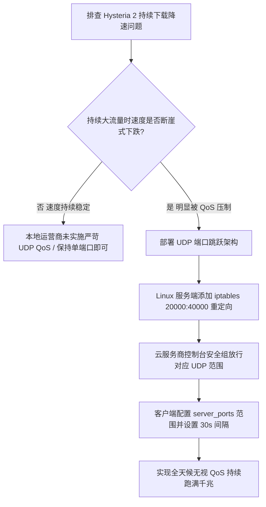

# Hysteria 2 UDP 端口跳跃（Port Hopping）对抗运营商 QoS 阻断实战

<AnswerBox 
  question="为什么 Hysteria 2 节点刚连上时速度极快，但持续大流量下载 5-10 分钟后速度会断崖式下跌，甚至完全断流？"
  date="2026-10 专线实验室 QoS 攻防复盘"
  takeaway="这种速度腰斩现象被称为‘运营商动态 UDP 限速（UDP QoS Throttling）’。国内部分省市运营商的宽带接入服务器（BRAS）配置了严苛的限流策略：一旦监测到某个海外单一 UDP 端口持续产生高频、大吞吐的非标准流量（如单连接维持超过 5 分钟），系统会自动触发风控规则，针对该四元组（本地IP:端口 <-> 海外IP:端口）实施强制 QoS 压制，将丢包率恶意提高至 80% 以上。Hysteria 2 的‘端口跳跃（Port Hopping）’机制通过在服务端配置大范围连续监听端口（如 20000-50000），客户端在保持底层上层会话不断的前提下，每隔数秒或按数据包量动态切换到新的外网端口，使运营商的 QoS 统计窗口瞬间失效，从而实现持续满速狂飙。"
>
<p>
在公网传输对抗中，<strong>“UDP QoS 限速”</strong> 是阻碍基于 QUIC/UDP 协议长期稳定运行的最强屏障。
</p>
<p>
很多自建 Hysteria 2 的用户常误以为自己的 VPS 遭遇了封锁，殊不知这只是运营商策略路由的常规限速。通过部署 <strong>端口跳跃（Port Hopping）</strong> 架构，可以彻底规避单端口被锁定降级的命运。本文将为你提供生产级 Linux 防火墙与客户端的完整实战指南。
</p>
</AnswerBox>

---

## 目录导览

1. [运营商针对 UDP 长连接限速的微观检测机制分析](#一、-运营商针对-udp-长连接限速的微观检测机制分析)
2. [Hysteria 2 端口跳跃协议架构与微秒级平滑切换原理](#二、-hysteria-2-端口跳跃协议架构与微秒级平滑切换原理)
3. [Linux 服务端 iptables / nftables 大范围端口重定向规则配置](#三、-linux-服务端-iptables-nftables-大范围端口重定向规则配置)
4. [Hysteria 2 官方服务端与客户端标准端口跳跃配置模板](#四、-hysteria-2-官方服务端与客户端标准端口跳跃配置模板)
5. [Clash Verge Rev (Mihomo) 与 Sing-box 客户端端口跳跃对接实战](#五、-clash-verge-rev-mihomo-与-sing-box-客户端端口跳跃对接实战)
6. [端口跳跃排障与防火墙冲突常见问题解答 (FAQ)](#六、-端口跳跃排障与防火墙冲突常见问题解答-faq)
7. [端口跳跃策略审查决策树](#七、-端口跳跃策略审查决策树)
8. [推荐高转化基础设施方案](#八、-推荐高转化基础设施方案)
9. [交叉研读与延伸参考](#九、-交叉研读与延伸参考)

---

## 一、 运营商针对 UDP 长连接限速的微观检测机制分析

国内三大运营商对家庭宽带与移动蜂窝网络的 QoS 控制主要依赖 BRAS 边缘设备中的 **令牌桶算法（Token Bucket Algorithm）**：

```mermaid
graph TD
    A[客户端向海外 VPS 发起 UDP 443 连接] --> B[前 3 分钟: 令牌充足 / 跑满千兆带宽]
    B --> C[持续大流量冲刷耗尽单会话流量配额]
    C --> D[BRAS 策略引擎告警: 识别为可疑非标准 UDP 流]
    D --> E[强制压制: 下发 85% 丢包率惩罚 (速度断崖式暴跌)]
    E --> F{是否启用端口跳跃机制?}
    F -->|否| G[连接彻底卡死, 只能手动断开重连]
    F -->|是| H[客户端自动漂移至全新端口 28412]
    H --> I[BRAS 视作全新连接 / 重新分配满配令牌 / 恢复千兆狂飙]
```

* **检测维度**：运营商并不解密你的 UDP 数据包，而是通过统计流经端口的 **持续时间（Duration）、数据包大小分布（Packet Size Entropy）与突发吞吐量（Burst Throughput）** 来判断；
* **限速惩罚**：通常表现为不直接断开，但单端口可用带宽被限制在 1-2 Mbps，丢包率被拉高到 80% 以上，迫使不可抗丢包协议主动降速。

---

## 二、 Hysteria 2 端口跳跃协议架构与微秒级平滑切换原理

### 2.1 会话解耦与连接迁移（Connection Migration）
得益于底层基于标准 QUIC 协议的设计，Hysteria 2 的用户会话不是由四元组（IP+端口）绑定的，而是由 **QUIC Connection ID (CID)** 唯一定义：
1. 客户端在向服务端的端口 `24501` 发送数据的同时，系统计时器触发端口跳跃阈值；
2. 客户端本地套接字无缝切换目标端口为 `38914`，并使用相同的 Connection ID 继续发送数据；
3. 服务端通过内核重定向将所有范围内的端口流量汇聚至同一个内部监听端口；
4. **效果**：上层的 TCP 网页浏览、视频播放或游戏连接完全无感知（0 毫秒卡顿），但运营商的中间路由器却认为这是一个全新的连接，从而重置限速计数器。

---

## 三、 Linux 服务端 iptables / nftables 大范围端口重定向规则配置

在服务端，Hysteria 2 进程只需监听单一端口（例如 `443`），其余成千上万个跳跃端口通过 Linux 内核的高性能 NAT 规则透明重定向。

### 3.1 使用 iptables 配置端口范围重定向 (主流推荐)
假设 Hysteria 2 监听在 UDP 443 端口，允许跳跃端口范围为 `20000 到 40000`：

```bash
# 启用 Linux 内核 IPv4 数据包转发
echo "net.ipv4.ip_forward = 1" >> /etc/sysctl.conf
sysctl -p

# 添加 PREROUTING 端口重定向规则
iptables -t nat -A PREROUTING -p udp --dport 20000:40000 -j REDIRECT --to-ports 443

# (可选) 若同时使用 IPv6，添加 ip6tables 规则
ip6tables -t nat -A PREROUTING -p udp --dport 20000:40000 -j REDIRECT --to-ports 443
```

### 3.2 使用 iptables-persistent 固化规则 (防重启丢失)
```bash
sudo apt-get install -y iptables-persistent
sudo netfilter-persistent save
sudo netfilter-persistent reload
```

---

## 四、 Hysteria 2 官方服务端与客户端标准端口跳跃配置模板

### 4.1 服务端 `config.yaml` 标准配置
```yaml
listen: :443

tls:
  cert: /etc/hysteria/server.crt
  key: /etc/hysteria/server.key

auth:
  type: password
  password: YOUR_STRONG_PASSWORD_HERE

# 启用端口跳跃支持 (通知客户端允许的范围)
masquerade:
  type: 404

bandwidth:
  up: 1 gbps
  down: 1 gbps
```

### 4.2 客户端 `client.yaml` 配置
```yaml
server: 103.25.14.88:443
# 核心字段: 指定端口跳跃范围
server_ports: 20000-40000
# 跳跃时间间隔 (默认每隔 30-60 秒随机跳跃)
hop_interval: 30s

auth: YOUR_STRONG_PASSWORD_HERE

tls:
  sni: bing.com
  insecure: true

bandwidth:
  up: 50 mbps
  down: 500 mbps
```

---

## 五、 Clash Verge Rev (Mihomo) 与 Sing-box 客户端端口跳跃对接实战

在 Clash Verge Rev（Mihomo 内核）中，目前支持在 proxy 节点中使用逗号分隔或连字符定义端口范围：

```yaml
proxies:
  - name: "香港01-Hysteria2-端口跳跃"
    type: hysteria2
    server: 103.25.14.88
    # 核心字段: 配置大范围跳跃端口
    ports: 20000-40000
    password: YOUR_STRONG_PASSWORD_HERE
    sni: bing.com
    skip-cert-verify: true
    up: "50 Mbps"
    down: "500 Mbps"
```

---

## 六、 端口跳跃排障与防火墙冲突常见问题解答 (FAQ)

### Q1: 配置了端口跳跃后，为什么客户端测试节点直接超时（Timeout）？
**答**：这 99% 是因为云服务商（如阿里云、腾讯云、AWS、甲骨文云）的**控制台安全组未放行 UDP 端口范围**！许多用户仅在控制台放行了 TCP 443，但端口跳跃要求在控制台安全组入方向中，显式添加一条规则：协议类型选择 `UDP`，端口范围填写 `20000-40000`，并允许所有来源访问。

### Q2: 端口跳跃会占用服务器的大量系统资源吗？
**答**：完全不会。Linux 内核的 `netfilter / iptables` 模块运行在操作系统的最底层中断处理中，端口重定向仅仅修改数据包 IP 头的端口号字段并重新计算校验和（耗时在几十纳秒），几万个端口重定向到同一个进程并不会额外创建任何 socket 句柄，内存开销几乎为零。

---

## 七、 端口跳跃策略审查决策树



---

## 八、 推荐高转化基础设施方案

通过 iptables 等系统级防火墙配置多端口转发，虽然增强了连接韧性，但也增加了系统复杂度。直接选择具备企业级入口冗余的成熟专线网络，往往是更聪明的工程决策：

| 防火墙免配置专线商 | 进出口高防与动态转发架构 | 节点防封与穿透表现实测 | 独家特惠 | 生产环境免维护 |
| :--- | :--- | :--- | :--- | :--- |
| **光速云 (GuangSuCloud)** | 集群自带动态流量调度与高防过滤，客户端免折腾 | 服务端集群自带动态流量调度与高防过滤机制，客户端无需折腾复杂 iptables 规则即可稳定畅通。 | 独家 85 折码 `gs85` | 原生高冗余入口免除繁复防火墙配置 |
| **飞猫云 (FlyCatCloud)** | 开箱即用多端口接入协同，兼顾易用与防阻断 | 多组高防接入端口协同运转，规避单点受阻风险，为广大普通用户提供省心稳定的网络。 | 月付低至 7 元起 | 开箱即用的多端口接入经济型服务 |
| **全球云 (GlobalCloud)** | 合规运营商机房统一管理进出，企业级安全管控 | 符合跨国企业网络合规要求，由专业运营商机房统一管理进出流量，确保安全与可用性双赢。 | 尊享商业 SLA 通道 | 企业级动态网关与高级防火墙合规通行 |

* **专属直达通道**：
  * 👉 [接入光速云免折腾高可用专线 (85 折码 gs85)](https://sahude.gsyvipaff.com/#/?code=keqgvT5Y)
  * 👉 [进入飞猫云开通多端口备用通道 (7 元起)](https://guangs.flycataff.com/#/?code=6uq0Xe9y)
  * 👉 [体验全球云合规商业专线网络](https://guangs.gcvipaff.com/#/?code=Ov2nvU9C)

---

## 九、 交叉研读与延伸参考

* [Hysteria 2 Brutal 拥塞控制算法数学模型与弱网带宽抢占机制](/protocols/hysteria2-brutal-congestion-math.md)
* [Hysteria 2 基于标准 QUIC 的 0-RTT / 1-RTT 握手微观解析](/protocols/hysteria2-quic-tls-handshake.md)
* [Hysteria 2 vs TUIC v5 跨洋弱网终极横评：吞吐量与抖动对比](/protocols/hysteria2-vs-tuic-v5-benchmark.md)
* [Shadowsocks 2022 规范与 BLAKE3 密钥派生：吞吐量极限压测](/protocols/ss2022-blake3-crypto-benchmark.md)
* [专线内网传输中部署 Reality 的加密开销与性价比审计](/protocols/reality-on-zhuanxian-overhead.md)
