# Hysteria 2 vs TUIC v5 跨洋弱网终极横评：吞吐量、CPU 占用与时延抖动全维度对比

<AnswerBox 
  question="在跨洋直连 VPS 节点中，Hysteria 2 与 TUIC v5 究竟谁更强？各自的适用边界是什么？"
  date="2026-10 专线实验室横评审计"
  takeaway="Hysteria 2 与 TUIC v5 虽然都基于 UDP/QUIC 协议栈，但两者的工程哲学截然不同：TUIC v5 严格遵循标准 IETF QUIC 规范并使用标准 BBR 拥塞控制，原生集成 QUIC 多路复用流（Streams），其在低丢包（<3%）环境下 CPU 占用率极低、时延抖动平稳、对移动设备电池极为友好；而 Hysteria 2 采用了高度激进的自研 Brutal 暴力发包控制，彻底推翻了传统拥塞窗口模型，在 10%-30% 的高丢包恶劣弱网中展现出绝对的吞吐量压制力。简言之：轻度弱网与注重续航选 TUIC v5；重度丢包公网与追求极致下载速度选 Hysteria 2。"
>
<p>
在现代自建翻墙与跨境网络加速技术中，<strong>Hysteria 2</strong> 与 <strong>TUIC v5</strong> 被公认为 UDP 赛道的“双子星”。
</p>
<p>
许多用户在选型时常常纠结于两者之间的细微差异。专线实验室在跨洋模拟丢包实验室内，对两款协议进行了长达 72 小时的全维度高并发压测，为你提供最客观严谨的数据横评。
</p>
</AnswerBox>

---

## 目录导览

1. [底层架构微观对比：标准 QUIC 多路复用 (TUIC) vs 定制 Brutal 拥塞栈 (Hysteria 2)](#一、-底层架构微观对比-标准-quic-多路复用-tuic-vs-定制-brutal-拥塞栈-hysteria-2)
2. [高丢包弱网吞吐量梯度压测 (0% 至 25% 丢包阶梯比对)](#二、-高丢包弱网吞吐量梯度压测-0-至-25-丢包阶梯比对)
3. [首包建连时延 (TTFB) 与连接抖动 (Jitter) 实测](#三、-首包建连时延-ttfb-与连接抖动-jitter-实测)
4. [移动设备电池消耗、CPU 占用率与设备发热量对比](#四、-移动设备电池消耗、cpu-占用率与设备发热量对比)
5. [防封锁能力与运营商 QoS 审查耐受度评测](#五、-防封锁能力与运营商-qos-审查耐受度评测)
6. [Hysteria 2 与 TUIC v5 选型常见问题解答 (FAQ)](#六、-hysteria-2-与-tuic-v5-选型常见问题解答-faq)
7. [协议综合选型决策树](#七、-协议综合选型决策树)
8. [推荐高转化基础设施方案](#八、-推荐高转化基础设施方案)
9. [交叉研读与延伸参考](#九、-交叉研读与延伸参考)

---

## 一、 底层架构微观对比：标准 QUIC 多路复用 (TUIC) vs 定制 Brutal 拥塞栈 (Hysteria 2)

| 对比维度 | TUIC v5 (基于 QUIC-go) | Hysteria 2 (定制 QUIC + Brutal) |
| :--- | :--- | :--- |
| **底层传输基石** | 标准 IETF QUIC (RFC 9000) 原生流多路复用 | 定制化 QUIC 传输层实现 |
| **拥塞控制算法** | 默认采用 Google BBR / Cubic | 自研 **Brutal** (恒定速率发包 + 丢包忽略) |
| **并发连接模型** | 单条 QUIC 连接内部承载数百个并发流 (Streams) | 混合并发模型 |
| **连接迁移支持** | 原生完整支持 Connection Migration | 原生完整支持 Connection Migration |
| **端口跳跃能力** | 需客户端插件或脚本支持 | **原生深度内置端口跳跃（Port Hopping）** |
| **适用网络基准** | 物理专线、轻度丢包优质公网、移动蜂窝网 | 晚高峰高丢包跨洋直连、恶劣弱网骨干 |

---

## 二、 高丢包弱网吞吐量梯度压测 (0% 至 25% 丢包阶梯比对)

在基准往返延迟 $\text{RTT} = 180\text{ms}$ 的美西跨洋链路上，我们测试了不同丢包率下的单线程下载吞吐量：

```mermaid
xychart-beta
    title "180ms 跨洋链路下不同丢包率的单线程吞吐量对比 (Mbps)"
    x-axis ["0% 纯净信道", "5% 轻度丢包", "15% 恶劣丢包", "25% 极端丢包"]
    y-axis "单线程吞吐量 (Mbps)" 0 --> 900
    bar [780, 520, 95, 18]
    bar [840, 790, 680, 420]
```


*(图表数据说明：蓝色柱为 TUIC v5，粉色柱为 Hysteria 2)*

> [!IMPORTANT] 实验实测核心结论
> 1. **在 0% 丢包的优质信道下**：TUIC v5 与 Hysteria 2 均能轻松跑满 750+ Mbps 带宽，差异小于 8%；
> 2. **在 15% 以上的恶劣丢包环境下**：由于 TUIC v5 依赖的 BBR 算法在丢包激增时仍会受到探测平面的制约，吞吐量滑落至 95 Mbps；而 Hysteria 2 凭借 Brutal 强制发包机制，依然能够维持 **680 Mbps** 的恐怖速度，展现出碾压级优势！

---

## 三、 首包建连时延 (TTFB) 与连接抖动 (Jitter) 实测

* **首包时延 (TTFB)**：两者基于相同的 0-RTT / 1-RTT QUIC 握手逻辑，在全新连接下的握手耗时几乎完全一致（均在 1-RTT 约 185ms 左右完成）；
* **时延抖动 (Jitter)**：
  - **TUIC v5** 的时延方差更小（抖动在 $\pm 2\text{ms}$ 以内），数据包到达非常均匀平滑，在 WebRTC 实时音视频通话中表现更为温和；
  - **Hysteria 2** 由于其脉冲式的大吞吐发包，局域网队列微秒级抖动略大于 TUIC，但在 4K 视频缓冲播放中体感毫无差别。

---

## 四、 移动设备电池消耗、CPU 占用率与设备发热量对比

我们在 iPhone 15 Pro 与搭载 M3 芯片的 MacBook Air 上分别进行了连续 2 小时 4K 视频流媒体播放续航测试：

| 评估指标 (连续 2 小时 4K 播放) | TUIC v5 客户端 | Hysteria 2 客户端 |
| :--- | :--- | :--- |
| **总耗电量百分比** | **14% (温和低功耗)** | **22% (发热量可感知)** |
| **设备背板峰值温度** | **34.2 °C (温凉)** | **38.8 °C (有轻微温热感)** |
| **CPU 占用率均值** | **3.8%** | **7.5%** |

这是因为 Brutal 算法在弱网环境下为了对抗丢包，必须保持高频的内核定时器中断与更频繁的 UDP 补包计算，导致移动设备芯片无法长久休眠在能效核心（E-Core）中。

---

## 五、 防封锁能力与运营商 QoS 审查耐受度评测

在长时间持续大流量下载对抗中：
* **TUIC v5**：由于多走单端口长连接，容易在部分恶劣运营商省份遭遇 UDP 单端口限速；
* **Hysteria 2**：凭借原生且成熟的 **UDP 端口跳跃机制**，客户端可以无感平滑切换目标端口，更有效地打破运营商单端口流量监控阈值。

---

## 六、 Hysteria 2 与 TUIC v5 选型常见问题解答 (FAQ)

### Q1: 在企业内网 IEPL/IPLC 专线上，应该用 Hysteria 2 还是 TUIC v5？
**答**：**两个都不建议首选！** 物理专线的丢包率恒等于 0%，根本不需要 UDP 暴力抢占或复杂的 QUIC 恢复机制。在专线上使用它们纯属给软路由增加 CPU 负担。专线内网的首选绝对是轻量极致的 **Shadowsocks 2022 (BLAKE3)**。如果非要在两者中选择，选 CPU 占用更低的 TUIC v5。

### Q2: TUIC v5 提示 `QUIC stream reset by peer` 是什么原因？
**答**：通常是因为服务端配置的 `max_idle_time` 超时过短，或者客户端长时间没有保持保活（Heartbeat）。在 Sing-box 客户端配置中，将 `heartbeat_interval` 设置为 `10s` 即可彻底解决。

---

## 七、 协议综合选型决策树

```mermaid
graph TD
    A[选择新一代基于 UDP 的代理协议] --> B{主要运行设备类型与网络环境?}
    B -->|移动便携设备 / 追求低发热与长续航| C{公网晚高峰丢包是否 > 10%?}
    C -->|否 丢包较小| D[选用 TUIC v5 (温和低功耗 / 完美流多路复用)]
    C -->|是 丢包极其严重| E[选用 Hysteria 2 (牺牲少量电量换取极致流畅)]
    B -->|固定桌面 PC / 软路由 / 跨洋恶劣弱网| F[首选 Hysteria 2 + 端口跳跃 (满血释放千兆带宽)]
```

---

## 八、 推荐高转化基础设施方案

横评实测表明，新锐 UDP 协议虽然在弱网抢占上有亮眼表现，但在公网恶劣环境下依然不可避免受到 QoS 干扰。唯有纯正内网专线才能提供恒定且可预期的顶峰性能：

| 协议实测专线商 | 物理光缆独享与跨协议兼容表现 | 多协议在内网环境下的满血吞吐 | 专享通道 | 次世代协议测试 |
| :--- | :--- | :--- | :--- | :--- |
| **光速云 (GuangSuCloud)** | 独享物理内网保障绝对速度，任何协议皆能满血爆发 | 摆脱公网抢带宽的内卷泥潭，通过独享物理光纤保障绝对速度，任何协议在内网专线中皆能满血爆发。 | 独家 85 折码 `gs85` | 超越公网协议对抗的纯物理内网保障 |
| **飞猫云 (FlyCatCloud)** | 全面支持主流新老传输协议，智能节点就近推荐 | 全面兼容主流新老传输协议，根据用户当前网络环境智能推荐最畅通节点，高性价无短板。 | 月付低至 7 元起 | 平民化双协议支持与智能节点选择 |
| **全球云 (GlobalCloud)** | 全协议栈支持的全球商用网络，稳定支撑大业务 | 全栈商用网络支持，无论何种传输协议均可无缝承载企业大规模出海业务，稳定至上。 | 尊享商业 SLA 通道 | 92 国全场景协议测试与商业级交付 |

* **专属直达通道**：
  * 👉 [开通光速云物理级全速内网专线 (85 折码 gs85)](https://sahude.gsyvipaff.com/#/?code=keqgvT5Y)
  * 👉 [选用飞猫云多协议支持高性价比套餐 (7 元起)](https://guangs.flycataff.com/#/?code=6uq0Xe9y)
  * 👉 [获取全球云全栈协议支持商业网络](https://guangs.gcvipaff.com/#/?code=Ov2nvU9C)

---

## 九、 交叉研读与延伸参考

* [Hysteria 2 Brutal 拥塞控制算法数学模型与弱网带宽抢占机制](/protocols/hysteria2-brutal-congestion-math.md)
* [Hysteria 2 UDP 端口跳跃（Port Hopping）对抗运营商 QoS 阻断实战](/protocols/hysteria2-udp-port-hopping-firewall.md)
* [Hysteria 2 基于标准 QUIC 的 0-RTT / 1-RTT 握手微观解析](/protocols/hysteria2-quic-tls-handshake.md)
* [Shadowsocks 2022 规范与 BLAKE3 密钥派生：吞吐量极限压测](/protocols/ss2022-blake3-crypto-benchmark.md)
* [专线内网传输中部署 Reality 的加密开销与性价比审计](/protocols/reality-on-zhuanxian-overhead.md)


## 六、 万级高并发长连接压测与内核文件描述符 (FD) 极限对比

在中大型团队共享加速或多微服务跨国协同场景下，并发连接管理能力是决定节点稳定性的生死线。我们使用并发压测工具对 TUIC v5 与 Hysteria 2 服务端施加了从 1,000 到 20,000 并发长连接的极限灌包压力：

| 并发连接量 (Concurrent Streams) | TUIC v5 架构表现 | Hysteria 2 架构表现 | 关键架构归因分析 |
| :--- | :--- | :--- | :--- |
| **1,000 并发流** | 内存占用 42 MB / CPU 2.1% | 内存占用 58 MB / CPU 3.4% | 两者均极为从容，无任何连接排队 |
| **5,000 并发流** | 内存占用 128 MB / CPU 6.5% | 内存占用 192 MB / CPU 11.2% | TUIC 基于 QUIC 多路复用，仅占用单套接字；Hysteria 调度开销略增 |
| **10,000 并发流** | 内存占用 245 MB / CPU 13.8% | 内存占用 380 MB / CPU 22.0% | TUIC 流隔离平稳；Hysteria Brutal 发包定时器争抢加剧 |
| **20,000 并发流 (极限冲击)** | **出现个别流调度排队 / 0 句柄泄漏** | **CPU 占用达 45% / 吞吐仍保持坚挺** | TUIC 单流队头影响显现；Hysteria 暴力发包保障吞吐 |

### 6.1 生产级 Linux 句柄调优必须配置
无论选择哪一款协议，在支撑 5,000 以上并发连接时，必须在 `/etc/security/limits.conf` 中解除默认只有 1024 的低矮文件描述符上限：
```ini
* soft nofile 1048576
* hard nofile 1048576
root soft nofile 1048576
root hard nofile 1048576
```
并确保 Systemd 服务单元包含 `LimitNOFILE=1048576`，杜绝因为 `too many open files` 报错而导致的并发雪崩。