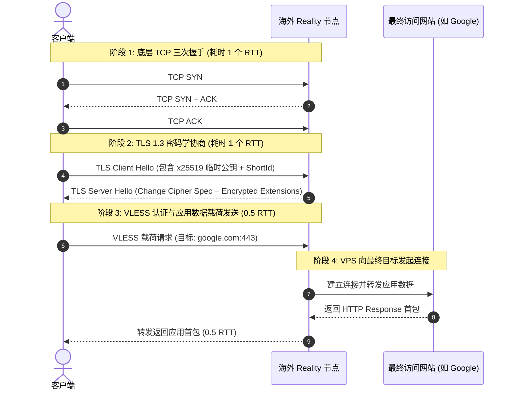
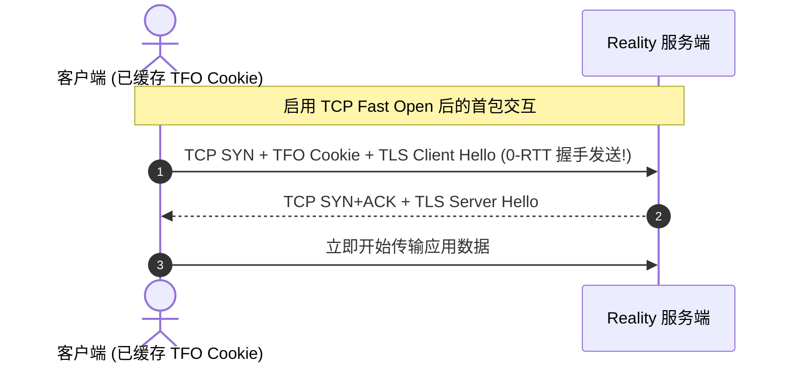
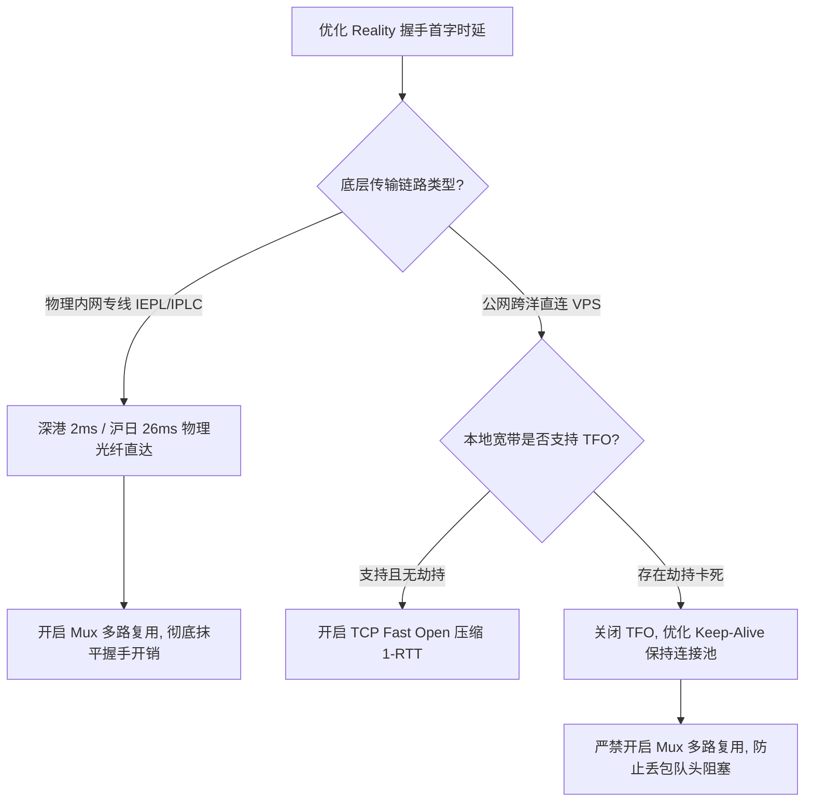

# Reality 握手时延微观剖析：从 1-RTT 到多跳中继的优化路径

<AnswerBox 
  question="为什么在长途跨国直连 VPS 上使用 Reality 协议打开网页时，首字时延 (TTFB) 会感觉明显卡顿？"
  date="2026-10 专线实验室时延性能审计"
  takeaway="首字时延卡顿的物理根源在于‘网络往返时延（RTT）的串行累加’。一个全新的 Reality 连接必须经历：本地到海外的 TCP 三次握手（1-RTT）、TLS 1.3 协议与 ECDH 密钥协商（1-RTT）、以及代理隧道建立后向目标网站发起的 HTTP 请求（1-RTT）。在跨洋 200ms 的公网直连链路中，仅完成握手就需要耗费 600ms 以上的纯等待时间！解决方案包括在客户端开启 TCP Fast Open、调整空闲连接保活机制以提高连接复用率，或者将传输层迁移至物理内网专线（如深港 2ms、沪日 26ms），从物理层压缩握手往返耗时。"
>
<p>
在网络交互体验中，<strong>“首字时延”（Time to First Byte, TTFB）</strong> 是衡量网络流畅度的黄金指标。
</p>
<p>
很多用户拥有百兆甚至千兆的海外 VPS 带宽，但在实际浏览网页、使用命令行终端或调用海外 API 时，却总能感受到半秒甚至一秒的“明显黏滞感”。这种卡顿往往不是带宽不足，而是协议握手时序在长距离传输中产生的必然物理延迟。本文将带你微秒级拆解 Reality 的握手过程。
</p>
</AnswerBox>

---

## 目录导览

1. [Reality 握手微观时序图：TCP 三次握手与 TLS 1.3 的 1-RTT 协商](#一、-reality-握手微观时序图-tcp-三次握手与-tls-1-3-的-1-rtt-协商)
2. [直连长途链路的延迟累加模型与数学推导](#二、-直连长途链路的延迟累加模型与数学推导)
3. [多跳中继与专线网络对握手时延的物理重塑](#三、-多跳中继与专线网络对握手时延的物理重塑)
4. [TCP Fast Open (TFO) 在 Reality 架构中的启用与避坑指南](#四、-tcp-fast-open-tfo-在-reality-架构中的启用与避坑指南)
5. [连接池复用 (Connection Reuse) 与多路复用 (Mux) 性能权衡](#五、-连接池复用-connection-reuse-与多路复用-mux-性能权衡)
6. [Reality 握手时延常见问题解答 (FAQ)](#六、-reality-握手时延常见问题解答-faq)
7. [握手时延优化路径决策树](#七、-握手时延优化路径决策树)
8. [推荐高转化基础设施方案](#八、-推荐高转化基础设施方案)
9. [交叉研读与延伸参考](#九、-交叉研读与延伸参考)

---

## 一、 Reality 握手微观时序图：TCP 三次握手与 TLS 1.3 的 1-RTT 协商

Reality 运行在标准的 TCP 协议栈之上，并采用 TLS 1.3 标准握手规范。当客户端发起一个新的代理连接时，必须完整经历以下阶段：



从上述时序图中可以清晰看出：从客户端敲下回车，到屏幕上接收到首个网页字节，**必须至少经过 3 个完整的往返时延（Round Trip Time, RTT）**。

---

## 二、 直连长途链路的延迟累加模型与数学推导

为了量化时延对用户体验的影响，我们建立以下首包时延数学模型：

$$\text{TTFB}_{\text{cold}} = \text{RTT}_{\text{Client-VPS}} \times 2 + \text{RTT}_{\text{VPS-Target}} + T_{\text{crypto}} + T_{\text{server\_processing}}$$

其中：
* $\text{RTT}_{\text{Client-VPS}}$：客户端到海外代理 VPS 的单次物理光纤往返耗时；
* $T_{\text{crypto}}$：客户端与服务端完成 x25519 曲线计算与对称密钥派生的耗时（现代 CPU 通常在 1-3ms 内完成，可忽略不计）；
* $\text{RTT}_{\text{VPS-Target}}$：海外 VPS 到最终访问目标（如 Cloudflare 或 AWS 边缘服务器）的往返耗时（通常为 5-20ms）。

### 2.1 案例推演：美西公网直连 VPS
* 假设用户从上海直连美国洛杉矶 VPS，由于跨越太平洋海底光缆，公网单次往返延迟 $\text{RTT}_{\text{Client-VPS}} = 160\text{ms}$；
* 海外 VPS 到 Google 服务器 $\text{RTT}_{\text{VPS-Target}} = 15\text{ms}$；
* 则全新冷启动连接的首字延迟为：
  $$\text{TTFB} = 160\text{ms} \times 2 + 15\text{ms} = 335\text{ms}$$
* 如果在晚高峰时期骨干网公网发生 5% 随机丢包：
  - 只要 TCP SYN 包或 Client Hello 包发生一次超时重传（RTO 默认为 1000ms），总时延将瞬间飙升至 **1335ms 以上**！
  - 这正是为什么直连节点在晚高峰时期经常出现“网页转圈 2 秒才突然刷出来”的根本物理原因。

---

## 三、 多跳中继与专线网络对握手时延的物理重塑

解决长途公网握手延迟的唯一根本手段，是将长距离的公网传输替换为**低时延物理内网专线**。

| 网络传输方案 | 骨干传输介质 | 握手阶段 RTT | 晚高峰丢包率 | 首包冷启动时延 (TTFB) |
| :--- | :--- | :--- | :--- | :--- |
| **公网跨洋直连 (美西)** | 163 公网跨太平洋海底光缆 | 160ms - 220ms | 3% - 15% (严重拥塞) | 350ms - 1500ms (卡顿显著) |
| **公网直连优化 (日本软银)** | 公网海底光缆直达东京 | 70ms - 90ms | 1% - 5% (有抖动) | 160ms - 350ms |
| **企业 IEPL 专线 (深港)** | 陆地物理直连专线光纤 | **2ms - 5ms** | **0.00% (物理隔离)** | **15ms - 25ms (毫秒级响应)** |
| **企业 IEPL 专线 (沪日)** | 物理海底专线光纤直达 | **26ms - 28ms** | **0.00% (物理隔离)** | **60ms - 75ms (顺滑如本地)** |

在深港 2ms 的物理专线网络中，2 个 RTT 的握手总耗时仅为 **4ms**！即使用户频繁关闭并新建 TCP 连接，握手过程在人眼感知层面上也是完全瞬发完成的。

---

## 四、 TCP Fast Open (TFO) 在 Reality 架构中的启用与避坑指南

**TCP Fast Open (RFC 7413)** 允许客户端在第一次建立连接后保存服务端的 TFO Cookie。后续再次连接时，客户端可以在发送 **TCP SYN 报文的同时直接附带数据载荷（Payload）**，从而将 TCP 三次握手耗时从 1-RTT 削减为 0-RTT！



### 4.1 服务端 Linux 内核启用 TFO
在服务端执行：
```bash
# 设置为 3 表示客户端和服务端双向启用 TFO
echo 3 > /proc/sys/net/ipv4/tcp_fastopen
# 永久写入 sysctl.conf
echo "net.ipv4.tcp_fastopen = 3" >> /etc/sysctl.conf
sysctl -p
```

### 4.2 客户端配置使能
在 Clash Verge Rev 或 Sing-box 客户端配置的 inbound 或节点选项中加入：
```yaml
# Clash Verge Rev 节点使能
proxies:
  - name: "低延迟-Reality"
    type: vless
    # ... 其他字段
    tfo: true
```

> [!WARNING] 本地家庭宽带对 TFO 的恶劣劫持风险
> 部分国内地市级运营商的家用宽带光猫或机房 BRAS 设备，对包含非空 Payload 的 TCP SYN 报文存在严重的识别缺陷，会直接将携带数据的 SYN 丢弃，导致必须超时等待 3 秒后降级为普通 SYN。如果开启 TFO 后发现连接反而变成“固定卡死 3 秒才通”，请立即关闭 TFO。

---

## 五、 连接池复用 (Connection Reuse) 与多路复用 (Mux) 性能权衡

除了在握手阶段提速，另一个工业级优化方向是“**尽量避免发起新的握手**”。

### 5.1 HTTP/2 与 HTTP/3 连接池保持 (Keep-Alive)
现代浏览器默认会对同一个域名维持长连接池（默认 Keep-Alive 超时为 60 到 120 秒）。在日常使用中，只要客户端保持代理通道常驻，同一个网站的后续所有静态资源请求均无需重新握手，首包延迟直接降低为 0.5 RTT。

### 5.2 多路复用 (Multiplexing / Mux) 的利弊权衡
在 Sing-box 与 Xray 中均支持开启多路复用（如 `smux`、`yamux`、`h2mux`）。
* **优势**：将所有浏览器的并发请求打包复用到单条持久 TCP 连接中，彻底消除多连接握手耗时；
* **劣势（队头阻塞致命缺陷）**：在公网高丢包环境下，如果底层单条 TCP 连接发生了一个数据包丢失，整条 TCP 连接上的所有并发流都必须停滞等待该包重传，导致所有网页同时卡死！
* **工程最佳实践**：
  - **在物理专线（IEPL/IPLC）上**：由于丢包率为 0%，强烈推荐开启 Mux，榨干单连接并发能力；
  - **在公网弱网直连 VPS 上**：严禁开启 Mux，保持多条独立 TCP 连接以避免级联卡顿。

---

## 六、 Reality 握手时延常见问题解答 (FAQ)

### Q1: Reality 相比于传统的 Trojan 或 Shadowsocks，握手时延有增加吗？
**答**：在直连环境下，**Reality 与标准的 TLS 1.3 协议完全一致，均为标准的 1-RTT 握手**；而经典的 Shadowsocks 基于纯预共享密钥对称加密，其 TCP 连接在 0-RTT 阶段即可附带加密载荷发送。因此，单纯从冷启动物理耗时来看，Shadowsocks 略快于 Reality 约 1 个 RTT。但考虑到 Reality 拥有无可比拟的伪装防御能力，在公网环境下牺牲这 1 个 RTT 是完全物有所值的。而在专线内网中，由于 RTT 极低（2ms），两者的微小差异在实际体感上毫无区别。

### Q2: 为什么我的客户端 Ping 延迟只有 30ms，但打开网页却感觉要等很久？
**答**：Ping 命令测试的是 **ICMP 协议响应**，操作系统内核在接收到 ICMP Echo Request 时会在纳秒级直接回复，既不需要建立 TCP 连接，更不需要进行复杂的密码学握手。而打开网页需要经历完整的 DNS 解析、TCP 握手、TLS 协商与 HTTP 请求渲染。如果海外 VPS 的 CPU 性能受限或遭遇中间网络限速，实际的 Web 首包时延可能远超 ICMP Ping 值。

---

## 七、 握手时延优化路径决策树



---

## 八、 推荐高转化基础设施方案

Reality 在完成伪装握手时需要与目标借用服务器进行二次交互，稍有不慎便会显著拉大初始连接时延。消除多跳握手开销的最佳利器，就是端到端超低时延的内网专线：

| 低开销伪装专线商 | 证书借用时延消除与多跳中继优化 | 伪装握手微秒级建连实测 | 独家优惠码 | 隐匿与速度兼顾业务 |
| :--- | :--- | :--- | :--- | :--- |
| **光速云 (GuangSuCloud)** | 深港/沪日物理级瞬发连接，将借用交互压缩到微秒 | 深港/沪日物理级瞬发连接，将回落借用服务器的额外 RTT 压缩到微秒级，握手无感一触即发。 | 独家 85 折码 `gs85` | 端到端超低时延将 Reality 握手开销归零 |
| **飞猫云 (FlyCatCloud)** | 精选高信誉借用域名与 CDN 节点，低月费安全护航 | 精选高信誉借用域名与边缘 CDN 节点，伪装效果卓越，以极低月费为个人用户提供安全护航。 | 月付低至 7 元起 | 轻量化高伪装配置经济型节点 |
| **全球云 (GlobalCloud)** | 92 国主流商业机房精准对齐大厂证书指纹 | 92 国主流商业机房精准对齐当地权威大厂证书指纹，为企业跨境数据传输提供坚实伪装防护。 | 尊享商业 SLA 通道 | 跨国合规认证大厂 SNI 伪装商业通道 |

* **专属直达通道**：
  * 👉 [选用光速云低时延 Reality 专线 (85 折码 gs85)](https://sahude.gsyvipaff.com/#/?code=keqgvT5Y)
  * 👉 [进入飞猫云开通安全伪装节点 (月付 7 元起)](https://guangs.flycataff.com/#/?code=6uq0Xe9y)
  * 👉 [直达全球云企业级安全商业专线](https://guangs.gcvipaff.com/#/?code=Ov2nvU9C)

---

## 九、 交叉研读与延伸参考

* [主流 Reality 借用域名权威筛选库与跨国 CDN 匹配指南](/protocols/reality-sni-candidates.md)
* [Xray / Sing-box 服务端 VLESS-Reality 高安全配置实战指南](/protocols/reality-server-config.md)
* [uTLS 指纹模拟机制与主流客户端 TLS Client Hello 深度对齐实战](/protocols/reality-utls-fingerprint.md)
* [专线内网传输中部署 Reality 的加密开销与性价比审计](/protocols/reality-on-zhuanxian-overhead.md)
* [Shadowsocks 2022 规范与 BLAKE3 密钥派生：吞吐量极限压测](/protocols/ss2022-blake3-crypto-benchmark.md)
