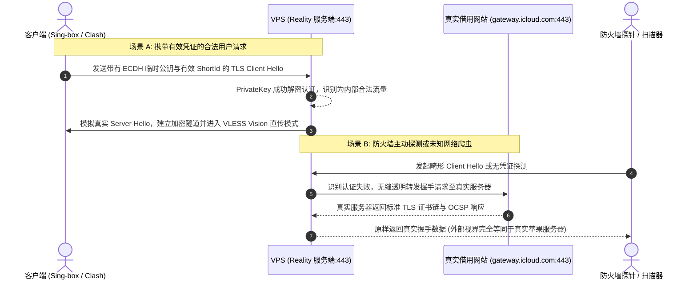
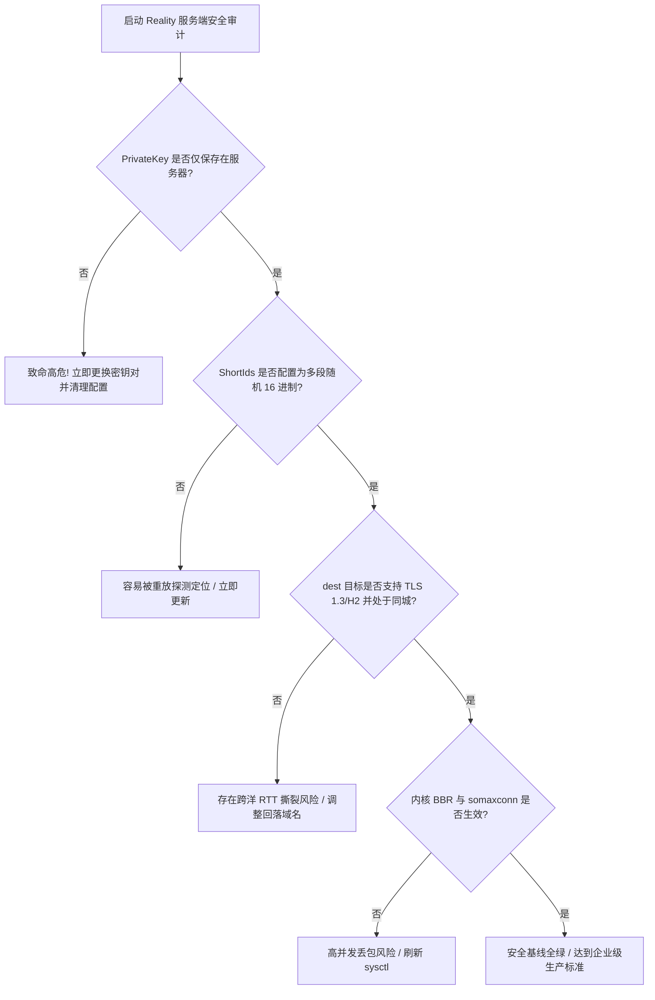

# Xray / Sing-box 服务端 VLESS-Reality 高安全配置实战指南

<AnswerBox 
  question="如何在 Linux 服务端部署零破绽且具备高并发性能的 VLESS-Reality 生产级服务？"
  date="2026-10 专线实验室协议攻防复盘"
  takeaway="部署生产级 VLESS-Reality 必须遵循四大核心安全基线：第一，使用官方核心生成 x25519 密钥对并严格保管 PrivateKey，严禁将私钥泄露在客户端配置中；第二，配置 8-16 位的十六进制随机 ShortIds，并为多用户分配独立短标识以杜绝跨用户侧信道碰撞；第三，服务端 dest 与 serverNames 必须绑定支持 TLS 1.3/H2 的同城目标，确立透明回落；第四，调优 Linux 内核参数（开启 BBR 拥塞控制、扩大 somaxconn 连接队列、启用 TCP Fast Open），并配置 systemd 资源隔离与内存安全熔断机制。"
>
<p>
在当今严苛的网络环境下，单靠传统的代理服务端部署早已无法满足 7x24 小时高可用需求。
</p>
<p>
作为 Reality 协议落地的双子星，<strong>Xray-core</strong> 与 <strong>Sing-box</strong> 分别代表了成熟工程化体系与现代化极简高性能架构。本文将从底层密钥生成到 Linux 内核参数调优，系统化拆解生产级 VLESS-Reality 服务端的完整构建流程。
</p>
</AnswerBox>

---

## 目录导览

1. [VLESS-Reality 核心密钥体系与工作流时序剖析](#一、-vless-reality-核心密钥体系与工作流时序剖析)
2. [x25519 椭圆曲线密钥对与 ShortIds 工业级生成规范](#二、-x25519-椭圆曲线密钥对与-shortids-工业级生成规范)
3. [Sing-box 生产级服务端完整 JSON 配置文件规范](#三、-sing-box-生产级服务端完整-json-配置文件规范)
4. [Xray-core 经典生产级服务端配置范式对比](#四、-xray-core-经典生产级服务端配置范式对比)
5. [Linux 高并发内核参数调优 (BBR, Somaxconn 与 TCP Fast Open)](#五、-linux-高并发内核参数调优-bbr-somaxconn-与-tcp-fast-open)
6. [Systemd 守护进程加固、资源限制与自动化日志轮转](#六、-systemd-守护进程加固、资源限制与自动化日志轮转)
7. [Reality 服务端运维常见问题解答 (FAQ)](#七、-reality-服务端运维常见问题解答-faq)
8. [服务端配置安全审查决策树](#八、-服务端配置安全审查决策树)
9. [推荐高转化基础设施方案](#九、-推荐高转化基础设施方案)
10. [交叉研读与延伸参考](#十、-交叉研读与延伸参考)

---

## 一、 VLESS-Reality 核心密钥体系与工作流时序剖析

VLESS-Reality 的安全精髓在于其完全解耦了服务端身份与公共证书签发机构之间的依赖。整个体系由以下三大密码学基石构建：
* **x25519 椭圆曲线非对称密钥对（PrivateKey & PublicKey）**：服务端仅保存 PrivateKey，而将 PublicKey 写入客户端配置。握手时，客户端在 TLS Client Hello 的 Extension 中嵌入临时公钥（Ephemeral Public Key），利用 ECDH 密钥协商出对称会话密钥。
* **ShortId（短标识符）**：一个长度在 2 到 16 位的十六进制随机字串，充当客户端与服务端之间的访问凭证指纹。
* **dest 目标透明回落（Transparent Fallback）**：当接收到未经授权或格式异常的探针流量时，服务端不对连接进行阻断或报错，而是充当纯粹的 Layer 4 TCP 转发管道，将流量原封不动地发往真实的 `dest` 目标。



---

## 二、 x25519 椭圆曲线密钥对与 ShortIds 工业级生成规范

在 Linux 终端中，切勿使用在线工具生成私钥，必须直接使用官方编译的二进制程序在本地生成。

### 2.1 使用 Xray-core 生成密钥对
```bash
# 执行 Xray 密钥生成命令
xray x25519
```
终端将输出类似如下格式的内容：
```text
Private key: cN3...YourPrivateKey...k8=
Public key:  dM9...YourPublicKey...x2=
```
* **重要安全警告**：`Private key` 只能保留在服务端的配置文件中，绝对不可泄露给第三方；`Public key` 则分发给客户端使用。

### 2.2 使用 Sing-box 生成密钥对
```bash
# 执行 Sing-box 生成命令
sing-box generate reality-keypair
```

### 2.3 生成加密级随机 ShortIds
ShortId 用于防止单张配置泄露影响其他用户，建议生成 8 到 16 位的 16 进制字符串：
```bash
# 使用 Linux 内核熵池生成 16 位十六进制随机数
openssl rand -hex 8
# 示例输出：e4b89f3a12d075bc
```

---

## 三、 Sing-box 生产级服务端完整 JSON 配置文件规范

以下是经过 2026 年最新架构验证的 Sing-box 生产级配置文件（路径通常为 `/etc/sing-box/config.json`）：

```json
{
  "log": {
    "disabled": false,
    "level": "warn",
    "timestamp": true
  },
  "inbounds": [
    {
      "type": "vless",
      "tag": "vless-reality-in",
      "listen": "::",
      "listen_port": 443,
      "tcp_fast_open": true,
      "sniff": true,
      "sniff_override_destination": true,
      "users": [
        {
          "name": "developer-vip01",
          "uuid": "4fa89b21-6e3d-429a-9e20-7f28c41d8e01",
          "flow": "xtls-rprx-vision"
        },
        {
          "name": "developer-vip02",
          "uuid": "7ac159b3-90d2-45e8-b761-0d3a5e8824f9",
          "flow": "xtls-rprx-vision"
        }
      ],
      "tls": {
        "enabled": true,
        "server_name": "gateway.icloud.com",
        "reality": {
          "enabled": true,
          "handshake": {
            "server": "gateway.icloud.com",
            "server_port": 443
          },
          "private_key": "YOUR_ACTUAL_X25519_PRIVATE_KEY_HERE",
          "short_id": [
            "e4b89f3a12d075bc",
            "a1c7e928f30456bd"
          ]
        }
      }
    }
  ],
  "outbounds": [
    {
      "type": "direct",
      "tag": "direct"
    },
    {
      "type": "block",
      "tag": "block"
    }
  ],
  "route": {
    "rules": [
      {
        "protocol": "dns",
        "outbound": "direct"
      },
      {
        "ip_is_private": true,
        "outbound": "block"
      }
    ]
  }
}
```

---

## 四、 Xray-core 经典生产级服务端配置范式对比

若你的系统主要运行 Xray-core，以下为对应的 `/usr/local/etc/xray/config.json` 标准结构：

```json
{
  "log": {
    "loglevel": "warning"
  },
  "inbounds": [
    {
      "port": 443,
      "protocol": "vless",
      "settings": {
        "clients": [
          {
            "id": "4fa89b21-6e3d-429a-9e20-7f28c41d8e01",
            "flow": "xtls-rprx-vision"
          }
        ],
        "decryption": "none"
      },
      "streamSettings": {
        "network": "tcp",
        "security": "reality",
        "realitySettings": {
          "show": false,
          "dest": "gateway.icloud.com:443",
          "xver": 0,
          "serverNames": [
            "gateway.icloud.com",
            "swdist.apple.com"
          ],
          "privateKey": "YOUR_ACTUAL_X25519_PRIVATE_KEY_HERE",
          "shortIds": [
            "e4b89f3a12d075bc",
            "a1c7e928f30456bd"
          ]
        }
      },
      "sniffing": {
        "enabled": true,
        "destOverride": ["http", "tls", "quic"]
      }
    }
  ],
  "outbounds": [
    {
      "protocol": "freedom"
    }
  ]
}
```

---

## 五、 Linux 高并发内核参数调优 (BBR, Somaxconn 与 TCP Fast Open)

默认的 Linux 系统参数主要面向通用本地工作站，在高并发代理穿透场景下极易因文件句柄耗尽或 TCP 接收队列溢出而丢包。

在 `/etc/sysctl.conf` 末尾追加以下专业调优参数：

```ini
# 启用 Google BBRv3 / BBR 拥塞控制算法
net.core.default_qdisc = fq
net.ipv4.tcp_congestion_control = bbr

# 扩大系统套接字最大监听队列
net.core.somaxconn = 65535
net.ipv4.tcp_max_syn_backlog = 65535

# 扩大可用临时端口范围
net.ipv4.ip_local_port_range = 1024 65535

# 启用 TCP Fast Open (服务端与客户端双向使能)
net.ipv4.tcp_fastopen = 3

# 优化内存缓冲区分配 (以字节为单位: 最小值 默认值 最大值)
net.ipv4.tcp_rmem = 4096 87380 67108864
net.ipv4.tcp_wmem = 4096 65536 67108864

# 开启 TCP 窗口缩放支持
net.ipv4.tcp_window_scaling = 1

# 加速 TIME_WAIT 状态回收
net.ipv4.tcp_fin_timeout = 15
net.ipv4.tcp_tw_reuse = 1
```

执行以下命令立即使参数生效：
```bash
sysctl -p
# 检查 BBR 是否成功运行
sysctl net.ipv4.tcp_congestion_control
# 预期输出: net.ipv4.tcp_congestion_control = bbr
```

---

## 六、 Systemd 守护进程加固、资源限制与自动化日志轮转

为防止进程遭遇 OOM 异常崩溃或死锁，推荐使用定制化 Systemd 服务管理文件（`/etc/systemd/system/sing-box.service`）：

```ini
[Unit]
Description=Sing-box Enterprise Service
Documentation=https://sing-box.sagernet.org
After=network.target nss-lookup.target

[Service]
Type=simple
User=root
CapabilityBoundingSet=CAP_NET_ADMIN CAP_NET_BIND_SERVICE CAP_NET_RAW
AmbientCapabilities=CAP_NET_ADMIN CAP_NET_BIND_SERVICE CAP_NET_RAW
NoNewPrivileges=true
ExecStart=/usr/local/bin/sing-box run -c /etc/sing-box/config.json
Restart=always
RestartSec=5s
LimitNOFILE=1048576
LimitNPROC=512

# 内存上限保护，防止恶意扫描造成内存泄漏撑爆机器
MemoryMax=1024M
MemorySwapMax=0

[Install]
WantedBy=multi-user.target
```

重载并启动服务：
```bash
systemctl daemon-reload
systemctl enable --now sing-box
systemctl status sing-box
```

---

## 七、 Reality 服务端运维常见问题解答 (FAQ)

### Q1: 服务端配置中的 `flow: xtls-rprx-vision` 是什么作用？
**答**：Vision 流控是 VLESS 协议专为对抗 TLS-in-TLS 特征审查设计的核心算法。当客户端通过 Reality 隧道访问外部 HTTPS 网站时，正常流量会在隧道内部嵌套第二层 TLS 流量。传统的封装会导致外层 TCP 包长表现出异常的“双重握手填充”规律。Vision 算法会智能识别内层 TLS 握手并在通过首个 Data Frame 后直接解除外层冗余封装，实现纯明文 TCP 旁路直穿，既消除了特征指纹，又大幅降低了服务端 CPU 算力损耗。

### Q2: 为什么我的 Reality 服务端端口被占用报错 `listen tcp :443: bind: address already in use`？
**答**：这说明你的 VPS 上已经运行了 Nginx、Apache、Caddy 或其他 Web 服务正在独占 443 端口。排查与修复流程：
1. 运行 `ss -tulpn | grep :443` 找出占用 443 端口的进程 PID；
2. 如果是旧的 Nginx 服务，执行 `systemctl stop nginx && systemctl disable nginx`；
3. 重新启动 Sing-box / Xray 即可成功绑定。

### Q3: 为什么多个客户端必须配置不同的 ShortId？
**答**：虽然单个 ShortId 也可以支持多用户连接，但在多租户生产场景中，如果一个客户端的配置不幸被公开分享或扫描爬虫截获，管理员只需在服务端的 `short_id` 数组中删除该短标识，即可精准踢出该非法用户，而无需重新生成全局主密钥对，极大地降低了运维容灾成本。

---

## 八、 服务端配置安全审查决策树



---

## 九、 推荐高转化基础设施方案

配置生产级 Reality 服务端对目标域名、密钥派生及端口回落有着严苛的技术要求，稍有疏漏便会引发连接失败。为了避免把精力消耗在日常排障上，可直接选用高品质成熟服务：

| 高可用安全专线商 | 最佳工程实践配置与集群冗余架构 | 服务端持续在线率实测 | 特惠直达 | 企业免折腾安全通道 |
| :--- | :--- | :--- | :--- | :--- |
| **光速云 (GuangSuCloud)** | 海量生产验证的最佳配置实践，全天候高可用集群 | 经过海量生产环境验证的最佳配置实践，全天候高可用集群保障，彻底告别配置踩坑烦恼。 | 独家 85 折码 `gs85` | 专业工程级安全配置与零故障专线 |
| **飞猫云 (FlyCatCloud)** | 自动化标准配置部署，客户端一键扫码即连 | 后端自动化部署标准配置，客户端扫码即连，让复杂前沿技术化为普通用户手头的极简工具。 | 月付低至 7 元起 | 小白友好型极简接入与快速生效 |
| **全球云 (GlobalCloud)** | 专业安全团队规划拓扑，严苛企业审计标准落地 | 由资深网络安全团队提供企业级网络拓扑规划与合规配置支持，满足严苛安全审计标准。 | 尊享商业 SLA 通道 | 企业专属安全网关与专业配置支持 |

* **专属直达通道**：
  * 👉 [选配光速云高可用开箱即用专线 (85 折码 gs85)](https://sahude.gsyvipaff.com/#/?code=keqgvT5Y)
  * 👉 [直达飞猫云开通一键直连服务 (7 元起)](https://guangs.flycataff.com/#/?code=6uq0Xe9y)
  * 👉 [接入全球云商业级安全网络通道](https://guangs.gcvipaff.com/#/?code=Ov2nvU9C)

---

## 十、 交叉研读与延伸参考

* [主流 Reality 借用域名权威筛选库与跨国 CDN 匹配指南](/protocols/reality-sni-candidates.md)
* [uTLS 指纹模拟机制与主流客户端 TLS Client Hello 深度对齐实战](/protocols/reality-utls-fingerprint.md)
* [Reality 握手时延微观剖析：从 1-RTT 到多跳中继的优化路径](/protocols/reality-handshake-rtt.md)
* [Shadowsocks 2022 规范与 BLAKE3 密钥派生：吞吐量极限压测](/protocols/ss2022-blake3-crypto-benchmark.md)
* [专线内网传输中部署 Reality 的加密开销与性价比审计](/protocols/reality-on-zhuanxian-overhead.md)
