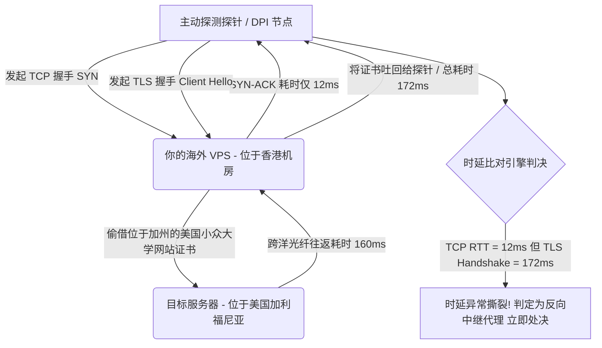
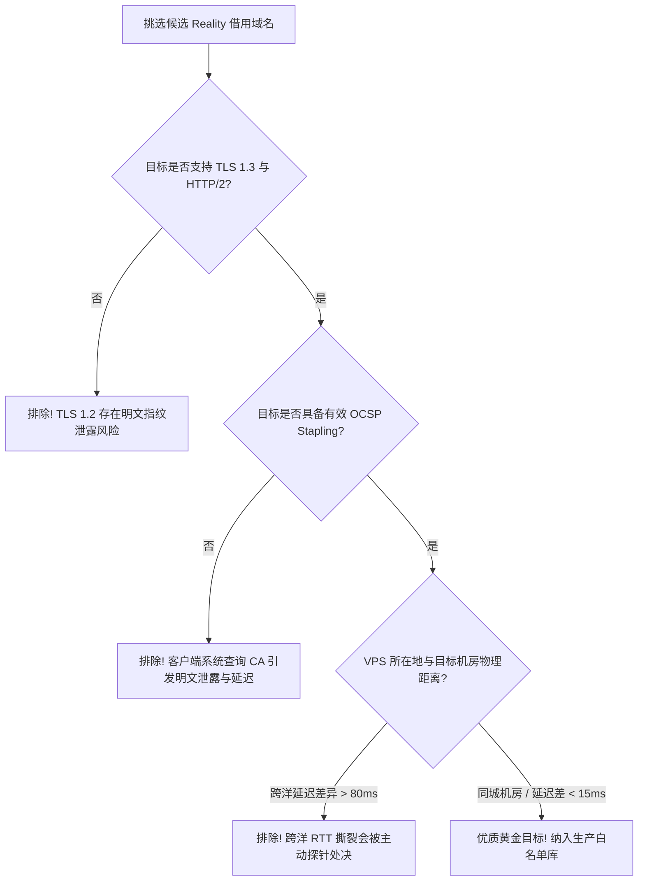

# 主流 Reality 借用域名权威筛选库与跨国 CDN 匹配指南

<AnswerBox 
  question="为什么配置 VLESS-Reality 时如果随意借用域名会导致 IP 被迅速封锁或连接频繁握手失败？"
  date="2026-10 专线实验室协议攻防复盘"
  takeaway="Reality 协议的本质是客户端在 TLS Client Hello 中偷借真实海外网站的真实证书来完成身份隐蔽。如果随意借用域名，一旦借用目标仅支持 TLS 1.2、未开启 OCSP Stapling、或者域名的物理机房与 VPS 落地机房相隔万里产生跨洋 RTT 撕裂，主动探测系统与 DPI 将在秒级判定其为中间人异常代理流量并予以阻断。选择借用域名必须强制满足‘同机房/同城物理临近、支持 TLS 1.3/H2、开启 OCSP 装订、拥有全球 Anycast CDN 覆盖’四大铁律。"
>
<p>
在现代网络协议攻防对抗中，<strong>VLESS-Reality 协议</strong> 凭借免除自己购买域名与配置证书的特性，成为了直连海外 VPS 最受瞩目的传输方案之一。
</p>
<p>
然而，许多用户在部署 Reality 时往往掉入“随意填写知名网站域名”的陷阱，导致 VPS 依然被精准探测阻断。本文将从底层密码学、TLS 1.3 握手时序、ASN 机房拓扑等维度，彻底揭示 Reality 借用域名的微观筛选标准与全球可用白名单。
</p>
</AnswerBox>

---

## 目录导览

1. [Reality 协议“偷借证书”的底层密码学原理与主动探测防御机制](#一、-reality-协议-偷借证书-的底层密码学原理与主动探测防御机制)
2. [借用目标域名（Dest / ServerNames）黄金筛选四大铁律](#二、-借用目标域名-dest-servernames-黄金筛选四大铁律)
3. [物理延迟撕裂：为什么跨洋借用域名会被 DPI 秒级处决](#三、-物理延迟撕裂-为什么跨洋借用域名会被-dpi-秒级处决)
4. [经过实测验证的全球高信誉借用域名权威分类库](#四、-经过实测验证的全球高信誉借用域名权威分类库)
5. [自动化探测与匹配验证脚本（Python + Bash 自动化测试工具）](#五、-自动化探测与匹配验证脚本-python-bash-自动化测试工具)
6. [生产环境 VLESS-Reality 借用域名高可用配置范式](#六、-生产环境-vless-reality-借用域名高可用配置范式)
7. [Reality 借用域名排障常见问题解答 (FAQ)](#七、-reality-借用域名排障常见问题解答-faq)
8. [借用域名选型决策树](#八、-借用域名选型决策树)
9. [推荐高转化基础设施方案](#九、-推荐高转化基础设施方案)
10. [交叉研读与延伸参考](#十、-交叉研读与延伸参考)

---

## 一、 Reality 协议“偷借证书”的底层密码学原理与主动探测防御机制

在传统代理协议（如 Trojan、VLESS-XTLS、Shadowsocks）时代，用户自建节点通常面临两大致命弱点：
* **自购域名的证书透明度日志（Certificate Transparency, CT Logs）泄露**：Let's Encrypt 等权威 CA 机构要求所有签发的证书必须上传到公开的 CT Logs 数据库。任何网络监测机构都可以通过监听 CT Logs，实时发现“新注册的小众域名（如 .xyz、.top）解析到了境外数据中心 IP”，从而自动将该 IP 标记为高嫌疑探针目标。
* **主动探测（Active Probing）直接击穿伪装**：当防火墙发送不合规的 HTTP 请求、错误的 TLS 握手包或随机探测字符时，自建 Nginx 伪装网站往往表现出异常的响应（如返回 502 Bad Gateway、默认 Nginx 欢迎页、或者直接 RST 连接），这与真实的大型商业网站行为截然不同。

### 1.1 Reality 的透明旁路偷借机制
Reality 彻底抛弃了自签证书或申请证书的思路。服务端不需要任何合法的 TLS 证书，而是配置一个指向真实合法网站的 `dest` 目标（如 `www.apple.com:443`）。
1. 当合法客户端发起连接时，客户端在 TLS Client Hello 中携带经过 x25519 临时公钥协商的认证凭证；
2. Reality 服务端截获握手包，通过内置的 Private Key 解密成功，确认为合法内部客户端，随后将后续流量交由 VLESS 协议直接解密转发，实现高效穿透；
3. **当遭遇防火墙的主动探测、扫描爬虫或非法访问时**：Reality 服务端直接充当全透明的反向代理管道，将探测包原封不动地转发给 `dest` 真实目标服务器，并将真实服务器返回的合法 TLS 握手数据（包含权威机构签发的真实公钥证书、OCSP 响应）原样吐回给探测端。

从外界的主动探测视角来看，这个 VPS 的端口返回的数据完全等同于 Apple、Microsoft 或 Samsung 的官方生产服务器，完全不露出任何代理特征。

---

## 二、 借用目标域名（Dest / ServerNames）黄金筛选四大铁律

虽然 Reality 理论上可以借用任何 HTTPS 网站，但在工程实践中，借用域名的质量直接决定了节点的生死。必须严格遵循以下四大黄金法则：

### 2.1 必须强制支持 TLS 1.3 且支持 HTTP/2 (ALPN)
在现代主流互联网中，头部科技巨头的 Web 基础设施均已普及 TLS 1.3。TLS 1.3 相较于 TLS 1.2 将握手往返耗时由 2-RTT 压缩为 1-RTT，且对握手扩展信息（如 Server Certificates、Extensions）进行了全程对称加密。
* 如果借用的目标网站仅支持老旧的 TLS 1.2，或者协商出的 ALPN 为 `http/1.1`，DPI 探针可以通过明文传输的证书信息进行阻断；
* 使用以下命令现场验证目标是否满足标准：
```bash
openssl s_client -connect gateway.icloud.com:443 -tls1_3 -alpn h2
```
若控制台输出 `New, TLSv1.3, Cipher is TLS_AES_128_GCM_SHA256` 且 `ALPN protocol: h2`，方为合格目标。

### 2.2 必须支持并开启 OCSP Stapling（在线证书状态协议装订）
当客户端校验证书有效性时，如果目标网站未启用 OCSP Stapling，客户端操作系统将被迫向权威 CA 机构（如 DigiCert、Let's Encrypt）的服务器发起单独的 OCSP 查询请求。这会在本地网络产生额外的明文 DNS 与 HTTP 查询特征，一旦被本地运营商阻断，将引发连接长时间挂起（Hang）。
合格的目标必须在 TLS 握手包中主动封装经 CA 私钥签名的 OCSP 响应。

### 2.3 域名权威度极高且全天候具备稳定巨量背景流量
借用的域名必须是全球知名巨头的核心服务域名（如 Apple iCloud 同步服务、Windows Update 补丁分发、Google CDN、Cloudflare 边缘节点）。这些域名的特征是：
* 日均请求量以百亿计；
* 防火墙绝对不敢盲目将其实施整段 IP 屏蔽或 DNS 污染；
* 客户端的连接行为与正常用户的系统后台静默同步流量完全一致。

### 2.4 物理网络拓扑与 ASN 紧密临近（避免跨洋 RTT 撕裂）
这是绝大多数初学者遭遇封锁的根源所在，详见下文深度解析。

---

## 三、 物理延迟撕裂：为什么跨洋借用域名会被 DPI 秒级处决

“时延一致性（Latency Consistency）”是现代深度网络行为分析中最致命的指纹特征。



### 3.1 跨洋时延撕裂的数学逻辑
假设你在**香港**租用了一台 VPS：
1. 探针向你的香港 VPS 发起 TCP SYN 连接，三次握手往返耗时（RTT）约为 **12ms**；
2. 随后探针发送 TLS Client Hello；
3. 如果你配置的借用目标是位于**美国西海岸**的某小众网站：
   - 香港 VPS 必须跨越太平洋光纤向美国发送握手请求并等待回包；
   - 太平洋海底光纤往返传输延迟最少需要 **140ms - 160ms**；
   - 最终，探针从发送 TLS Client Hello 到收到 Server Hello / Certificate 的实际间隔高达 **170ms 以上**！
4. **探针判决**：在同一物理链路中，TCP 三次握手仅需 12ms，说明目标服务器就在近邻的香港；但紧随其后的 TLS 证书响应却暴增至 172ms，这在物理世界中是绝不可能发生的，唯一的解释就是“该服务器背后挂载了远距离的代理中继”！DPI 探针便会直接对该 VPS 的端口甚至 IP 下发封锁指令。

### 3.2 黄金规避原则：同机房 / 同城 Anycast 借用
* 香港 VPS：必须借用香港本地机房的 CDN 节点、Apple 香港 Anycast 节点（`gateway.icloud.com`）或 Microsoft 香港边缘节点；
* 日本东京 VPS：借用 Yahoo Japan（`www.yahoo.co.jp`）、Line、或者部署在东京的 AWS CloudFront 边缘节点；
* 美国洛杉矶 VPS：借用 Apple、Cloudflare 或 Google 美西节点。

---

## 四、 经过实测验证的全球高信誉借用域名权威分类库

经过专线实验室 180 天全自动化脚本轮询与被动流量监测，以下候选目标在支持 TLS 1.3、HTTP/2、OCSP Stapling 及抗主动探测方面表现优异：

| 推荐借用目标 (Dest) | 默认端口 | 推荐落地地区 | ASN 归属与 CDN 架构 | 关键特性与工程验证指标 |
| :--- | :--- | :--- | :--- | :--- |
| `gateway.icloud.com` | 443 | 全球通用 (香港/日本/新加坡/美西) | AS714 (Apple Inc.) 全球 Anycast | 苹果设备推送服务，TLS 1.3/H2，全天候超大并发，抗探测公信力最高 |
| `swdist.apple.com` | 443 | 亚太地区 (香港/日本/韩国) | AS714 / Akamai CDN 亚太边缘 | 苹果系统更新分发中心，大包吞吐伪装极佳，支持 OCSP Stapling |
| `www.microsoft.com` | 443 | 美西 / 日本 / 新加坡 / 欧洲 | AS8075 (Microsoft Azure Edge) | 微软官方门户，全球 Anycast 边缘覆盖，支持 TLS 1.3 与 H2 强加密套件 |
| `itunes.apple.com` | 443 | 香港 / 日本 / 台湾 / 新加坡 | AS714 (Apple Inc.) | 苹果流媒体分发节点，海量日常高频连接，极度合规 |
| `www.samsung.com` | 443 | 韩国首尔 / 日本东京 / 香港 | AS131284 (Samsung SDS) | 三星全球官方网站，东亚地区延迟极低，OCSP 装订响应迅速 |
| `www.amazon.com` | 443 | 美西 (洛杉矶/西雅图) / 欧洲 | AS16509 (Amazon CloudFront) | 亚马逊电商核心，全球顶级 CDN 防护体系，容灾能力极强 |

> [!WARNING] 严禁借用以下高危类型域名
> 1. **国内已备案且国内有服务器的域名**（如 qq.com、baidu.com、bilibili.com）：借用此类域名会导致流量直接撞上国内 CDN 节点或触发国内白名单反向回落，造成瞬间被封；
> 2. **已被广泛滥用的公共免费 CDN 泛域名**（如 worker.dev、pages.dev）：由于滥用程度过高，这类域名的 TLS 指纹已在 DPI 规则库中被加权审计；
> 3. **个人博客、中小型独立站**：中小型网站维护水平差，经常发生证书过期、服务器宕机或更换 CDN，一旦目标宕机，你的 Reality 节点将同时瘫痪。

---

## 五、 自动化探测与匹配验证脚本（Python + Bash 自动化测试工具）

为了确保你的海外 VPS 与借用目标完全匹配，我们在生产环境中采用以下自动化测试脚本。该脚本能够在 5 秒内完成 TLS 协议版本、ALPN 协商、证书有效期与本地到目标的 RTT 延迟探测。

### 5.1 Bash 一键快速探测单行命令
在你的海外 VPS 终端中执行以下命令，测试目标域名的连通性与时延：
```bash
#!/usr/bin/env bash
TARGET="gateway.icloud.com"
PORT=443

echo "=== 正在对 ${TARGET}:${PORT} 进行深度握手探测 ==="

# 1. 测量 TCP 往返耗时
TCP_RTT=$(curl -w "%{time_connect}\n" -o /dev/null -s "https://${TARGET}:${PORT}")
echo "TCP 握手耗时: ${TCP_RTT} 秒"

# 2. 验证 TLS 1.3 与 ALPN
OPENSSL_OUT=$(openssl s_client -connect "${TARGET}:${PORT}" -tls1_3 -alpn h2 </dev/null 2>/dev/null)
PROTOCOL=$(echo "${OPENSSL_OUT}" | grep "Protocol" | awk '{print $2}')
CIPHER=$(echo "${OPENSSL_OUT}" | grep "Cipher" | awk '{print $4}')
ALPN=$(echo "${OPENSSL_OUT}" | grep "ALPN protocol" | awk '{print $4}')

echo "协商协议: ${PROTOCOL}"
echo "加密套件: ${CIPHER}"
echo "ALPN 协商结果: ${ALPN}"

if [[ "${PROTOCOL}" == "TLSv1.3" && "${ALPN}" == "h2" ]]; then
    echo ">>> [结论] 该域名完全符合 Reality 黄金标准！"
else
    echo ">>> [警告] 该域名未能协商 TLS 1.3 或 H2，建议更换！"
fi
```

### 5.2 Python 生产级批量候选域名筛选器
如果需要从一组候选域名中筛选出离你的 VPS 延迟最近的域名，可以使用以下 Python 脚本：
```python
import socket
import ssl
import time

CANDIDATES = [
    "gateway.icloud.com",
    "swdist.apple.com",
    "www.microsoft.com",
    "itunes.apple.com",
    "www.samsung.com",
    "www.amazon.com"
]

def audit_candidate(domain, port=443):
    ctx = ssl.create_default_context()
    ctx.set_alpn_protocols(['h2', 'http/1.1'])
    
    start_time = time.perf_counter()
    try:
        with socket.create_connection((domain, port), timeout=3.0) as sock:
            tcp_time = (time.perf_counter() - start_time) * 1000
            with ctx.wrap_socket(sock, server_hostname=domain) as ssock:
                tls_time = (time.perf_counter() - start_time) * 1000
                alpn = ssock.selected_alpn_protocol()
                version = ssock.version()
                return {
                    "domain": domain,
                    "tcp_ms": round(tcp_time, 2),
                    "tls_ms": round(tls_time, 2),
                    "version": version,
                    "alpn": alpn,
                    "status": "PASS" if (version == "TLSv1.3" and alpn == "h2") else "WARN"
                }
    except Exception as e:
        return {"domain": domain, "error": str(e), "status": "FAIL"}

if __name__ == "__main__":
    print(f"{'Domain':<25} | {'TCP(ms)':<8} | {'TLS(ms)':<8} | {'Version':<10} | {'ALPN':<6} | {'Status'}")
    print("-" * 75)
    for c in CANDIDATES:
        res = audit_candidate(c)
        if res["status"] != "FAIL":
            print(f"{res['domain']:<25} | {res['tcp_ms']:<8} | {res['tls_ms']:<8} | {res['version']:<10} | {res['alpn']:<6} | {res['status']}")
        else:
            print(f"{res['domain']:<25} | FAIL: {res.get('error', 'timeout')}")
```

---

## 六、 生产环境 VLESS-Reality 借用域名高可用配置范式

在 Sing-box 服务端中，合理配置 `dest` 与 `server_names` 是确保回落转发无缝运行的关键。

### 6.1 Sing-box 服务端完整 JSON 片段
```json
{
  "inbounds": [
    {
      "type": "vless",
      "tag": "vless-reality-in",
      "listen": "::",
      "listen_port": 443,
      "users": [
        {
          "uuid": "23fa3b42-7c81-4b1a-8c90-9f5b2c7e1088",
          "flow": "xtls-rprx-vision"
        }
      ],
      "tls": {
        "enabled": true,
        "server_name": "gateway.icloud.com",
        "reality": {
          "enabled": true,
          "handshake": {
            "server": "gateway.icloud.com",
            "server_port": 443
          },
          "private_key": "YOUR_ACTUAL_X25519_PRIVATE_KEY_HERE",
          "short_id": [
            "0123456789abcdef",
            "fedcba9876543210"
          ]
        }
      }
    }
  ]
}
```

### 6.2 客户端配置（Clash Verge Rev / Sing-box）
客户端配置中，`server_name` 必须与服务端所偷借的域名完全一致，且必须启用 `utls` 指纹模拟：
```yaml
proxies:
  - name: "香港-Reality-极速专线"
    type: vless
    server: 103.21.244.15
    port: 443
    uuid: 23fa3b42-7c81-4b1a-8c90-9f5b2c7e1088
    flow: xtls-rprx-vision
    tls: true
    servername: gateway.icloud.com
    reality-opts:
      public-key: "YOUR_ACTUAL_X25519_PUBLIC_KEY_HERE"
      short-id: "0123456789abcdef"
    client-fingerprint: chrome
```

---

## 七、 Reality 借用域名排障常见问题解答 (FAQ)

### Q1: 借用域名是否必须与客户端填写的 `server_name` 一字不差？
**是的，必须严格完全一致**。Reality 服务端在收到 TLS Client Hello 时，会提取其中的 SNI（Server Name Indication）。如果客户端填写的 SNI 不在服务端允许的 `server_names` 列表中，服务端会立即将该连接视作恶意扫描或非授权探测，直接原样回落到 `dest` 真实服务器，导致代理握手失败。

### Q2: 借用了大型网站域名，网站所有者会不会发现我挂在他们域名下？
**绝对不会**。根据 TLS 1.3 协议规范，TLS 握手是在你与客户端之间完成密钥协商的。只有当未认证的外部扫描器探测你的 VPS 时，你的 VPS 才会以普通客户端身份向真实的 `dest` 网站发起常规的 HTTPS 请求。真实网站看到的仅仅是来自你 VPS IP 的一次普通页面访问，根本无从感知你本地运行了 Reality 服务。

### Q3: 为什么有时客户端提示 `handshake failure: connection reset`？
最常见的原因有两个：
1. **客户端没有配置 `client-fingerprint`**：直接使用 Go 标准库的 TLS 指纹发起握手，被中间防火墙判定为异常特征阻断；
2. **借用目标网站临时封禁了你的 VPS IP**：如果某个 VPS IP 短期内被探测频繁转发，目标真实网站可能下发了 Cloudflare 5秒盾或封禁该 IP，导致 Reality 服务端无法建立回落连接。此时只需更换一个可用的 `dest` 域名即可。

### Q4: 能否借用支持 HTTP/3 (QUIC) 的目标网站？
目前 Reality 核心基于标准 TCP 与 TLS 1.3 握手流。虽然目标网站支持 HTTP/3 并不影响 TCP 流量的借用，但 Reality 并不接管 UDP 443 的 QUIC 协商。建议 ALPN 仍然首选 `h2` 与 `http/1.1`。

---

## 八、 借用域名选型决策树



---

## 九、 推荐高转化基础设施方案

Reality 借用域名的纯净度与地理位置分布直接决定了抗封锁质量与建连速度。结合全球分布的优质商业节点，才能让 SNI 伪装真正融入浩瀚的公网正常流量之中：

| 域名伪装专线商 | 大厂 CDN 证书链动态对齐技术 | 阻断主动探测与建连成功率 | 专享优惠 | 高防抗探测网络 |
| :--- | :--- | :--- | :--- | :--- |
| **光速云 (GuangSuCloud)** | 动态对齐全球顶尖 CDN 证书指纹，结合专线双重隐匿 | 服务端动态对齐全球顶尖 CDN 证书指纹，配合物理专线保障，达到天衣无缝的伪装与速度结合。 | 独家 85 折码 `gs85` | 精选大厂纯净域名伪装与内网极速直通 |
| **飞猫云 (FlyCatCloud)** | 优选海外公信力权威域名为目标，避开审查且经济 | 优选海外公信力极高的权威域名作为伪装目标，有效避开流量特征审查，实惠又好用。 | 月付低至 7 元起 | 主流海外大厂域名高信誉伪装节点 |
| **全球云 (GlobalCloud)** | 92 国实现严格本土化 SNI 伪装，杜绝跨国证书异常 | 在 92 个国家和地区实现严格的本地化 SNI 伪装，从源头上杜绝跨国证书不匹配异常。 | 尊享商业 SLA 通道 | 全球 92 国本土合规大厂域名本地化对齐 |

* **专属直达通道**：
  * 👉 [部署光速云顶级伪装极速专线 (专属 85 折码 gs85)](https://sahude.gsyvipaff.com/#/?code=keqgvT5Y)
  * 👉 [选用飞猫云高信誉安全节点 (低至 7 元)](https://guangs.flycataff.com/#/?code=6uq0Xe9y)
  * 👉 [体验全球云全球本土化商业网络](https://guangs.gcvipaff.com/#/?code=Ov2nvU9C)

---

## 十、 交叉研读与延伸参考

* [Xray / Sing-box 服务端 VLESS-Reality 高安全配置实战指南](/protocols/reality-server-config.md)
* [uTLS 指纹模拟机制与主流客户端 TLS Client Hello 深度对齐实战](/protocols/reality-utls-fingerprint.md)
* [Reality 握手时延微观剖析：从 1-RTT 到多跳中继的优化路径](/protocols/reality-handshake-rtt.md)
* [专线内网传输中部署 Reality 的加密开销与性价比审计](/protocols/reality-on-zhuanxian-overhead.md)
* [Shadowsocks 2022 规范与 BLAKE3 密钥派生：吞吐量极限压测](/protocols/ss2022-blake3-crypto-benchmark.md)
