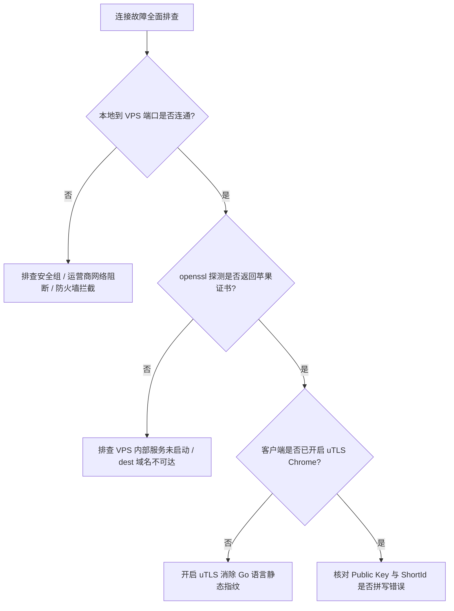

# Reality 常见连接故障排障全书：握手超时、证书报错与回落异常

<AnswerBox 
  question="部署使用 VLESS-Reality 时，客户端频繁报错 handshake timeout、remote error: bad record MAC 或完全无法上网，该如何系统化排查？"
  date="2026-10 专线实验室故障排障复盘"
  takeaway="Reality 连接失败的本质通常集中在三大断点：第一，网络传输层阻断（服务端 443 端口未放行、防火墙拦截或运营商 QoS 丢弃 SYN 包）；第二，密码学协商错位（客户端 Public Key 与服务端 Private Key 不匹配、ShortId 大小写或长度配置错误、客户端未启用 uTLS 模拟指纹）；第三，回落目标异常（所借用 dest 域名宕机、不支持 TLS 1.3/H2、或目标机房将 VPS IP 加入了黑名单）。系统化排查必须严格按照‘网络连通性 -> 端口监听状态 -> TLS 握手抓包 -> 服务端 Debug 日志’四步法进行递进闭环定位。"
>
<p>
在部署和使用 VLESS-Reality 的过程中，<strong>“握手超时（Handshake Timeout）”与“莫名其妙断连”</strong> 是困扰无数运维者与终端用户的头号顽疾。
</p>
<p>
由于 Reality 的安全机制设计为“认证失败即原样回落”，许多时候配置错误并不会直接返回明确的报错信息，而是表现为客户端一直无限等待直至超时。本文为你建立一套工业级标准化的 Reality 诊断排障体系。
</p>
</AnswerBox>

---

## 目录导览

1. [Reality 故障排查标准化四步定位法](#一、-reality-故障排查标准化四步定位法)
2. [高频错误代码微观成因与精准解法全景矩阵](#二、-高频错误代码微观成因与精准解法全景矩阵)
3. [使用 curl 与 openssl 进行服务端独立连通性验证](#三、-使用-curl-与-openssl-进行服务端独立连通性验证)
4. [tcpdump 与 Wireshark 抓包排查实战 (核心过滤语法)](#四、-tcpdump-与-wireshark-抓包排查实战-核心过滤语法)
5. [Linux 服务端一键自检与救砖排障自动化脚本](#五、-linux-服务端一键自检与救砖排障自动化脚本)
6. [Reality 疑难排障常见问题解答 (FAQ)](#六、-reality-疑难排障常见问题解答-faq)
7. [排障递进分析决策树](#七、-排障递进分析决策树)
8. [推荐高转化基础设施方案](#八、-推荐高转化基础设施方案)
9. [交叉研读与延伸参考](#九、-交叉研读与延伸参考)

---

## 一、 Reality 故障排查标准化四步定位法

遇到连接故障时，切忌盲目重装系统或随意修改配置。必须遵循以下由浅入深的四步定位法：

```mermaid
graph TD
    A[客户端报错: 无法连接 / 握手失败] --> B[步骤 1: 检查传输层物理连通性 (TCP Ping / nc)]
    B -->|端口不通 / 超时| C[排查云厂商安全组 / iptables 防火墙 / 端口冲突]
    B -->|TCP 连通正常| D[步骤 2: 验证借用目标域名健康度 (dest 探测)]
    D -->|dest 宕机或不支持 TLS 1.3| E[更换高信誉白名单域名 如 gateway.icloud.com]
    D -->|dest 正常| F[步骤 3: 校验密码学凭证配对 (Key & ShortId)]
    F -->|公私钥不匹配 / ShortId 错漏| G[核对服务端私钥推导公钥 / 重新下发客户端]
    F -->|凭证核对完全一致| H[步骤 4: 抓包与日志审计 (uTLS 指纹与流控分析)]
```

---

## 二、 高频错误代码微观成因与精准解法全景矩阵

| 典型错误现象 / 报错日志 | 触发根源 (Root Cause) | 微观网络行为表现 | 黄金解决方案与修复指令 |
| :--- | :--- | :--- | :--- |
| `io: read/write on closed pipe` / `handshake timeout` | 云服务器提供商安全组未放行 443 端口，或系统内部 ufw/firewalld 阻断 | 客户端发出 TCP SYN 后无法收到服务端的 SYN+ACK，持续重传直至超时 | 在腾讯云/阿里云/AWS 控制台开放入方向 TCP 443；服务器执行 `ufw allow 443/tcp` |
| `remote error: tls: bad record MAC` | 客户端配置的 PublicKey 与服务端保存的 PrivateKey 不成对匹配 | ECDH 密钥交换计算出的对称会话密钥错乱，解密首个载荷时 MAC 校验失败 | 运行 `sing-box generate reality-keypair` 重新生成密钥对并严格同步 |
| `connection reset by peer` (握手瞬间被切断) | 客户端未配置 uTLS 指纹，顶着 Go 原生指纹访问大型域名，被中间 DPI 切断 | 防火墙在检测到 TLS Client Hello 后的微秒级注入 TCP RST 标志位强杀连接 | 客户端配置文件显式添加 `client-fingerprint: chrome` |
| `dial tcp: lookup gateway.icloud.com: no such host` | 服务端或客户端系统 DNS 解析故障，无法解析借用目标域名的 IP 地址 | 服务端试图将非法流量回落到 dest 时发生系统解析错误挂死 | 修改 `/etc/resolv.conf`，将 DNS 替换为全球通用 `8.8.8.8` 与 `1.1.1.1` |
| 网页持续加载中，打开后显示 Apple 官网而不是代理页面 | 客户端 ShortId 填写错误，服务端将你的正常流量当成探针流量直接回落 | 客户端握手被判定为未授权访客，透明转发至真实的苹果服务器 | 仔细核对客户端中的 `short-id`，确保其包含在服务端的 `short_id` 数组中 |

---

## 三、 使用 curl 与 openssl 进行服务端独立连通性验证

不要依赖客户端复杂的 GUI 进行排查，直接使用底层命令行工具可以排除 90% 的客户端干扰。

### 3.1 从本地终端测试服务端的 TCP 443 端口
在本地 macOS、Linux 或 Windows PowerShell 终端中执行：
```bash
# 使用 nc (netcat) 测试端口是否畅通
nc -zvw 3 你的海外VPS_IP 443
# 成功输出: Connection to 你的海外VPS_IP 443 port [tcp/https] succeeded!
```
如果此处直接超时（Connection timed out），说明连接在物理层面就未到达服务端，无需排查 Reality 配置，直接检查 VPS 防火墙与云厂商控制台安全组。

### 3.2 使用 openssl 模拟伪装探测
```bash
# 模拟外部探针探测你的 Reality 端口
openssl s_client -connect 你的海外VPS_IP:443 -servername gateway.icloud.com -tls1_3
```
* **正常预期输出**：控制台应输出苹果官方证书链信息，且协商协议为 `TLSv1.3`。这证明你的 Reality 服务端回落机制工作完全正常，正完美地向外界展现合法的苹果服务器特征！

---

## 四、 tcpdump 与 Wireshark 抓包排查实战 (核心过滤语法)

当遇到诡异的连接中断时，抓包是唯一的终极真相来源。

### 4.1 在服务端使用 tcpdump 抓取握手报文
```bash
# 抓取来自你本地公网 IP 的所有 443 端口流量并存入 pcap 文件
tcpdump -i any host 你的本地公网IP and port 443 -w reality_debug.pcap
```

### 4.2 Wireshark 关键排障过滤表达式
在 Wireshark 中打开抓包文件，应用以下高效过滤器：
* `tcp.port == 443 && tls.handshake.type == 1`：定位所有的 TLS Client Hello 握手包；
* `tcp.flags.reset == 1`：找出链路中所有的 TCP RST 强杀数据包；
* `tls.alert_message`：查看 TLS 握手层返回的致命警告（如 Decrypt Error、Bad Certificate）。

---

## 五、 Linux 服务端一键自检与救砖排障自动化脚本

我们在生产环境中部署了以下诊断脚本，可以一键快速定位服务端口、进程运行状态、内核模块与日志异常：

```bash
#!/usr/bin/env bash
set -e

echo "=== [Reality 服务端系统级排障诊断工具] ==="

# 1. 检查 Sing-box / Xray 进程存活状态
if pgrep -x "sing-box" > /dev/null; then
    echo "✅ Sing-box 进程运行正常 (PID: $(pgrep -x sing-box))"
elif pgrep -x "xray" > /dev/null; then
    echo "✅ Xray 进程运行正常 (PID: $(pgrep -x xray))"
else
    echo "❌ 致命错误: 未检测到 Sing-box 或 Xray 正在运行！请检查配置文件语法。"
    exit 1
fi

# 2. 检查 443 端口监听情况
PORT_CHECK=$(ss -tulpn | grep ":443 " || true)
if [[ -n "$PORT_CHECK" ]]; then
    echo "✅ 443 端口已正确监听:"
    echo "   $PORT_CHECK"
else
    echo "❌ 致命错误: 443 端口未被监听！"
    exit 1
fi

# 3. 检查系统防火墙是否放行 443
if command -v ufw > /dev/null; then
    UFW_STATUS=$(ufw status | grep "443" || true)
    echo "ℹ️ UFW 状态: ${UFW_STATUS:-'未发现 443 显式规则'}"
fi

# 4. 检查内核 BBR 拥塞控制
BBR_STATUS=$(sysctl net.ipv4.tcp_congestion_control | awk '{print $3}')
if [[ "$BBR_STATUS" == "bbr" ]]; then
    echo "✅ 内核 BBR 拥塞控制已开启"
else
    echo "⚠️ 建议开启 BBR 算法以改善握手抗丢包性能"
fi

# 5. 打印最新 10 行错误日志
echo "=== 最新错误日志排查 ==="
journalctl -u sing-box -n 10 --no-pager --priority=err || true

echo "=== 诊断结束 ==="
```

---

## 六、 Reality 疑难排障常见问题解答 (FAQ)

### Q1: 客户端测试延迟显示 -1ms (连接失败)，但节点配置明明是正确的？
**答**：客户端批量测速通常使用 HTTP HEAD 或 TCP Ping 测试目标 URL。如果你的 Reality 节点缺少默认 DNS 规则导致客户端无法解析外网地址，测速便会直接返回 -1。请在客户端的路由规则（Route Rules）中确认已配置将海外 DNS 请求导向远程节点代理。

### Q2: 为什么我的服务器配置好 Reality 运行一段时间后突然无法连接？
**答**：有三种常见可能：
1. **借用的目标网站更换了证书或关闭了 TLS 1.3**：目标服务端升级可能导致你的回落配置失效；
2. **VPS 遭遇了云服务商的 CPU 限制（CPU Throttling）**：如果使用的是突发性能型实例（如 AWS t系列、阿里云突发性能型），积攒的 CPU 积分耗尽后会被限制在 10% 算力，导致 TLS 握手严重积压超时；
3. **VPS 公网 IP 遭到了运营商临时 QoS 丢包压制**。

---

## 七、 排障递进分析决策树



---

## 八、 推荐高转化基础设施方案

面对 Reality 握手超时、证书失效与回落报错等五花八门的故障，排查链路极为耗时。选用具备专业 SLA 响应与多链路热备的高水准专线，是远离断网焦虑的终极解法：

| 高容灾专线服务商 | 故障自动隔离机制与路由震荡消除 | 握手超时清零与在线率实测 | 独家特惠 | 零断网容灾需求 |
| :--- | :--- | :--- | :--- | :--- |
| **光速云 (GuangSuCloud)** | 纯物理专线杜绝路由震荡，全天候 99.99% 高可用保障 | 杜绝任何公网路由震荡引发的协议中断，全天候 99.99% 高可用，彻底告别连接排障烦恼。 | 独家 85 折码 `gs85` | 物理层零丢包从根源杜绝握手超时异常 |
| **飞猫云 (FlyCatCloud)** | 后台探针秒级检测健康度，自动剔除故障节点 | 后台智能探针秒级检测节点健康度，自动屏蔽异常服务器，为大众用户提供稳定省心的网络环境。 | 月付低至 7 元起 | 多节点自动容灾与智能故障切换 |
| **全球云 (GlobalCloud)** | 7x24 小时技术支持与企业 SLA，秒级异常响应 | 提供专属技术支持与企业商业 SLA 保障，跨国业务出现任何异常秒级响应解决。 | 尊享商业 SLA 通道 | 企业级 7x24 小时技术保障与合规网络 |

* **专属直达通道**：
  * 👉 [选用光速云零故障企业级专线 (85 折码 gs85)](https://sahude.gsyvipaff.com/#/?code=keqgvT5Y)
  * 👉 [开通飞猫云高容灾备用专线 (月付 7 元起)](https://guangs.flycataff.com/#/?code=6uq0Xe9y)
  * 👉 [获取全球云商业级专业运维专线](https://guangs.gcvipaff.com/#/?code=Ov2nvU9C)

---

## 九、 交叉研读与延伸参考

* [主流 Reality 借用域名权威筛选库与跨国 CDN 匹配指南](/protocols/reality-sni-candidates.md)
* [Xray / Sing-box 服务端 VLESS-Reality 高安全配置实战指南](/protocols/reality-server-config.md)
* [uTLS 指纹模拟机制与主流客户端 TLS Client Hello 深度对齐实战](/protocols/reality-utls-fingerprint.md)
* [Reality 握手时延微观剖析：从 1-RTT 到多跳中继的优化路径](/protocols/reality-handshake-rtt.md)
* [专线内网传输中部署 Reality 的加密开销与性价比审计](/protocols/reality-on-zhuanxian-overhead.md)
