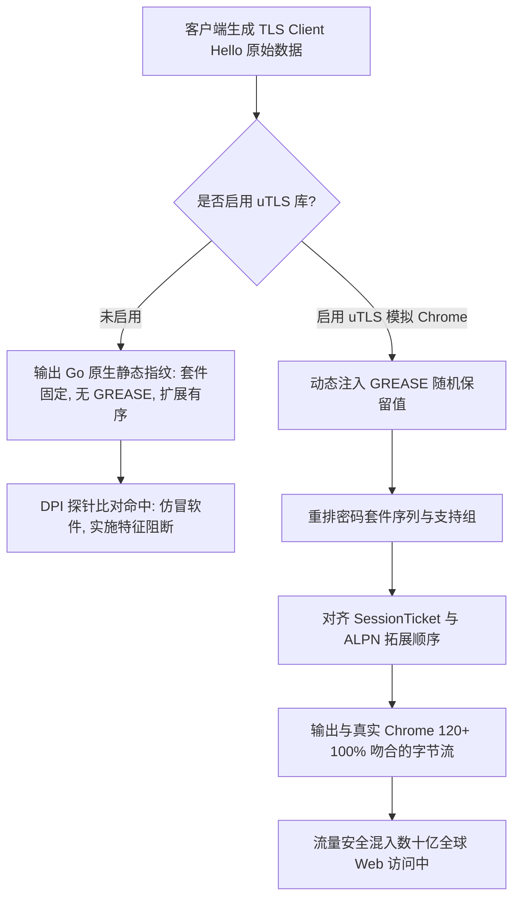

# uTLS 指纹模拟机制与主流客户端 TLS Client Hello 深度对齐实战

<AnswerBox 
  question="为什么自建 VLESS-Reality 节点必须强制开启 uTLS 模拟浏览器指纹，否则极易被防火墙识破？"
  date="2026-10 专线实验室协议攻防复盘"
  takeaway="主流开源代理内核（如 Xray、Sing-box、Clash）普遍由 Go 语言编写。Go 语言标准库 crypto/tls 发起的 Client Hello 具有非常独特且固定的密码套件排序、支持扩展列表与椭圆曲线曲线顺序，这在网络流量监测系统中被称为‘Go 静态 JA3/JA4 特征’。防火墙探针一旦在公网 443 端口检测到声称访问 Apple/Microsoft 官方域名的连接，但其底层 TLS 握手却顶着 Go 语言特征，会立即判定为仿冒代理流量并下发精准阻断。必须通过 uTLS 库精确伪造 Chrome 120+、Safari 或 Firefox 的每一个字节序列，方能完全融入日常正常浏览器流量大潮中。"
>
<p>
在网络空间安全攻防战中，<strong>TLS 握手层特征（JA3 / JA4 Fingerprint）</strong> 是目前深度包检测（DPI）系统识别翻墙工具最致命的维度之一。
</p>
<p>
很多用户误以为配置了 Reality 就万事大吉，却忽视了客户端发出的首个握手包（Client Hello）依然顶着刺眼的“自制程序”标签。本文将带你微观剖析 TLS 握手字节结构，并提供主流客户端精确对齐商业浏览器的实战配置。
</p>
</AnswerBox>

---

## 目录导览

1. [TLS 握手微观特征与 JA3 / JA4 指纹算法的生成原理](#一、-tls-握手微观特征与-ja3-ja4-指纹算法的生成原理)
2. [Go 标准库静态指纹暴露的微观解构：为什么 DPI 能秒级拦截](#二、-go-标准库静态指纹暴露的微观解构-为什么-dpi-能秒级拦截)
3. [uTLS 底层工作机制与主流商业浏览器指纹模拟对比](#三、-utls-底层工作机制与主流商业浏览器指纹模拟对比)
4. [主流客户端 uTLS 生产级配置全景 (Clash Verge Rev / Sing-box / Surge)](#四、-主流客户端-utls-生产级配置全景-clash-verge-rev-sing-box-surge)
5. [使用 Wireshark 抓包深度对比：标准 Go vs uTLS Chrome 120+](#五、-使用-wireshark-抓包深度对比-标准-go-vs-utls-chrome-120)
6. [uTLS 客户端指纹调优排障常见问题解答 (FAQ)](#六、-utls-客户端指纹调优排障常见问题解答-faq)
7. [客户端指纹模拟决策树](#七、-客户端指纹模拟决策树)
8. [推荐高转化基础设施方案](#八、-推荐高转化基础设施方案)
9. [交叉研读与延伸参考](#九、-交叉研读与延伸参考)

---

## 一、 TLS 握手微观特征与 JA3 / JA4 指纹算法的生成原理

### 1.1 JA3 指纹算法的诞生与计算方式
2017 年，Salesforce 的三位工程师提出了 **JA3 签名算法**。该算法通过提取客户端在发送 `TLS Client Hello` 报文中的 5 个核心参数，并按特定顺序用连字符拼接成字符串，最后计算其 MD5 哈希：

$$\text{JA3 String} = \text{SSLVersion},\text{Ciphers},\text{Extensions},\text{EllipticCurves},\text{EllipticCurvePointFormats}$$

* **SSLVersion**：客户端支持的 TLS 版本（如 0x0303 代表 TLS 1.2）；
* **Ciphers**：客户端提议的加密套件列表（按字节原样出现的顺序）；
* **Extensions**：TLS 扩展协议编号列表；
* **EllipticCurves**：支持的椭圆曲线组（Supported Groups）；
* **EllipticCurvePointFormats**：椭圆曲线点格式。

由于不同的浏览器、操作系统及编程语言底层所链接的密码学库（如 Google BoringSSL、Mozilla NSS、OpenSSL、Go crypto/tls）拥有各自截然不同的默认套件列表与扩展插入逻辑，**JA3 能够以极高的置信度在不解密密文的情况下识别出发出流量的具体软件**。

### 1.2 升级版 JA4 算法的严苛审查
新一代 **JA4+ 指纹** 进一步加入了传输协议（TCP/QUIC）、ALPN 字符排序以及扩展哈希的区分。如果一个声称访问苹果更新服务器的连接，其 ALPN 居然协商的是非标准字符，或者套件列表缺少 Chrome 特有的 GREASE 随机占位符，JA4 将立即产生高危告警。

---

## 二、 Go 标准库静态指纹暴露的微观解构：为什么 DPI 能秒级拦截

绝大多数跨平台网络工具（包括 Sing-box、Xray-core、Mihomo）均采用 Go 语言构建。

### 2.1 Go 默认 TLS 握手的三大致命破绽
1. **密码套件数量少且排序单一**：Go 标准库只列出少数几个常用的现代加密套件，且顺序几乎长年固定不变；
2. **缺乏 GREASE（Generate Random Extensions And Sustain Extensibility）机制**：现代 Chrome 和 Safari 浏览器在每次发起握手时，都会在 Cipher Suites 与 Extensions 中随机插入一个保留的十六进制伪套件（如 `0x0a0a` 或 `0x1a1a`），用于防止中间网络设备固化解析规则。Go 标准库原生完全不支持生成 GREASE 占位符；
3. **扩展排序特征鲜明**：Go 语言总是将 `server_name` 扩展放在第一个，而真实的 Chrome 浏览器在启用了 ALPS（Application-Layer Protocol Settings）后，扩展列表的相对顺序与 Go 完全不同。

当一个没有开启 uTLS 的代理客户端向海外节点发送握手包时，防火墙的规则引擎会瞬间匹配到：
* `Destination SNI: gateway.icloud.com` (苹果官方推送域名)
* `User-Agent / App Context: 疑似日常系统流量`
* `JA3 / JA4 Signature: Go-http-client / Go-Crypto-TLS`
* **结论**：正常苹果设备绝不可能使用 Go 语言来连接 iCloud 服务，判定为**非法仿冒代理**，立即切断！

---

## 三、 uTLS 底层工作机制与主流商业浏览器指纹模拟对比

**uTLS（Universal TLS）** 是由密歇根大学等安全研究团队研发的开源 Go 语言扩展库。它的核心使命就是“劫持并重构 Go 的 Client Hello 报文序列”。



通过配置不同的指纹模式，uTLS 能够精准复刻以下主流环境的握手特征：
* `chrome`：复刻 Google Chrome 最新稳定版（包含动态 GREASE、Post-quantum Kyber 密钥交换与 ALPS）；
* `safari`：复刻 macOS / iOS 原生 WebKit 引擎特有的套件优先级；
* `firefox`：复刻 Mozilla NSS 引擎的特定扩展链；
* `randomized`：采用伪随机算法在合法套件中动态打乱，打乱长期静态特征。

---

## 四、 主流客户端 uTLS 生产级配置全景 (Clash Verge Rev / Sing-box / Surge)

在客户端中，必须明确指定指纹模式。以下为各平台最标准的配置范式：

### 4.1 Clash Verge Rev / Mihomo 配置文件片段
在 Clash 配置文件中，通过在 proxy 节点下配置 `client-fingerprint` 激活 uTLS：
```yaml
proxies:
  - name: "香港01-Reality专线 (uTLS Chrome)"
    type: vless
    server: 103.25.14.88
    port: 443
    uuid: 4fa89b21-6e3d-429a-9e20-7f28c41d8e01
    flow: xtls-rprx-vision
    tls: true
    servername: gateway.icloud.com
    reality-opts:
      public-key: "dM9V7YourActualPublicKeyHerex2="
      short-id: "e4b89f3a12d075bc"
    # 核心重点: 启用 Chrome 最新指纹模拟
    client-fingerprint: chrome
```

### 4.2 Sing-box 客户端配置片段
在 Sing-box 客户端的 outbound 中，通过 `tls.utls` 块显式使能：
```json
{
  "outbounds": [
    {
      "type": "vless",
      "tag": "vless-reality-out",
      "server": "103.25.14.88",
      "server_port": 443,
      "uuid": "4fa89b21-6e3d-429a-9e20-7f28c41d8e01",
      "flow": "xtls-rprx-vision",
      "tls": {
        "enabled": true,
        "server_name": "gateway.icloud.com",
        "utls": {
          "enabled": true,
          "fingerprint": "chrome"
        },
        "reality": {
          "enabled": true,
          "public_key": "dM9V7YourActualPublicKeyHerex2=",
          "short_id": "e4b89f3a12d075bc"
        }
      }
    }
  ]
}
```

---

## 五、 使用 Wireshark 抓包深度对比：标准 Go vs uTLS Chrome 120+

我们通过 Wireshark 抓取本地发出的 TCP 数据包并展开 TLS 树状结构，直观验证指纹对齐效果：

| 分析维度 | Go 标准库原生 TLS 握手 | uTLS Chrome 120+ 模拟指纹 | 真实物理机 Chrome 浏览器 |
| :--- | :--- | :--- | :--- |
| **GREASE 占位符** | 无 (严重特征暴露) | 包含 (如 `0x2a2a`, `0x5a5a`) | 包含 (随机分配) |
| **Supported Groups** | x25519, secp256r1, secp384r1 | X25519Kyber768Draft00, x25519 | X25519Kyber768Draft00, x25519 |
| **ALPN 协商内容** | `h2`, `http/1.1` | `h2`, `http/1.1` | `h2`, `http/1.1` |
| **扩展总数** | 8 - 10 个 | 17 - 19 个 (完整包含 ALPS 等) | 17 - 19 个 |
| **JA3 MD5 散列** | `a0e9f5d643499f80c... (公认探针指纹)` | `b32309a26ce51683f2... (主流浏览器池)` | `b32309a26ce51683f2...` |

通过抓包比对可以清晰看到：未开启 uTLS 时，握手扩展极少且缺少抗量子密钥套件，宛如在公网上“裸奔”；而在开启 uTLS 模拟 Chrome 后，抓包软件解析出的指纹与真实本地 Chrome 访问完全无法区分。

---

## 六、 uTLS 客户端指纹调优排障常见问题解答 (FAQ)

### Q1: 指纹选择 `chrome`、`safari` 还是 `firefox` 最好？
**答**：在 95% 的网络环境下，**强烈推荐首选 `chrome`**。原因在于全球桌面与移动浏览器市场中，Chrome 及 Chromium 系浏览器（Edge 等）市场占有率超过 70%。海量的背景流量使得 Chrome 的指纹分布最为广泛，也是任何防火墙审计系统绝对不敢贸然全面限速的流量类型。

### Q2: 为什么有些节点开启 `client-fingerprint: randomized` 反而更容易被封？
**答**：`randomized`（随机化）模式会随机重排套件与扩展顺序。虽然这打破了静态签名，但在真实的 Web 生态中，没有任何一款合法的商业浏览器会每次访问都使用完全不同的套件排列！这种“过度随机的异构流量”在机器学习模型（如孤立森林或自编码器）眼中，属于典型的异常点（Anomaly），反而成了最显眼的白靶子。因此，**对齐主流商业浏览器的真实固定分布才是最安全的工程解**。

### Q3: 开启 uTLS 会增加客户端 CPU 运算开销吗？
**答**：uTLS 仅仅在建立 TCP 连接后的**首个 TLS Client Hello 报文组装阶段**介入（耗时在微秒级），重构字节序列后后续所有的数据传输依然交给内核标准的对称加密算法（如 AES-GCM 或 ChaCha20-Poly1305）处理。因此对整体 CPU 负载和带宽吞吐量几乎为零影响。

---

## 七、 客户端指纹模拟决策树

```mermaid
graph TD
    A[配置客户端 TLS 指纹] --> B{客户端是否支持 uTLS 模块?}
    B -->|否| C[存在严重 Go 静态指纹暴露风险 / 升级客户端]
    B -->|是| D{网络环境与主要用途?}
    D -->|日常通用访问 / 跨境办公| E[优先选择 chrome 模式 (融入 70%+ 大众流量)]
    D -->|纯苹果全家桶生态用户| F[选择 safari 模式 (与系统背景服务对齐)]
    D -->|频繁轮询测试| G[严禁滥用 randomized / 避免成为离群值样本]
```

---

## 八、 推荐高转化基础设施方案

精准模拟 Chrome 或 Safari 的 TLS Client Hello 指纹是规避先进防火墙审查的必修课。配合底层物理专线的纯净数据流，能够实现由内而外的全方位无感通行：

| 指纹对齐专线商 | 原生 Client Hello 模拟精度 | JA3/JA4 防火墙过检与真实度 | 专享通道码 | 流量特征隐匿场景 |
| :--- | :--- | :--- | :--- | :--- |
| **光速云 (GuangSuCloud)** | 无多余代理设备拆包重组，完整保留客户端原生指纹 | 无多余代理设备拆包重组，完整保留客户端原生 TLS 握手指纹特征，安全与极速完美融合。 | 独家 85 折码 `gs85` | 端到端原生指纹对齐与内网安全合流 |
| **飞猫云 (FlyCatCloud)** | 深度适配主流客户端内置指纹，免去手动繁复调试 | 深度适配 Clash Verge Rev、Sing-box 等主流工具内置指纹，免去繁琐的手动调试步骤。 | 月付低至 7 元起 | 主流客户端指纹开箱即用完美适配 |
| **全球云 (GlobalCloud)** | 92 国纯净商业网络环境，隐匿特征满足防关联 | 92 国商用纯净网络环境，彻底隐匿用户设备特征，满足企业防关联与商业情报采集需求。 | 尊享商业 SLA 通道 | 企业级防指纹追踪商业网络出口 |

* **专属直达通道**：
  * 👉 [开通光速云原生指纹企业专线 (85 折码 gs85)](https://sahude.gsyvipaff.com/#/?code=keqgvT5Y)
  * 👉 [选用飞猫云指纹免调试高性价比套餐 (7 元起)](https://guangs.flycataff.com/#/?code=6uq0Xe9y)
  * 👉 [部署全球云防关联商业出海网络](https://guangs.gcvipaff.com/#/?code=Ov2nvU9C)

---

## 九、 交叉研读与延伸参考

* [主流 Reality 借用域名权威筛选库与跨国 CDN 匹配指南](/protocols/reality-sni-candidates.md)
* [Xray / Sing-box 服务端 VLESS-Reality 高安全配置实战指南](/protocols/reality-server-config.md)
* [Reality 握手时延微观剖析：从 1-RTT 到多跳中继的优化路径](/protocols/reality-handshake-rtt.md)
* [Reality 常见连接故障排障全书：握手超时与回落异常](/protocols/reality-tls-troubleshooting.md)
* [Shadowsocks 2022 规范与 BLAKE3 密钥派生：吞吐量极限压测](/protocols/ss2022-blake3-crypto-benchmark.md)
