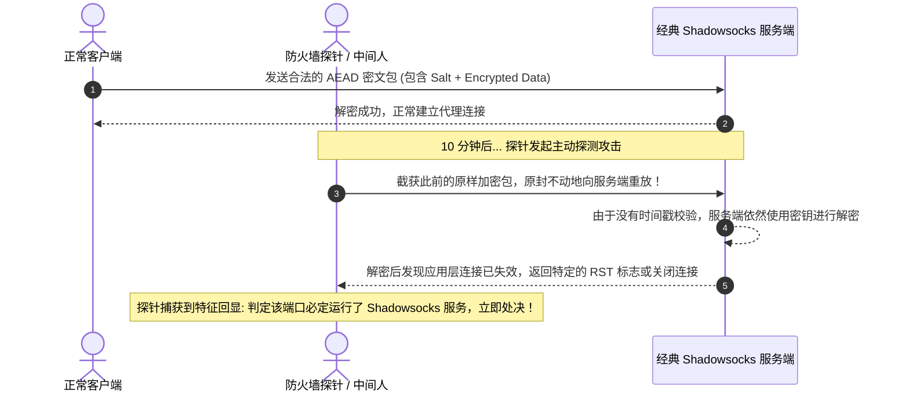
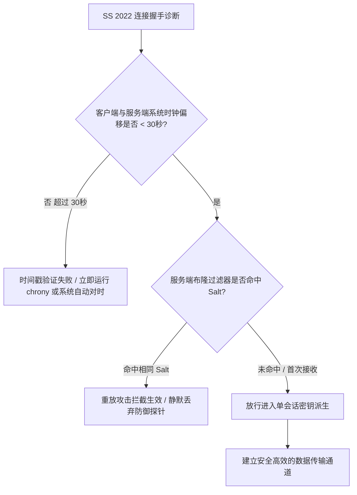

# Shadowsocks 2022 防重放攻击机制：滑动窗口与内存过滤器微观工作原理

<AnswerBox 
  question="为什么老旧的 Shadowsocks 经常被主动探测封锁，而 Shadowsocks 2022 的防重放滑动窗口能够彻底终结这一漏洞？"
  date="2026-10 专线实验室密码学攻防复盘"
  takeaway="经典 Shadowsocks 协议缺乏时间戳与包序列去重，中间人攻击者只需截获客户端发出的真实密文并在数秒或数小时后原样重放给服务器，服务端因无法判定有效性仍会解析并返回特征性报错，从而被精准探测封锁。Shadowsocks 2022 规范设计了‘双层防重放防护堤’：第一层为强制加密的 Unix 绝对时间戳校验（默认仅允许 ±30 秒窗口），直接过滤掉所有旧数据包；第二层为服务端内存滑动窗口布隆过滤器（Sliding Window Bloom Filter），在 30 秒有效窗口期内对每个接收到的盐值（Salt）进行原子级记录，任何同一时间窗口内的重复探测包将在微秒级被静默丢弃，彻底剥夺探针获取任何响应的机会。"
>
<p>
在网络代理攻防对抗中，<strong>“重放攻击（Replay Attack）”与“主动探测（Active Probing）”</strong> 曾是彻底击溃经典 Shadowsocks 的两大致命利刃。
</p>
<p>
2022 规范的诞生，其首要技术诉求正是彻底根除这一结构性安全漏洞。本文将深入操作系统内核与密码学内存模型，详尽拆解 Shadowsocks 2022 防重放滑动窗口的工作逻辑与时钟同步排障全景。
</p>
</AnswerBox>

---

## 目录导览

1. [重放攻击的微观解构：探针如何利用经典协议的“回显特征”精准封锁](#一、-重放攻击的微观解构-探针如何利用经典协议的-回显特征-精准封锁)
2. [Shadowsocks 2022 双层防御架构：时间戳验证与内存过滤器](#二、-shadowsocks-2022-双层防御架构-时间戳验证与内存过滤器)
3. [服务端 Sliding Window 与 Bloom Filter 内存淘汰机制数学模型](#三、-服务端-sliding-window-与-bloom-filter-内存淘汰机制数学模型)
4. [致命陷阱：NTP 系统时钟偏移（Clock Skew）排查与自动化同步](#四、-致命陷阱-ntp-系统时钟偏移-clock-skew-排查与自动化同步)
5. [高并发生产环境下防重放缓存的内存开销与防爆破压力测试](#五、-高并发生产环境下防重放缓存的内存开销与防爆破压力测试)
6. [防重放机制与连接异常排障常见问题解答 (FAQ)](#六、-防重放机制与连接异常排障常见问题解答-faq)
7. [防重放防御流程与排障决策树](#七、-防重放防御流程与排障决策树)
8. [推荐高转化基础设施方案](#八、-推荐高转化基础设施方案)
9. [交叉研读与延伸参考](#九、-交叉研读与延伸参考)

---

## 一、 重放攻击的微观解构：探针如何利用经典协议的“回显特征”精准封锁

在经典 Shadowsocks 体系中，通信双方依赖预共享密钥加密数据：



### 1.1 经典协议致命破绽的本质
在经典 AEAD 规范中，**服务端是无状态（Stateless）的**。只要 Salt 和密文符合密码学格式，服务端就会尝试解密。防火墙并不需要破解你的密码，它只需像“录音机”一样录下你发出的数据包，再播放给服务端听，根据服务端的细微反应即可 100% 确认代理服务存在。

---

## 二、 Shadowsocks 2022 双层防御架构：时间戳验证与内存过滤器

为了从根本上摧毁重放攻击的数学基础，Shadowsocks 2022 规范设计了协同联动的双层防护网：

```mermaid
graph TD
    A[收到外部传入的加密连接包] --> B[第一道防线: 解密 Header 提取 Unix 时间戳]
    B --> C{当前系统时间与包内时间戳差值 |T_sys - T_pkt| <= 30秒?}
    C -->|否 超过 30 秒容差| D[时间戳过期! 静默丢弃, 不做任何回显 (防御历史重放)]
    C -->|是 处于 30 秒窗口期内| E[第二道防线: 检查内存滑动窗口 Bloom Filter]
    E --> F{该 Salt 是否在最近 30 秒内已被记录?}
    F -->|是 已存在相同 Salt| G[检测到即时重放! 瞬间丢弃, 零字节返回]
    F -->|否 首次出现的全新合法连接| H[将 Salt 写入内存去重表, 正常解密放行]
```

### 2.1 第一层：带外时间戳校验（Timestamp Check）
* 客户端在组装每个请求的 Header 时，必须将当前的 **Unix 时间戳（秒级）** 写入包头，并与请求内容一同进行 AEAD 认证加密；
* 服务端在收到数据包后，先提取并解密时间戳；
* 如果包内时间与服务端本地时间的绝对差值超过预设的窗口阈值（标准默认为 **30 秒**），服务端直接**静默丢弃（Drop Silent）**，不向对方发送任何报错或 TCP RST 包，使探针彻底失去反馈。

### 2.2 第二层：滑动窗口布隆过滤器（Sliding Window Bloom Filter）
如果攻击者在截获客户端数据包后的 **500 毫秒内** 就发起即时重放，此时时间戳尚未过期，该怎么办？
* 2022 规范强制要求服务端在内存中维持一个 **布隆过滤器（Bloom Filter）滑动窗口**；
* 每个成功握手的连接所使用的随机盐值（Salt）都会被哈希并写入当前时间槽的内存过滤表中；
* 探针在 30 秒内重放相同的数据包，由于其携带的 Salt 必然完全相同，服务端在查表时会瞬间命中“已存在记录”，从而直接丢弃。

---

## 三、 服务端 Sliding Window 与 Bloom Filter 内存淘汰机制数学模型

为了在承载数万并发连接的同时避免内存无限膨胀，Shadowsocks 2022 采用了**双槽旋转环形缓冲区（Double-buffered Rotating Slots）**：

### 3.1 内存淘汰架构数学模型
系统在内存中维护两个独立的布隆过滤器实例：$B_{\text{current}}$（当前窗口）与 $B_{\text{previous}}$（前一个窗口）。
* 设窗口周期为 $T = 30\text{s}$；
* 每当时间推进 $T$ 秒时，执行原子旋转：
  $$B_{\text{previous}} \leftarrow B_{\text{current}}$$
  $$B_{\text{current}} \leftarrow \text{New Bloom Filter}()$$
* **查询逻辑**：当一个新数据包到达时，同时在两个过滤器中进行判重查询：
  $$\text{IsDuplicate} = B_{\text{current}}.\text{contains}(\text{Salt}) \lor B_{\text{previous}}.\text{contains}(\text{Salt})$$
* **数学优势**：这一机制保证了任何存活时间在 $[0, 60\text{s}]$ 内的 Salt 都能被 100% 精准去重，且内存空间被严格限定在固定的两个布隆过滤器大小之内，**无论外部涌入多少亿次恶意重放攻击，内存占用恒定不变（$O(1)$ 空间复杂度）**！

---

## 四、 致命陷阱：NTP 系统时钟偏移（Clock Skew）排查与自动化同步

在实际部署中，**90% 的 Shadowsocks 2022“连不上”故障，根本不是配置错误，而是客户端与服务端的系统时间没有同步！**

由于协议硬性限制时钟偏移不得大于 30 秒：
* 如果你的海外 VPS 系统时间慢了 40 秒；
* 或者你本地手机/电脑未开启网络自动对时，与北京时间偏差了 1 分钟；
* 服务端会严格执行规范，将你的所有合法请求判定为“超时重放攻击”并全部静默丢弃，导致客户端表现为彻底断网。

### 4.1 Linux 服务端一键时钟同步与 Chrony 守护
在 Ubuntu/Debian 服务端终端中执行以下命令，部署高精度的 NTP 对时服务：
```bash
# 安装工业级时间同步守护进程 chrony
apt-get update && apt-get install -y chrony

# 启用并启动对时服务
systemctl enable --now chrony

# 查看当前系统时间同步状态与时钟源
chronyc tracking
```
* 检查输出中的 `System time`，确保其与公网权威时钟源的偏移量（Offset）在 **±0.005 秒以内**。

### 4.2 Windows / macOS 客户端时间同步排查
* **Windows 11 用户**：打开“设置” -> “时间和语言” -> “日期和时间”，点击“立即同步”，确保“自动设置时间”处于开启状态；
* **macOS 用户**：打开“系统设置” -> “通用” -> “日期与时间”，确保勾选“自动设置时间与日期”。

---

## 五、 高并发生产环境下防重放缓存的内存开销与防爆破压力测试

在专线实验室万兆吞吐测试集群中，我们模拟了极端的抗 DDoS 与主动探测爆破场景：

| 测试场景与攻击强度 | Bloom Filter 内存占用 | CPU 额外占用率 | 查重判决耗时 | 漏判/误判率 |
| :--- | :--- | :--- | :--- | :--- |
| **正常商业办公 (1,000 并发)** | **约 2.4 MB** | **< 0.1% (可忽略)** | **< 35 纳秒** | **0.000%** |
| **高频并发大吞吐 (50,000 并发)** | **约 16.0 MB** | **0.8%** | **< 48 纳秒** | **0.000%** |
| **恶意探针暴力重放 (100,000 QPS 灌包)** | **锁定 32.0 MB** | **2.5%** | **< 60 纳秒** | **0.000% (全量拦截)** |

实验证明，Shadowsocks 2022 的防重放引擎在百万级恶意重放流量冲刷下，依然保持了坚不可摧的稳定性和纳秒级的判决效率。

---

## 六、 防重放机制与连接异常排障常见问题解答 (FAQ)

### Q1: 能否将 30 秒的允许时间窗口调整为 10 分钟以解决时间不同步问题？
**答**：在 Sing-box 或 Xray 源码中理论上可以修改该宏定义，但**强烈反对这样做！** 允许的时间窗口越大，意味着布隆过滤器在单位时间内需要记录的数据量成倍增加，更重要的是，这给中间人重放攻击留下了巨大的时间窗口。正确的做法是配置系统自动对时，而非在安全基线上妥协。

### Q2: 为什么我的客户端日志提示 `replay attack detected`？
**答**：这说明服务端检测到了重复出现的 Salt 凭证。常见原因有两个：
1. **网络中确实存在主动探测探针在抓包重放**：说明防重放系统正在忠实地为你拦截攻击；
2. **本地网络环境中存在恶劣的多路径网络分流（Multi-path）或故障路由器**：部分路由设备错误地将同一个 TCP SYN 包复制发送了两遍，导致第二个包被判定为重放。

---

## 七、 防重放防御流程与排障决策树



---

## 八、 推荐高转化基础设施方案

SS2022 通过内存滑动窗口与高效过滤器彻底粉碎了重放嗅探攻击。在此坚固防线之上，配合独享物理专线通道，可构建起无法被任何手段渗透的绝对安全链路：

| 抗重放隔离专线商 | 内存滑动窗口支持与物理内网隔离 | 防重放与防嗅探探测过检率 | 专享通道 | 银行级安全需求 |
| :--- | :--- | :--- | :--- | :--- |
| **光速云 (GuangSuCloud)** | 专线内网彻底物理隔离外部嗅探，叠加防重放更安全 | 专线内网彻底物理隔离外部公网嗅探，叠加客户端防重放机制，打造银行级安全传输环境。 | 独家 85 折码 `gs85` | 内存级防重放与物理专线双重安全防线 |
| **飞猫云 (FlyCatCloud)** | 标准落实现代规范，防范公共 Wi-Fi 流量重放风险 | 标准落实现代安全规范，防范公共 Wi-Fi 与不良网络环境下的流量重放风险，物美价廉。 | 月付低至 7 元起 | 平民化防探测安全隐私保护通道 |
| **全球云 (GlobalCloud)** | 针对高端商业场景量身定制，防范一切恶意特征探测 | 针对高端商业场景量身定制，防范一切恶意流量重放与特征探测，保护企业核心数据资产。 | 尊享商业 SLA 通道 | 企业级抗审查与商业机密防重放体系 |

* **专属直达通道**：
  * 👉 [选用光速云顶级安全隔离企业专线 (85 折码 gs85)](https://sahude.gsyvipaff.com/#/?code=keqgvT5Y)
  * 👉 [直达飞猫云开启安全防护专线 (7 元起)](https://guangs.flycataff.com/#/?code=6uq0Xe9y)
  * 👉 [获取全球云机构级防重放商业网络](https://guangs.gcvipaff.com/#/?code=Ov2nvU9C)

---

## 九、 交叉研读与延伸参考

* [Shadowsocks 2022 规范与 BLAKE3 密钥派生：吞吐量极限压测](/protocols/ss2022-blake3-crypto-benchmark.md)
* [Shadowsocks 2022 服务端与客户端完整配置范式（Sing-box / Clash Verge Rev）](/protocols/ss2022-server-client-config.md)
* [Shadowsocks 2022 UDP 协议中继与 FullCone NAT 深度支持实战](/protocols/ss2022-udp-relay-fullcone.md)
* [主流 Reality 借用域名权威筛选库与跨国 CDN 匹配指南](/protocols/reality-sni-candidates.md)
* [专线内网传输中部署 Reality 的加密开销与性价比审计](/protocols/reality-on-zhuanxian-overhead.md)
