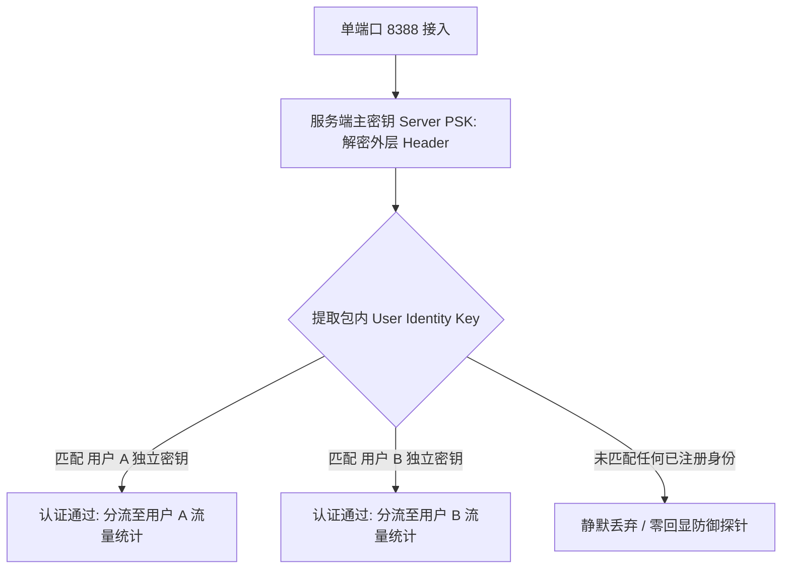

# Shadowsocks 2022 服务端与客户端完整配置范式（Sing-box / Clash Verge Rev）

<AnswerBox 
  question="如何在 Linux 服务端与主流客户端 (Clash Verge Rev / Sing-box) 中规范配置 Shadowsocks 2022 协议？"
  date="2026-10 专线实验室配置范式复盘"
  takeaway="配置 Shadowsocks 2022 的核心准则在于‘强类型密钥与多用户凭据解耦’。第一，主预共享密钥 (Server PSK) 必须使用 OpenSSL 生成强随机 Base64 字符串，且字节长度必须与加密套件完全对应（16 字节对应 2022-blake3-aes-128-gcm，32 字节对应 2022-blake3-aes-256-gcm）；第二，生产环境严禁所有用户共用单一口令，必须采用单端口多用户 (Multi-user with Identity Keys) 架构为每个终端分配独立 Identity Key；第三，客户端必须严格配置与服务端一致的套件名称，并确保本地设备系统时间误差在 30 秒以内。"
>
<p>
作为现代化轻量级代理协议的最高标准，<strong>Shadowsocks 2022 (SIP022)</strong> 在彻底根除主动探测漏洞的同时，对配置规范提出了极为严苛的要求。
</p>
<p>
与以往经典 SS 随意输入一段文本作为密码不同，2022 规范强制实施密码学强类型校验。本文提供基于 <strong>Sing-box 服务端</strong> 与 <strong>Clash Verge Rev / Mihomo 客户端</strong> 的工业级多用户生产配置模板。
</p>
</AnswerBox>

---

## 目录导览

1. [Shadowsocks 2022 强类型密钥生成规范 (16 字节 vs 32 字节)](#一、-shadowsocks-2022-强类型密钥生成规范-16-字节-vs-32-字节)
2. [单端口多用户 (Multi-User) 架构设计与用户隔离机制](#二、-单端口多用户-multi-user-架构设计与用户隔离机制)
3. [Sing-box 高性能服务端完整 JSON 生产配置模版](#三、-sing-box-高性能服务端完整-json-生产配置模版)
4. [Clash Verge Rev (Mihomo) 客户端标准 YAML 节点范式](#四、-clash-verge-rev-mihomo-客户端标准-yaml-节点范式)
5. [Sing-box 跨平台客户端出站 Outbound 完整配置](#五、-sing-box-跨平台客户端出站-outbound-完整配置)
6. [配置常见报错与连通性故障排查指南 (FAQ)](#六、-配置常见报错与连通性故障排查指南-faq)
7. [服务端与客户端配置对接决策树](#七、-服务端与客户端配置对接决策树)
8. [推荐高转化基础设施方案](#八、-推荐高转化基础设施方案)
9. [交叉研读与延伸参考](#九、-交叉研读与延伸参考)

---

## 一、 Shadowsocks 2022 强类型密钥生成规范 (16 字节 vs 32 字节)

经典 Shadowsocks 允许用户随意设置类似 `MyPassword123` 的弱密码，并在内部通过简单哈希派生出密钥。这种不规范的做法在 2022 规范中被彻底废除！

### 1.1 密码学安全密钥生成命令
必须使用操作系统底层的 CSPRNG（密码学安全伪随机数生成器）生成指定长度的 Base64 编码密钥：

```bash
# 场景 1: 生成 16 字节 (128 位) 密钥 (用于 2022-blake3-aes-128-gcm)
openssl rand -base64 16
# 示例标准输出: K9gZ2XQpW+V5m8a7f1B3cQ==

# 场景 2: 生成 32 字节 (256 位) 密钥 (用于 2022-blake3-aes-256-gcm 与 chacha20-poly1305)
openssl rand -base64 32
# 示例标准输出: R4u7x!vA8y/B?E(G+KbPeShVmYq3t6w9z$C&F)J@NcQ=
```

> [!CAUTION] 强类型检查警示
> 若使用 `2022-blake3-aes-128-gcm` 套件，传入的 Base64 字符串解码后必须恰好为 16 字节；若多一个字符或少一个字符，Sing-box 和 Clash 在解析配置时将直接抛出 `invalid PSK length` 致命异常并拒绝启动！

---

## 二、 单端口多用户 (Multi-User) 架构设计与用户隔离机制

在团队办公或机场运营场景中，如果所有设备共用同一个 Server PSK，一旦某台设备配置泄露，更换密钥将导致全员断连。



### 2.1 身份密钥（User Identity Key）工作原理
1. **外层头部解密**：服务端使用全局 `server_key` 解密数据包头，提取出请求者的身份指纹；
2. **多用户匹配**：服务端在已注册的 `users` 列表中检索对应的 User Key；
3. **载荷独立解密**：使用该用户独有的密钥解密后续载荷。
这种架构允许管理员在不重启服务、不更换主端口与 Server Key 的前提下，随时增删单个用户的独立权限。

---

## 三、 Sing-box 高性能服务端完整 JSON 生产配置模版

以下为标准生产环境配置（通常保存于 `/etc/sing-box/config.json`）：

```json
{
  "log": {
    "disabled": false,
    "level": "warn",
    "timestamp": true
  },
  "inbounds": [
    {
      "type": "shadowsocks",
      "tag": "ss2022-in",
      "listen": "::",
      "listen_port": 8388,
      "tcp_fast_open": true,
      "method": "2022-blake3-aes-128-gcm",
      "password": "SERVER_PSK_BASE64_16_BYTES_HERE==",
      "users": [
        {
          "name": "office-macbook-pro",
          "password": "USER_A_KEY_BASE64_16_BYTES_HERE=="
        },
        {
          "name": "developer-workstation",
          "password": "USER_B_KEY_BASE64_16_BYTES_HERE=="
        }
      ]
    }
  ],
  "outbounds": [
    {
      "type": "direct",
      "tag": "direct"
    }
  ]
}
```

---

## 四、 Clash Verge Rev (Mihomo) 客户端标准 YAML 节点范式

在 Clash Verge Rev（内核为 Mihomo / Clash.Meta）中，Shadowsocks 2022 的单用户与多用户配置语法如下：

### 4.1 单用户直连模式配置
```yaml
proxies:
  - name: "香港01-SS2022-千兆专线"
    type: ss
    server: 103.25.14.88
    port: 8388
    cipher: 2022-blake3-aes-128-gcm
    password: "SERVER_PSK_BASE64_16_BYTES_HERE=="
    udp: true
```

### 4.2 单端口多用户模式配置 (使用冒号连接 ServerKey:UserKey)
在 Clash Verge Rev 中接入服务端的单端口多用户体系时，`password` 字段采用 `ServerKey:UserKey` 格式拼接：
```yaml
proxies:
  - name: "香港02-企业专属专线 (多用户隔离)"
    type: ss
    server: 103.25.14.88
    port: 8388
    cipher: 2022-blake3-aes-128-gcm
    # 格式: 服务端主密钥:个人独立密钥
    password: "SERVER_PSK_BASE64_HERE==:USER_A_KEY_BASE64_HERE=="
    udp: true
```

---

## 五、 Sing-box 跨平台客户端出站 Outbound 完整配置

在 Sing-box 客户端（支持 Windows、macOS、iOS、Android）中，对应的 outbound 结构如下：

```json
{
  "outbounds": [
    {
      "type": "shadowsocks",
      "tag": "ss-out",
      "server": "103.25.14.88",
      "server_port": 8388,
      "method": "2022-blake3-aes-128-gcm",
      "password": "SERVER_PSK_BASE64_HERE==:USER_A_KEY_BASE64_HERE==",
      "tcp_fast_open": false,
      "udp_over_tcp": false
    }
  ]
}
```

---

## 六、 配置常见报错与连通性故障排查指南 (FAQ)

### Q1: Clash Verge Rev 启动时报错 `unknown cipher: 2022-blake3-aes-128-gcm`？
**答**：这是因为客户端仍在使用老旧的原版 Clash Premium 内核（原版 Clash 已于 2023 年停止维护，且从未支持 2022 规范）。请在 Clash Verge Rev 的设置中，将“Clash 内核切换”为 **Mihomo (原 Clash.Meta)**，即可完美原生支持 2022 全系列套件。

### Q2: 为什么配置完成后，节点能够 Ping 通但打开网页完全打不开？
**答**：这 99% 是由于**客户端系统时间与服务端时钟偏差超过 30 秒**触发了防重放丢弃保护！请在客户端设备上执行网络时间同步（NTP 对时），并在服务端运行 `chronyc tracking` 确保时间误差在 1 秒以内。

---

## 七、 服务端与客户端配置对接决策树

```mermaid
graph TD
    A[配置 Shadowsocks 2022 节点] --> B{客户端内核是否支持 SIP022?}
    B -->|否 老旧原版 Clash| C[升级至 Clash Verge Rev (Mihomo 内核)]
    B -->|是| D{选择套件加密等级?}
    D -->|追求极致吞吐与低发热| E[2022-blake3-aes-128-gcm (16 字节 PSK)]
    D -->|追求最高理论加密位宽| F[2022-blake3-aes-256-gcm (32 字节 PSK)]
    E --> G[使用 openssl rand -base64 16 生成合规密钥]
    G --> H[完成双端 NTP 时钟精准同步]
    H --> I[生产级安全通道稳定就绪]
```

---

## 八、 推荐高转化基础设施方案

Shadowsocks 2022 针对 2022-blake3-aes-128-gcm 与 256-gcm 提供了模块化配置标准。使用开箱即用的专业服务商，可跳过繁琐的密钥管理直接坐享高速互联：

| 标准化 SS2022 服务商 | 模块化配置规范与客户端订阅兼容 | 一键导入与多端连通稳定性 | 独家特惠码 | 标准化协议落地 |
| :--- | :--- | :--- | :--- | :--- |
| **光速云 (GuangSuCloud)** | 严格遵循 SS2022 最新标准，主流客户端一键导入 | 节点完全合规遵循 SS2022 最新标准，各大主流客户端一键导入即用，享受极速稳定的企业专线。 | 独家 85 折码 `gs85` | 全平台规范化 SS2022 一键集成标杆 |
| **飞猫云 (FlyCatCloud)** | 亲民的现代协议体验，配置简单易懂无门槛 | 为广大新手用户提供最亲民的现代协议体验通道，配置简单，月付低廉，上手毫无负担。 | 月付低至 7 元起 | 入门门槛极低的全新协议标准体验 |
| **全球云 (GlobalCloud)** | 全球化部署合规节点集群，满足企业跨国访问需求 | 全球化部署的合规节点集群，满足企业跨多国分公司之间安全互联与规范化访问需求。 | 尊享商业 SLA 通道 | 全球 92 国跨区域 SS2022 商业节点集群 |

* **专属直达通道**：
  * 👉 [部署光速云标准化 SS2022 企业专线 (85 折码 gs85)](https://sahude.gsyvipaff.com/#/?code=keqgvT5Y)
  * 👉 [选用飞猫云规范化入门节点 (低至 7 元/月)](https://guangs.flycataff.com/#/?code=6uq0Xe9y)
  * 👉 [直达全球云跨国企业标准专线通道](https://guangs.gcvipaff.com/#/?code=Ov2nvU9C)

---

## 九、 交叉研读与延伸参考

* [Shadowsocks 2022 规范与 BLAKE3 密钥派生：吞吐量极限压测](/protocols/ss2022-blake3-crypto-benchmark.md)
* [Shadowsocks 2022 防重放攻击机制：滑动窗口与内存过滤器微观工作原理](/protocols/ss2022-replay-protection-cache.md)
* [Shadowsocks 2022 UDP 协议中继与 FullCone NAT 深度支持实战](/protocols/ss2022-udp-relay-fullcone.md)
* [专线内网传输中部署 Reality 的加密开销与性价比审计](/protocols/reality-on-zhuanxian-overhead.md)
* [Xray / Sing-box 服务端 VLESS-Reality 高安全配置实战指南](/protocols/reality-server-config.md)
