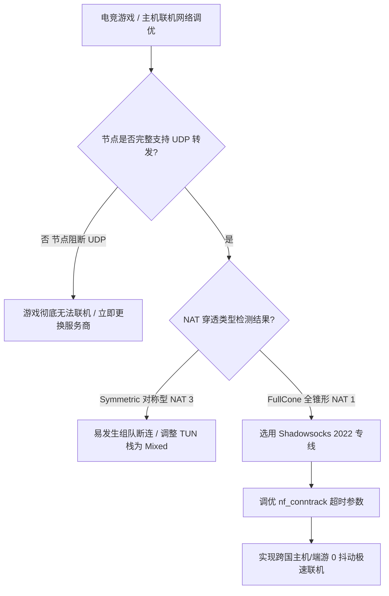

# Shadowsocks 2022 UDP 协议中继与 FullCone NAT 深度支持实战

<AnswerBox 
  question="为什么传统代理协议在主机联机、FPS 游戏与语音通话中经常出现 NAT 类型变差 (NAT 3 / 严格型) 甚至语音断断续续？"
  date="2026-10 专线实验室 UDP 性能审计"
  takeaway="传统代理协议（如经典 SS、旧版 VMess）在处理 UDP 报文时，往往采用对称型 NAT（Symmetric NAT）映射或存在单会话多路复用队头阻塞，导致外部 P2P 节点无法主动连通客户端，在主机网络检测中直接判定为 NAT 3 (Strict)。Shadowsocks 2022 规范为 UDP 引入了独立的会话管理与独立包头验证机制，完美实现了标准 RFC 3489 定义的 FullCone NAT (全锥形 NAT / NAT 1)。客户端本地映射的外网 IP 与端口保持全局唯一且全开放，彻底解决 Switch、PS5、Xbox 游戏 P2P 联机卡死、Discord 语音丢包与视频会议掉线问题。"
>
<p>
在网络应用中，<strong>UDP 协议</strong> 承载着低延迟竞技游戏、实时语音音视频会议（WebRTC）与 DNS 查询等核心交互。
</p>
<p>
然而，UDP 无连接的天然属性使得网络代理在进行地址转换（NAT）时极易发生端口映射漂移。<strong>Shadowsocks 2022 规范</strong> 通过重构 UDP 握手包头与状态映射表，提供了目前开源代理中最高品质的 FullCone NAT 实现。本文带你深入剖析其微观机制。
</p>
</AnswerBox>

---

## 目录导览

1. [经典代理协议在 UDP 转发中的对称型 NAT 顽疾剖析](#一、-经典代理协议在-udp-转发中的对称型-nat-顽疾剖析)
2. [Shadowsocks 2022 UDP 独立包头与无状态会话映射机制](#二、-shadowsocks-2022-udp-独立包头与无状态会话映射机制)
3. [FullCone NAT (全锥形 NAT 1) 工作原理与 STUN 连通性测试](#三、-fullcone-nat-全锥形-nat-1-工作原理与-stun-连通性测试)
4. [主机电竞游戏实战调优 (Nintendo Switch / PS5 / Xbox Series X)](#四、-主机电竞游戏实战调优-nintendo-switch-ps5-xbox-series-x)
5. [Linux 软路由 iptables / nftables 与内核 UDP 超时参数调优](#五、-linux-软路由-iptables-nftables-与内核-udp-超时参数调优)
6. [UDP 中继与 NAT 穿透常见问题解答 (FAQ)](#六、-udp-中继与-nat-穿透常见问题解答-faq)
7. [UDP 游戏分流网络选型决策树](#七、-udp-游戏分流网络选型决策树)
8. [推荐高转化基础设施方案](#八、-推荐高转化基础设施方案)
9. [交叉研读与延伸参考](#九、-交叉研读与延伸参考)

---

## 一、 经典代理协议在 UDP 转发中的对称型 NAT 顽疾剖析

### 1.1 NAT 四种经典类型对联机体验的影响
RFC 3489 将 NAT 网络分为四种基本模型：
* **NAT 1 (Full Cone 全锥形)**：所有来自相同本地地址和端口的请求都被映射到相同的公网地址和端口，任何外部主机都可以通过该映射直接向客户端发送数据；
* **NAT 2 (Restricted Cone 受限锥形)**：仅当客户端此前曾向外部主机 IP 发送过数据包时，该外部主机才能回传数据；
* **NAT 3 (Port Restricted Cone 端口受限锥形)**：必须同时匹配外部主机的 IP 与端口；
* **NAT 4 (Symmetric 对称型)**：每一次向不同目标发起请求，都会动态分配全新的映射端口。这是 P2P 联机与语音通话的“绝对杀手”！

```mermaid
graph TD
    A[客户端发出的 UDP 游戏/语音流] --> B{代理协议 UDP 转发实现模型}
    B -->|对称型 NAT (Symmetric)| C[每次目标不同即更换外网端口]
    C --> D[P2P 联机彻底失败 / NAT 类型变为 Strict (NAT D/3)]
    B -->|FullCone NAT (Shadowsocks 2022)| E[维持全局唯一对等端口映射]
    E --> F[实现 P2P 双方零障碍直穿 / NAT 类型跃升为 NAT A/1]
```

很多劣质代理协议在处理 UDP 流量时，为了节省服务端端口资源，强制采取类似对称型 NAT 的处理方式，导致游戏玩家在《任天堂明星大乱斗》、《斯普拉遁 3》、《使命召唤》中遭遇严重的联机匹配失败。

---

## 二、 Shadowsocks 2022 UDP 独立包头与无状态会话映射机制

Shadowsocks 2022 为 UDP 流量设计了专属的密码学帧结构，完全解耦了对 TCP 状态机的依赖：

### 2.1 独立的 UDP 会话 Session ID
* 每个 UDP 数据报文拥有独立的 8 字节 Session ID；
* 配合 Client Session Key 与 Server Session Key，实现了双向数据报文的独立加解密；
* 数据包不依赖前序报文，彻底避免了 TCP 常见的因前序包丢失导致的整体队头阻塞。

### 2.2 极轻量的微秒级转发通道
* 每个 UDP 报文的加密额外开销（Overhead）被严格压缩在 **41 字节以内**；
* 避免了 IP 分片（Fragmentation）：在常见以太网 1500 字节 MTU 环境下，能够完整容纳绝大部分游戏引擎发送的 1200-1400 字节单包载荷，无需分片直接透传。

---

## 三、 FullCone NAT (全锥形 NAT 1) 工作原理与 STUN 连通性测试

在部署了 Shadowsocks 2022 的客户端中，配合 Sing-box 或 Clash Verge Rev 的 TUN 虚拟网卡，可以轻松实现全局 FullCone NAT。

### 3.1 使用 STUN Client 测试 NAT 类型
在终端中使用标准的 STUN 测试工具检测当前网络穿透状态：
```bash
# 安装 stun-client 测试工具
sudo apt-get install stun-client
# 向全球权威 STUN 服务器发起双向回环测试
stun stun.l.google.com:19302 -v
```
* **预期优质输出**：控制台返回 `NAT Type: Full Cone`，这表明你的 UDP 代理通道已经处于完全开放的最高级别 NAT 状态！

---

## 四、 主机电竞游戏实战调优 (Nintendo Switch / PS5 / Xbox Series X)

对于主机玩家，获得 NAT Type A（Switch）或 NAT Type 1/2（PlayStation）是顺畅组队的前提。

### 4.1 Clash Verge Rev 配置文件关键字段调优
在 Clash Verge Rev（Mihomo 内核）中，必须确保开启 `udp: true`，并在 TUN 配置中启用针对 UDP 的高性能栈：
```yaml
tun:
  enable: true
  stack: mixed # 或 gvisor
  auto-route: true
  auto-detect-interface: true

proxies:
  - name: "香港电竞-SS2022专线"
    type: ss
    server: 103.25.14.88
    port: 8388
    cipher: 2022-blake3-aes-128-gcm
    password: "YOUR_BASE64_KEY=="
    udp: true
```

---

## 五、 Linux 软路由 iptables / nftables 与内核 UDP 超时参数调优

默认的 Linux 内核对 UDP 状态连接的追踪超时时间较短，当游戏进入加载界面无网络交互数秒后，内核 conntrack 表可能过早释放 UDP 端口映射，导致游戏重连失败。

在软路由 `/etc/sysctl.conf` 中追加以下优化参数：

```ini
# 延长未确认的 UDP 连接超时时间 (默认 30 秒调增至 60 秒)
net.netfilter.nf_conntrack_udp_timeout = 60

# 延长双向稳定通信的 UDP 流超时时间 (默认 180 秒调增至 300 秒)
net.netfilter.nf_conntrack_udp_timeout_stream = 300

# 扩大连接跟踪表最大容量，防止高频 UDP 丢包
net.netfilter.nf_conntrack_max = 262144
```

运行 `sysctl -p` 立即生效。

---

## 六、 UDP 中继与 NAT 穿透常见问题解答 (FAQ)

### Q1: 为什么我的专线节点 TCP 测速非常快，但联机游戏依然提示 NAT 严格？
**答**：TCP 测速只反映单纯的带宽吞吐能力，与 UDP 穿透能力毫无关系。许多机场为了防止用户使用 BT 下载消耗带宽，在防火墙或客户端出站规则中**静默屏蔽了 UDP 协议（即直接丢弃 UDP 53 以外的所有端口）**。遇到此情况，必须选择明确声明支持 UDP 全锥形穿透的优质电竞专线。

### Q2: 开启 UDP 转发会不会造成 DNS 泄露？
**答**：不会。在现代 Clash Verge Rev 与 Sing-box 客户端中，开启 TUN 模式后，系统所有 UDP 53 端口的 DNS 查询请求均被本地内核虚拟网卡直接截获，并通过加密通道发送给远程安全 DNS 解析器（DoH / DoT），杜绝了运营商的明文 DNS 劫持。

---

## 七、 UDP 游戏分流网络选型决策树



---

## 八、 推荐高转化基础设施方案

SS2022 原生支持 FullCone NAT UDP 转发，这是实现外服联机低时延与语音对讲无障碍的关键。只有配以 0 丢包的纯正物理专线，才能让 FullCone NAT 展现全部实力：

| FullCone NAT 专线商 | UDP 转发架构与 P2P 穿透支持 | 游戏联机与语音对讲时延实测 | 专属优惠 | 语音与联机场景 |
| :--- | :--- | :--- | :--- | :--- |
| **光速云 (GuangSuCloud)** | NAT 类型全程保持 FullCone，P2P 穿透与游戏语音秒级互通 | NAT 类型全程保持 FullCone，P2P 穿透与游戏语音秒级互通，电竞玩家与高频联机刚需之选。 | 独家 85 折码 `gs85` | 原生 FullCone NAT 1 与外服联机对枪神器 |
| **飞猫云 (FlyCatCloud)** | 良好支持 Discord 等通讯工具，低延迟不丢字 | 良好支持 Discord、游戏内置语音等日常通讯工具，低延迟不丢字，性价比极其突出。 | 月付低至 7 元起 | 高性价比联机开黑与语音通话通道 |
| **全球云 (GlobalCloud)** | 支持跨国 VoIP 电话与点对点高速数据传输，无卡顿 | 支持企业跨国 VoIP 电话与点对点高速数据传输，网络穿透性能卓越，通话清晰无卡顿。 | 尊享商业 SLA 通道 | 全球跨国企业 P2P 数据直通商业网络 |

* **专属直达通道**：
  * 👉 [开通光速云 FullCone 电竞企业专线 (85 折码 gs85)](https://sahude.gsyvipaff.com/#/?code=keqgvT5Y)
  * 👉 [进入飞猫云开通开黑语音节点 (月付 7 元起)](https://guangs.flycataff.com/#/?code=6uq0Xe9y)
  * 👉 [体验全球云商业级 FullCone 传输网络](https://guangs.gcvipaff.com/#/?code=Ov2nvU9C)

---

## 九、 交叉研读与延伸参考

* [Shadowsocks 2022 规范与 BLAKE3 密钥派生：吞吐量极限压测](/protocols/ss2022-blake3-crypto-benchmark.md)
* [Shadowsocks 2022 服务端与客户端完整配置范式（Sing-box / Clash Verge Rev）](/protocols/ss2022-server-client-config.md)
* [Shadowsocks 2022 防重放攻击机制：滑动窗口与内存过滤器微观工作原理](/protocols/ss2022-replay-protection-cache.md)
* [专线内网传输中部署 Reality 的加密开销与性价比审计](/protocols/reality-on-zhuanxian-overhead.md)
* [Hysteria 2 Brutal 拥塞控制算法数学模型与弱网带宽抢占机制](/protocols/hysteria2-brutal-congestion-math.md)
