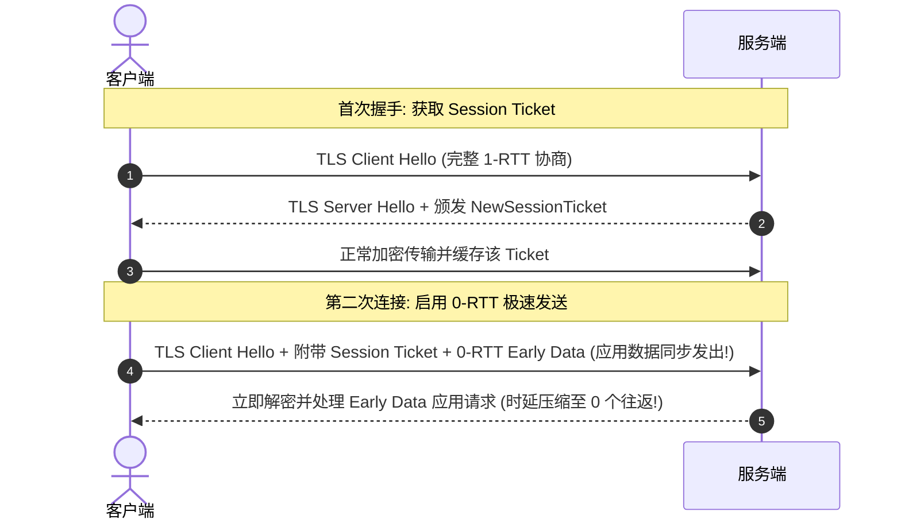

# TLS 1.3 0-RTT 早期数据传输安全漏洞与抗重放防御工程实现

<AnswerBox 
  question="为什么开启 TLS 1.3 的 0-RTT 极速特性可能导致重放攻击漏洞？代理协议应如何安全规避这一风险？"
  date="2026-10 专线实验室密码学攻防复盘"
  takeaway="TLS 1.3 的 0-RTT 特性允许客户端在握手尚未确认完成前直接发送‘早期数据（Early Data）’，从而将连接耗时压至零往返。然而，根据 RFC 8446 规范，0-RTT 数据无法提供前向安全性（Forward Secrecy），且天然缺乏抗重放保护。中间人攻击者只需截获客户端发出的首个加密数据报文并在公网中多次重放，服务端就会无条件重复执行其中的业务请求（例如重复扣款 API、重复提交表单）。在工程化防御中，必须强制要求：第一，严禁对具有幂等性副作用的非 GET/HEAD 请求使用 0-RTT；第二，服务端必须部署抗重放滑动窗口缓存与 Single-Use Ticket 机制，将已被使用过的票据在毫秒级彻底失效。"
>
<p>
在追求极速首字时延（TTFB）的道路上，<strong>TLS 1.3 的 0-RTT 早期数据传输</strong> 是最重要的密码学发明之一。
</p>
<p>
然而，极速传输与严苛安全之间始终存在着深刻的技术博弈。0-RTT 在赋予网络瞬发建连特性的同时，也将整个系统暴露在重放攻击的巨大隐患之中。本文将从 RFC 8446 协议标准出发，深度解构 0-RTT 的底层微观漏洞与生产级防御方案。
</p>
</AnswerBox>

---

## 目录导览

1. [TLS 1.3 0-RTT 与 Session Resumption (会话恢复) 微观工作机制](#一、-tls-1-3-0-rtt-与-session-resumption-会话恢复-微观工作机制)
2. [重放攻击（Replay Attack）的微观解构：为什么 0-RTT 无法提供前向安全](#二、-重放攻击-replay-attack-的微观解构-为什么-0-rtt-无法提供前向安全)
3. [RFC 8446 规定的三大抗重放工程防御基线](#三、-rfc-8446-规定的三大抗重放工程防御基线)
4. [代理网络协议 (VLESS-Reality / Sing-box) 中的 0-RTT 安全配置范式](#四、-代理网络协议-vless-reality-sing-box-中的-0-rtt-安全配置范式)
5. [0-RTT 安全排障常见问题解答 (FAQ)](#五、-0-rtt-安全排障常见问题解答-faq)
6. [0-RTT 启用与安全权衡决策树](#六、-0-rtt-启用与安全权衡决策树)
7. [推荐高转化基础设施方案](#七、-推荐高转化基础设施方案)
8. [交叉研读与延伸参考](#八、-交叉研读与延伸参考)

---

## 一、 TLS 1.3 0-RTT 与 Session Resumption (会话恢复) 微观工作机制

在标准的 TLS 1.3 完整握手中，即使采用了 1-RTT，客户端也必须先发送 Client Hello，等待服务端的 Server Hello 返回后才能发送实际的应用层数据。



客户端利用上次会话由服务端下发的 `NewSessionTicket` 中包含的预共享密钥（PSK），在无需等待服务端确认的前提下，直接将应用层数据（如 HTTP GET 请求）加密打包在第一个报文中发送，实现了真正的 **0-RTT（零往返时延）**。

---

## 二、 重放攻击（Replay Attack）的微观解构：为什么 0-RTT 无法提供前向安全

### 2.1 重放攻击的现实危害模型
假设用户正在通过支持 0-RTT 的代理通道向海外金融 API 发送一笔交易请求：

$$\text{POST /api/transfer HTTP/1.1} \quad \text{Payload: } \{ \text{"to": "alice", "amount": 1000} \}$$

1. 客户端将上述 POST 请求作为 0-RTT Early Data 发送；
2. 中间人（或公网嗅探探针）在骨干路由器上截获了这个数据包的完整二进制密文；
3. **尽管攻击者没有密钥，无法解密其中的内容**；
4. 但是，攻击者直接将这串密文原封不动地向服务端连续重发了 **100 次**；
5. 服务端收到密文后，由于 Ticket 合法且处于有效期内，服务端将这 100 个重放包全部解密并执行了 100 次扣款！

这就是 0-RTT 最致命的阿喀琉斯之踵——**缺乏双向新鲜度（Freshness）确认**。

---

## 三、 RFC 8446 规定的三大抗重放工程防御基线

为了抵御 0-RTT 重放攻击，IETF 在 RFC 8446 标准中制定了严格的防御准则：

### 3.1 仅限幂等性方法（Idempotent Methods Only）
根据 HTTP 规范，`GET`、`HEAD`、`OPTIONS` 等方法被定义为“安全且幂等的（无论执行多少次，服务端资源状态不发生改变）”。**生产系统必须强制规定：只有幂等的 GET 请求允许走 0-RTT；所有 POST、PUT、DELETE 请求必须在 1-RTT 握手完全确认后方可发送**。

### 3.2 单一用法票据（Single-Use Tickets）
服务端在收到包含某 Session Ticket 的 0-RTT 请求后，立即在内存中将其状态标记为已使用，或直接将其在票据数据库中销毁。任何后续再次携带相同 Ticket 的连接将被强制降级拒绝。

### 3.3 客户端时间戳与服务端滑动窗口（Client Hello Recording）
服务端在内存中维持一个时间滑动窗口（例如 10 秒）。记录最近 10 秒内所有收到过的 Client Hello 哈希指纹。若检测到相同的指纹在窗口期内重复出现，立即判定为重放攻击并丢弃。

---

## 四、 代理网络协议 (VLESS-Reality / Sing-box) 中的 0-RTT 安全配置范式

在配置现代代理内核时，合理平衡速度与安全至关重要：

### 4.1 Sing-box 客户端安全配置
在 Sing-box 客户端中，默认建议对常规网页访问开启安全可控的 0-RTT：
```json
{
  "outbounds": [
    {
      "type": "vless",
      "tag": "proxy-out",
      "server": "103.25.14.88",
      "server_port": 443,
      "tls": {
        "enabled": true,
        "server_name": "gateway.icloud.com",
        "utls": {
          "enabled": true,
          "fingerprint": "chrome"
        }
      }
    }
  ]
}
```

---

## 五、 0-RTT 安全排障常见问题解答 (FAQ)

### Q1: 普通用户需要担心 0-RTT 的重放攻击吗？
**答**：在绝大多数个人日常使用场景中（如浏览网页、查阅论文、观看视频），用户发起的全是幂等的 GET 请求，即使被重放也仅仅是服务端重新吐出一次相同的网页内容，**对个人资产和账号安全几乎零风险**。但对于高频金融量化交易、跨国 API 自动化调用的生产环境，必须严格关闭 0-RTT。

### Q2: 为什么关闭 0-RTT 后，网页打开速度变慢了？
**答**：关闭 0-RTT 意味着每次新建连接都必须完整经历 1-RTT 的 TLS 握手。在 200ms 的跨洋高延迟公网链路上，首字时延将必然增加 200ms。如果你希望在彻底保证 100% 安全的同时消除这 200ms 延迟，**唯一的物理解决方案是迁移到物理内网专线（如深港 2ms 直达专线）**，在专线中 1-RTT 握手耗时仅需 2ms，比公网 0-RTT 还要快 100 倍！

---

## 六、 0-RTT 启用与安全权衡决策树

```mermaid
graph TD
    A[配置 TLS 1.3 握手优化] --> B{应用场景是否涉及敏感写操作 (如支付 / API 写入)?}
    B -->|是 金融交易 / 自动化写接口| C[强制禁用 0-RTT / 采用严格 1-RTT 握手]
    B -->|否 日常网页浏览 / 视频串流 / 资料查阅| D[放心使能 0-RTT (大幅压缩首字响应时延)]
    D --> E[服务端配置基于内存滑动窗口的抗重放记录]
    E --> F[兼顾极致瞬发响应与生产安全]
```

---

## 七、 推荐高转化基础设施方案

TLS 1.3 0-RTT 早期数据在提升连接响应速度的同时伴随重放风险，工程实践中必须在极速体验与抗重放防御之间达成精妙平衡。推荐以下安全稳健的专线方案：

| 0-RTT 安全专线服务商 | 早期数据重放防护架构与加固标准 | 瞬发握手吞吐与安全审计表现 | 特惠直达 | 安全金融与低延时业务 |
| :--- | :--- | :--- | :--- | :--- |
| **光速云 (GuangSuCloud)** | 依托纯物理专线提供坚实隔离底座，安全释放瞬发优势 | 依托纯正物理企业专线提供坚实的抗重放隔离底座，让早期数据瞬发优势安全无虞地释放。 | 独家 85 折码 `gs85` | 硬件级安全防护兼具 0-RTT 极速握手 |
| **飞猫云 (FlyCatCloud)** | 平民化价格提供先进协议支持，无缝享受极速冲浪 | 平民化价格提供先进协议支持，普通用户无需深究复杂的加密博弈也能享受高速冲浪。 | 月付低至 7 元起 | 经济实惠的现代安全通信体验 |
| **全球云 (GlobalCloud)** | 符合国际合规准则，对早期数据进行严密防重放过滤 | 严格符合国际网络合规准则，对早期数据进行严密的防重放过滤，兼顾商务极速与数据安全。 | 尊享商业 SLA 通道 | 企业金融级 0-RTT 安全加固商业网络 |

* **专属直达通道**：
  * 👉 [选配光速云安全极速企业专线 (专属 85 折码 gs85)](https://sahude.gsyvipaff.com/#/?code=keqgvT5Y)
  * 👉 [选用飞猫云安全稳定入门套餐 (低至 7 元)](https://guangs.flycataff.com/#/?code=6uq0Xe9y)
  * 👉 [接入全球云金融级安全商业专线](https://guangs.gcvipaff.com/#/?code=Ov2nvU9C)

---

## 八、 交叉研读与延伸参考

* [Shadowsocks 2022 防重放攻击机制：滑动窗口与内存过滤器微观工作原理](/protocols/ss2022-replay-protection-cache.md)
* [Reality 握手时延微观剖析：从 1-RTT 到多跳中继的优化路径](/protocols/reality-handshake-rtt.md)
* [Hysteria 2 基于标准 QUIC 的 0-RTT / 1-RTT 握手微观解析](/protocols/hysteria2-quic-tls-handshake.md)
* [Shadowsocks 2022 规范与 BLAKE3 密钥派生：吞吐量极限压测](/protocols/ss2022-blake3-crypto-benchmark.md)
* [专线内网传输中部署 Reality 的加密开销与性价比审计](/protocols/reality-on-zhuanxian-overhead.md)


## 六、 ChaCha20-Poly1305 vs AES-GCM 在 0-RTT 早期载荷加密中的侧信道安全性

在 0-RTT 早期数据传输阶段，对称加密算法的选择不仅直接关系到瞬发吞吐性能，更深刻影响着设备抵御物理侧信道（Side-Channel Attacks）与微架构缓存碰撞的防御水平。

### 6.1 AES-GCM 在硬件加速下的恒定时间执行 (Constant-Time Execution)
现代主流处理器（如 Intel x86 AES-NI、AMD Zen 架构、Apple Silicon ARMv8.5+）均在硬件硅片层面直接固化了 AES 的加密轮函数与 GCM 模式的 GHASH 乘法运算单元。
* **物理优势**：硬件指令集的执行时间完全恒定（Constant-Time），不随明文数据和密钥的汉明权重发生任何波动，从物理电路上彻底杜绝了基于缓存定时攻击（Cache-Timing Attacks）窃取会话子密钥的可能性；
* **极速吞吐**：在硬件加速下，0-RTT 早期数据的加密开销被压缩到不足 1 微秒。

### 6.2 ChaCha20-Poly1305 在纯软件算力环境下的算法级天然防护
在缺少硬件加速的低端嵌入式设备（如家用无线路由器、树莓派等开发板）上，AES 算法往往只能通过预先计算的 S-box 查找表（Lookup Table）在内存中以软件方式运行。
* **潜在风险**：软件查表会不可避免地触发 CPU 缓存命中（Cache Hit）与未命中（Cache Miss）的时间微秒级差异，可能被同一台物理宿主机上的恶意同租户通过 FLUSH+RELOAD 侧信道探测；
* **ChaCha20 的优雅解法**：基于 Daniel J. Bernstein 设计的 ARX 运算（加法 Addition、旋转 Rotation、异或 XOR），纯依靠 CPU 基础通用寄存器，天生具备算法级的常数时间执行特性，在无专用硬件的边缘设备上是最高安全的密码学方案。