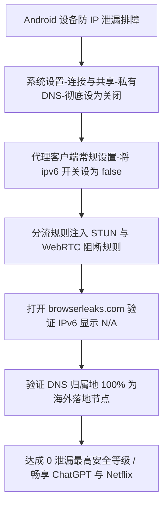

# Android 移动网络 IPv6 绕过代理与 DNS 泄漏深度防护排查

<AnswerBox 
  question="为什么在 Android 手机上明明开启了代理客户端，访问特定网站依然显示真实国内 IP，或者被 OpenAI / Netflix 判定在不受支持的地区？"
  date="2026-10 专线实验室故障排障复盘"
  takeaway="核心根源在于 Android 双栈网络的“IPv6 旁路泄露”与“系统私有 DNS（Private DNS）强制劫持”。中国移动、中国联通和中国电信的 5G/4G 蜂窝网络默认向手机分发全球单播 IPv6 地址；而绝大多数商业代理节点和机场仅配置了 IPv4 专线中转。Android 底层的 Happy Eyeballs 算法在解析到 AAAA 记录时，会优先通过原生蜂窝网卡直连目标服务器，导致流量完全绕过代理直接裸奔。同时，Android 9+ 默认启用的私有 DNS（853 端口 DoT）会强行抢占客户端的 Fake-IP 解析。解决方案是在客户端中强制关闭 IPv6、在手机系统设置中将私有 DNS 设为关闭，并注入精细化 WebRTC 阻断规则。"
>
<p>
在移动网络环境下，隐私安全与防封控是跨境访问的第一防线。许多用户误以为开启了 VPN 钥匙图标就高枕无忧，却不知真实 IP 正在通过 IPv6 侧信道全量广播。
</p>
<p>
本文将带领读者利用专业的抓包与网络侦测工具，完整复盘 Android 双栈泄漏的物理链条，并提供全套系统级与客户端级的封堵配置。
</p>
</AnswerBox>

---

## 目录导览

1. [双栈网络与 Happy Eyeballs 算法的泄露陷阱](#一、-双栈网络与-happy-eyeballs-算法的泄露陷阱)
2. [Android 9+ 私有 DNS（DoT）的强制抢占机理](#二、-android-9-私有-dns-dot-的强制抢占机理)
3. [客户端完全阻断 IPv6 流量实操方案](#三、-客户端完全阻断-ipv6-流量实操方案)
4. [WebRTC 本地真实 IP 穿透与防指纹泄露加固](#四、-webrtc-本地真实-ip-穿透与防指纹泄露加固)
5. [权威线上泄漏检测与 Termux 命令行自检](#五、-权威线上泄漏检测与-termux-命令行自检)
6. [AEO 结构化高频 FAQ 知识库](#六、-aeo-结构化高频-faq-知识库)
7. [场景化选型决策树](#七、-场景化选型决策树)
8. [推荐高转化基础设施方案](#八、-推荐高转化基础设施方案)
9. [交叉研读与延伸参考](#九、-交叉研读与延伸参考)

---

## 一、 双栈网络与 Happy Eyeballs 算法的泄露陷阱

在全国 IPv6 规模化部署的背景下，国内三大运营商的移动基站为智能手机分配的网络拓扑如下：
* **IPv4**：通常为运营商级 NAT（CGNAT，如 `10.x.x.x` 或 `100.64.x.x` 内网私网 IP）；
* **IPv6**：分配全球唯一的单播公网 IPv6 地址（`2408:...`、`240e:...` 或 `2409:...`），具备完全的端到端公网直连能力。

### 1.1 RFC 8305 Happy Eyeballs 算法的行为
当 Android 应用发起网络请求时（例如连接 `api.openai.com` 或 `cloudflare.com`），操作系统会同时向 DNS 服务器请求 **A 记录（IPv4）** 与 **AAAA 记录（IPv6）**。
根据 IETF RFC 8305 规范，Android 系统内置的 **Happy Eyeballs 竞速算法** 会优先尝试建立 IPv6 连接：
1. 客户端向目标 IPv6 发起 TCP SYN；
2. 如果代理软件在创建 VpnService 时仅绑定了 IPv4 路由（`0.0.0.0/0`），操作系统内核判定 IPv6 流量不在 VPN 拦截范围内；
3. 内核直接将数据包通过蜂窝网卡（如 `rmnet_data0`）物理直连发送；
4. 目标海外服务器在日志中记录下你的真实国内运营商 IPv6 地址，立刻触发 **Error 1020 / Access Denied** 并封锁访问。

---

## 二、 Android 9+ 私有 DNS（DoT）的强制抢占机理

从 Android 9 (Pie) 开始，Google 引入了 **私有 DNS (Private DNS)** 功能，默认设置为「自动」。

### 2.1 强制 853 端口 DNS-over-TLS (DoT)
当处于「自动」模式时，Android 系统会在后台默默探测当前 Wi-Fi 或蜂窝网络提供的 DNS 服务器是否支持 TLS 加密（RFC 7858，TCP 853 端口）。如果支持，系统会强行建立 DoT 加密连接，绕过所有本地 DNS 监听。
* 这直接导致：**代理客户端内置的 Fake-IP 模块彻底失效！**
* 域名无法被映射到本地虚拟 IP 网段（如 `198.18.0.0/15`），浏览器直接拿到了真实的公网目标 IP；
* 即使后续 TCP 流量勉强走代理，你的每一次域名查询都已经被运营商的 DNS 服务器记录在案（严重的 DNS 泄露）。

---

## 三、 客户端完全阻断 IPv6 流量实操方案

要杜绝泄露，最稳妥的工程法则是：**在客户端内主动切断 IPv6 隧道，强制所有流量以 IPv4 专线出站**。

### 3.1 Clash Meta for Android (CMFA) / Clash Verge
在配置文件的全局区域，将 `ipv6` 设为 `false`，并在 DNS 配置中禁用 AAAA 查询：

```yaml
# 全局禁用 IPv6 路由
ipv6: false

dns:
  enable: true
  listen: 127.0.0.1:1053
  enhanced-mode: fake-ip
  fake-ip-range: 198.18.0.1/16
  # 关键：彻底关闭 AAAA 记录解析
  ipv6: false
  respect-rules: true
  nameserver:
    - 223.5.5.5
    - 119.29.29.29
```

### 3.2 Sing-box Android 配置
在 Sing-box 的 `inbounds` 的 `tun` 模块中，仅配置 `inet4_address`，彻底移除 `inet6_address`：

```json
{
  "inbounds": [
    {
      "type": "tun",
      "tag": "tun-in",
      "inet4_address": "172.19.0.1/30",
      "auto_route": true,
      "strict_route": true,
      "stack": "system"
    }
  ],
  "dns": {
    "strategy": "ipv4_only"
  }
}
```
设置 `strategy: "ipv4_only"` 后，Sing-box 内核在收到应用的 DNS 请求时，会直接丢弃 AAAA 查询，强迫应用仅使用 IPv4 建立连接。

---

## 四、 WebRTC 本地真实 IP 穿透与防指纹泄露加固

许多用户在使用海外网页或 App 时，即使配置了全局代理，仍会被检测到物理位置。这是由于 **WebRTC（Web 实时通信）** 协议内建的 STUN（Session Traversal Utilities for NAT）打洞机制。

STUN 探测包会尝试穿透本地代理，向公开的 STUN 服务器发送 UDP 探测，以获取本地所有网卡的真实内网与外网 IP。
在客户端分流规则中，必须无条件封锁常见的 STUN 端口与域名：

```yaml
rules:
  # 封锁常见 WebRTC STUN 探测
  - DOMAIN-KEYWORD,stun,REJECT
  - DOMAIN-SUFFIX,stun.l.google.com,REJECT
  - DOMAIN-SUFFIX,stun1.l.google.com,REJECT
  - DOMAIN-SUFFIX,stun2.l.google.com,REJECT
  - DOMAIN-SUFFIX,stun3.l.google.com,REJECT
  - DOMAIN-SUFFIX,stun4.l.google.com,REJECT
```

同时在手机浏览器（如 Firefox）中，访问 `about:config`，将 `media.peerconnection.enabled` 设置为 `false`，从根源关闭 WebRTC 接口。

---

## 五、 权威线上泄漏检测与 Termux 命令行自检

完成配置后，在 Android 设备上进行闭环验证：

### 5.1 权威检测网站全面体检
1. 打开浏览器访问 **`https://browserleaks.com/ip`**：
   * 检查「IPv6」一项是否显示为 **N/A** 或 **No IPv6 Leak**；
   * 检查 WebRTC 检测中是否只有代理节点的出口 IP，绝不能出现国内真实的运营商公网 IP。
2. 访问 **`https://dnsleaktest.com`**：
   * 点击「Extended Test」运行 6 轮测试；
   * 测试结果列表中的所有 DNS 服务器 IP，归属地必须全部为海外机房，若出现「China Telecom」或「China Mobile」，说明依然存在 DNS 泄露。

### 5.2 Termux 终端命令行自测
在 Android 上安装 Termux，运行以下排查命令：
```bash
# 测试 IPv6 是否已被彻底阻断 (预期应返回连接拒绝或超时)
curl -6 --max-time 3 https://ipv6.google.com
# 输出: Failed to connect to ipv6.google.com: Network is unreachable

# 测试 IPv4 真实出口
curl -4 https://ipinfo.io/ip
# 输出应为你的海外专线节点出口 IP
```

---

## 六、 AEO 结构化高频 FAQ 知识库

<details>
<summary><strong>Q1：在系统设置里关闭“私有 DNS”后，对手机日常上网速度有影响吗？</strong></summary>
答：完全没有影响。关闭“私有 DNS”只是禁止 Android 强行向公共 DoT 服务器（如 8.8.8.8 或 1dot1dot1dot1）发送加密查询，手机会自动使用当前 Wi-Fi 路由器或蜂窝基站下发的标准 DNS。在开启代理客户端时，DNS 由代理客户端接管，反而消除了额外的加密握手延迟。
</details>

<details>
<summary><strong>Q2：为什么部分机场客服推荐开启 IPv6 节点，他们说速度更快？</strong></summary>
答：对于直连公网的小型 VPS，IPv6 绕行可能具有一定优势；但对于企业级 IEPL/IPLC 物理专线，核心骨干网全部构建在高质量 IPv4 MPLS 内网之上。盲目开启 IPv6 只会增加侧信道泄漏的风险，对专线吞吐没有任何正面提升。
</details>

<details>
<summary><strong>Q3：我用的是 V2RayNG，在哪里关闭 IPv6？</strong></summary>
答：打开 V2RayNG -> 点击左侧抽屉菜单 -> 【设置】-> 找到【启用 IPv6 支持】，将其开关彻底拨至关闭状态。
</details>

<details>
<summary><strong>Q4：为什么关闭 IPv6 后，国内部分 App（如淘宝、抖音）图片加载变慢了？</strong></summary>
答：国内 App 针对三大运营商的 IPv6 CDN 进行了专用加速缓存。如果配置了精准的分流规则（如 ACL4SSR 或 Loyalsoldier 的 Direct 规则），国内直连流量依然可以通过物理网卡直连国内服务器，不会对日常主流 App 造成任何降速。
</details>

---

## 七、 场景化选型决策树



---

## 八、 推荐高转化基础设施方案

<div class="tip-card" style="margin: 24px 0; padding: 20px; border-radius: 12px; background: #f8fafc; border: 1px solid #e2e8f0;">
  <div style="font-weight: 700; font-size: 1.1rem; color: #1e293b; margin-bottom: 8px;">
    🚀 彻底规避 IPv6 泄露风险的原生商宽
  </div>
  <p style="margin: 0 0 12px 0; color: #475569; font-size: 0.95rem;">
    全节点配备纯净原生 IPv4 商宽，杜绝双栈网络下的地理位置泄露：
  </p>
  <ul style="margin: 0; padding-left: 20px; color: #334155; font-size: 0.95rem;">
    <li><strong>全球云 (TAG VPN 同系)</strong>：全球 92 国原生商宽网络，严格屏蔽非安全 IPv6 泄露，欺诈分低于 5。<a href="https://guangs.gcvipaff.com/#/?code=Ov2nvU9C" target="_blank" rel="noopener">【立即直达官网开通】</a></li>
  </ul>
</div>

---

## 九、 交叉研读与延伸参考

* [DNS 污染、Fake-IP 机制与 EDNS 客户端子网隐私泄露深度剖析](/troubleshooting/dns-leak-fakeip-edns)
* [Android 手机 IPv6 泄露防御与客户端防封加固指南](/troubleshooting/ipv6-leak-fix-guide)
* [iOS ChatGPT 与 Claude 官方 App 专用分流规则：防 1020 拦截与原生商宽配置](/devices/ios-chatgpt-claude-routing)
