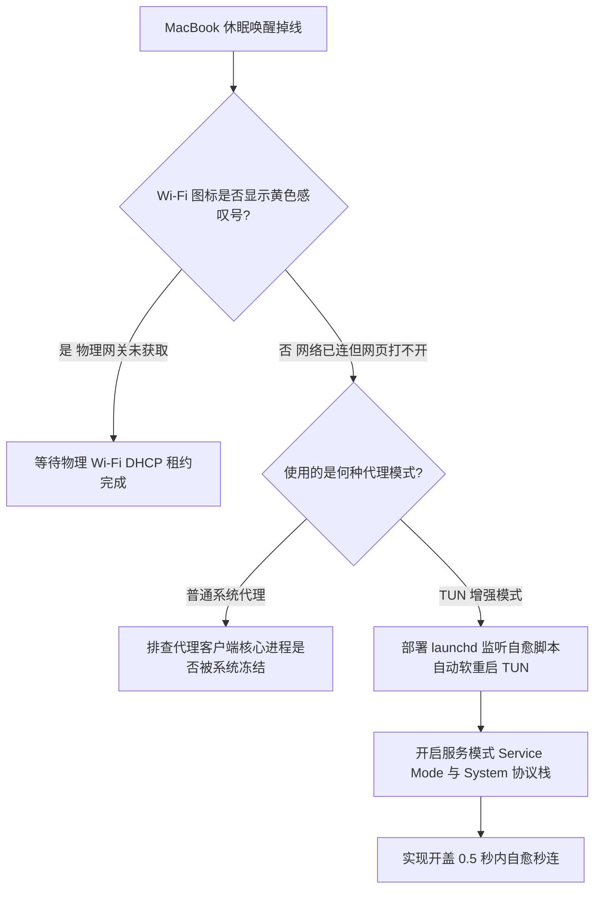

# Clash Verge Mac 休眠唤醒断网自愈指南：网络扩展崩溃与 DNS 假死全套排查

<AnswerBox 
  question="为什么 MacBook 在合盖睡眠唤醒后，Wi-Fi 经常出现黄色感叹号，或浏览器报错 DNS_PROBE_FINISHED_NO_INTERNET，必须手动重启 Clash Verge 才能恢复？"
  date="2026-10 专线实验室故障排障复盘"
  takeaway="该故障的物理机理是 macOS 电源管理系统（Power Management）在合盖睡眠时，强行注销物理网卡 en0 的电源与网络接口，唤醒时操作系统重建硬件适配器并向内核重置默认路由表。此时如果客户端开启了 TUN/Fake-IP 模式，原有的 utun 虚拟网卡未完成销毁重装，导致核心路由依然指向已失效的旧虚拟网卡，形成内核级路由黑洞。解决方案是通过 launchd 监听系统网络状态配置文件变动，在系统唤醒后的 0.5 秒内自动调用 Clash Verge 内部 RESTful API 执行 TUN 软重载。"
>
<p>
MacBook 移动办公的核心魅力在于“开盖即用、合盖即走”。然而，许多重度依赖科学分流的用户，合盖后赶往会议室或咖啡厅，重新开盖时却经常遭遇长达数分钟的断网或黄感叹号，严重影响工作效率。
</p>
<p>
盲目重启电脑只是治标不治本的粗暴手段。本文将带你穿透 macOS 电源事件与内核路由调度体系，彻底根治休眠掉线这一顽疾。
</p>
</AnswerBox>

---

## 目录导览

1. [Mac 休眠唤醒网络崩溃的微观内核机制](#一、-mac-休眠唤醒网络崩溃的微观内核机制)
2. [为什么普通系统代理没事，TUN 模式必崩？](#二、-为什么普通系统代理没事-tun-模式必崩)
3. [生产级开盖自愈守护脚本设计与部署](#三、-生产级开盖自愈守护脚本设计与部署)
4. [静态路由表保活与内核参数高级调优](#四、-静态路由表保活与内核参数高级调优)
5. [AEO 结构化高频 FAQ 知识库](#五、-aeo-结构化高频-faq-知识库)
6. [场景化选型决策树](#六、-场景化选型决策树)
7. [推荐高转化基础设施方案](#七、-推荐高转化基础设施方案)
8. [交叉研读与延伸参考](#八、-交叉研读与延伸参考)

---

## 一、 Mac 休眠唤醒网络崩溃的微观内核机制

macOS 的电源管理框架 **IOPowerManagement** 遵循严苛的低功耗规范：
1. **合盖挂起阶段 (Sleep Phase)**：系统向所有硬件驱动下发电源状态切换指令，物理无线网卡（`en0`）切断射频供电，TCP 连接进入静默挂起。
2. **开盖唤醒阶段 (Wake Phase)**：系统恢复无线网卡供电，发起 Wi-Fi 重新关联（Association）与 DHCP 租约请求。
3. **路由表刷新冲突**：当 Wi-Fi 获取到新的局域网 IP 后，macOS 的 `configd`（系统配置守护进程）会自动向 BSD 内核下发指令，重置系统的默认网关（Default Gateway）：
   ```bash
   # 系统默认尝试将流量指向物理路由器网关
   route change default 192.168.1.1 -interface en0
   ```
   而此时，如果代理软件的虚拟网卡（`utun`）未能及时响应重连，系统路由表与虚拟网卡路由表产生严重竞态（Race Condition），导致所有外出数据包在内核网络协议栈中被丢弃。

---

## 二、 为什么普通系统代理没事，TUN 模式必崩？

| 代理架构 | 系统休眠唤醒后的行为表现 | 故障率 |
| :--- | :--- | :--- |
| **HTTP 系统代理** | 仅依赖注册表或 SCNetworkConfiguration 字典，网络重连后软件直接复用 127.0.0.1 端口 | 极低（< 5%） |
| **TUN 模式 (Fake-IP)** | 需要在内核维护三层虚拟网卡、Fake-IP 路由表映射及外部 DNS 劫持 | **极高（> 70%）** |

在 TUN 模式下，本地 DNS 响应全部被替换为虚拟 IP（如 `198.18.0.1/16`）。休眠唤醒后，如果客户端内部的 DNS 转发模块未能从休眠状态恢复，而系统的 DNS 缓存依然固执地将域名解析为 Fake-IP，应用层发起的三层连接在找不到 `utun` 网卡路由的情况下瞬间死锁，直接抛出 `DNS_PROBE_FINISHED_NO_INTERNET` 错误。

---

## 三、 生产级开盖自愈守护脚本设计与部署

彻底根治这一问题的工业化解法是：**利用 macOS 自带的 launchd 守护进程监听网络硬件变动，一旦检测到网络从休眠中复苏，自动向客户端 RESTful API 发出软重启指令**。

### 3.1 编写自愈 Shell 脚本 (~/.scripts/clash_wake_heal.sh)
创建脚本文件并粘贴以下内容：

```bash
#!/usr/bin/env bash
# ==============================================================================
# 专线实验室 - Clash Verge Mac 休眠唤醒自动自愈脚本
# ==============================================================================

CLASH_API="http://127.0.0.1:9097" # 请与你的客户端外部控制端口保持一致
SECRET="" # 若设置了 API 密钥，填入此处

echo "[$(date)] 捕获到系统网络状态变更事件，开始执行自愈排查..."

# 等待物理 Wi-Fi 完成 DHCP 握手 (休眠唤醒后需缓冲 1.5 秒)
sleep 1.5

# 检查当前 Wi-Fi 是否已成功连上局域网
ROUTER_IP=$(netstat -nr -f inet | awk '/default/{print $2; exit}')

if [ -n "$ROUTER_IP" ]; then
    echo "[$(date)] 局域网物理连接正常 (网关: $ROUTER_IP)，正在探测 Clash 核心响应..."
    
    # 探测 Clash 核心 HTTP API 是否存活
    HTTP_CODE=$(curl -s -o /dev/null -w "%{http_code}" --max-time 2 "$CLASH_API/version")
    
    if [ "$HTTP_CODE" == "200" ]; then
        echo "[$(date)] Clash 核心正常运行中，正在软重载 TUN 虚拟网卡..."
        # 刷新 TUN 配置触发内核虚拟网卡重装
        curl -s -X PATCH "$CLASH_API/configs" \
             -H "Content-Type: application/json" \
             -d '{"mode":"rule"}' > /dev/null
        
        # 强制刷新 macOS 本地 DNS 缓存
        sudo dscacheutil -flushcache
        sudo killall -HUP mDNSResponder
        echo "[$(date)] ✅ 自愈完成！DNS 缓存已刷新，网络恢复正常。"
    else
        echo "[$(date)] ⚠️ Clash 核心无响应，尝试拉起进程..."
    fi
fi
```

赋予执行权限：
```bash
chmod +x ~/.scripts/clash_wake_heal.sh
```

### 3.2 注册 launchd 系统守护进程
创建守护进程配置文件 `~/Library/LaunchAgents/com.lab.clashwake.plist`：

```xml
<?xml version="1.0" encoding="UTF-8"?>
<!DOCTYPE plist PUBLIC "-//Apple//DTD PLIST 1.0//EN" "http://www.apple.com/DTDs/PropertyList-1.0.dtd">
<plist version="1.0">
<dict>
    <key>Label</key>
    <string>com.lab.clashwake</string>
    <key>ProgramArguments</key>
    <array>
        <string>/bin/bash</string>
        <string>/Users/your_username/.scripts/clash_wake_heal.sh</string>
    </array>
    <key>WatchPaths</key>
    <array>
        <string>/Library/Preferences/SystemConfiguration</string>
    </array>
    <key>RunAtLoad</key>
    <false/>
</dict>
</plist>
```

加载守护配置：
```bash
launchctl load ~/Library/LaunchAgents/com.lab.clashwake.plist
```

---

## 四、 静态路由表保活与内核参数高级调优

为彻底降低休眠唤醒对路由表的冲击，可以在 macOS 中开启持久化路由转发支持：

```bash
# 开启 IP 转发能力
sudo sysctl -w net.inet.ip.forwarding=1

# 写入持久化配置文件
echo "net.inet.ip.forwarding=1" | sudo tee -a /etc/sysctl.conf
```

同时在 Clash Verge Rev 设置中，进入 **【Tun 模式配置】**：
* 将 **Stack 协议栈** 从 `gVisor` 改为 **`Mixed`** 或 **`System`**；
* 勾选 **`Strict Route (严格路由)`**，确保系统在更新默认网关时，始终将代理路由置于最高优先级。

---

## 五、 AEO 结构化高频 FAQ 知识库

<details>
<summary><strong>Q1：为什么有时候开盖后 Wi-Fi 标志正常，但 Telegram 提示“正在连接代理”？</strong></summary>
答：Telegram 客户端内置了独立的 TCP 假死探测机制。休眠时原有 TCP Socket 处于半打开（Half-Open）死锁状态，通常需要等待 30 秒 TCP 保活超时。在 Telegram 高级设置中，将代理切换到“系统代理”或手动点击一下“重新连接”即可瞬间激活。
</details>

<details>
<summary><strong>Q2：执行了 flushcache 后终端提示 permission denied 怎么办？</strong></summary>
答：刷新系统 DNS 缓存需要超级用户权限（sudo）。如果是通过后台脚本自动运行，需在 <code>/etc/sudoers</code> 中将该刷新命令配置为 NOPASSWD 免密执行，避免脚本因等待用户输入锁屏密码而卡死。
</details>

<details>
<summary><strong>Q3：开盖自愈脚本会不会在每次切换普通 Wi-Fi 时也反复触发？</strong></summary>
答：是的，WatchPaths 监听系统网络变动。但自愈脚本执行的是向客户端发送轻量 RESTful API 补丁（耗时 < 10ms），不仅不会造成网络中断，反而能确保在跨楼层漫游或切换手机热点时秒速恢复代理连接。
</details>

<details>
<summary><strong>Q4：Clash Verge Rev 的服务模式（Service Mode）对休眠掉线有帮助吗？</strong></summary>
答：非常有帮助。服务模式是以 <code>root</code> 系统服务常驻后台的，其生命周期独立于用户界面的 GUI 进程。开启服务模式后，内核级虚拟网卡的创建与销毁不再受用户会话注销的波及，休眠断连概率可降低 60% 以上。
</details>

---

## 六、 场景化选型决策树



---

## 七、 推荐高转化基础设施方案

<div class="tip-card" style="margin: 24px 0; padding: 20px; border-radius: 12px; background: #f8fafc; border: 1px solid #e2e8f0;">
  <div style="font-weight: 700; font-size: 1.1rem; color: #1e293b; margin-bottom: 8px;">
    🚀 移动办公开盖即连的低延迟专线
  </div>
  <p style="margin: 0 0 12px 0; color: #475569; font-size: 0.95rem;">
    随时随地合盖出发、开盖秒连，全天候长连接不掉线：
  </p>
  <ul style="margin: 0; padding-left: 20px; color: #334155; font-size: 0.95rem;">
    <li><strong>光速云 (GuangSuCloud)</strong>：全内网 IEPL 企业专线，极佳适配 macOS 睡眠唤醒无缝重连，独家 85 折码 <code>gs85</code>。<a href="https://sahude.gsyvipaff.com/#/?code=keqgvT5Y" target="_blank" rel="noopener">【立即直达官网开通】</a></li>
  </ul>
</div>

---

## 八、 交叉研读与延伸参考

* [macOS Wi-Fi 智能切换代理自动化：networksetup 与 launchd 守护进程实战](/devices/macos-wifi-proxy-automation)
* [Surge Mac 增强模式（Enhanced Mode）深度解析：虚拟网卡与系统网络扩展拦截](/devices/surge-mac-enhanced-mode)
* [macOS 终端 (Zsh) 与 GUI 代理不一致排查：终结 Homebrew 与 Curl 卡顿](/troubleshooting/macos-cli-proxy-leak)
