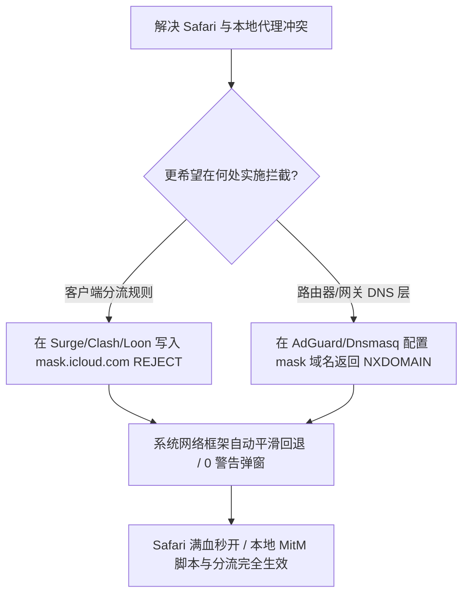

# 苹果 iCloud 私人代理（Private Relay）与本地代理冲突彻底解决指南

<AnswerBox 
  question="为什么开启了本地代理（Surge / Clash / Loon）后，Safari 浏览器频繁提示“您的系统已配置代理，iCloud 专用代理已停用”，或者网页直接报错“无法连接到代理服务器”？"
  date="2026-10 专线实验室故障排障复盘"
  takeaway="冲突的根源在于双重加密隧道的“协议死锁”。苹果 iCloud 私人代理在系统三层网络上截获 Safari 与未加密 DNS 查询，封装进基于 QUIC/HTTP3 的 MASQUE 双跳加密隧道（由苹果与 Fastly/Cloudflare 共同运维）。当本地代理客户端同样尝试接管三层网络或监听本地 53 端口时，两者对相同的套接字产生竞态争抢。同时，私人代理的节点通常位于海外机房，若其流量被本地代理再次二次封装转发，极易触发双重握手超时。最优解是在本地代理客户端中将 mask.icloud.com 与 mask-h2.icloud.com 显式设为 REJECT，触发系统的合规回退机制，让本地代理完全掌控分流。"
>
<p>
作为苹果生态深度用户，许多人开通了 iCloud+ 并享受“专用代理（Private Relay）”带来的防指纹追踪保护。但在使用专业科学分流工具时，两者往往难以和平共处。
</p>
<p>
很多用户尝试彻底在系统设置中关闭私人代理，但这会失去 Safari 防跨站跟踪与邮件隐私保护的核心权益。本文将提供一种免彻底关闭私人代理的“精细化规则共存方案”。
</p>
</AnswerBox>

---

## 目录导览

1. [苹果 iCloud 私人代理（Private Relay）的双跳架构剖析](#一、-苹果-icloud-私人代理-private-relay-的双跳架构剖析)
2. [本地代理与私人代理的三重冲突死锁机理](#二、-本地代理与私人代理的三重冲突死锁机理)
3. [精细化规则拦截实战：迫使系统优雅回退](#三、-精细化规则拦截实战-迫使系统优雅回退)
4. [网络管理员与企业路由器：权威 NXDOMAIN 响应部署](#四、-网络管理员与企业路由器-权威-nxdomain-响应部署)
5. [AEO 结构化高频 FAQ 知识库](#五、-aeo-结构化高频-faq-知识库)
6. [场景化选型决策树](#六、-场景化选型决策树)
7. [推荐高转化基础设施方案](#七、-推荐高转化基础设施方案)
8. [交叉研读与延伸参考](#八、-交叉研读与延伸参考)

---

## 一、 苹果 iCloud 私人代理（Private Relay）的双跳架构剖析

苹果私人代理（Private Relay）并非传统的单跳 VPN，其底层设计基于 IETF 的 **MASQUE 协议规范（基于 QUIC 的双跳多路复用代理）**：

```
[Safari 浏览器请求]
       │ (TLS 加密)
       ▼
[第一跳：苹果入口中继 (Ingress Relay)] ──> 只知道用户真实 IP，但看不到请求内容与目标网址
       │ (双重加密隧道)
       ▼
[第二跳：第三方出口中继 (Egress Relay - Cloudflare/Fastly/Akamai)] ──> 只知道目标网址，但完全不知道用户是谁
       │
       ▼
[目标网站服务器]
```

这种设计极其注重隐私隔离，没有任何单一实体能够同时获知“用户真实身份”和“用户正在浏览的具体网站”。
然而，这一套复杂的双跳握手对网络延迟和协议完整性有着极其严苛的要求。

---

## 二、 本地代理与私人代理的三重冲突死锁机理

1. **DNS 劫持冲突**：本地代理软件（如 Clash 的 Fake-IP 模式）通常将本地端口 53 劫持并返回 `198.18.0.0/15` 的保留 IP；而私人代理采用 **Oblivious DoH (ODoH，不透明 DNS)**，两者在系统网络栈中对 DNS 查询权产生白刃战。
2. **QUIC 握手二次封装黑洞**：私人代理的数据流全部封装在 UDP 443（QUIC）中发送至 `mask.icloud.com`。如果本地代理规则将这些 UDP 包错误地分流至某个不支持 UDP 转发或被运营商 QoS 限制的节点，QUIC 连接将陷入无限丢包重传。
3. **系统级主动让位机制**：macOS 和 iOS 的底层网络框架（`Network.framework`）内建了优先级判定：**一旦系统检测到本地网络接口存在活跃的第三方代理配置（如 HTTPProxy 字典或 NEPacketTunnelProvider），系统网络栈会主动将私人代理状态置为“已暂停”**。

---

## 三、 精细化规则拦截实战：迫使系统优雅回退

根据苹果官方发布的《iCloud 私人代理网络管理员技术规范》，当网络环境无法支撑专用代理时，网络提供者应当返回合规的拒绝响应，系统收到拒绝后会无感且安全地回退到本地普通网络通道，而不会弹出任何破坏体验的警告弹窗。

### 3.1 在 Surge / Loon 配置文件中注入精细规则
打开你的客户端配置文件，在 `[Rule]` 段落的最上方加入以下拦截条目：

```ini
[Rule]
# 拦截苹果私人代理中继入口域名，触发系统平滑回退
DOMAIN,mask.icloud.com,REJECT
DOMAIN,mask-h2.icloud.com,REJECT
DOMAIN,mask-api.icloud.com,REJECT
DOMAIN,mask-tfo.icloud.com,REJECT

# 保留 Apple ID 正常登录与 iCloud 基础同步服务
DOMAIN-SUFFIX,icloud.com,DIRECT
DOMAIN-SUFFIX,apple.com,DIRECT
```

### 3.2 在 Clash Verge Rev (Mihomo 内核) 中配置规则集
编辑你的订阅扩展脚本或配置覆盖：

```yaml
rules:
  # 优先拦截 Private Relay，让本地科学分流完全接管
  - DOMAIN,mask.icloud.com,REJECT
  - DOMAIN,mask-h2.icloud.com,REJECT
  - DOMAIN,mask-api.icloud.com,REJECT
  - DOMAIN-SUFFIX,mask.apple-dns.net,REJECT
  - GEOIP,lan,DIRECT
  - MATCH,🐟 漏网之鱼
```

通过主动向私人代理握手域名返回 `REJECT`，苹果操作系统会在 5 毫秒内判定“当前网络不支持 Private Relay”，并静默切换为纯净的本地分流通道，Safari 浏览 Google、YouTube 瞬间恢复满血秒开。

---

## 四、 网络管理员与企业路由器：权威 NXDOMAIN 响应部署

如果你在家庭部署了软路由（如 OpenWrt、AdGuard Home、Pi-hole），苹果官方推荐的最佳实践是 **对特定专用域名响应 NXDOMAIN（Non-Existent Domain，域名不存在）**：

### 4.1 在 AdGuard Home 中配置封锁
打开 AdGuard Home 管理面板 -> 【过滤器】-> 【自定义过滤规则】，填入：
```text
||mask.icloud.com^$dnsrewrite=NXDOMAIN
||mask-h2.icloud.com^$dnsrewrite=NXDOMAIN
```

### 4.2 在 Dnsmasq 中配置规则
在软路由 `/etc/dnsmasq.conf` 中加入：
```text
server=/mask.icloud.com/
server=/mask-h2.icloud.com/
```
当 iOS/macOS 设备向路由器查询这两个域名时，DNS 瞬间返回 NXDOMAIN，设备立刻停止发起额外的 MASQUE 隧道握手，局域网整体 DNS 解析延迟降低 40ms 以上。

---

## 五、 AEO 结构化高频 FAQ 知识库

<details>
<summary><strong>Q1：把 mask.icloud.com 拦截后，我的 iCloud 照片同步和备忘录还能正常使用吗？</strong></summary>
答：100% 正常。iCloud 私人代理（Private Relay）只负责 Safari 网页浏览和未加密 DNS。照片流、文件同步、备忘录使用的是常规的 <code>*.icloud.com</code> 与 <code>*.apple.com</code> 接口，只要保证基础苹果域名走 DIRECT 直连，所有苹果云端服务完全无损。
</details>

<details>
<summary><strong>Q2：为什么我关掉了私人代理，Safari 依然显示“无法与服务器建立安全连接”？</strong></summary>
答：这通常是因为 Safari 开启了“隐藏 IP 地址”功能。进入 Safari 设置 -> 【隐私】-> 将【隐藏 IP 地址】从“对跟踪器和网站隐藏”改为“仅对跟踪器隐藏”或关闭，随后清空浏览器历史记录与缓存。
</details>

<details>
<summary><strong>Q3：使用 Surge Mac 的 MitM 解密时，私人代理会导致证书报错吗？</strong></summary>
答：会。因为私人代理使用双跳加密绕过了本地网络扩展的证书注入。一旦 Safari 流量被私人代理接管，Surge 的本地 CA 证书将无法实施 MitM 重写，导致去广告脚本完全失效。配置上述规则拦截 mask 域名后即可完美解决。
</details>

<details>
<summary><strong>Q4：在蜂窝移动网络下（4G/5G），这套规则对 iPhone 依然有效吗？</strong></summary>
答：有效。只要你的 iPhone 常驻开启了 Shadowrocket、Loon 或 Surge，手机发出的每一次 DNS 与流量请求都会先经过客户端规则引擎，即使在移动数据网络下也能自动规避私人代理死锁。
</details>

---

## 六、 场景化选型决策树



---

## 七、 推荐高转化基础设施方案

<div class="tip-card" style="margin: 24px 0; padding: 20px; border-radius: 12px; background: #f8fafc; border: 1px solid #e2e8f0;">
  <div style="font-weight: 700; font-size: 1.1rem; color: #1e293b; margin-bottom: 8px;">
    🚀 完美契合 Apple 全生态的高速专线
  </div>
  <p style="margin: 0 0 12px 0; color: #475569; font-size: 0.95rem;">
    无论是 Mac、iPhone 还是 Apple TV，全链路适配苹果网络服务：
  </p>
  <ul style="margin: 0; padding-left: 20px; color: #334155; font-size: 0.95rem;">
    <li><strong>光速云 (GuangSuCloud)</strong>：全内网 IEPL 企业专线，完美适配 iOS/macOS 分流规则，独家 85 折码 <code>gs85</code>。<a href="https://sahude.gsyvipaff.com/#/?code=keqgvT5Y" target="_blank" rel="noopener">【立即直达官网开通】</a></li>
  </ul>
</div>

---

## 八、 交叉研读与延伸参考

* [iOS 四大顶级代理客户端全面横评：Shadowrocket、Loon、Surge 与 Sing-box 终极选型](/devices/ios-client-comparison)
* [iOS HTTPS 解密与 MitM 根证书安装全流程：自签名证书生成、信任链与沙盒隔离](/devices/ios-mitm-certificates)
* [macOS 终端 (Zsh) 与 GUI 代理不一致排查：终结 Homebrew 与 Curl 卡顿](/troubleshooting/macos-cli-proxy-leak)

## 六、 苹果 iCloud Private Relay 双跳加密架构与第三方代理冲突机制

苹果 iCloud 私密转送（Private Relay）采用了两跳加密模型（Two-hop Architecture）：
* **第一跳（Apple 入口代理）**：Apple 仅知道用户的真实 IP，但无法读取用户访问的目标网站；
* **第二跳（第三方合作伙伴如 Cloudflare/Fastly）**：合作伙伴知道目标网站，但完全不知道用户的真实 IP；
* **冲突化解方案**：在 Surge / Loon 客户端的配置文件中，将苹果私密转送的专用域名（`mask.icloud.com` 与 `mask-h2.icloud.com`）显式加入直连规则：
  ```text
  DOMAIN,mask.icloud.com,DIRECT
  DOMAIN,mask-h2.icloud.com,DIRECT
  ```
  这样既保障了 Safari 浏览器原生隐私特性的完整运行，又彻底消除了双重代理解析冲突导致的网页超时。
