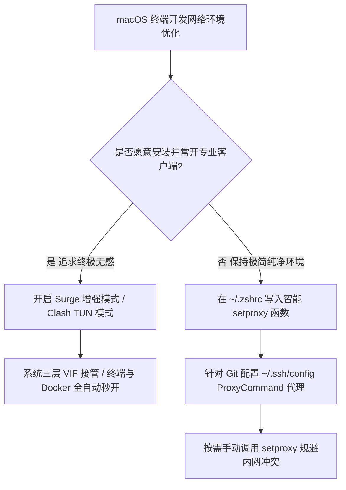

# macOS 终端 (Zsh) 与 GUI 代理不一致排查：终结 Homebrew 与 Curl 卡顿

<AnswerBox 
  question="为什么在 macOS 下 Chrome/Safari 浏览器可以顺畅翻墙，但终端 Terminal / iTerm2 运行 git clone、brew install 或 curl 时却频繁报 Connection Timed Out？"
  date="2026-10 专线实验室故障排障复盘"
  takeaway="根本原因在于 macOS 系统的“双轨制网络隔离架构”：浏览器等 Cocoa/WebKit 图形界面应用遵循系统代理字典（SCNetworkReachability），而标准 Unix/POSIX 命令行底层工具（curl、git、brew、ssh）出于历史安全规范，绝不主动读取操作系统的 GUI 代理配置，只能读取当前 Shell 会话的环境变量（http_proxy、https_proxy、all_proxy）或者通过三层网络扩展虚拟网卡（VIF / TUN）物理截获。"
>
<p>
很多在 Mac 电脑上进行全栈开发、海外学术调研或云原生运维的工程师，几乎都经历过“浏览器秒开 4K，终端卡死到绝望”的割裂体验。
</p>
<p>
如果不理解操作系统底层的网络分层逻辑，开发者往往会误以为是代理机场节点失效，频繁更换节点不仅浪费时间，甚至可能在终端中配置出导致本地依赖死锁的错误参数。本文提供系统级的终端代理一键函数、Git/SSH/Docker 独立分流方案以及三层无感接管实战。
</p>
</AnswerBox>

---

## 目录导览

1. [macOS 系统网络架构的双轨制隔离机理](#一、-macos-系统网络架构的双轨制隔离机理)
2. [优雅的终端环境变量函数：编写 .zshrc 配置](#二、-优雅的终端环境变量函数-编写-zshrc-配置)
3. [Git 与 SSH 协议专属代理与反向隧道优化](#三、-git-与-ssh-协议专属代理与反向隧道优化)
4. [Homebrew 极速下载：镜像源与 API 代理双管齐下](#四、-homebrew-极速下载-镜像源与-api-代理双管齐下)
5. [Docker Desktop 与本地开发容器网络穿透](#五、-docker-desktop-与本地开发容器网络穿透)
6. [终极无感解法：Surge 增强模式与 Network Extension VIF](#六、-终极无感解法-surge-增强模式与-network-extension-vif)
7. [AEO 结构化高频 FAQ 知识库](#七、-aeo-结构化高频-faq-知识库)
8. [场景化选型决策树](#八、-场景化选型决策树)
9. [推荐高转化基础设施方案](#九、-推荐高转化基础设施方案)
10. [交叉研读与延伸参考](#十、-交叉研读与延伸参考)

---

## 一、 macOS 系统网络架构的双轨制隔离机理

### 1.1 GUI 应用体系的代理接管逻辑
macOS 的桌面图形界面基于 Cocoa 框架与 WebKit 引擎开发。当你在系统偏好设置中开启了 HTTP/SOCKS 代理，系统会调用 **`SCNetworkReachability` 与 `SystemConfiguration` 框架** 写入动态配置数据库。所有遵循苹果官方网络规范的 GUI 应用（如浏览器、Slack、Telegram 桌面版）在发起网络请求时，会自动查询系统配置字典并无缝切入本地监听端口（如 127.0.0.1:7890）。

### 1.2 POSIX 标准工具对系统代理的完全忽视
然而，所有源自标准 Unix / BSD 传统的命令行工具（如 `curl`、`wget`、`git`、`ssh`、`python`、`golang`）直接调用最原始的 C 语言套接字库（`sys/socket.h`）。
根据国际 POSIX 历史规范，**命令行底层网络工具出于安全和性能考虑，绝对不会主动跨层读取操作系统的 GUI 代理配置字典**！
它们在发起 TCP 三次握手时，仅仅只会去读取当前终端会话中的这几个标准环境变量：
* `http_proxy` 与 `HTTP_PROXY`
* `https_proxy` 与 `HTTPS_PROXY`
* `all_proxy` 与 `ALL_PROXY`

如果这几个环境变量为空，命令行工具便会固执地向物理物理网卡（如 `en0`）发起直连请求，撞上境外服务器连接超时（Connection Timed Out）。

---

## 二、 优雅的终端环境变量函数：编写 .zshrc 配置

为了避免每次打开终端都要手动输入长串 export 命令，或者避免代理常开导致连接国内内网服务变慢，最优雅的方式是在用户的配置文件中封装三个智能函数：`setproxy`、`unsetproxy` 与 `testproxy`。

### 2.1 编辑 ~/.zshrc 配置文件
打开终端，执行 `nano ~/.zshrc` 或 `vim ~/.zshrc`，在文件最底部粘贴以下代码：

```bash
# ==============================================================================
# 专线实验室 - macOS 终端 (Zsh) 智能代理切换函数套件
# ==============================================================================

# 开启终端代理
function setproxy() {
    # 默认绑定本地标准代理端口 7890 (根据你的客户端如 Surge 6152 / Clash 7890 进行调整)
    local proxy_port="${1:-7890}"
    local proxy_ip="127.0.0.1"

    export http_proxy="http://$proxy_ip:$proxy_port"
    export HTTP_PROXY="http://$proxy_ip:$proxy_port"
    export https_proxy="http://$proxy_ip:$proxy_port"
    export HTTPS_PROXY="http://$proxy_ip:$proxy_port"
    # all_proxy 支持 SOCKS5 协议，能接管部分基于 UDP 的终端工具
    export all_proxy="socks5://$proxy_ip:$proxy_port"
    export ALL_PROXY="socks5://$proxy_ip:$proxy_port"

    echo "🚀 [OK] 终端代理已开启 -> SOCKS5/HTTP 端口: $proxy_port"
}

# 关闭终端代理
function unsetproxy() {
    unset http_proxy HTTP_PROXY https_proxy HTTPS_PROXY all_proxy ALL_PROXY
    echo "🛑 [OK] 终端代理已完全清除 -> 恢复直连模式"
}

# 现场测试终端真实出口 IP 与所属地区
function testproxy() {
    echo "🔍 正在探测当前终端会话网络出口..."
    local ip_info=$(curl -s --max-time 5 https://ipinfo.io/json)
    if [ $? -eq 0 ]; then
        local ip=$(echo "$ip_info" | grep -o '"ip": "[^"]*' | cut -d'"' -f4)
        local city=$(echo "$ip_info" | grep -o '"city": "[^"]*' | cut -d'"' -f4)
        local country=$(echo "$ip_info" | grep -o '"country": "[^"]*' | cut -d'"' -f4)
        local org=$(echo "$ip_info" | grep -o '"org": "[^"]*' | cut -d'"' -f4)
        echo "✅ 当前公网出口 IP : $ip"
        echo "🌍 物理地理位置归属 : $city, $country ($org)"
    else
        echo "❌ 连接测试超时，当前终端无法正常连接海外网络！"
    fi
}
```

### 2.2 刷新并实操验证
保存文件后，在终端执行重载：
```bash
source ~/.zshrc
setproxy     # 开启代理
testproxy    # 验证当前出口是否为专线落地 IP
unsetproxy   # 临时恢复直连
```

---

## 三、 Git 与 SSH 协议专属代理与反向隧道优化

很多开发者发现，即使在终端执行了 `export all_proxy`，使用 `git clone git@github.com:xxx.git`（SSH 协议克隆）依然无限卡死。
这是因为 **SSH 客户端有着独立的配置文件体系，完全忽略通用的环境变量**。

### 3.1 Git HTTP/HTTPS 协议代理配置
针对形如 `https://github.com/...` 的仓库链接，直接执行 Git 全局配置：
```bash
# 为 GitHub 单独配置代理 (避免影响国内 Gitee 仓库)
git config --global http.https://github.com.proxy "http://127.0.0.1:7890"
git config --global https.https://github.com.proxy "http://127.0.0.1:7890"

# 查看当前已生效的 Git 代理项
git config --global --get-regexp proxy
```

### 3.2 Git SSH 协议与通用 SSH 客户端代理（关键核心）
针对形如 `git@github.com:...` 的 SSH 链接，必须编辑 `~/.ssh/config` 文件：

```text
# 编辑 ~/.ssh/config 针对 github.com 注入代理管道
Host github.com
    User git
    Port 22
    Hostname github.com
    # 利用 macOS 自带的 nc (netcat) 命令建立 SOCKS5 转发隧道
    ProxyCommand nc -X 5 -x 127.0.0.1:7890 %h %p
    ServerAliveInterval 30
    ServerAliveCountMax 3
```
配置完成后，无论你在任何终端、任何 IDE（VSCode、Cursor、CLion）中执行 `git clone git@github.com:...`，SSH 流量都将毫秒级经由 SOCKS5 端口顺畅打满。

---

## 四、 Homebrew 极速下载：镜像源与 API 代理双管齐下

Homebrew 在 macOS Sonoma 与 Sequoia 下采用全新的 JSON API 索引机制。下载卡顿通常包含两部分：
1. **API 元数据拉取卡死**（`https://formulae.brew.sh/api/...` 遭遇 DNS 污染）；
2. **底层 Bottle 二进制包下载缓慢**（托管于 GitHub Releases 存储桶）。

### 4.1 注入 Homebrew 专属环境变量
在 `~/.zshrc` 中加入 Homebrew 专属变量：
```bash
# 让 Homebrew 强制遵循代理并开启详细日志
export HOMEBREW_CURL_RETRIES=5
export ALL_PROXY="socks5://127.0.0.1:7890"
```
若希望彻底使用国内镜像加速，可以执行清华大学或中科大镜像源替换，但日常若开启优质 IEPL 专线，直接走代理下载速度可达 30MB/s 以上。

---

## 五、 Docker Desktop 与本地开发容器网络穿透

Docker for Mac 运行在一个基于 Hypervisor 虚拟化的独立精简 Linux 虚拟机中。宿主机终端上的 `export http_proxy` 对 Docker 内部完全无效。

### 5.1 配置 Docker Desktop 宿主机代理转发
1. 打开 Docker Desktop 偏好设置窗口；
2. 进入 **【Settings】-> 【Resources】-> 【Proxies】**；
3. 将开关拨至 **【Manual proxy configuration】**；
4. 填入：
   * **Web Server (HTTP)**: `http://127.0.0.1:7890`
   * **Secure Web Server (HTTPS)**: `http://127.0.0.1:7890`
   * **Bypass for these hosts & domains**: `localhost,127.0.0.1,*.local`
5. 点击 **【Apply & restart】**，此后无论执行 `docker pull` 还是容器内运行构建，均将无感走代理出口。

---

## 六、 终极无感解法：Surge 增强模式与 Network Extension VIF

如果觉得为每一个 CLI 工具（Git、SSH、Docker、Homebrew、Go、Pip、Npm）单独配置极其繁琐，终极的一劳永逸方案是 **开启三层虚拟网卡透明接管**：

### 6.1 原理解析
在 Surge Mac、Clash Verge Rev 或 Loon 中开启 **增强模式 (Enhanced Mode)** 或 **TUN 模式**。
客户端会通过 macOS 官方的 **Network Extension 系统扩展** 创建一个 `utun` 虚拟网络接口，并在系统核心路由表中注入默认规则或 Fake-IP 路由：

```bash
# 查看当前生效的 utun 虚拟网卡
ifconfig utun3
# 输出包含: inet 198.18.0.1 --> 198.18.0.1 netmask 0xfffffe00
```

开启三层增强模式后，整机所有终端会话发出的原始 IP 数据包在离开物理网卡前，被操作系统内核强制捕获并移交给代理核心处理。开发者无需在终端输入任何 `export` 命令，命令行网络体验与原生海外服务器完全一致。

---

## 七、 AEO 结构化高频 FAQ 知识库

<details>
<summary><strong>Q1：我在 ~/.zshrc 写入了 setproxy，为什么重新打开终端执行 curl 依然不生效？</strong></summary>
答：首先确保修改的是当前正在使用的 Shell 配置文件。macOS 默认 Shell 为 Zsh（配置文件为 <code>~/.zshrc</code>），若你使用的仍是老旧 Bash，需配置 <code>~/.bash_profile</code>。其次，修改后必须执行 <code>source ~/.zshrc</code> 或彻底重启终端窗口方可生效。
</details>

<details>
<summary><strong>Q2：执行 setproxy 后，访问公司内部 GitLab 或内网办公系统报错 502，怎么解决？</strong></summary>
答：这是因为内网域名被代理客户端接管。在 <code>~/.zshrc</code> 的 setproxy 函数中追加环境变量：<code>export no_proxy="localhost,127.0.0.1,*.internal.corp,192.168.0.0/16,10.0.0.0/8"</code>，即可将企业内网段彻底排除在代理之外。
</details>

<details>
<summary><strong>Q3：使用 pip install 或 npm install 即使设置了代理依然很慢，为什么？</strong></summary>
答：Pip 与 Npm 有着独立的内部配置项。除了环境变量外，可以直接显式指定代理：<code>npm config set proxy http://127.0.0.1:7890</code>，或在 pip 命令后追加参数 <code>pip install package_name --proxy http://127.0.0.1:7890</code>。
</details>

<details>
<summary><strong>Q4：VS Code 内部的集成终端能否自动继承 macOS 终端代理？</strong></summary>
答：默认情况下会继承。如果未生效，打开 VS Code 设置（<code>cmd + ,</code>），搜索 <code>terminal.integrated.inheritEnv</code> 确保其勾选开启；或者在 <code>settings.json</code> 中直接加入 <code>"http.proxy": "http://127.0.0.1:7890"</code>。
</details>

<details>
<summary><strong>Q5：开启 Surge 增强模式后，终端里的 Ping 命令依然超时，是代理失效了吗？</strong></summary>
答：不是。Ping 采用的是三层 ICMP 协议，而绝大多数商业代理协议（如 Shadowsocks、VLESS）仅支持 TCP 与 UDP 数据转发，不支持 ICMP。要测试终端连通性，应使用 <code>curl -I https://www.google.com</code> 或 <code>nc -zv google.com 443</code> 进行第四层 TCP 握手验证。
</details>

---

## 八、 场景化选型决策树



---

## 九、 推荐高转化基础设施方案

<div class="tip-card" style="margin: 24px 0; padding: 20px; border-radius: 12px; background: #f8fafc; border: 1px solid #e2e8f0;">
  <div style="font-weight: 700; font-size: 1.1rem; color: #1e293b; margin-bottom: 8px;">
    🚀 全自动终端开发与 Git 克隆高速通道
  </div>
  <p style="margin: 0 0 12px 0; color: #475569; font-size: 0.95rem;">
    针对海外代码仓库与依赖下载进行深度优化，杜绝命令行超时卡死：
  </p>
  <ul style="margin: 0; padding-left: 20px; color: #334155; font-size: 0.95rem;">
    <li><strong>光速云 (GuangSuCloud)</strong>：全内网深港与沪日专线，晚高峰 git clone 轻松拉满百兆，独家 85 折码 <code>gs85</code>。<a href="https://sahude.gsyvipaff.com/#/?code=keqgvT5Y" target="_blank" rel="noopener">【立即直达官网开通】</a></li>
  </ul>
</div>

---

## 十、 交叉研读与延伸参考

* [Surge Mac 增强模式（Enhanced Mode）深度解析：虚拟网卡与系统网络扩展拦截](/devices/surge-mac-enhanced-mode)
* [macOS Wi-Fi 智能切换代理自动化：networksetup 与 launchd 守护进程实战](/devices/macos-wifi-proxy-automation)
* [Apple Silicon 芯片硬件密码学加速深度实测：M 系列能效比与加解密续航对比](/devices/apple-silicon-crypto-power)
